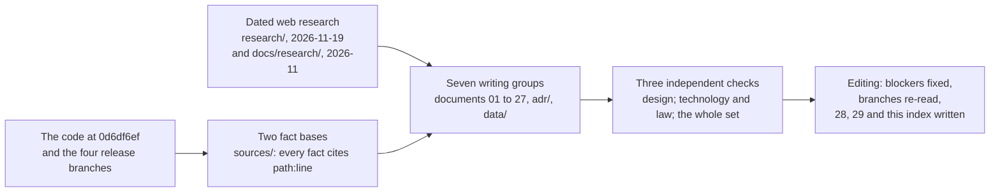

# Sonnet Man design dossier

- **Purpose:** the front door to the dossier: what it is, how it was made, how to read it, what each document is for, what is still missing, and how to keep it true as the code changes.
- **Audience:** everyone who opens this folder: the team (David Charlot, founder and technical lead; Devon Glover, "The Sonnet Man", creative director; Arrocito del Diablo, co-founder for game design and card mechanics), future collaborators, contractors and coding agents, and investors who are sent a document from it.
- **As of:** commit `0d6df6ef` (branch `integrate/wave3`, 2026-11-18 20:27 -0500, the game as it is about to ship), plus the release in flight on 2026-11-19: `fix/judge-wording`, `fix/server-authority`, `fix/voice-g2p`, `fix/compliance`, and the nightly database backup. Branch contents were re-read at 02:16 on 2026-11-19.
- **Status:** Draft for the team, 2026-11-19.
- **Related documents:** all of them, listed in the index below. Start with [`01-concept-one-pager.md`](01-concept-one-pager.md), then [`03-gdd.md`](03-gdd.md), the hub; the owner's decisions, and the eleven questions only the owner can answer, are in [`28-owner-decisions.md`](28-owner-decisions.md).

---

## What this is

Sonnet Man, by Inspired Mile (Voyage Tracable LLC), is a free web card game at sonnetman.inspiredmile.com. Each move is a verse the player writes or speaks, in one of 16 languages, fought as a three-round duel against an opponent that runs in the browser.

This folder holds the standard game-development documents for it: a concept and a pitch, a game design document, content, systems, modes, narrative, art, audio, UX and accessibility documents, a technical design with its decision records, AI system cards, a localisation kit, QA, analytics and operations plans, trust-and-safety, privacy and legal packs, a production plan, risks, market, marketing and live operations, an analysis of the gaps against the state of the art, a glossary, the owner's decisions and postmortem templates.

It was **worked backward from what is built**. Nothing here describes the game as it was once meant to be, except where a document sets the plans against the code on purpose.

---

## How it was made

1. **Fact bases.** Two files read the repository at `0d6df6ef` and record what the game does, each fact with the file and line it comes from: [`sources/as-built-design.md`](sources/as-built-design.md) (play, cards, modes, economy, narrative, art, audio, onboarding, intent against what was built) and [`sources/as-built-tech.md`](sources/as-built-tech.md) (architecture, API, data, AI, languages, tests, operations, licences, known defects). Nothing was built, run in a browser or asked of production for them; a behaviour "read from the code" was not observed running.
2. **Dated research.** [`research/sota-design-2026-11.md`](research/sota-design-2026-11.md) (what 2025 and 2026 games teach this one) and [`research/sota-production-2026-11.md`](research/sota-production-2026-11.md) (platforms, technology, law and the standard document set; its section 7 defines each document, section 8 the tiers), both dated 2026-11-19, with every claim marked verified, secondary or unverified. Older research sits outside this folder in [`../research/`](../research/): card games, in-browser AI and XR card games, all November 2026.
3. **Writing.** Seven groups wrote the documents from the fact bases, the research and the code. Some numbers were computed by running the game's own engine in light local scripts (for example the worked examples in document 05 and the 1,000-seed sweep in document 03).
4. **Checking.** Three independent checkers re-tested more than 170 claims against the code, the branches and primary sources, and re-ran the data generator and the worked examples. They raised 18 blockers and about 50 concerns.
5. **Editing.** Every blocker was fixed; the concerns were fixed or answered (the editor's report lists any not taken). The release branches had moved while the documents were written, so their state was re-read and every "Not known" they answered was replaced. Internal addresses, host names and secret names were taken out of the fact bases and every document except document 17.

---

## How to read it

### Every statement is one of four kinds

| Label | Means | How it is backed |
|---|---|---|
| **As built** | true of the code at `0d6df6ef` | a `path:line`, or a section of a fact base |
| **In this release** | decided by the owner on 2026-11-19 and on a named branch, not yet live | the branch name, and a commit where one exists |
| **Proposed** | a recommendation | the research or document that supports it |
| **Not known** | no record was found | listed in the document's closing "Owner questions", and gathered in document 28 |

A proposal is never written as if it were built, and a pending fix is never written as if it were live.

### Decisions, and the owner's rules of 2026-11-19

Document 28 records two kinds of decision: **decided by the owner**, with the date, and **decided by default**, where a sensible default followed from the owner's standing rules or the evidence, with that rule or evidence named. A decision settles what to do; the work it calls for stays **Proposed** until it is built. Each document's closing "Owner questions" says, for every question, where it was decided, or that it is open and why. Only eleven questions are open (O-1 to O-11 in document 28): each needs the owner's money, identity or contact details, a legal commitment in the company's name, or a public step not yet approved.

Four rules the owner gave on 2026-11-19 bind every document:

1. **AI is the playtester.** No human playtests, paid or volunteer, no think-aloud sessions and no human baselines. AI players with no prior training on the game play through what a player sees and a player's controls, on self-hosted models released after 2026-04-01, on the build host; no claim says "human-level" ([`15-qa-and-test-plan.md`](15-qa-and-test-plan.md) §8).
2. **No faux choices.** Where a default follows from the standing rules or the evidence, it is decided and recorded, not put to the owner.
3. **A design's recommendations stand.** Nothing is cut to make the work smaller; putting work in order is not a cut.
4. **The public contact is contact@voyagetracable.com**, for privacy pages, the press kit, store pages and the accessibility statement.

### Short forms used in citations

| Short form | Means |
|---|---|
| `D §n`, "design §n" | `sources/as-built-design.md`, section n |
| `T §n`, "tech §n" | `sources/as-built-tech.md`, section n |
| `SD`, `R-des`, "sota-design", "design research" | `research/sota-design-2026-11.md` |
| `SP`, `R-prod`, "sota-production", "prod research" | `research/sota-production-2026-11.md` |
| `IBA`, `CGL`, `XR` | `../research/in-browser-ai-2026-11.md`, `card-games-landscape-2026-11.md`, `xr-card-games-2026-11.md` |
| "doc NN", "NN §n" | the dossier document of that number |
| `path:line` | a file in the repository at `0d6df6ef`; `main:path` is the same file on `main`, presumed live |

### Reading paths

| If you are | Read |
|---|---|
| New to the project | 01, 03 (§1 to §4), 26 ("The short answer"), 27 as needed |
| An investor or funder | 01, 02, then 23; ask the team for 05 §7 and 21 |
| The owner, deciding | 28 (the open questions O-1 to O-11 are at its top), then 26, then 17 §8 before a deploy |
| Designing cards or balance | 04 with `data/cards.csv`, 05, 06, 03 §14 |
| Writing, translating or reviewing language | 07, 14, 04 §8, 27 |
| Making art, sound or UI | 08, 09, 10 with `data/design-tokens.json`, 11 |
| An engineer or coding agent | 12, `adr/`, 13, 15, the repository's `CLAUDE.md`; 17 only with operator access |
| Handling safety, privacy, law or schools | 18, 19, 20, 11; counsel should review every legal statement |
| Running the game after launch | 25, 16, 17, 29 |

### Sharing rules

- **Document 17** opens with "INTERNAL: do not share outside the company". It names real hosts, addresses and secret names.
- **The `sources/` folder is for the team only.** Its internal details have been replaced with general terms, but it is the raw record behind the documents, not a document for outside readers.
- **Document 26** is written candidly for the owner; edit it before an investor reads it.
- **Devon Glover is a real person.** No document records his words, views, approvals or consent; where they are needed, the documents say what to ask him. Nothing about him leaves the company without his written approval.

---

## Index

All documents have the status "Draft for the team, 2026-11-19".

| File | Purpose | Audience |
|---|---|---|
| [`00-README.md`](00-README.md) | This index: how the dossier was made, how to read it and keep it current | everyone |
| [`01-concept-one-pager.md`](01-concept-one-pager.md) | What the game is, for whom, and how far along, on one page | everyone, including investors |
| [`02-pitch.md`](02-pitch.md) | The pitch narrative and a 12-slide deck outline with speaker notes | founders; investors, funders, partners |
| [`03-gdd.md`](03-gdd.md) | The game design document and hub: how the game plays, worked from the code, with its open design problems | team, contractors, investors wanting detail |
| [`04-content-and-card-bible.md`](04-content-and-card-bible.md) | Every card, house, form, device, curse and quotation, the content rules, and how to add a card | team, writers, translators, card designers, artists |
| [`05-systems-economy-and-balance.md`](05-systems-economy-and-balance.md) | Scoring with worked examples, the economy as built and in this release, balance targets, the adaptive opponent | team, designers, engineers, data people |
| [`06-modes.md`](06-modes.md) | One section per mode and screen: purpose, flow, status, gaps, this release, proposals | team, designers, engineers, QA |
| [`07-narrative-and-performer-bible.md`](07-narrative-and-performer-bible.md) | World, houses, characters, voice and tone, the Sonnet Man persona, story mode, the talent bible | team, writers, translators, prompt authors, counsel |
| [`08-art-bible.md`](08-art-bible.md) | How the game looks, how pictures are made and recorded, the imagery rule, what to fix next | team, artists, contractors |
| [`09-audio-bible.md`](09-audio-bible.md) | Music, effects, voice and speech input; which audio has no recorded right; what to replace | team, composers, sound designers, engineers, counsel |
| [`10-ux-flows-and-design-system.md`](10-ux-flows-and-design-system.md) | Screen map, first-time flow as built and proposed, the duel screen, design tokens | team, designers, front-end engineers, testers |
| [`11-accessibility-plan-and-statement.md`](11-accessibility-plan-and-statement.md) | Gaps against WCAG 2.2, the game and Xbox guidelines, the legal dates, the plan, a draft statement | team, engineers, school reviewers |
| [`12-technical-design.md`](12-technical-design.md) | How the game is built and why, and its ranked technical debt | technical lead, engineers, coding agents |
| [`13-ai-design-and-system-cards.md`](13-ai-design-and-system-cards.md) | What AI does and never does, a card per model, injection defences, EU AI Act disclosure, the phone gap | team, engineers, counsel |
| [`14-localisation-kit.md`](14-localisation-kit.md) | The 16 languages: what each has, how its data is made, what is wrong, how review should start | team, native reviewers, translators, engineers |
| [`15-qa-and-test-plan.md`](15-qa-and-test-plan.md) | Test suites, deploy gates, the independent-checker method, devices, gaps, and the AI playtests (§8) | technical lead, engineers, testers |
| [`16-analytics-and-tracking-plan.md`](16-analytics-and-tracking-plan.md) | What is collected and promised today, and a self-hosted, privacy-first event plan with KPIs | technical lead, designers, privacy reviewers |
| [`17-operations-runbook-and-launch-checklist.md`](17-operations-runbook-and-launch-checklist.md) | **Internal.** Hosts, deploy, rollback, backup, monitoring, incidents, and this release's checklist | operator only |
| [`18-trust-and-safety-plan.md`](18-trust-and-safety-plan.md) | Keeping players safe when they show each other verse; what the law asks; a draft Online Safety Act risk assessment | team, moderators, school partners |
| [`19-privacy-pack.md`](19-privacy-pack.md) | The data inventory, a draft DPIA, the COPPA pack, the school pack, retention, deletion | team, counsel, school reviewers |
| [`20-legal-and-licence-register.md`](20-legal-and-licence-register.md) | Every right the game depends on and duty it carries, the Devon Glover agreement, the regulatory calendar, the SBOM approach | team, counsel, platforms |
| [`21-production-plan-and-roadmap.md`](21-production-plan-and-roadmap.md) | Where the project stands, this release, milestones M0 to M13, the vertical-slice brief, the backlog | team, collaborators, investors |
| [`22-risk-register.md`](22-risk-register.md) | Every scored risk with its owner, trigger and response | team, collaborators, investors |
| [`23-market-and-competitors.md`](23-market-and-competitors.md) | Who the game is for, what else they play, sourced numbers, segments, revenue options | team, investors |
| [`24-marketing-press-kit-and-store-pages.md`](24-marketing-press-kit-and-store-pages.md) | What may and may not be claimed, positioning, press kit, FAQ, portals and stores | team, copywriters, community |
| [`25-live-ops-plan.md`](25-live-ops-plan.md) | Seasons, the daily shared verse, events, content cadence, the economy's ethical rules | team, community, data |
| [`26-sota-gap-analysis.md`](26-sota-gap-analysis.md) | The owner's question answered: what is next, against the state of the art, ranked | the owner first; edit before investors |
| [`27-glossary.md`](27-glossary.md) | One line for every term the dossier uses | everyone |
| [`28-owner-decisions.md`](28-owner-decisions.md) | Every decision, made by the owner or by default under the owner's rules, with dates and the rule or evidence behind each; the eleven questions only the owner can answer | the owner; the team |
| [`29-postmortem-and-incident-templates.md`](29-postmortem-and-incident-templates.md) | A milestone and season postmortem template and a blameless incident review covering AI output | team, contractors |
| [`adr/README.md`](adr/README.md) | Index of 22 architecture decision records (MADR 4.0), 0001 to 0022 | engineers, coding agents |

### Supporting files

| File | What it is |
|---|---|
| [`data/cards.csv`](data/cards.csv), [`data/forms.csv`](data/forms.csv), [`data/devices.csv`](data/devices.csv) | The 71 cards, 12 forms and 18 devices, generated from the game's own modules |
| [`data/generate.mjs`](data/generate.mjs) | Regenerates the three CSV files: `node docs/dossier/data/generate.mjs` from the repository root (Node 23.6 or later); `--examples` also prints document 05's worked examples. A few cells are written in the script itself; its header says which |
| [`data/design-tokens.json`](data/design-tokens.json) | The design system in the W3C Design Tokens Community Group format (2025.10), each token marked built, unused or proposed |
| [`sources/`](sources/) | The two fact bases (team only) |
| [`research/`](research/) | The two dated research reports behind the proposals |

---

## What is not in it yet

| Missing | Where it stands | What would close it |
|---|---|---|
| An `AGENTS.md` for coding agents | The repository's root `CLAUDE.md` serves that role: stack, rules, test commands, gotchas | Keep `CLAUDE.md` current, or add an `AGENTS.md` that points to it |
| An economy data file in the dossier | The rates live in `backend/data/economy.json` on `fix/server-authority`; `docs/ECONOMY.md`, which is to explain each number, was not yet written on 2026-11-19 | Write `docs/ECONOMY.md` before deploy (`28-owner-decisions.md` D-05) and link it from document 05 |
| A tracking-plan file | Proposed in document 16 §10 as `docs/analytics/tracking-plan.yaml` | Write it when analytics events are built |
| A strings file | The game's strings are `src/i18n/locales/*.ts` and `src/i18n/pages/*`; no copy is kept here | None needed; document 14 explains them |
| Support pages and a teacher guide | Draft FAQ answers in document 24 §7.3; school pack in document 19 §6 | Write the help pages and a one-page teacher guide before inviting classes |
| A public "making of" postmortem | Proposed in document 29 | After launch, with Devon Glover's written approval of anything about him |
| Devon Glover's input | Nothing in the dossier records it | The questions in document 28, Part 3, once the owner approaches him (O-1) |
| Counsel's review | Every legal statement summarises research | Review of documents 18, 19 and 20, once a lawyer is hired (28 O-2) |
| Native-speaker review | No record shows a native speaker has read the non-English text | Document 14's review plan, once readers are paid for (28 O-7) |
| Real measurements | No playtest (human or AI), no analytics event, no test on a real phone or headset is on record | The AI playtests of document 15 §8 (Proposed), the analytics of document 16, and 21 M1 |

---

## Keeping it current

The dossier is docs-as-code: it lives beside the game and changes in the same commits as the code it describes. When a change lands, update the documents in the right-hand column, and move anything that has shipped from "In this release" to "As built" with its commit.

| When this changes | Update |
|---|---|
| Cards, houses, devices, forms, packs (`src/lib/cards.ts`, `src/lib/verse/devices.ts`, `forms.ts`, `packs/*`) | rerun `data/generate.mjs`; 04, 05, 27 |
| Scoring or judging (`src/lib/verse/duel.ts`, `judge.ts`, `referee.ts`, `session.ts`) | 03 §4, 05 §2 to §5 (rerun the examples), 13 §6, 15, ADR 0004 and 0005 |
| Model lists or the evaluation (`src/lib/brain.ts`, `scripts/model-eval/`) | 13, 12 §4, 20 §4, 26 area 3, ADR 0003; 28 D-28 if a model is added or removed |
| The economy (`backend/data/economy.json`, `backend/src/ledger.rs`, the economy handlers) | 05 §7, 12 §5.3, 19 §7, 25, ADR 0021 |
| Online play and rooms (`backend/src/multiplayer/`, `backend/src/verse/`) | 06 §3, 12 §5.4 and §8, 18, ADR 0012 to 0014 |
| Sign-in and sessions (`backend/src/auth/`) | 12 §7, 19 §3, ADR 0009 to 0011 |
| Migrations (`backend/migrations/`) | 12 §6, 17 §4.2 and §8, 19 §3, ADR 0020 |
| Strings and language data (`src/i18n/`, `docs/language/`, `scripts/lang/`) | 14, 27, ADR 0015 |
| Pages, navigation and copy (`src/pages/`, `src/layouts/`) | 06, 10, 11, 24 §2 |
| Pictures, music, effects, 3D (`public/images/`, `public/audio/`, `public/models/`, `docs/ASSETS.md`) | 08, 09, 20 §8.2 |
| The privacy policy or the third-party allowlist (`src/pages/privacy.astro`, `tests/third-party-allowlist.ts`) | 16 §3, 19, ADR 0016 and 0018 |
| Hosts, deploy, proxies, backups (`site-ops`, prod) | 17 (internal), 12 §10 |
| The service worker or the PWA (`public/sw.js`, `public/manifest.json`) | 12 §4, ADR 0017 |
| An owner decision | 28 Part 1 with its date; every document that asked the question; an ADR if it is technical |
| A milestone or season ends | a postmortem from 29; 21; 22; refresh 26 |
| A release branch is deployed | every "In this release" line that names it; the "As of" line of each document; 17 §9 |
| Research more than six months old | refresh `research/`, then 26, 22 and 20 §9 |

**Check before each commit to the dossier:** every relative link resolves (a short script can list each `](...)` target and each backticked `NN-name.md` and test that the file exists); no internal address, host name or secret name appears outside document 17; every new statement carries its label.

---

## Owner questions

All three were decided by default on 2026-11-19 (`28-owner-decisions.md` D-79); none stays open.

1. May the dossier stay in the game's repository, which contractors will see, given that `sources/` and document 17 are internal? **Decided by default:** it stays while only the team can read the repository; before any contractor gets access, document 17 and `sources/` move to a private store.
2. Who keeps the dossier current? **Decided by default:** whoever changes the code, in the same commit, as the table above says.
3. When is the dossier re-checked against the code? **Decided by default:** a light check (links and labels) at each deploy, and a full re-check at each milestone.
