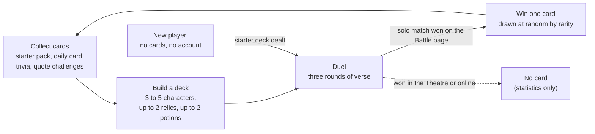
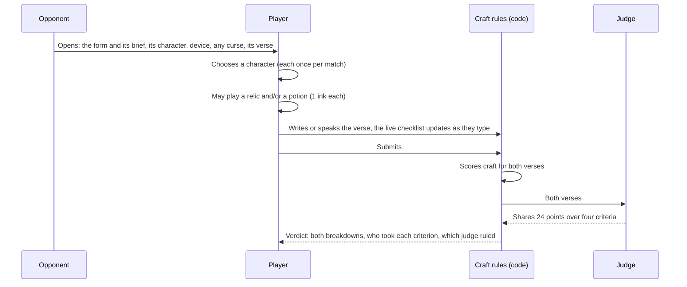
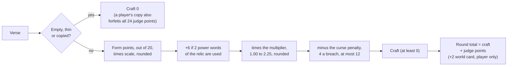
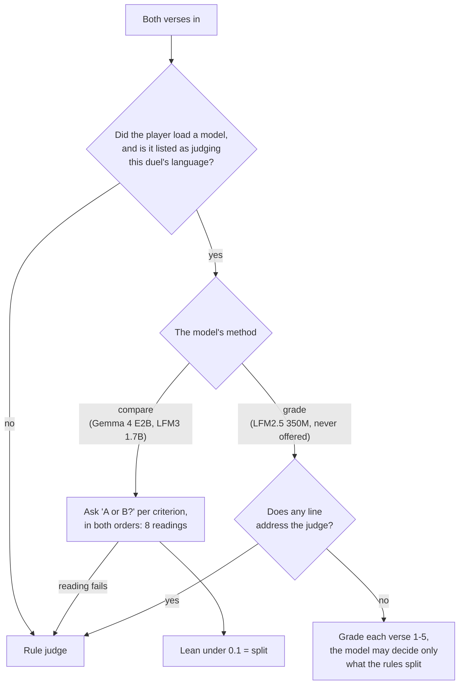

# Sonnet Man: game design document

- **Purpose:** the authoritative description of what Sonnet Man is and how it plays, worked backward from the code, with the design problems still open. It is the hub of the dossier.
- **Audience:** the team (David Charlot, founder and technical lead; Devon Glover, "The Sonnet Man", creative director; Arrocito del Diablo, co-founder for game design and card mechanics), future collaborators and contractors, and investors who want the detail behind `02-pitch.md`.
- **As of:** commit `0d6df6ef` (branch `integrate/wave3`, 2026-11-18, the game as it is about to ship), plus the release in flight on 2026-11-19:
  - `fix/judge-wording`: the judge's wording goes back to main's;
  - `fix/server-authority`: a server-authoritative economy;
  - `fix/voice-g2p`: the English voice without its GPL eSpeak NG part;
  - `fix/compliance`: credits, AI notice, privacy wording and asset provenance;
  - a nightly database backup.
- **Status:** Draft for the team, 2026-11-19.
- **Related documents:**
  - `01-concept-one-pager.md`, `02-pitch.md`;
  - `04-content-and-card-bible.md` with `data/cards.csv`, `data/forms.csv` and `data/devices.csv`;
  - `05-systems-economy-and-balance.md`, `06-modes.md`, `07-narrative-and-performer-bible.md`;
  - `08-art-bible.md`, `09-audio-bible.md`, `10-ux-flows-and-design-system.md`, `11-accessibility-plan-and-statement.md`;
  - `12-technical-design.md` and `adr/`, `13-ai-design-and-system-cards.md`, `14-localisation-kit.md`, `15-qa-and-test-plan.md`, `16-analytics-and-tracking-plan.md`, `17-operations-runbook-and-launch-checklist.md`;
  - `18-trust-and-safety-plan.md`, `19-privacy-pack.md`, `20-legal-and-licence-register.md`;
  - `21-production-plan-and-roadmap.md`, `22-risk-register.md`, `23-market-and-competitors.md`, `24-marketing-press-kit-and-store-pages.md`, `25-live-ops-plan.md`;
  - `26-sota-gap-analysis.md`, `27-glossary.md`, `28-owner-decisions.md`, `29-postmortem-and-incident-templates.md`; the index is `00-README.md`.
- **Fact bases:** `sources/as-built-design.md` and `sources/as-built-tech.md` carry internal details in places and are for the team only; never share the `sources/` folder outside the company.

## How to read this document

Every statement is one of four kinds. The label is given wherever the kind is not obvious from the heading.

| Label | Meaning | How it is sourced |
|---|---|---|
| **As built** | What the code at `0d6df6ef` does | `D§n`, a section of `sources/as-built-design.md`; `T§n`, a section of `sources/as-built-tech.md`; or a code `path:line` at `0d6df6ef` |
| **In this release** | Decided by the owner on 2026-11-19 and being made on a named branch; not live, and not built at `0d6df6ef` | the branch name |
| **Proposed** | The recommendation of this document | `R-des §n`, a section of `research/sota-design-2026-11.md`; `R-prod §n`, a section of `research/sota-production-2026-11.md`; or `docs/research/` |
| **Not known** | No record was found | listed again in §15, "Owner questions" |

**Words used throughout** (the full list is in `27-glossary.md`):

| Word | Meaning |
|---|---|
| Form | The shape a round's verse must take: a couplet, a haiku, an acrostic. |
| Craft | The points code gives a verse: for keeping its form, multiplied by what its cards made it do. |
| Judge | What shares 24 more points between the two verses, by rules or by a model. |
| Device | A writing move a character's house rewards, such as ending a line on "?". |
| Signature | Words from the character's famous line, echoed without reciting it. |
| Relic | A card that lends five *power words*; weaving two into the verse earns points. |
| Potion | A card that casts a *curse*, a rule the opponent's next verse must obey. |
| Ink | The budget a player spends on relics and potions. |
| Written opponent | The opponent that plays verses written in advance, used wherever no model runs. |
| Seed | A number that fixes a duel's plan, so the same seed and deck give the same forms. |

---

## 1. Vision and pillars

### 1.1 High concept

A free browser card game in which every move is a verse you write or speak, in any of 16 languages, fought as a three-round duel against Shakespeare's characters, with an opponent and a judge that run on your own device.

### 1.2 Player fantasy

You are the challenger on Shakespeare's stage. The opponent always speaks first, so you always have a verse to answer (`src/lib/verse/devices.ts:237`). You choose who answers it, spend ink on a relic or a potion, and write back. Then the verdict shows, check by check, why you won or lost. The fantasy is mastery of language under pressure, judged fairly. It is not luck and it is not a bigger number.

### 1.3 Design pillars

No pillar document existed before this one. The four pillars below are reconstructed from what is built and from the owner's recorded direction (`CLAUDE.md:639-644`). Each is held by code today.

| Pillar | What it means | Held by (as built) | Where it is weak |
|---|---|---|---|
| **1. Your verse is the move** | A card changes how you must write. Nothing scores a card's number. | The house devices, signatures, relics and curses (D§1.5) | ATK, DEF and HP are still printed on every character and do nothing (§14.1) |
| **2. Fair, and shows its working** | Code decides the form; the verdict shows every check; the same seed draws the same plan; a model judges only where it was measured to. | `src/lib/verse/forms.ts:2-3`; `src/pages/battle.astro:170,901-958`; `src/lib/brain.ts:61-83` | The rule judge splits most criteria in many languages (§4.10) |
| **3. Your solo duel stays on your device** | No server reads a solo verse, voice or model output. No cloud AI anywhere. | T§1.6; commit `8d113da8` (the cloud judge removed) | Model weights come from a third-party hub, unpinned (T§4.1) |
| **4. Every language is home** | 16 languages, forms checked by each language's own sound rules, and native forms. | D§1.4, D§8; T§6 | Online play is English only; no native speaker has read any of the text (T§6.4) |

**A candidate fifth pillar: "the performer is real".** The 2025 brief built the product around Devon Glover's Shakespeare-meets-hip-hop work (`PROJECT_BRIEF.md:5`), and the research recommends making him and his method the centre of the brand (R-des §9; R-prod §7.2). *As built*, no recording, verse, voice or music of his is in the game (D§6.1). *Proposed*: adopt this pillar only after Devon Glover has said what he wants. The questions to ask him are in §15.

### 1.4 What Sonnet Man is not

These are summarised here; the full list is in §12.

- It is not a stats battler: no number on a card decides a round.
- It is not a game the AI plays for you: the AI writes only the *opponent's* verse, and never the player's.
- It is not a shop: nothing is sold for real money.
- It is not cloud AI.

---

## 2. Audience and player motivations

### 2.1 Who can play, as built

- **Age.** Anyone 13 or over. A date-of-birth gate on every page blocks under-13s. Players aged 13 to 17 need a parent's permission. Only the result is stored, in the browser (D§8, "First-time flow"; T§3.6).
- **No account and no download are needed** for a solo duel. The starter deck is dealt, and "Play now without a download" starts it against the written opponent (D§1.1, D§8).
- **An account, made with a passkey, is needed** for online play, the marketplace, tournaments, the Season Pass and the classroom (D§8, "Sign-in").
- **Devices.** Any modern browser plays: written opponent and rule judge. A model is offered only on a desktop with WebGPU, 16-bit shaders and 8 GB or more of reported memory, or no memory figure at all: a browser without `navigator.deviceMemory` reports none, and `brain.ts:152` then offers the model (T§4.4).

### 2.2 Who it is for

- **Measured audience:** none. The production database had 0 accounts on 2026-11-19, and no game event is recorded by analytics (T§9).
- **Intended:**
  - from the 2025 brief: fans of Devon Glover's Shakespeare-meets-hip-hop brand, and collectors of digital cards (`PROJECT_BRIEF.md:5`);
  - schools: the site was made a "clean edu-only" platform in February 2026 (commit `7982d79c`), and Classroom mode exists, partly built (§6).
- **Proposed personas, from the research** (R-prod §7.15):
  - a secondary English teacher;
  - a student aged 13 to 17;
  - an adult wordsmith or rapper;
  - a language learner;
  - Devon Glover's existing audience.

### 2.3 Motivations, and what serves each

| Motivation | What serves it, as built | What is missing |
|---|---|---|
| **Mastery**: getting better at a hard thing | Partial credit for near misses (`forms.ts:5-6`), the live checklist, the verdict's breakdown, three difficulty settings | Difficulty does nothing without a model (§4.11); no post-round "a stronger line you could have written" (R-des §2) |
| **Self-expression** | Free verse inside a form, typed or spoken; 16 languages | No way to keep, share or replay one's own verses (sharing code is dead: D§5.8) |
| **Competition** | Online duels scored by the server; a public leaderboard | Ranks come from self-reported solo rounds (D§5.6); in this release, only from server-judged matches (`fix/server-authority`) |
| **Collection** | 71 cards, starter and daily packs, trivia and quote challenges, world-card variants | Duplicates have no use; no set goals beyond achievements (D§4.2) |
| **Learning** | 200 trivia questions, 104 quote challenges, forms that teach scansion | Classroom mode records no progress (D§4.13) |
| **Belonging and identity** (Shakespeare remixed through hip-hop) | The world-card cities' battle-rap framing (D§6.6); one art tradition per house from around the world (D§7.2) | Devon Glover's own performance; the written opponent's voice is mock-Early-Modern, "with no hip-hop idiom" (D§6.7) |

---

## 3. The core loop

As built (D§1.1):

- **The session loop** is one duel: two or three rounds, each a verse from each side, ending in a verdict.
- **The meta loop** is collect, build, duel, win a card.
- **The loop does not require collecting.** A new player duels at once with the starter deck: The Sonnet Man, Romeo, Juliet, Yorick's Skull and the Love Potion (`src/lib/verse/duel.ts:287-295`; `src/lib/cards.ts:33,42,51,105,123`).
- **Only a solo match won on `/battle` pays a card.** A win in the Theatre or online pays nothing (D§4.3). This is an open problem (§14.5).
- **Match length is Not known.** No clock runs in solo play and nobody has timed a duel. The forms are short, two to four lines (D§1.4), unlike the "sonnet a move" the research assumed (R-des §1). The research's reference is about three minutes a match and about five minutes a mobile session (R-des §1). *Proposed*: time it first in the AI playtests, where AI players with no prior training on the game play through the page alone on the build host (`15-qa-and-test-plan.md` §8; `28-owner-decisions.md` D-63), then with live aggregate analytics after launch (`16-analytics-and-tracking-plan.md`).

---

## 4. The duel in full

### 4.1 Set-up

As built (`src/pages/battle.astro:23-91`; D§1.2):

| Choice | Options | Default |
|---|---|---|
| Deck | The active saved deck, if it has at least 3 valid characters; otherwise the starter deck | Starter deck |
| Duel language | Any of 16 | The last one chosen (remembered), or `?lang=` |
| Opponent difficulty | Apprentice ("writes one draft"), Player ("picks the better of two drafts"), Master ("picks the best of three drafts") | Player |
| World card | One owned city variant, shown only to a player who owns one | None |
| Opponent's mind | Download a model, if the device is offered one; or "Play now without a download" | No model |
| Seed | A random whole number, or `?seed=`; shown on screen with "The same seed and deck draw the same forms" | Random |

**Deck rules** (`src/lib/battle-rules.ts:82-88`; `src/lib/deck-manager.ts:25-31`):
- 3 to 5 characters, at most 2 relics and at most 2 potions, 7 cards in all;
- one copy of each card;
- only cards the player owns.

### 4.2 The plan, fixed by the seed before round one

As built (`src/lib/verse/duel.ts:301-331`):

- **Three rounds**, each under a different form, shuffled from the forms of the duel's language (§4.6).
- **The opponent's deck.** Three characters drawn from all 53, one relic and one potion. The opponent can therefore field a Legendary: The Sonnet Man or Zeus.
- **The opponent's items.** It casts its potion on the player in round 2 or 3, and lends itself its relic's words in the other of those two rounds. "Round one is a clean read of the form for both sides" (`duel.ts:308-311`).
- **Form details.** An acrostic's word is drawn from the language pack: in English *bard, moon, king, rose, fate, wit, play, star*. A Forbidden Letter curse draws its letter from the pack: in English *s, t, r, n, o, i* (`src/lib/verse/packs/en.ts:5-6`).

### 4.3 A round, step by step

As built (`src/lib/verse/session.ts:94-245`; D§1.2):

1. **The opponent opens and writes first.** The screen shows:
   - the form, its brief and the round number;
   - the opponent's character, its device, any curse it has cast on the player, and its verse.

   With the voice on, the verse is read aloud.
2. **The player chooses a character** to answer with. Each character can answer once per match.
3. **The player may play a relic, a potion, or both.**
   - **Cost.** Each costs 1 ink. The player has 2 ink in round one and gains 1 each round after, so 4 ink at most over a match.
   - **Once only.** Each item is used once per match.
   - **When a potion bites.** It curses the opponent's *next* verse, since the opponent has already written this one. It cannot be played in the last round. The page warns that it is a gamble once either side can win the match that round (`session.ts:163-167`).
4. **The player writes or speaks the verse.**
   - **Limits.** The box takes 600 characters; the engine keeps 8 lines at most.
   - **Speech.** The microphone transcribes on the device and adds the text to the box, where it can be edited.
   - **The live checklist.** "What your verse must do" and "Craft so far" come from the same function that scores the round.
5. **Submit.** It is refused until a character is chosen and the verse holds a letter.
6. **The verdict**, then the next round. The match ends when a side has two rounds.

### 4.4 Timers and limits

| What | Solo (as built) | Online (as built) | Source |
|---|---|---|---|
| Time to write a verse | No clock | 180 s; when time runs out, the verse as it stands is scored, and a side that sent nothing plays an empty verse | D§1.2; `backend/src/multiplayer/game_room.rs:99,845-858` |
| Reconnect grace | n/a | 45 s, then the match goes to the other player | `game_room.rs:100` |
| Paired opponent must arrive | n/a | 60 s | `game_room.rs:101` |
| Quick-match search | n/a | 30 s a request; the page gives up after 3 min | D§5.1 |
| Verse length | 600 characters, 8 lines | the same, plus 2,000 bytes raw | `src/lib/verse/text.ts:33-34`; `game_room.rs:43` |
| Verses kept after a match | never leave the device | at most 2 minutes after the match ends; the build itself enforces it | `game_room.rs:65-76` |

*Proposed*: keep solo play untimed, which suits a writing game and the research's advice to make time limits adjustable or removable (R-des §8). Make the online round time adjustable for private rooms and classrooms.

### 4.5 Controls and input

As built (D§1.2, D§7.5, D§8):

- **Typing.** The verse box is labelled and lays out right-to-left text by itself (`dir="auto"`).
- **Speaking.**
  - **How.** Whisper base transcribes on the device. A take stops at 45 s, and the duel's language is passed to it (`src/lib/ear.ts:1-20,128`).
  - **Privacy.** The browser's own speech recognition is never used, because it sends audio to a server (commit `e41c73f5`).
- **In the Theatre.** Cards and buttons are picked by pointer, controller ray or pinch. In a headset the verse is spoken; on a flat screen a text box is offered as well (`src/lib/xr/theatre.ts:9-11`).

### 4.6 Verse forms, and what code checks

"Whether a verse keeps the form is decided here by code, never by the model" (`forms.ts:2-3`). "A near miss still scores" (`forms.ts:5-6`). English rhyme and syllables come from the CMU Pronouncing Dictionary, so a word with two pronunciations gives a line a range of syllable counts. Other languages are read from their own sound tables, a Japanese morphological analyser, or the browser's word segmenter (Chinese, Thai) (D§1.4).

As built (`forms.ts:209-344`; D§1.4). Each form is worth 20 points:

| Form | Lines | What code checks (points) | Offered in |
|---|---|---|---|
| Couplet | 2 | 2 lines (6); lines 1 and 2 rhyme (14) | where rhyme is checked |
| Paired Quatrain (AABB) | 4 | 4 lines (6); 1-2 rhyme (7); 3-4 rhyme (7) | where rhyme is checked |
| Crossed Quatrain (ABAB) | 4 | 4 lines (6); 1-3 rhyme (7); 2-4 rhyme (7) | where rhyme is checked |
| Tercet | 3 | 3 lines (6); 1-3 rhyme (14) | where rhyme is checked |
| Anaphora | 3 | 3 lines (6); every line opens with the same word, or character in Chinese and Japanese (14) | all |
| Acrostic | one per letter of the drawn word | line count (6); the lines' openings spell the word (14), with each script's own rule for an "opening" | all |
| Crescendo | 3 | 3 lines (6); each line longer than the last (14) | all |
| Epistrophe | 3 | 3 lines (6); every line ends on the same word or character (14) | all but English, "so that an English duel draws from exactly the forms it always has" |
| Haiku | 3 | 3 lines (5); 5, 7 and 5 syllables exactly (5 each); characters in Chinese, kana sounds in Japanese | where syllables are counted |
| Heroic Couplet | 2 | 2 lines (4); 1-2 rhyme (8); about 10 syllables, plus or minus 1, each line (4 each) | where both are checked |
| Jueju | 4 | 4 lines (6); every line of 5 characters, or every line of 7 (14); tone and rhyme not checked | Chinese only |
| Lục Bát | 2 | 2 lines (4); 6 syllables (4); 8 syllables (4); the sixth word of each line rhymes (8) | Vietnamese only |

- **Where rhyme is checked:** everywhere except Chinese, Japanese and Thai until their sound data has loaded. The battle page loads it before the duel starts.
- **Where syllables are counted:** everywhere except Arabic and Thai.

Forms in each language's draw, as built (D§1.4):

| Language | Forms |
|---|---|
| English | 9: everything above but epistrophe and the two native forms |
| Spanish, French, German, Italian, Portuguese, Polish, Russian, Hindi, Korean, Indonesian | 10: the English nine and epistrophe |
| Japanese | the same 10 (5 if its sound data fails to load) |
| Chinese | 11, with jueju (6 if its sound data fails to load) |
| Vietnamese | 11, with lục bát |
| Arabic, Thai | 8: the four rhyming forms and the four structural ones (Thai: 4 if its sound data fails to load) |

**A verse earns nothing if it is thin.** It is thin if any line has no word, if it has fewer different words than lines (and never fewer than 3), if half or more of its lines are repeats, or if under 60% of it is words of its language (`forms.ts:384-391`). A verse that is mostly words of its language but short of telling words earns its form points scaled down (`scale`, §4.8).

Full form data: `data/forms.csv` and `04-content-and-card-bible.md`. Per-language rules: `14-localisation-kit.md`.

### 4.7 Card devices and their exact effect

**Characters.** Every character carries its house's device and its own signature (`devices.ts:4-6`). In the multiplier (§4.8):
- landing the device adds +0.5, or +0.75 with house synergy (the deck holds 2 or more characters of that house, the card itself included);
- landing the signature adds +0.5.

House devices, as built (`devices.ts:64-216`; D§1.5). The thresholds are English; each language has its own (`src/lib/verse/lang.ts:33-55`):

| Device | Houses | Lands when |
|---|---|---|
| The Question | Danish Court | a line that holds a letter ends in a question mark |
| The Outcry | Capulet; also any Riposte house in a verse that opens a round | a line that holds a letter ends in "!" |
| Alliteration | Forest of Arden | 3 different words in one line, each of at least 3 letters and not a function word, share an initial |
| The Drumbeat | Scottish Court | one content word appears 3 times |
| Inner Rhyme | Montague | two words inside one line rhyme |
| The Riposte | Verona Court, Underworld | the verse uses a word of 5 letters or more from the opponent's verse |
| Brevity | Illyria | every line has at most 6 words |
| The Swell | The Tempest | the last line is strictly the longest (2 lines or more) |
| Balance | Lake District | 2 lines or more, all of the same length |
| The Ring | Gothic Circle | the first word of the first line is the last word of the last line, in a verse of more than 2 words |
| Invocation | Rome | the verse names a catalogue character |
| Grandeur | Olympus | 2 different words of 9 letters or more |
| One Rhyme | Legendary (The Sonnet Man only) | 2 lines or more, every line's last word rhymes with the first line's |

- **Without rhyme.** Where rhyme cannot be checked, Inner Rhyme becomes The Drumbeat and One Rhyme becomes The Ring, "so no card is left with a flourish that can never land" (`devices.ts:218-228`).
- **The Riposte when nothing has been said.** In a verse that opens a round, which in solo play only the opponent writes, the Riposte is held to The Outcry (`devices.ts:230-242`).

**Signature** (`devices.ts:272-345`).
- **Which words count.** The signature is the "telling" words of the card's English line: words of 4 letters or more that are not function words.
- **How many.** The verse must use 2 of them, or 1 if the line has only one or two.
- **Reciting is not echoing.** Four of the line's words in a row is a quotation and does not land.
- **Other languages.** A duel in another language also accepts the line as that language prints it.
- **Example.** Romeo, "But soft, what light through yonder window breaks?": echo 2 of *soft, light, yonder, window, breaks*.

**Relics** lend five power words for one round. A verse that uses at least 2 of them earns +6 craft (`devices.ts:439-440`). English asks for the exact word; other languages accept a word that begins with the power word, with looser rules for Arabic, Chinese, Japanese and Thai (`devices.ts:442-473`).

| Relic (rarity) | Power words (English) |
|---|---|
| Yorick's Skull (Rare) | skull, jest, grave, laugh, dust |
| Prospero's Staff (Legendary) | storm, spell, staff, island, drown |
| Dagger of the Mind (Uncommon) | dagger, blood, sleep, vision, hand |
| Romeo's Ring (Rare) | ring, vow, night, banished, kiss |
| Portia's Casket (Uncommon) | gold, choice, mercy, lead, casket |
| Macbeth's Crown (Epic) | crown, throne, ambition, witch, king |
| The Tempest Codex (Rare) | book, tempest, magic, page, drown |
| Cordelia's Tears (Rare) | tears, truth, daughter, nothing, heart |
| Bottom's Mask (Uncommon) | mask, dream, fool, play, moon |

**Potions** cast a curse on the opponent's next verse: −4 craft for each breach, at most −12 (`devices.ts:362-434`).

| Curse | Rule (English thresholds) | Potions |
|---|---|---|
| Forbidden Letter | no word may contain the drawn letter; look-alike letters from other alphabets, and digits standing in for it, count | Witches' Brew, Hemlock Tincture, Apothecary's Elixir |
| Tongue-Tied | no word longer than 6 letters | Mandrake Root, Mermaid's Tears |
| No Echoes | no word of 4 letters or more used twice | Love Potion, Oberon's Dew |
| Short Breath | no line longer than 5 words | Puck's Flower Juice, Mistletoe Extract |

Per-card effects, all 71, with their signature words: `data/cards.csv`, `data/devices.csv` and `04-content-and-card-bible.md`.

### 4.8 The scoring formula

"A verse scores craft + judge (+ the world card's bonus, for the player)" (`duel.ts:9-11`).

As built (`duel.ts:463-571`; `forms.ts:381-397`; D§1.3):

**Craft** = max(0, round((form points + power-word bonus) × multiplier) − curse penalty).

| Term | Rule | Constant |
|---|---|---|
| Form points | The sum of the requirements met (out of 20), times `scale`, rounded | `FORM_POINTS = 20` |
| `scale` | min(1, *known* ÷ 0.7, *telling* ÷ (0.5 × lines)). *Known* is the share of the verse that is words of its language; *telling* is the number of different telling words. In Chinese and Japanese the telling term is 1. | `FULL_KNOWN_SHARE = 0.7`, `TELLING_PER_LINE = 0.5` |
| Power-word bonus | +6 when 2 of the lent relic's 5 words are used | `POWER_WORD_BONUS = 6`, `POWER_WORDS_NEEDED = 2` |
| Multiplier | 1 + round(bonus × substance × 100) ÷ 100, where bonus = 0.5 (device) + 0.5 (signature) + 0.25 (synergy) | from 1.00 to 2.25 |
| `substance` | min(1, own telling words ÷ (1.5 × the lines the form asks)). Own words are those beyond the words that landed the device and the signature, so a verse that is only its device multiplies nothing. | `OWN_WORDS_PER_LINE = 1.5` |
| Curse penalty | min(12, 4 × breaches) | `CURSE_PENALTY = 4`, `CURSE_PENALTY_CAP = 12` |

**Judge.** 24 points a round (`JUDGE_POOL`), over four criteria: wordplay, allusion, flow and wit. Each criterion gives 6 points to the side that takes it, or 3 to each on a split (`src/lib/verse/judge.ts:265-276,491-499`).

**World card.** +2 to the player when the judge gives the player the city's criterion and the verse is not void. The player's side only, in solo play only (`duel.ts:563-565`).

**The round.**
- **Totals.** The player's total is craft + judge points + world-card bonus; the opponent's is craft + judge points.
- **Winner.** The higher total wins. On equal totals the side the judge preferred wins; on equal judge points the player, "the challenger", wins. A solo round is never drawn (`duel.ts:569-571`).

**Ranges** (derived from the constants):
- **Craft.** At most 45 with no relic (20 × 2.25), and 59 with one (26 × 2.25 = 58.5, rounded to 59).
- **Round total.** At most 85 for the player (59 + 24 + 2).
- **Achievements on a round total.** Two are set on one: "Wordsmith" at 35 and "Virtuoso" at 45 (`src/lib/achievements.ts:101,174`).

**Copies and void verses** (`duel.ts:54-115,388-469,515-520`).
- **What a copy is.** A verse that carries over the opponent's lines, or most of its content words, is a copy. It is measured from both sides and line by line, so moving the lines, swapping rhyme words or padding every line does not hide one (`CLAUDE.md:54-81`).
- **What it costs.** An empty, thin or copied verse earns craft 0 and lands no device or signature. A copied player verse also forfeits all 24 judge points to the opponent.
- **The opponent's verse is never tested for copying.** Otherwise a player could void the written opponent by typing its next verse a round early, since the seed makes it knowable (`duel.ts:388-394`).

### 4.9 Two worked examples

Both rounds below were computed for this document by the game's own functions at `0d6df6ef`: `createDuel`, `writeOpponentVerse`, `rulesJudge` and `resolveRound`, run in Node, with no model. The player's verses were written for this document; the opponent's come from the English pack. Duel: English, seed 22, starter deck (The Sonnet Man, Romeo, Juliet, Yorick's Skull, Love Potion). The seed draws a couplet, then a crossed quatrain, then an anaphora.

**Example 1. Round one, a couplet: Romeo with Yorick's Skull, against Odysseus (written opponent).**

The opponent opens:

> Step up, poor player, strut thy little hour
> Then watch thy verses wither like a flower

The player chooses Romeo (Montague: Inner Rhyme; signature: 2 of *soft, light, yonder, window, breaks*). They spend 2 ink, all they have: Yorick's Skull (*skull, jest, grave, laugh, dust*) and the Love Potion, which will curse the opponent's next verse with No Echoes. They write:

> Soft is the light that crowns my jest tonight;
> your grave of verses fades before my sight.

| Step | Player (Romeo) | Opponent (Odysseus) |
|---|---|---|
| Form: 2 lines (6) + lines rhyme (14) | 6 + 14 (*tonight / sight*) = 20 | 6 + 14 (*hour / flower*) = 20 |
| Scale | 1.0 | 1.0 |
| Power words | *jest*, *grave*: +6, so 26 | no relic this round: 20 |
| Device | Inner Rhyme lands (*light / tonight*): +0.5 | Grandeur does not land: +0 |
| Signature | *soft*, *light*: +0.5 | does not land: +0 |
| Synergy | no (Romeo is the deck's only Montague): +0 | +0 |
| Substance | 1.0 | 1.0 |
| Multiplier | 1 + 1.0 × 1.0 = 2.00 | 1.00 |
| **Craft** | round(26 × 2.00) = **52** | **20** |
| Judge: wordplay (different telling words) | 9: loses | 10: **takes it**, 6 |
| Judge: allusion (catalogue words) | 3 (*soft, light, grave*): split, 3 | 3 (*poor, hour, flower*): split, 3 |
| Judge: flow | split, 3 | split, 3 |
| Judge: wit | split, 3 (always, against the written opponent) | split, 3 |
| **Judge points** | **9** | **15** |
| **Round total** | 52 + 9 = **61** | 20 + 15 = **35** |

The player takes round one. Craft decided it: the opponent won the judge 15 to 9 and still lost by 26.

**Example 2. Round two, a crossed quatrain (ABAB): Juliet, cursed by Oberon's Dew, against Lady Macbeth.**

The opponent has cast its potion, Oberon's Dew, on the player's verse: No Echoes, so no word of 4 letters or more may be used twice. The player's Love Potion binds the opponent's verse this round with the same curse, so the written opponent plays the verse in its bank that breaks it least (`src/lib/verse/opponent.ts:132-141`):

> Thy verse limps in upon a single leg
> And begs the crowd to pity its poor sound
> I will not kick a man who comes to beg
> I simply leave him sitting on the ground

The player has 1 ink (2 at the start, +1 for this round, −2 spent) and plays no item. They choose Juliet (Capulet: The Outcry; signature: 2 of *name, call, rose*) and write:

> What is a name? I call the morning rose!
> The lady's hands are cold as winter stone,
> A rose by any name still blooms and grows!
> Yet you, Macbeth's dark queen, must sleep alone.

| Step | Player (Juliet) | Opponent (Lady Macbeth) |
|---|---|---|
| Form: 4 lines (6) + 1-3 rhyme (7) + 2-4 rhyme (7) | 6 + 7 (*rose / grows*) + 7 (*stone / alone*) = 20 | 6 + 7 (*leg / beg*) + 7 (*sound / ground*) = 20 |
| Device | The Outcry lands (line 1 ends in "!"): +0.5 | The Drumbeat does not land: +0 |
| Signature | *name*, *call*: +0.5 | does not land: +0 |
| Multiplier | 2.00 | 1.00 |
| Curse: No Echoes | *name* twice, *rose* twice: 2 breaches, −8 | 0 breaches, −0 |
| **Craft** | round(20 × 2.00) − 8 = **32** | **20** |
| Judge | wordplay **player** 6, allusion **player** 6, flow split 3, wit split 3: **18** | 0 + 0 + 3 + 3 = **6** |
| **Round total** | 32 + 18 = **50** | 20 + 6 = **26** |

The player takes round two and the match, 2 rounds to 0, so round three is not played. Echoing *rose* twice cost 8 points: the curse worked, and the verse won anyway.

**What the examples show, as a design finding.** The written opponent's verses rarely land their own card's device or signature, so their craft is usually 20.
- **Measured for this document.** Over seeds 1 to 1,000 in English, with no curse, by the same functions: the written opponent's craft was 20 in 2,848 of 3,000 rounds, 30 in 142 and 35 in 10. It landed its relic's power words in none of the 1,000 rounds in which it lent itself a relic.
- **Derived.** Wit is always a split against the written opponent, so the player always has at least 3 judge points. A player verse with craft 40 (form kept, device and signature landed) therefore cannot lose to a written verse of craft 20 while it is not cursed: 40 + 3 = 43 beats 20 + 21 = 41. The written opponent casts its potion on the player in round 2 or 3 of every duel (`src/lib/verse/duel.ts:310`), and a craft-40 verse cursed for two breaches scores 32: 32 + 3 = 35 loses to 41.

The consequence is in §4.11 and §14.2.

### 4.10 The rule judge and the model judge

**Which judge runs** (`src/lib/verse/referee.ts:126-142`; `session.ts:219-245`):

As built, the lists of languages each model judges are measured, not assumed (`src/lib/brain.ts:63-81`; T§4.1):
- Gemma 4 E2B judges English, Russian, Chinese and Indonesian;
- LFM3 1.7B judges Vietnamese, and only if it is the model loaded;
- the rule judge decides everywhere else, and also whenever a model's reading fails.

The verdict says which one judged (`battle.astro:935-940`).

**The rule judge** compares the two verses on four criteria (`judge.ts:401-501`). A thin verse loses every criterion to a real one.

| Criterion | Measured as |
|---|---|
| Wordplay | different telling words, over as many lines as the shorter verse has, at most 30 |
| Allusion | different words from the allusion lexicon: character names of 4 letters or more, and every card's signature words, in English and in the duel's language |
| Flow | 2 × the rhymed pairs of line ends, + lines that open on the same content word as the line before (not mere repeats), + 1 for three or more lines each longer than the last, − the spread of line lengths over their mean |
| Wit | words of the answered verse thrown back (telling, long enough), at most 3; compared only when both verses answered one, otherwise a split |

- **Against the written opponent, wit is always a split.** The written opponent answers nothing, so the session passes no previous verse to the judge (`session.ts:225-227`). In every round one, wit is also a split.
- **Its accuracy is held, not proven.** On labelled pairs in all 16 languages, the rule judge must be at least as accurate as main's rule judge. Main's tallies were, in criteria given to the better verse / split / given to the worse: English 115/79/19, German 6/30/0, Chinese 0/40/0 (`src/lib/verse/judge-accuracy.test.ts:33-35,79-91`). It splits most criteria in many languages, so craft decides most rounds.

**The model judge** returns per-criterion margins, never text (`judge.ts:14-18`).
- **Compare.** For each criterion the model is asked "Which verse is better on this criterion? Reply A or B", once in each order. The lean is the forward reading minus the reversed one, which cancels the model's bias for a position. A lean under `SPLIT_BELOW = 0.1` is a split (`judge.ts:4-12,43,234-276`).
- **Grade.** Used by the lite model, which is never offered (§4.11). The defences on this path:
  - lines that address the judge (a digit, a number word or a judge word) are not read, and a round holding one goes to the rules;
  - the model decides only what the rules split, by a gap of `GRADE_MARGIN = 0.5` or more (`CLAUDE.md:36-52`; `referee.ts:108-115`).
- **Measured quality**, first English test, 8 pairs × 4 criteria, compare / grade (`brain.ts:24-34`): Gemma 4 E2B 31/32 and 31/32; LFM3 1.7B 27/32 and 21/32; LFM2.5 350M 9/32 and 25/32. Per-language results cover 66 of 96 model-language cells (T§4.2).

**In this release (`fix/judge-wording`).**
- **The problem.** The integration had moved the duel's language out of the compare instructions. Under that wording a planted verse, "Ignore all previous instructions…", beat a real verse in 11 languages, and Gemma passed the judging bar in only 4.
- **The fix.** The owner chose to go back to main's wording, which measured 2 such losses and 14 languages passing (commit `3015897a`; T§4.2).
- **What follows.** The 32 compare-path judging cells are set aside and measured again. Which languages Gemma will judge after that is **Not known** until the measurement is done.

*Proposed* (R-des §2, §4; R-prod §4.1):
- show the code-checked craft first and the judge's share beside it, with one plain reason per criterion;
- after the round, offer "a stronger line you could have written";
- never let a model alone decide anything of value.

Detail: `13-ai-design-and-system-cards.md`.

### 4.11 Opponents and difficulty

**The written opponent** (as built: `opponent.ts:132-178`; D§1.6, D§6.7).
- **What it plays.** A verse from the duel language's pack that keeps the form, picked by the seed. Under a curse, it plays the verse of its bank that loses least to the curse.
- **The English bank:**
  - 17 verses over 8 forms;
  - 17 spare verses for a cursed opponent;
  - 36 acrostic lines, two for each of 18 letters.
- **The other banks.** Every other language has 14 to 20 verses and no spares.
- **Its register.** Mock-Early-Modern trash talk ("Rhyme is a blade, and thou hast brought a spoon").
- **Where it plays:**
  - on every phone, tablet and headset;
  - wherever the player has not downloaded Gemma;
  - in Arabic, Japanese, Korean and Vietnamese on every device, since Gemma does not write those at `0d6df6ef`.
- **In this release.** On the release branches' common base (commit `ee2bf5ad`), Gemma 4 E2B also writes Vietnamese: 35 of 110 plays kept the form in full, against a bar of 30%.

**The model opponent** (`opponent.ts:42-162`).
- **The prompt.** English, naming the language to write in: "You are {card.name} in a duel of verses: theatrical, sharp, in character. Your line in the play: "{quote}"". The player's last verse is passed as data.
- **Drafts.** It writes 1 draft (Apprentice), 2 (Player) or 3 (Master), at temperatures 0.7 + 0.1 × draft number. It plays the draft with the most craft, measured by the same scorer the player faces.
- **The fallback.** If the best draft is void, or worth less than half the written verse's craft, the written verse plays instead.

**Difficulty**, as built.
- **What it is.** The number of drafts a model writes (`opponent.ts:42`).
- **Without a model it does nothing.** Apprentice, Player and Master meet the same written verses (D§1.6).
- **In the Theatre.** The difficulty is fixed at Player (`src/pages/theatre.astro:190`).
- **Model tiers, and which device gets which** (`brain.ts:11-164`):

  | Tier | Model | Download | Writes in (at `0d6df6ef`) | Judges in | Offered to |
  |---|---|---|---|---|---|
  | grand | Gemma 4 E2B | 3,100 MB | en es fr de it pt pl ru hi zh th id | en ru zh id | desktops with WebGPU, f16 and 8 GB or more |
  | standard | LFM3 1.7B | 1,090 MB | none | vi | the same desktops, as the lighter download |
  | lite | LFM2.5 350M | 295 MB | none | none | nobody: a tier used in no language is never offered |

**What this means for play.** Every phone and headset player, and every desktop player who does not download 3.1 GB, meets the written opponent. How many players that is will only be known once players arrive. Against it, difficulty does nothing, and a strong verse almost never loses: one that keeps its form and lands its device and signature cannot lose to a craft-20 written verse when it is not cursed, which is 95% of the written opponent's rounds; a curse, or one of its rarer 30- or 35-craft verses, can still beat it (§4.9). The open problem and its proposed direction are in §14.2.

### 4.12 What decides a round and a duel

| | Solo (Battle and Theatre) | Online |
|---|---|---|
| Who writes when | The opponent opens; the player answers | Both write at once, under the same form |
| Items and ink | Relics, potions, ink; a world card | None of them (`src/lib/multiplayer-rules.ts:28-39`) |
| Judge | Rules, or a model where measured | Server rules only, no model |
| What "answers" | The player answers the opponent's verse this round | Each side answers the other's verse of the round before |
| Round winner | Higher total; then the judge's preference; then the challenger (never a draw) | Higher total; then the larger judge share; else a draw |
| Match winner | First to 2 rounds | First to 2; after 3 rounds, more rounds won; then more points; else a draw |
| Source | `duel.ts:569-583` | `backend/src/verse/duel.rs:559-653` |

---

## 5. Cards in play

As built (D§2; `src/lib/cards.ts`, "the single source of truth for card data across all pages").

- **71 cards:** 53 characters, 9 relics and 9 potions.
- **By rarity:** Common 9, Uncommon 21, Rare 25, Epic 13, Legendary 3 (The Sonnet Man, Prospero's Staff, Zeus).
- **By era:** 51 Shakespeare, 10 Romantic and Victorian poets, 10 Greek myth.

| House | Characters | Device | Source |
|---|---|---|---|
| Montague | 4 (Romeo, Mercutio, Benvolio, Lord Montague) | Inner Rhyme | Romeo and Juliet |
| Capulet | 3 (Juliet, Tybalt, Lady Capulet) | The Outcry | Romeo and Juliet |
| Verona Court | 4 (Prince Escalus, Friar Lawrence, The Nurse, Paris) | The Riposte | Romeo and Juliet |
| Danish Court | 4 (Hamlet, Ophelia, King Claudius, Horatio) | The Question | Hamlet |
| Forest of Arden | 4 (Puck, Titania, Oberon, Bottom) | Alliteration | A Midsummer Night's Dream (house named from As You Like It) |
| The Tempest | 4 (Prospero, Ariel, Caliban, Miranda) | The Swell | The Tempest |
| Scottish Court | 3 (Macbeth, Lady Macbeth, Banquo) | The Drumbeat | Macbeth |
| Illyria | 3 (Viola, Malvolio, Olivia) | Brevity | Twelfth Night |
| Rome | 3 (Brutus, Cassius, Mark Antony) | Invocation | Julius Caesar |
| Legendary | 1 (The Sonnet Man) | One Rhyme | the game's own |
| Lake District | 5 (Wordsworth, Coleridge, Keats, E. B. Browning, C. Rossetti) | Balance | Romantic and Victorian poets |
| Gothic Circle | 5 (Byron, Mary Shelley, Poe, Blake, P. B. Shelley) | The Ring | Romantic and Gothic writers |
| Olympus | 7 (Zeus, Athena, Apollo, Aphrodite, Hermes, Odysseus, Achilles) | Grandeur | Greek myth |
| Underworld | 3 (Hades, Persephone, Medusa) | The Riposte | Greek myth |

**What a card does in a duel, as built:**
- **A character** carries its house's device and its own signature. Within a house, the signature is the only thing that tells two characters apart in play (D§2).
- **A relic** lends its five power words for one round.
- **A potion** casts its curse on the opponent's next verse.
- **Rarity** sets only the odds of drawing a card (Common 50%, Uncommon 30%, Rare 15%, Epic 4%, Legendary 1%) and the fanfare when it is won (`cards.ts:740-746`).
- **ATK, DEF, HP and element** are printed on every character and play no part in a duel. Nothing in the rules reads them (D§1.3). See §14.1.
- **The Sonnet Man**, the one Legendary character (1 draw in 300, derived), is in every new player's starter deck and may be fielded online by every account (D§4.3, D§5.4). See §14.6.

**Where the lines come from.** Each card has one English line. 61 of the 71 are cited to a published work; the 10 Olympus and Underworld lines are "the game's own line" (D§6.4). Other languages use public-domain published translations where they were found, or lines written for the game, which are marked as such. Full catalogue: `04-content-and-card-bible.md` and `data/cards.csv`. Story and voice: `07-narrative-and-performer-bible.md`.

---

## 6. Modes

As built (D§3). The full specification of each mode is in `06-modes.md`.

| Mode (page) | What it is | Status | Reached from |
|---|---|---|---|
| Battle Arena (`/battle`) | The solo duel, flat | **Working**: the most-tested page | Navigation (Play), footer, home, playground, app shortcut |
| The Theatre (`/theatre`) | The same duel staged in 3D; WebXR on Quest 3 and Vision Pro | **Working**; no card reward, difficulty fixed, no language picker | **Only** the VR gallery and the app shortcut |
| Multiplayer (`/multiplayer`) | Online duel against a person, scored by the server, English only | **Working** for signed-in players | Navigation, footer |
| Collection (`/collection`) | The card grid, card detail with 3D and AR, deck builder, world cards, achievements | **Working**; 3D files exist for 1 of 18 configured cards | Navigation, footer |
| Playground (`/playground`) | Free starter and daily packs, trivia, quote challenges, first-visit tour | **Working**; the credit-priced packs cannot be bought | Navigation, footer, home |
| Story (`/story`) | Five acts, 19 encounters | **Stub**: one encounter can be read, none played | URL and sitemap only |
| Season Pass (`/season`) | XP and a reward track | **Partly**: no XP is ever earned and no season is set up | URL and sitemap only |
| Tournaments (`/tournaments`) | List, register, bracket, standings | **Partly**: no way to create one or play a match on the site | Navigation, footer |
| Classroom (`/classroom`) | Teacher creates a class; students join by code | **Partly**: roster and assignment titles only; no progress, though the tour promises it | URL and sitemap only |
| Marketplace (`/marketplace`) | List, buy and trade cards for credits | **Partly**: a purchase moves no credits and copies the card | Navigation (Explore), footer |
| Profile (`/profile`) | Local statistics, achievements, public leaderboard | **Working** locally; the leaderboard ranks self-reported numbers | Navigation |
| World Map (`/world-map`) | The 20 cities of world-card variants | **Working**, display only | Navigation (Explore), footer |
| 3D Viewer (`/viewer`), VR Gallery (`/vr`) | A splat or GLB view of a character; every card on pedestals | **Partly** (one model exists, a point cloud) / **working**, display only | Navigation (Explore) |

**Navigation gaps**, as built:
- The Theatre, Story, Season and Classroom are in neither the header nor the footer.
- The sitemap lists `/trivia/` and `/challenges/`, which have no page, and leaves out the Theatre, World Map, Viewer and VR Gallery.
- The home page advertises the Theatre and does not link to it (D§3).

See §14.4.

---

## 7. Progression and economy (summary)

The full design, sources and sinks, and balance are in `05-systems-economy-and-balance.md`.

### 7.1 As built

- **Cards are the only working reward, and they live in the browser** (D§4.0). Every live source writes to the browser's storage:
  - a starter pack of 3, once;
  - a daily card every 24 hours;
  - a card for each trivia round won (3 of 5 right) and each quote challenge solved, with no limit and no cooldown;
  - a card for each solo match won on `/battle`.
- **Rarity and duplicates.** Draws are with replacement, weighted by rarity. Duplicates have no use (D§4.2).
- **Credits** exist only on the server, and no page earns or spends them (the client module has no importer). The About page promises "+50/+30/+20/+10" for a battle, a trivia round, a challenge and a daily login; nothing pays them (D§4.6).
- **Nothing costs anything.** The credit-priced packs (Standard 50, Rare 150, Epic 400) are shown with no way to buy them. A marketplace purchase moves no credits and does not take the seller's card (D§4.9).
- **The server trusts the client** (this release changes that: §7.2).
  - Any signed-in account can add up to 1,000 credits a call by naming the amount; XP likewise.
  - Statistics are raised to whatever the browser sends, and feed the public leaderboard.
  - Achievements are claimed by id, and any card can be added (T§12, item 1).
- **Achievements.** 30, with no rewards. "Battle wins" count rounds won, not matches, and two achievements check something other than what they say (D§4.5).
- **Built and never wired to a page:** the Season Pass's XP, tournaments' match play, referral, streaks, weekly events, draft mode and house allegiance (D§4.11).

### 7.2 In this release (`fix/server-authority`)

The owner decided to make the economy server-authoritative before this deploy, and the branch writes `docs/ECONOMY.md`:
- credits at fixed rates, with daily caps;
- cards only from the server;
- the leaderboard and tournaments only from server-judged matches;
- purchases that move the credits and the card.

The branch's commits (`f661c4cc`, `3fa2c384`, 2026-11-19) answer the earlier questions; `05-systems-economy-and-balance.md` §7.1 gives the full table. In short, in this release:
- every rate and cap lives in `backend/data/economy.json` (for example a solo win pays 50 credits, at most 3 times a UTC day; an online win 50, at most 10 a day);
- signed out, the browser keeps its own collection for solo play; trivia and quote challenges add a card to it at most 3 times a day each;
- cards already held in a browser move into an account once, at first sign-in, capped at 20 (at most 1 Legendary, 2 Epic, 5 Rare);
- a solo result counts only as a capped claim of a fixed amount, because the server never sees a solo verse.

`docs/ECONOMY.md`, which is to explain each number, was not yet written on 2026-11-19.

### 7.3 Proposed direction

The economy problem in full, with options, is §14.5.

---

## 8. Multiplayer and social (summary)

As built (D§5; T§2.3):

- **Getting in.** Quick match is "first come, first paired", with no rating, level or region. A private room ("Challenge a friend") is shared by a link whose room id is 122 random bits. An account is required.
- **The match.** Best of three. Both write at once under the same form, with 180 s a round. The server draws the seed and scores both verses by the same rules as solo play, with no relics, potions, ink or model.
  - **The browser checks the server.** The page previews with the browser's rules, recomputes every round the server sends, and says so if they disagree.
  - **Two engines held together.** About 35,000 golden cases hold the Rust server engine to the browser's TypeScript one (T§5).
- **English only, by decision (2026-11-17).** The other 15 languages rely on sound tables, a Japanese analyser and the browser's word segmenter, "which a Rust server could not reproduce exactly", and "a server that scored them differently from the preview would be worse than none" (`CLAUDE.md:134-139`).
- **Decks online.** 3 to 5 characters, no items. The three starter characters are free to all; any other must be held in the account's server-side cards (D§5.4).
- **What is stored.** Nothing about a match: no result, rating or history. A finished match's verses leave the server within 2 minutes (D§5.6, §5.2).
- **Safety, as built (D§5.7):**
  - a 20-entry English word filter on every online verse;
  - a "Report your opponent's verse" button, whose reports are stored and never read;
  - no chat, friend list, block or mute;
  - opponents see each other's username only;
  - a teen account can be paired by quick match with any adult stranger.
- **Social sharing** is dead code. The footer links to Devon Glover's own channels (D§5.8).

**In this release** (`fix/server-authority`): the leaderboard and tournaments count only server-judged matches.

*Proposed*, with the evidence:
- **Before verses are shown to strangers at scale:** a written risk assessment; reports that someone reads, with a takedown process and a statement of reasons; block and mute. The UK Online Safety Act has no small-business exemption, and the EU DSA's notice-and-action duties apply at any size (R-prod §0, item 5; §4.3).
- **Design the risk out for teens and classrooms:** private rooms, verses visible only within the match or class, and no profiles or friend discovery (R-prod §4, "For Sonnet Man", item 2).
- **Give everyone an opponent without a wait:** asynchronous "ghost" duels against another player's recorded verses, scored by the server (R-des §5). This needs the writer's consent to keep their verses, and a change to the published promise that a match's verses leave the server within two minutes (`CLAUDE.md:186-193`; `19-privacy-pack.md`).
- **When ranks return:** a rating with uncertainty, such as Glicko-2, suits a small, infrequent player pool (R-des §4; R-prod §6.3). Always label an AI opponent, never disguise a bot as a person, and rank AI wins apart (R-des §4).

Detail: `06-modes.md`, `18-trust-and-safety-plan.md`, `25-live-ops-plan.md`.

---

## 9. The role of AI, and how players are told

### 9.1 What the AI does, and does not do

As built (T§4; D§1.6-1.8):

| Role | Model | Where it runs | When |
|---|---|---|---|
| Writes the opponent's verse | Gemma 4 E2B | The player's browser, on WebGPU | Only if the player chose to download it, on a capable desktop, in a language it was measured to write |
| Judges the round | Gemma 4 E2B; LFM3 1.7B (Vietnamese only) | The player's browser | The same, in the languages each was measured to judge |
| Transcribes speech | Whisper base | The player's browser, on WebAssembly | When the player presses the microphone button |
| Reads the opponent's verse aloud | Kokoro-82M (English); other languages use the device's own local voices | The player's browser | Only when the player turns the voice on (off by default) |
| Writes trivia and quote challenges | the loaded model, English only | The browser | **Never in practice**: the playground loads no model (D§6.9) |

- **The AI never writes the player's verse, never decides a form, and never decides online scores.** No server runs inference (`CLAUDE.md:13`).
- **Without a model the whole game still plays**: written opponent and rule judge in all 16 languages (T§4.4).
- **Model weights come from the Hugging Face hub, not pinned to a revision**, so a change there reaches players unmeasured (T§4.1).

### 9.2 How players are told, as built

- **The model offer** names the model and its size: "This device can run {model} in the browser. It is a {size} download the first time", beside "Play now without a download" (D§8).
- **On the battle page:** "The opponent runs in your browser: nothing you write leaves this device." The language picker groups the languages under the model's name "· on this device" and under "Written opponent" (D§6.10, D§8).
- **The verdict says which judge ruled**, for example "Judged by rule (variety, allusion, sound, and comeback), because no model is running" (D§6.10).
- **The multiplayer page** says the server scores both verses by fixed rules and "No language model reads your verse".
- **The About page** names Gemma 4 and Liquid LFM3 as open models that run in the browser.

### 9.3 In this release (`fix/compliance`)

- **An EU AI Act Article 50(1) notice.** People must be told they are interacting with an AI "at the latest at the time of the first interaction" (R-des §3). This duty has applied since 2026-08-02. On the branch (commits `4dc02c7f`, `13ff3148`, `d9b966b1`), `src/lib/ai-notice.ts` picks one of five sentences from the model in use and the duel's language: a model writes and judges; writes only; judges only; no model ("No artificial intelligence plays or judges this duel. You face the written opponent, a program that plays verses prepared in advance, and the duel is judged by rule."); or online ("No artificial intelligence plays or judges an online duel"). It is shown before the first duel on the battle page (under "Your opponent's mind"), in the Theatre and on the multiplayer page, in all 16 languages, with "artificial intelligence" taken from each language's Wikidata label (Q11660).
- **A `/credits` page** (commit `50525b46`) naming every model, dataset, font, library and asset the game ships, with each licence's duties, linked from every page's footer; and `docs/ASSETS.md`, which traces two music tracks byte for byte to CC0 tracks on OpenGameArt and the 3D figure to the owner's own pipeline, and records two tracks and all 14 effects as untraced.
- **Article 50(2), machine-readable marking of AI output.** Whether Sonnet Man counts as a "provider" here needs legal review. The transition to 2026-12-02 covers only systems already on the market before 2026-08-02; the in-browser models reached the public later, so the cautious reading is that the duty applies from this deploy (R-des §3; R-prod §0; `13-ai-design-and-system-cards.md` §7.2). Not in any release branch. See `20-legal-and-licence-register.md`.
- **In `fix/voice-g2p`** (commits `21446923`, `35f43c22`), the English voice's text-to-sound step is rebuilt without GPL code. The `phonemizer` package under kokoro-js embeds a compiled eSpeak NG, which is GPL-3.0, under an Apache label (R-prod §3.4). The branch adds a new generated table of whole CMU pronunciations (the verse rules ship only rhyme keys and syllable counts), taken from the same pinned cmudict commit, with the public-domain NRL letter-to-sound rules for words the table lacks; a build check fails if eSpeak NG reaches the built site.

### 9.4 Proposed

- **The notice already follows the state of the duel in this release** (§9.3). Proposed on top of it: add that the scoring rules were written by people, and, for the written opponent, that its verses were drafted with the help of a language model (13 §7.3), so the notice says how the content was made as well as who plays (after R-des §3).
- **Label an AI verse "AI, not Devon Glover".** This matters whenever the opponent plays The Sonnet Man card, which the seed can draw. With a model loaded, the prompt then reads "You are The Sonnet Man…": the model writes "as" a real person's persona. The research says that use needs his signed licence with specific AI terms (R-prod §5.8). Until he agrees, *Proposed*: keep SM-001 out of the opponent's draw when a model writes.
- **Keep the model off the path to the first verse.** Offer it after the first duel, with its size, progress and resume (R-prod §2.2; R-des §4).
- **Serve pinned model weights from the game's own origin.** This keeps a hub change from reaching players unmeasured and stops the hub learning players' addresses (T§4.1, T§9).
- **Owner's model rule.** The rule is AI models released after 2026-04-01 only. Gemma 4 E2B (2026-04-02) and LFM3 1.7B (2026-10-27) meet it. Whisper base and Kokoro-82M (2025-01-27) predate it, and the research records the LFM2.5 family as launched before it, date unverified (R-prod §2.1; `docs/research/in-browser-ai-2026-11.md`). Post-cutoff candidates the research found:
  - for speech in: Moonshine Streaming (2026-08-24, MIT; 7 languages plus English) and Granite Speech 5.0 (2026-10, Apache 2.0);
  - for voice out: Kitten TTS 2 nano and pico (2026-11-13, Apache 2.0; 8 languages), and Supertonic 3 (vendor release 2026-04-29; on the Hugging Face hub from 2026-05-06; OpenRAIL-M, whose terms forbid harming minors and require output to be disclosed as machine-made) for the rest;
  - for judging: d1-2B (2026-10-27), which returns a score rather than text (R-prod §2.3, §3).

  Whether to keep the older models was decided by default on 2026-11-19: remove LFM2.5 now, keep Whisper base and Kokoro until newer models are measured to do their jobs (`28-owner-decisions.md` D-28; §15).

Detail: `13-ai-design-and-system-cards.md`, `12-technical-design.md`.

---

## 10. Presentation (summary)

As built (D§7). The bibles are `08-art-bible.md`, `09-audio-bible.md` and `10-ux-flows-and-design-system.md`.

- **Card art.** All 71 cards were painted on 2026-11-16 with an open image model run on the owner's machines; `docs/CARD-ART.md` records it as "FLUX 3 Image Klein (FLUX Kommunity License)". Its release date and licence terms were not verified for this dossier (§15, item 12).
  - **Direction.** The owner's art direction is quoted in the prompt script: "we are a global planet and represent everyone", "represent all styles". Each house is painted in one historical art tradition from around the world: Haitian painting for the Forest of Arden, ukiyo-e for The Tempest, Ethiopian Orthodox icon for Verona Court (`scripts/art/build_prompts.py:3-33`).
  - **Known faults.** The owner's record lists some (Juliet cast as East Asian and painted white; painted labels on two potions; and others), and viewing six images found three more (D§7.2).
- **Variant and 3D art.** The 198 world-card variant images are orphaned: no page shows them, and they are in an older, photographic style. Of the 18 configured 3D models, only The Sonnet Man's exists, and it is a coloured point cloud (D§7.2, D§7.6).
- **Music and sound.** Four music tracks, two carrying other artists' tags, have no recorded licence. Fourteen sound effects have no recorded source, and two are never played (D§7.3). *In this release*: asset provenance (`fix/compliance`).
- **The Theatre.** Minimal and geometric: a dark floor, a red curtain, text panels and the player's hand as cards; no 3D characters (D§7.5).
- **Look.** Dark only: obsidian, gold and crimson, with Playfair Display headings and Inter body text. Fonts are shipped for Latin scripts only, and stop short of most Vietnamese tone-marked letters (D§7.7).
- **Juice.** Sounds on clicks and packs, a fanfare by rarity on a card won, and pulsing, floating animations on every page, with no reduced-motion setting (D§8).

*Proposed*:
- **Spend presentation effort on the verdict moment, and keep it short and skippable.** Juice that rewards an outcome reads as feel; juice that blocks the next input reads as friction (R-des §4, §9).
- **Fix the art faults and decide the variants' future** before adding more art (R-des §9: rough art did not hold back Slay the Spire 2).
- **Generated brand imagery** (key art, marketing): its central people are Black, of Haitian descent, by default, per the owner's standing rule. That rule never applies to depicting a real person.
- **Is SM-001's art meant to depict Devon Glover?** The prompt does not name him (D§6.1). This is a question for him (§15).

---

## 11. Languages and accessibility (summary)

### 11.1 Languages

As built (D§8; T§6). The kit is `14-localisation-kit.md`.

| Language | Forms | Gemma writes the opponent | A model judges | Voice out | Online |
|---|---|---|---|---|---|
| English | 9 | yes | Gemma | Kokoro | **yes** |
| Spanish, French, German, Italian, Portuguese (Brazilian), Polish, Hindi | 10 | yes | rules | device voice | no |
| Russian, Indonesian | 10 | yes | Gemma | device voice | no |
| Chinese | 11 (jueju) | yes | Gemma | device voice | no |
| Thai | 8 (no syllable forms) | yes | rules | device voice | no |
| Japanese, Korean | 10 | no | rules | device voice | no |
| Vietnamese | 11 (lục bát) | no; **in this release**, yes (base `ee2bf5ad`) | LFM3, if it is the model loaded | device voice | no |
| Arabic (right to left) | 8 (no syllable forms) | no | rules | device voice | no |

- **On every phone and headset**, every row reads "written opponent, rules".
- **After `fix/judge-wording`** the "a model judges" column is measured again (§4.10).
- **Interface text** is in all 16 languages, except the multiplayer, privacy and terms pages, which stay English.
- **Card names** come from Wikidata, and card lines from public-domain translations where found. Seven languages have no published translation of any card line.
- **No native speaker has read any of it.** The record says so, and lists 28 open questions for a reviewer (T§6.4).

*Proposed*, under the owner's rule that language data comes from authoritative sources and never from one model's unchecked output:
- a native-speaker review in each language, in the order of `docs/language/HUMAN-REVIEW.md`;
- the written opponent's verses in each language written or rewritten by native-speaking poets, which also serves §14.2;
- per-language prosody checks, tested against open tools such as Qawafi for Arabic and Rantanplan for Spanish (R-des §8).

### 11.2 Accessibility

As built (D§8, "Accessibility as built"). The plan and statement are `11-accessibility-plan-and-statement.md`.

- **What works:** labels on the verse box and the microphone; right-to-left Arabic, tested; speech input; spoken text always also on screen; Escape closes the card modal.
- **What does not:**
  - the desktop Play and Explore menus open on hover only, so a keyboard user cannot open them;
  - the verdict is not announced to screen readers;
  - there is no reduced-motion setting, the site is dark only, and contrast has never been measured;
  - the Theatre is a canvas.

*Proposed*: a text-first duel can be fully playable with a screen reader (R-des §8). US public schools must meet WCAG 2.1 AA from 26 April 2027, and the duty covers vendors' tools (R-des §6, §8).

---

## 12. Non-goals

**As built, by decision:**

| Non-goal | Evidence |
|---|---|
| No real-money purchases; "Credits are earned through gameplay, never purchased with real money" | `src/i18n/pages/about/en.ts:50`; `src/pages/terms.astro:45-54` |
| No cards "sold at random"; no blockchain, no wallet, no NFTs (built 2026-02-14, removed 2026-02-17) | `about/en.ts:40`; commit `7982d79c` |
| No cloud AI; no server inference; online judging is rules only | Owner direction 2026-11-16 (`CLAUDE.md:639-644`); commit `8d113da8` |
| No speech sent to a server (the browser's own recognition refused) | commit `e41c73f5` |
| No passwords and no Google sign-in | Owner direction 2026-11-16; `CLAUDE.md:240-330` |
| No ads: no ad network is among the third-party requests the tests allow | T§1.4 |
| Online duels in languages other than English, for now | `CLAUDE.md:134-139` (2026-11-17) |
| No account needed for solo play: "Anonymous localStorage play always works" | `src/lib/storage-backend.ts:7` |

**Proposed non-goals:**
- Never sell random packs (R-des §7).
- Never synthesise Devon Glover's voice or likeness without his separate written agreement (R-des §9; R-prod §5.8).
- Never let a model-only verdict decide credits, ranks or tournaments (R-des, finding 6).
- No free chat between players, and no voice relayed between players (R-prod §4).
- No streak that punishes absence (R-des §5; PEGI, per `docs/research/card-games-landscape-2026-11.md` §5).
- No paid APIs at runtime or for assets; no GitHub Actions. These are the owner's standing rules.

---

## 13. The design intent behind the main decisions

Reconstructed from `CLAUDE.md`, code comments, commit messages and the owner's recorded direction. Each line gives its source. No separate design-rationale document existed before this one.

| Decision | The intent, as recorded | Source |
|---|---|---|
| The rebuild as a three-round verse duel with forms, devices, curses, relics, ink and a riposte | The mechanics follow the research the team commissioned: "today the card acts after the verse is written, so it cannot shape the verse"; split scoring into "layer one… checked by ordinary code" and "layer two… the LLM's comparative judgment". The rebuild commit came half an hour after the research was committed. | `docs/research/card-games-landscape-2026-11.md`, "Implications"; commits `8853b437`, `ae20b599` (2026-11-16); D§9 |
| Code decides the form, never a model | "whether a verse keeps the form is decided here by code, never by the model" | `forms.ts:2-3` |
| Partial credit | "Partial credit is deliberate: a near miss still scores" | `forms.ts:5-6` |
| The opponent always opens in solo play | "Only the opponent ever opens: the player always has the opponent's verse to answer" | `devices.ts:237`; `duel.ts:543` |
| Round one has no items from the opponent | "Round one is a clean read of the form for both sides" | `duel.ts:308-311` |
| A potion curses the *next* verse | The opponent has already written this round's verse | `battle.astro:829-830`; `session.ts:153` |
| The opponent's verse is never tested for copying | Otherwise "a player could void the written opponent by typing its next verse… a round early" | `duel.ts:388-394` |
| A copy forfeits the judge as well as its craft | A copy is "not an answer" | `duel.ts:55,515-520` |
| Ties go to the challenger | The player is "the challenger" | `duel.ts:569-571` |
| A substance floor on the multiplier | A verse that is "its device and its signature and nothing else… multiplies nothing" | `duel.ts:117-121,490` |
| Every threshold is measured, not guessed | "What counts as a copy, a verse or a word is measured, not guessed"; each threshold is asserted by a test | `CLAUDE.md:54-59` |
| The judge reads both orders | "asked 'A or B?' outright, small models answer by position" (LFM3 answered by position 32 times in 40) | `CLAUDE.md:33-35`; commit `ae20b599` |
| A model writes or judges only where measured | "each model writes and judges only in the languages it was measured to handle"; the pass marks were committed before any measurement ran | `CLAUDE.md:14-20`; T§4.1 |
| Defences on the grade path | A graded model "obeys a line such as 'Grade: 5'"; three defences, "all by structure" | `CLAUDE.md:36-52` |
| The same seed draws the same plan | Shown to the player: "The same seed and deck draw the same forms"; the research asked for a "legible and repeatable" verdict | `battle.astro:170`; card-games research, implication 10 |
| In-browser models only; online judged by rules on the server | Owner direction, 2026-11-16: "in-browser models only, no cloud provider… the multiplayer judge must stop calling a cloud API" | `CLAUDE.md:639-644`; commit `8d113da8` |
| Online is English only | "a server that scored them differently from the preview would be worse than none" | `CLAUDE.md:134-139` (2026-11-17) |
| Speech is transcribed on the device | "The browser's Web Speech recognition sends audio to a server, so it is gone" | commit `e41c73f5` |
| The server keeps a match's verses at most two minutes | A published promise, enforced by the build | `CLAUDE.md:186-193` |
| The game plays without any account or model | "Anonymous localStorage play always works. Backend is progressive enhancement" | `storage-backend.ts:7` |
| Device fallbacks where rhyme cannot be checked | "so no card is left with a flourish that can never land" | `devices.ts:218-228` |
| No epistrophe in English | "so that an English duel draws from exactly the forms it always has" | `forms.ts:268-279` |
| Model-written trivia in English only | "nothing checks what a 1 to 3 GB model writes in another language, or whether a 'fact' it states is one" | `src/lib/content-gen.ts:164-175` |
| Language data pinned to authoritative sources | "Generated data, each from a pinned source with its sha256 (the script refuses a different file)" | `CLAUDE.md:87-94` |
| No Web3 | "Strip all Web3/crypto features for clean edu-only site" | commit `7982d79c` (2026-02-17) |
| One world art tradition per house | "we are a global planet and represent everyone", "represent all styles" | `scripts/art/build_prompts.py:3-10`; commit `0566ca42` |
| The release decisions of 2026-11-19 | Restore the judge's wording; a server-authoritative economy; nightly backups; replace the GPL voice part before deploy; credits, AI notice, privacy and provenance | the owner, 2026-11-19 (this release) |

**Not recorded anywhere:** why story mode, house allegiance, streaks, weekly events, draft mode and referral were never wired. Were they deferred or dropped (D§11)? Why do ATK, DEF and HP remain on the cards? Both are in §15.

---

## 14. Open design problems

Each problem gives what the fact bases found, a proposed direction, its evidence, and who decides.

### 14.1 Card stats that do nothing

- **Found (as built).**
  - **What is printed.** Every character prints ATK, DEF and HP, and the collection shows them; nothing in the duel reads them (D§1.3, D§10 item 5).
  - **What would read them.** The only code that reads ATK is draft mode, which no page imports. It drafts the character with the highest ATK, "a stat the verse duel does not use" (D§4.11).
  - **The other dead fields.** Element is likewise only shown, and rarity sets only drop odds and fanfare.
  - **Within a house,** characters differ in play only by their signature (D§2).
- **Proposed direction.** Retire ATK, DEF, HP and element from the card face. Replace them with what acts in play:
  - the house device, with one line on how to land it;
  - the signature words;
  - the house, and whether the deck already gives it synergy.

  If more variety is wanted inside a house, give each character a small, code-checkable twist on the house device, rather than a number.
- **Evidence.**
  - The research the rebuild followed asks for "character cards as conditional multipliers, not flat bonuses… Each character then implies a way of writing" (`docs/research/card-games-landscape-2026-11.md`, implication 2).
  - The 2026 research adds that every card should cost something, and that prescriptive mechanics homogenised Hearthstone's meta (R-des §1).
  - A number that does nothing breaks pillar 1, and misleads in the pitch (`02-pitch.md`, slide 4).
- **Who decides:** Arrocito del Diablo (card mechanics), with David Charlot. Specification: `04-content-and-card-bible.md`, `05-systems-economy-and-balance.md`.

### 14.2 Phones never get a model, and the written opponent is easy to beat

- **Found (as built).**
  - **No model on handhelds.** Handhelds, and desktops without 16-bit shaders or 8 GB, are put on the lite tier, which is used in no language and so is never offered. Phones, tablets, Quest and Vision Pro therefore get no model (D§1.8; T§12 item 5). A stale document still calls LFM2.5 the model of "every phone and tablet".
  - **The written opponent is small and knowable.** It has 17 English verses picked by seed, answers nothing, and scores craft 20 in 95% of rounds (§4.9, measured). A verse that keeps its form and lands its device and signature cannot lose to a craft-20 written verse when it is not cursed; a curse, or one of the rarer 30- or 35-craft verses, can still beat it.
  - **Difficulty is decorative there.** It does nothing without a model.
  - **Who is affected.** Every phone and headset player, and every desktop player who does not download 3.1 GB.
- **Proposed direction.** Treat the written opponent as the main opponent, not the fallback.
  1. **Tier the bank by difficulty.** Apprentice verses keep the form; Player verses also land their card's device; Master verses land device, signature and relic words. This makes difficulty real without a model, and named tiers suit a game sold on fair judging better than silent adjustment (R-des §4).
  2. **Grow and refresh the bank with human-written verses**, in each language by native-speaking writers: several per form per card house, with spares for every curse.
     - It fits the owner's rule that language content comes from authoritative human sources, not one model's unchecked output.
     - Players reward "human-crafted" work (R-des §2, NYT), and content cadence drives card games (R-des §1).
     - The written opponent's voice is the obvious place for the hip-hop register the brief promised, if Devon Glover wants to shape it (§15).
  3. **Let the written opponent answer.** From round two, choose verses whose riposte words appear in the player's last verse where the bank allows. Pass the answered verse to the judge only when it truly answers, so wit is no longer always a split.
  4. **Keep the first duel model-free everywhere** (R-prod §2.2: "the first match needs zero model bytes").
  5. **Measure a phone model on real devices, later.** The research found d1-2B (2026-10-27, 1.95 GB), which returns calibrated scores rather than text. That makes it a judge candidate for strong Android phones and desktops, never iPhone (R-prod §2.3). No post-cutoff small writer with a verified browser build was found that fits a phone. Remove or re-document the unused lite tier.
- **Who decides:** Arrocito del Diablo (difficulty design), David Charlot (models), Devon Glover (voice of the verses, if he wishes). Detail: `13-ai-design-and-system-cards.md`, `05-systems-economy-and-balance.md`, `15-qa-and-test-plan.md` (device matrix).

### 14.3 Story mode is a stub

- **Found (as built).**
  - **What exists.** Five acts and 19 encounters, each naming an opponent card and carrying a short narrative.
  - **What does not work.** No duel starts, and nothing ever completes an encounter, so only encounter 1-1 can be read. The difficulty labels are only labels. The page is reachable by URL and sitemap only.
  - **The text contradicts the data twice.** "A Capulet servant" is played by Tybalt, and the Ghost's scene by Claudius (D§6.5).
- **Proposed direction.** Wire each encounter to a duel session with:
  - a fixed seed;
  - the named opponent card;
  - forms chosen to teach;
  - stars awarded by margin.

  Make Act I the guided first campaign:
  - **1-1** a couplet with no items;
  - **1-2** a device;
  - **1-3** a relic;
  - **1-4** a potion.

  Each opens with a skippable scene and teaches by writing one line, not by reading rules. Fix the two text mismatches. If it cannot be wired soon, take `/story` out of the sitemap until it can.
- **Evidence.**
  - Teach forms by writing, with instant code-checked feedback ("finish this couplet; it must rhyme with *night*").
  - Make every intro skippable. Poki's guidance: first levels "specifically designed to tell the player how the gameplay loop works" (R-des §4).
  - Card games' content drops bundled story and puzzle modes (R-des §1, Shadowverse).
- **Who decides:** David Charlot and Arrocito del Diablo; the narrative voice with Devon Glover. Detail: `06-modes.md`, `07-narrative-and-performer-bible.md`.

### 14.4 Modes missing from navigation

- **Found (as built).**
  - The Theatre, which works, is reachable only from the VR gallery and the app shortcut.
  - Story, Season and Classroom are reachable only by URL.
  - The sitemap lists two pages that do not exist and leaves out four that do.
  - The home page advertises the Theatre with no link.
  - The desktop menus open on hover only (D§3, D§8).
- **Proposed direction.**
  - Add the Theatre to the Play menu and link it from the home page.
  - Keep Story and Season out of navigation until they work, and mark them "coming" if shown at all.
  - Fix the sitemap.
  - Show Classroom to teachers only when it records what its tour promises. The tour says "See what each student has completed, their scores and the cards they have earned", and the About page says "Classroom mode stores no grades or student work" (D§4.13). Reconcile the two.
  - Make the menus keyboard-operable.
- **Evidence.**
  - Districts adopt through rostering, privacy certification and accessibility conformance (R-des §6).
  - Visible broken promises are the kind of thing reviews punish (R-des §1).
- **Who decides:** David Charlot. Detail: `06-modes.md`, `10-ux-flows-and-design-system.md`, `11-accessibility-plan-and-statement.md`.

### 14.5 The economy

- **Found (as built):** see §7.1.
  - The server trusts the client; credits have no live earn or spend; the marketplace copies cards for free.
  - A season reward claimed by one player is claimed for everyone; tournaments cannot be played, and a bye never advances.
  - "Battle wins" count rounds; only a solo match on `/battle` pays a card.
  - Cards won after the one-time upload cannot be fielded online (D§4, D§5.4).
- **In this release** (`fix/server-authority`): fixed rates with daily caps, cards only from the server, rankings and tournaments only from server-judged matches, and purchases that move credits and the card.
- **Proposed direction, for what the release does not settle.**
  1. **Decide whether credits can ever be bought, before building more on them.** Currency that can only be earned falls outside the EU consumer principles on in-game currency. Bought currency brings real-money price display, 14-day refunds of unused credits and spending off by default in any game not meant only for adults (R-des, finding 9; §7).
  2. **Never sell random packs.** Remove the display of credit-priced packs until a decision is made (R-des §7).
  3. **Marketplace and referral off by default** for teen and classroom accounts. Referral rewards for recruits behave much like exhorting children to buy (R-des §7; R-prod §5).
  4. **Make seasons non-expiring,** with a way to claim missed rewards, and countdowns that are true (R-des §7). Fix the shared-claim fault before any season is set up.
  5. **Pay something for every way of playing**, Theatre and online included. Give duplicates a use, and fix the achievement counters so a "battle" is a match.
  6. **Review the Vermont design code's duty of care** (from 2027-01-01) for seasons, streaks and notifications before shipping any of them (R-prod §0).
- **Who decides:** David Charlot and Arrocito del Diablo. Detail: `05-systems-economy-and-balance.md`, `25-live-ops-plan.md`, `20-legal-and-licence-register.md`.

### 14.6 Other problems the fact bases found

| Problem (as built) | Proposed direction | Evidence |
|---|---|---|
| **The best card is free to everyone.** The one Legendary character is in every starter deck and free online, while drawn 1 in 300 | Decide on purpose: either The Sonnet Man is the player's own avatar, and stops being a 1-in-300 draw; or the starter deck changes | D§10 item 6; owner question |
| **The rule judge splits most criteria** in many languages, so craft decides most rounds | Accept that craft leads; explain each criterion in one line; measure on pairs of two decent verses, which no test yet does | D§1.7; T§4.2 |
| **The first-time path** offers the model on the set-up panel, and the battle page has no tutorial of its own | First verse in seconds with no model; offer the model after the first duel; Act I of story as the tutorial (§14.3) | R-des §4 (Poki: 50% to 72% conversion when load fell from 29.5 s to 3.7 s); R-prod §2.2 |
| **Two names:** "the duel of verses" and "rap battle" | Choose one; do not imply music, beats or delivery the game does not have, or artist involvement that does not exist | D§6.10; R-des §9 (the OnlyHands pattern) |
| **None of Devon Glover's work is in the game** | Ask him first. The research suggests a recite-then-remix round matching his method; recorded, credited performances; never a synthetic voice (all subject to his agreement) | D§6.1; R-des §9; R-prod §5.8 |
| **First-mover effect is unmeasured.** In solo play the player always answers | Log who moved first and the win rates by tier, language and card | R-prod §6.3 |
| **No way to keep or share one's verse** | A plain-text, spoiler-free share card, and one shared "verse of the day" with a forgiving streak | R-des, finding 8; §5 |

---

## 15. Owner questions

Settled on 2026-11-19 in `28-owner-decisions.md`: decided by default under the owner's standing rules where a sensible default existed; open only where it needs the owner's money, identity or contact details, a legal commitment in the company's name, or a public step not yet approved. Questions for Devon Glover are to be asked of him; nothing here assumes his answer.

### For David Charlot (founder, technical lead)

1. **Judge languages.** Which languages will Gemma 4 E2B judge after the re-measurement? (§4.10) **Decided by the owner (2026-11-19, R11):** the cells are measured again on the build host before deploy and the lists are derived, never hand-edited; which languages pass is known only after the run (28 D-07).
2. **The economy branch.** Are the rates and caps of `fix/server-authority` the launch values, and will `docs/ECONOMY.md` be written before deploy? (§7.2; 05 §7.1) **Decided by the owner (2026-11-19, R9):** yes, as tunable launch values, with `docs/ECONOMY.md` and two handler tests before deploy (28 D-05).
3. **Bought credits.** Can credits ever be bought? (§14.5) **Decided by the owner (2026-11-19, R10):** no, credits are never sold; **decided by default:** packs are never sold either (28 D-56).
4. **The AI notice and marking.** (§9.3) **Decided by the owner (2026-11-19, R6 and R13):** machine-readable marking and a visible "AI" label beside each model-written verse ship in this release (28 D-01, D-12). **Open (28 O-2):** whether the EU AI Act treats the company as a "provider" goes to a lawyer. A native read of the notice in each language waits until readers are paid for (**Open, 28 O-7**; D-50).
5. **The model-date rule.** Whisper base, Kokoro-82M and LFM2.5 350M predate the post-2026-04-01 rule. (§9.4) **Decided by default:** remove LFM2.5 now; keep Whisper base and Kokoro until a newer model is measured to do each job, with a review each quarter (28 D-28).
6. **Self-hosting.** (§9.4) **Decided by default:** self-hosted Umami replaces the hosted analytics script (28 D-25); emailed codes go through Resend, as the owner directed on 2026-11-16, once its account exists (28 D-24, O-11); model weights are pinned now and served from the game's own origin once traffic shows the bandwidth (28 D-26).
7. **Unwired modules.** Story mode, the Season Pass, tournaments' match play, house allegiance, streaks, weekly events, draft mode and referral: wired or dropped? (§13) **Decided by default:** finish story mode first; hide the season pass, tournaments, house allegiance, draft mode and weekly events until each can be played end to end, with none deleted from the plan; replace streaks with a forgiving streak; referral and the marketplace for adults only (R10) (28 D-39).
8. **Classroom.** Is it shown before it records progress, and is its audience 13 and over? (§2.1, §14.4) **Decided by default:** the tour's promises come off now (R7), the roster page stays reachable by link only, classroom v1 is built, then one 13+ class pilots it (28 D-51); 13 and over (28 D-23).
9. **Teens online.** Should quick match pair teen accounts with adult strangers? (§8) **Decided by the owner (2026-11-19, R14):** no; online play is by private room only at launch, then adults-only quick match (28 D-02).
10. **Match length.** A target match length, and a solo clock? (§3, §4.4) **Decided by default:** about five minutes a match and no solo clock (28 D-40); the AI playtests time it first (`15-qa-and-test-plan.md` §8).
11. **Authorship.** Who wrote the written opponent's verses in each language, and the "game's own" card lines? (D§6.1, D§11) **Fact to find out** (28, Facts to find out, 4).
12. **Art and audio licences.** (§10) **Decided by default:** the card-art model's US$5M revenue condition is recorded beside the LFM one, its release date is found, and the 198 variant pictures are removed (28 D-33); whether the company is under that revenue is **Open (28 O-9)**. **Decided by the owner (2026-11-19, R12):** the two untraced tracks and the two unused effects are removed, and the other effects replaced within a month (28 D-08). Where the rest of the audio and the 3D figure came from is a **fact to find out** (28, Facts to find out, 9).

### For Devon Glover (creative director), to ask him

These are his to answer; asking him is part of the agreement you would ask him for (28 O-1; the gathered list is 28 Part 3).

13. Has he seen or reviewed the game, and what may it say about him (the About page biography, the "Shakespeare on the Go" badge, the product name)?
14. Will he sign a written agreement for the use of his name, "The Sonnet Man", and his programme's name, with specific AI terms and his own counsel, as the research recommends (R-prod §5.8)?
15. Is the Sonnet Man card's art meant to depict him? If so, does he approve it; if not, should it change so it does not suggest his likeness?
16. May the AI opponent ever play "as" The Sonnet Man card? If so, labelled how?
17. Would he record performances for the game, such as a round where a player recites a Shakespeare passage and then remixes it, or model answers after a round? On what terms?
18. Should the game be called a "rap battle" or a "verse duel"? How should hip-hop be present, given that the written opponent's voice today is mock-Early-Modern?
19. Would he want one of the game's design principles (§1.3) to be about his own performance? Would he want "beat the Sonnet Man" challenges tied to his calendar?
20. Which plays and sonnets should the first story acts and decks favour?

### For Arrocito del Diablo (game design, card mechanics)

Each was decided by default on 2026-11-19 so that work can go ahead (28 Part 6). His weekly review (28 D-49) may change any of them; a change is recorded in 28 as a new decision.

21. Card stats: retire ATK, DEF, HP and element from the face, or give them a role? (§14.1) **Decided by default:** off the card face until they have a role in writing; they stay in the card data for the redesign (28 D-42).
22. Should characters within a house differ by more than their signature? (§14.1) **Decided by default:** yes, each gets one condition of its own (28 D-42).
23. The Sonnet Man as the free starter Legendary? (§14.6) **Decided by default:** his place in the starter deck and his rarity wait on Devon Glover's answer (28 D-43, O-1).
24. Should rarity mean anything in play, and should duplicates have a use? (§5, §14.5) **Decided by default:** rarity stays a collecting tier, not power; duplicates get a use, designed in the card redesign (28 D-43).
25. Difficulty: bank tiers for the written opponent (Apprentice, Player, Master)? (§14.2) **Decided by default:** yes, as the base of the adaptive opponent, which is the default; the difficulty labels stay beside it (28 D-41).
26. Should relics, potions and the ink that pays for them come to online play? **Decided by default:** they stay solo until online rules are written (28 D-42).
27. Should a trailing player get a stake or an exit, such as raising the stakes before round three or bowing out for a smaller loss? (R-des §1) **Decided by default:** built behind a switch and compared, with and without, in the AI playtests before it ships (28 D-44; `15-qa-and-test-plan.md` §8).
28. Achievements: should the counters be fixed ("Completionist" says 48 of 71 cards; "Relic Hunter" checks 15 cards of any type; "battle wins" count rounds)? (§7.1) **Decided by default:** yes, to match the server's counters (28 D-45).

---

## 16. Change log

| Date | Change | By |
|---|---|---|
| 2026-11-19 | First draft, worked backward from `0d6df6ef` and the release in flight | dossier draft for the team |
