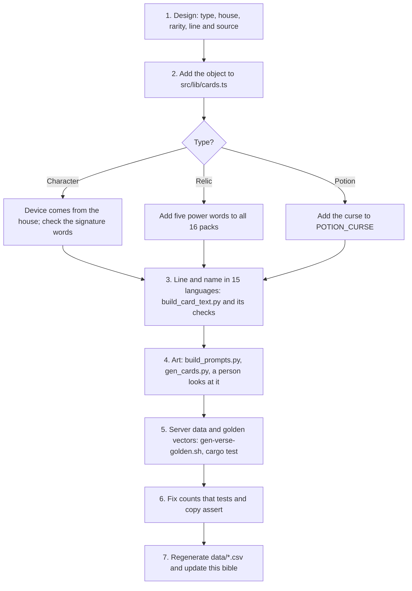

# Sonnet Man: content and card bible

- **Purpose:** the one reference for every card, house, form, device, curse and quotation in the game: what each one is, what it does in a duel, where its words come from, the rules new content must follow, and how to add a card.
- **Audience:** the team (David Charlot, Devon Glover, Arrocito del Diablo), writers, translators, card designers, artists and contractors who add or change content.
- **As of:** commit `0d6df6ef` on `integrate/wave3` (2026-11-18), plus the release branches `fix/judge-wording`, `fix/server-authority`, `fix/voice-g2p` and `fix/compliance` (2026-11-19).
- **Status:** Draft for the team, 2026-11-19.
- **Related documents:** `05-systems-economy-and-balance.md` (scoring maths and balance), `06-modes.md` (where content appears), `07-narrative-and-performer-bible.md` (world, voice, Devon Glover), `08-art-bible.md` (card art), `data/cards.csv`, `data/forms.csv`, `data/devices.csv`, `data/generate.mjs`, `sources/as-built-design.md`, `sources/as-built-tech.md`, `research/sota-design-2026-11.md`, `research/sota-production-2026-11.md`, `17-operations-runbook-and-launch-checklist.md`; also `00-README.md` (index), `28-owner-decisions.md`.

**How to read the labels.** *As built* means the code at `0d6df6ef` does it; the citation is a section of `sources/as-built-design.md` (written "design §2") or a `path:line`. *In this release* names the branch that will change it. *Proposed* is a recommendation, with the research that supports it. Where something is not known, the text says "Not known" and the question is in the closing list.

---

## 1. The point of a card: it is a writing rule

As built, a card does nothing by itself. It changes what the player must write, and code checks whether the verse did it (design §1.3, §1.5). This is the game's central content idea, and every new card should keep it.

- A **Character** card carries its house's **device** (a rule such as "end a line with a question mark") and its own **signature** (echo words from the character's famous line). Landing them multiplies the verse's form points.
- A **Relic** card lends five **power words**. Using two of them adds 6 craft.
- A **Potion** card casts a **curse** on the opponent's next verse (for example "no word longer than six letters"). Each breach costs the opponent 4 craft, at most 12.
- A **Form** is not a card. It is the shape every verse in a round must take (couplet, haiku, acrostic). The seed draws three per match.

Jargon in one line each:
- **Craft**: the points code gives a verse for keeping the form and landing its cards.
- **Judge**: 24 points a round shared between the two verses on wordplay, allusion, flow and wit.
- **Seed**: a number that fixes every random draw of a match, so the same seed and deck draw the same forms.
- **Telling word**: a word of four letters or more that is not a stop word ("the", "and").
- **Ink**: the duel's budget for relics and potions: 2 at the start, +1 a round, 1 per item.

The scoring maths, with worked examples, is in `05-systems-economy-and-balance.md`.

## 2. The catalogue at a glance

As built (design §2; regenerated in `data/cards.csv`):

| Count | Value |
|---|---|
| Cards | 71: 53 Characters, 9 Relics, 9 Potions |
| By rarity | Common 9, Uncommon 21, Rare 25, Epic 13, Legendary 3 |
| Legendary cards | The Sonnet Man (SM-001), Prospero's Staff (RL-002), Zeus (OL-001) |
| By era | 51 Shakespeare, 10 Romantic and Victorian poets, 10 Greek myth |
| Character houses | 14: 13 houses plus "Legendary", which holds only The Sonnet Man |
| Verse forms | 12; 9 in an English duel |
| Card devices | 13 |
| Curses | 4 |
| Art | 71 paintings, one per card; every file exists (`image_exists` in `data/cards.csv`) |

**What rarity does.** Only two things: the odds of drawing the card and the fanfare when it is won (design §2). Draw weights are Common 50, Uncommon 30, Rare 15, Epic 4, Legendary 1. Per card (derived, column `draw_chance_per_card`): each Common 5.56%, each Uncommon 1.43%, each Rare 0.60%, each Epic 0.31%, each Legendary 0.33%. A given Legendary is slightly likelier than a given Epic. Rarity does not make a card stronger in a duel.

**The starter deck.** A player with no saved deck duels with The Sonnet Man, Romeo and Juliet, Yorick's Skull and the Love Potion: the first cards of each type in the catalogue (`in_starter_deck`; `src/lib/verse/duel.ts:287-295`). Online, anyone may field the first three characters (`online_starter`). So the one Legendary character is in every new player's hand (design §10 item 6).

## 3. Anatomy of a card

Every card is one object in `src/lib/cards.ts`, "the single source of truth for card data across all pages" (`src/lib/cards.ts:1-4`). `data/cards.csv` holds every field, one row per card.

| Field | Example (SM-001) | Plays a part in a duel? | Where else it is used |
|---|---|---|---|
| `id` | SM-001 | Yes: keys the device, curse and power words | Inventory, decks, online deck check, art file name |
| `name` | The Sonnet Man | Yes: the Invocation device and the rule judge's allusion list count character names | Card face, story, opponent prompt ("You are {name}…") |
| `house` | Legendary | Yes: decides the device, and house synergy (2+ of a house in the deck) | Collection filters, art tradition |
| `type` | Character | Yes: Character, Relic or Potion | Deck rules |
| `rarity` | Legendary | No: draw odds and fanfare only | Collection colours |
| `era` | shakespeare | No | Labels "Shakespeare", "Romantic Poets", "Greek Mythology" |
| `atk`, `def`, `hp` | 95, 80, 100 | **No.** Nothing in the verse engine reads them | Printed on the card and the home page (design §1.3) |
| `element` | Fire | No | Printed on the card |
| `quote` | Shall I compare thee to a summer's day? | Yes: its telling words are the signature, and feed the allusion list | Card face, opponent prompt ("Your line in the play") |
| `scene` | "A grand stage materializes…" | No | Collection modal; the base of the art prompt |
| `image` | /images/cards/sm-001.webp | No | Card face |
| `icon`, `gradient`, `border` | ⚔, gold to crimson | No | Fallback icon and card colours |

Two facts a designer must know:
- **The numbers on the card do nothing.** ATK, DEF and HP are shown on every character and are never read by a duel. The only code that reads `atk` is draft mode, which no page imports (design §1.3, §4.11). Proposed: either remove them from the card face or give them a meaning the verse can feel (for example, HP as the number of lines the character can sustain). Until then they mislead players (design §10 item 5).
- **A relic's words and a potion's curse are not in `cards.ts`.** Power words live in each language pack (`src/lib/verse/packs/<lang>.ts`, `relics`); the potion-to-curse table is `POTION_CURSE` (`src/lib/verse/devices.ts:424-434`).

## 4. The houses

As built (design §6.2; `src/lib/verse/devices.ts:201-216`; `src/lib/verse/english.ts:22-29,128-137`; `scripts/art/build_prompts.py:16-33`). Every character of a house fights with the house's device. What tells two characters of a house apart in play is only their signature words.

| House | Characters | Drawn from | Device | Why line (shown to the player) | Art tradition |
|---|---|---|---|---|---|
| Legendary | 1: The Sonnet Man | the game's own | One Rhyme | "The Sonnet Man rides one rhyme all the way down." | contemporary street-art mural |
| Montague | 4 | Romeo and Juliet | Inner Rhyme | "Mercutio's quick tongue rhymes mid-line." | Italian Renaissance fresco |
| Capulet | 3 | Romeo and Juliet | The Outcry | "O Romeo, Romeo!" | Art Nouveau poster |
| Verona Court | 4 | Romeo and Juliet | The Riposte | "The court weighs every word said against you." | Ethiopian Orthodox icon |
| Danish Court | 4 | Hamlet | The Question | "To be, or not to be, that is the question." | German Expressionist woodcut |
| Forest of Arden | 4 | A Midsummer Night's Dream (name from As You Like It) | Alliteration | "Whereat, with blade, with bloody blameful blade." | Haitian painting |
| The Tempest | 4 | The Tempest | The Swell | "The storm builds until it breaks." | Japanese ukiyo-e |
| Scottish Court | 3 | Macbeth | The Drumbeat | "Tomorrow, and tomorrow, and tomorrow." | Celtic illuminated manuscript |
| Illyria | 3 | Twelfth Night | Brevity | "Brevity is the soul of wit." | Persian miniature |
| Rome | 3 | Julius Caesar | Invocation | "Friends, Romans, countrymen." | Mexican muralism |
| Lake District | 5 | Romantic and Victorian poets | Balance | "The Romantics measured every line." | Chinese shan shui ink wash |
| Gothic Circle | 5 | Romantic and Gothic writers | The Ring | "The tale ends where it began." | Russian lacquer miniature |
| Olympus | 7 | Greek myth | Grandeur | "The gods speak in thunderous words." | Greek red-figure vase |
| Underworld | 3 | Greek myth | The Riposte | "The dead remember everything you said." | ancient Egyptian tomb painting |
| Relic (not a house) | 9 objects | Shakespeare's plays | none: power words | none | Mughal miniature |
| Potion (not a house) | 9 objects | Shakespeare's plays | none: curses | none | West African textile |

Known mismatches (design §6.2):
- **Forest of Arden** is As You Like It's forest, but all four of its characters, and its why line, are from A Midsummer Night's Dream. The home page links the house to As You Like It (`src/pages/index.astro:23`).
- **Illyria's** why line, "Brevity is the soul of wit", is from Hamlet, not Twelfth Night.
- **Lake District** holds two Victorian poets, Elizabeth Barrett Browning and Christina Rossetti, beside the Romantics.
- **Legendary** has one character, so The Sonnet Man can never earn house synergy (derived from the synergy rule, design §1.3).
- **The home page shows four houses** (Montague, Capulet, Danish Court, Forest of Arden) and promises "Each house draws from a different Shakespeare play" (`src/i18n/pages/home/en.ts:30`). Five of the fourteen houses are not Shakespeare's (Lake District, Gothic Circle, Olympus, Underworld, and Legendary, which is the game's own), and even the four shown are not from four plays: Montague and Capulet are both from Romeo and Juliet.

An unused layer exists: `src/lib/house-allegiance.ts` gives nine Shakespeare houses a motto, colour and a +1 or +2 "bonus". No page imports it, and two of its axes ("Depth", "Creativity") are not judge criteria (design §4.11). Treat it as dead code, not canon.

## 5. Every card and what it does in a duel

Summarised from `data/cards.csv`. The source of each line is from `docs/language/NAMES-AND-QUOTATIONS.md` ("Card by card"). "Echo N of […]" means the verse must use N of those words from the card's English line, without reciting four of the line's words in a row (`src/lib/verse/devices.ts:295-360`). A duel in another language also accepts the line as that language prints it (`src/lib/verse/echo.ts`).

### 5.1 Characters, by house

#### Legendary: One Rhyme (1 character)

Device: *End every line on the same rhyme.* Why: The Sonnet Man rides one rhyme all the way down. Where rhyme cannot be checked (Chinese, Japanese, Thai without their sound data) it becomes The Ring.

| Id | Name | Rarity | Signature | Card line | Source | Story opponent |
|---|---|---|---|---|---|---|
| SM-001 | The Sonnet Man | Legendary | echo 1 of compare, summer | Shall I compare thee to a summer's day? | Shakespeare, Sonnet 18, line 1 | 5-3 The Final Bow (hard) |

#### Montague: Inner Rhyme (4 characters)

Device: *Rhyme two words inside a single line.* Why: Mercutio's quick tongue rhymes mid-line. Where rhyme cannot be checked (Chinese, Japanese, Thai without their sound data) it becomes The Drumbeat.

| Id | Name | Rarity | Signature | Card line | Source | Story opponent |
|---|---|---|---|---|---|---|
| MO-001 | Romeo | Rare | echo 2 of soft, light, yonder, window, breaks | But soft, what light through yonder window breaks? | Romeo and Juliet 2.2 | — |
| MO-002 | Mercutio | Rare | echo 1 of plague, houses | A plague on both your houses! | Romeo and Juliet 3.1 | 1-3 Mercutio's Challenge (medium) |
| MO-003 | Benvolio | Common | echo 2 of keep, peace, sword | I do but keep the peace. Put up thy sword. | Romeo and Juliet 1.1 | — |
| MO-004 | Lord Montague | Common | echo 2 of morning, seen, tears, augmenting, fresh | Many a morning hath he there been seen, with tears augmenting the fresh morning dew. | Romeo and Juliet 1.1 | — |

#### Capulet: The Outcry (3 characters)

Device: *Cry out: end a line with an exclamation mark.* Why: "O Romeo, Romeo!"

| Id | Name | Rarity | Signature | Card line | Source | Story opponent |
|---|---|---|---|---|---|---|
| CA-001 | Juliet | Rare | echo 2 of name, call, rose | What's in a name? That which we call a rose... | Romeo and Juliet 2.2 | — |
| CA-002 | Tybalt | Rare | echo 2 of drawn, talk, peace, hate, word | What, drawn, and talk of peace? I hate the word. | Romeo and Juliet 1.1 | 1-1 Street Brawl (easy) |
| CA-003 | Lady Capulet | Uncommon | echo 2 of marry, theme, talk | Marry, that marry is the very theme I came to talk of. | Romeo and Juliet 1.3 | — |

#### Verona Court: The Riposte (4 characters)

Device: *Turn a word of 5 letters or more from your opponent's last verse back on them.* Why: The court weighs every word said against you. In a verse that opens a round it is held to The Outcry; in a solo duel only the opponent opens, so the player always has a verse to answer.

| Id | Name | Rarity | Signature | Card line | Source | Story opponent |
|---|---|---|---|---|---|---|
| VC-001 | Prince Escalus | Epic | echo 2 of disturb, streets, lives, forfeit, peace | If ever you disturb our streets again, your lives shall pay the forfeit of the peace. | Romeo and Juliet 1.1 | 1-4 The Prince's Judgment (medium) |
| VC-002 | Friar Lawrence | Uncommon | echo 2 of violent, delights, ends | These violent delights have violent ends. | Romeo and Juliet 2.6 | — |
| VC-003 | The Nurse | Common | echo 2 of drudge, toil, delight | I am the drudge and toil in your delight. | Romeo and Juliet 2.5 | 1-2 The Nurse's Riddle (easy) |
| VC-004 | Paris | Uncommon | echo 2 of times, afford, time | These times of woe afford no time to woo. | Romeo and Juliet 3.4 | — |

#### Danish Court: The Question (4 characters)

Device: *Ask a question: end a line with a question mark.* Why: "To be, or not to be, that is the question."

| Id | Name | Rarity | Signature | Card line | Source | Story opponent |
|---|---|---|---|---|---|---|
| DC-001 | Hamlet | Epic | echo 1 of question | To be, or not to be, that is the question. | Hamlet 3.1 | 2-4 Hamlet's Soliloquy (hard) |
| DC-002 | Ophelia | Rare | echo 1 of rosemary, remembrance | There's rosemary, that's for remembrance. | Hamlet 4.5 | 2-2 Ophelia's Garden (easy) |
| DC-003 | King Claudius | Rare | echo 2 of words, thoughts, remain, below | My words fly up, my thoughts remain below. | Hamlet 3.3 | 2-1 The Ghost's Warning (medium); 2-3 The Mousetrap (hard) |
| DC-004 | Horatio | Uncommon | echo 2 of cracks, noble, heart, good, night, sweet, prince | Now cracks a noble heart. Good night, sweet prince. | Hamlet 5.2 | — |

#### Forest of Arden: Alliteration (4 characters)

Device: *Start three words in one line with the same letter.* Why: "Whereat, with blade, with bloody blameful blade."

| Id | Name | Rarity | Signature | Card line | Source | Story opponent |
|---|---|---|---|---|---|---|
| FA-001 | Puck | Uncommon | echo 1 of fools, mortals | Lord, what fools these mortals be! | A Midsummer Night's Dream 3.2 | 3-1 Puck's Pranks (easy) |
| FA-002 | Titania | Epic | echo 1 of flowery | Come, sit thee down upon this flowery bed. | A Midsummer Night's Dream 4.1 | 3-3 Titania's Court (medium) |
| FA-003 | Oberon | Epic | echo 2 of moonlight, proud, titania | Ill met by moonlight, proud Titania. | A Midsummer Night's Dream 2.1 | 3-4 Oberon's Trial (hard) |
| FA-004 | Bottom | Common | echo 2 of rare, vision, dream, past | I have had a most rare vision. I have had a dream, past the wit of man. | A Midsummer Night's Dream 4.1 | 3-2 Bottom's Dream (medium) |

#### The Tempest: The Swell (4 characters)

Device: *Make your last line your longest.* Why: The storm builds until it breaks.

| Id | Name | Rarity | Signature | Card line | Source | Story opponent |
|---|---|---|---|---|---|---|
| TP-001 | Prospero | Epic | echo 1 of stuff, dreams | We are such stuff as dreams are made on. | The Tempest 4.1 | 4-4 Prospero's Final Test (hard) |
| TP-002 | Ariel | Rare | echo 2 of hail, great, master, grave | All hail, great master! Grave sir, hail! | The Tempest 1.2 | 4-2 Ariel's Song (medium) |
| TP-003 | Caliban | Uncommon | echo 2 of island, sycorax, mother | This island's mine, by Sycorax my mother. | The Tempest 1.2 | 4-1 Caliban's Rage (medium) |
| TP-004 | Miranda | Uncommon | echo 2 of brave, world, people | O brave new world, that has such people in it! | The Tempest 5.1 | 4-3 Miranda's Wonder (easy) |

#### Scottish Court: The Drumbeat (3 characters)

Device: *Repeat one strong word three times.* Why: "Tomorrow, and tomorrow, and tomorrow."

| Id | Name | Rarity | Signature | Card line | Source | Story opponent |
|---|---|---|---|---|---|---|
| SC-001 | Macbeth | Epic | echo 2 of dare, become, dares | I dare do all that may become a man; who dares do more is none. | Macbeth 1.7 | 5-1 The Scottish King (hard) |
| SC-002 | Lady Macbeth | Rare | echo 2 of spirits, tend, mortal, thoughts, unsex | Come, you spirits that tend on mortal thoughts, unsex me here. | Macbeth 1.5 | — |
| SC-003 | Banquo | Uncommon | echo 1 of kings | Thou shalt get kings, though thou be none. | Macbeth 1.3 | — |

#### Illyria: Brevity (3 characters)

Device: *Keep every line to 6 words or fewer.* Why: "Brevity is the soul of wit."

| Id | Name | Rarity | Signature | Card line | Source | Story opponent |
|---|---|---|---|---|---|---|
| IL-001 | Viola | Rare | echo 1 of not what | I am not what I am. | Twelfth Night 3.1 | — |
| IL-002 | Malvolio | Uncommon | echo 2 of born, great, achieve, greatness, thrust | Some are born great, some achieve greatness, and some have greatness thrust upon them. | Twelfth Night 2.5 | — |
| IL-003 | Olivia | Rare | echo 2 of love, sought, good, given, unsought, better | Love sought is good, but given unsought, is better. | Twelfth Night 3.1 | — |

#### Rome: Invocation (3 characters)

Device: *Call on a character by name.* Why: "Friends, Romans, countrymen."

| Id | Name | Rarity | Signature | Card line | Source | Story opponent |
|---|---|---|---|---|---|---|
| RM-001 | Brutus | Epic | echo 2 of loved, caesar, less, rome | Not that I loved Caesar less, but that I loved Rome more. | Julius Caesar 3.2 | 5-2 Rome's Betrayal (hard) |
| RM-002 | Cassius | Rare | echo 2 of fault, dear, brutus, stars, ourselves | The fault, dear Brutus, is not in our stars, but in ourselves. | Julius Caesar 1.2 | — |
| RM-003 | Mark Antony | Epic | echo 2 of friends, romans, countrymen, lend, ears | Friends, Romans, countrymen, lend me your ears! | Julius Caesar 3.2 | — |

#### Lake District: Balance (5 characters)

Device: *Give every line the same number of words.* Why: The Romantics measured every line.

| Id | Name | Rarity | Signature | Card line | Source | Story opponent |
|---|---|---|---|---|---|---|
| LD-001 | William Wordsworth | Uncommon | echo 2 of wandered, lonely, cloud, floats, high, vales, hills | I wandered lonely as a cloud that floats on high o'er vales and hills. | Wordsworth, "I Wandered Lonely as a Cloud", lines 1-2 | — |
| LD-002 | Samuel Coleridge | Uncommon | echo 2 of water, drop, drink | Water, water, every where, nor any drop to drink. | Coleridge, The Rime of the Ancient Mariner, Part II | — |
| LD-003 | John Keats | Rare | echo 2 of beauty, loveliness, increases | A thing of beauty is a joy for ever: its loveliness increases. | Keats, Endymion, Book I, lines 1-2 | — |
| LD-004 | Elizabeth Barrett Browning | Uncommon | echo 2 of love, count, ways | How do I love thee? Let me count the ways. | E. B. Browning, Sonnets from the Portuguese 43, line 1 | — |
| LD-005 | Christina Rossetti | Common | echo 2 of remember, gone, away, silent, land | Remember me when I am gone away, gone far away into the silent land. | C. Rossetti, "Remember", lines 1-2 | — |

#### Gothic Circle: The Ring (5 characters)

Device: *End your verse on the same word it began with.* Why: The tale ends where it began.

| Id | Name | Rarity | Signature | Card line | Source | Story opponent |
|---|---|---|---|---|---|---|
| GC-001 | Lord Byron | Rare | echo 2 of walks, beauty, night, cloudless, climes, starry, skies | She walks in beauty, like the night of cloudless climes and starry skies. | Byron, "She Walks in Beauty", lines 1-2 | — |
| GC-002 | Mary Shelley | Epic | echo 2 of beware, fearless, therefore, powerful | Beware; for I am fearless, and therefore powerful. | Mary Shelley, Frankenstein, chapter 20 | — |
| GC-003 | Edgar Allan Poe | Rare | echo 2 of midnight, dreary, pondered, weak, weary | Once upon a midnight dreary, while I pondered, weak and weary. | Poe, "The Raven", line 1 | — |
| GC-004 | William Blake | Rare | echo 2 of world, grain, sand, heaven, wild, flower | To see a World in a Grain of Sand and a Heaven in a Wild Flower. | Blake, "Auguries of Innocence", lines 1-2 | — |
| GC-005 | Percy Bysshe Shelley | Epic | echo 2 of winter, spring, behind | If Winter comes, can Spring be far behind? | P. B. Shelley, "Ode to the West Wind", last line | — |

#### Olympus: Grandeur (7 characters)

Device: *Use two words of 9 letters or more.* Why: The gods speak in thunderous words.

| Id | Name | Rarity | Signature | Card line | Source | Story opponent |
|---|---|---|---|---|---|---|
| OL-001 | Zeus | Legendary | echo 2 of cloud, gatherer, wide, heavens | I am the cloud-gatherer, lord of the wide heavens. | the game's own line (Zeus's Homeric epithet, cloud-gatherer) | — |
| OL-002 | Athena | Epic | echo 2 of wisdom, flight, dusk | The owl of wisdom takes flight only at dusk. | the game's own line (after Hegel's owl of Minerva) | — |
| OL-003 | Apollo | Uncommon | echo 2 of song, healing, radiant | I am the god of song, of healing, and of the radiant sun. | the game's own line | — |
| OL-004 | Aphrodite | Uncommon | echo 2 of gods, resist, power, love | Even the gods cannot resist the power of love. | the game's own line | — |
| OL-005 | Hermes | Uncommon | echo 2 of swift, thought, carry, words, gods, mortal, ears | Swift as thought, I carry the words of gods to mortal ears. | the game's own line | — |
| OL-006 | Odysseus | Rare | echo 2 of tell, muse, ways, wandered | Tell me, O Muse, of the man of many ways, who wandered far. | the game's own paraphrase of Odyssey 1.1 | — |
| OL-007 | Achilles | Rare | echo 2 of rather, live, short, life, glory, long, forgotten | I would rather live a short life of glory than a long life forgotten. | the game's own paraphrase of Iliad 9.410-416 | — |

#### Underworld: The Riposte (3 characters)

Device: *Turn a word of 5 letters or more from your opponent's last verse back on them.* Why: The dead remember everything you said. In a verse that opens a round it is held to The Outcry; in a solo duel only the opponent opens, so the player always has a verse to answer.

| Id | Name | Rarity | Signature | Card line | Source | Story opponent |
|---|---|---|---|---|---|---|
| UW-001 | Hades | Rare | echo 1 of souls, patient | All souls come to me in the end. I am patient. | the game's own line | — |
| UW-002 | Persephone | Epic | echo 2 of seeds, bound, myself, worlds, forever | Six seeds I ate, and bound myself between two worlds forever. | the game's own line | — |
| UW-003 | Medusa | Rare | echo 2 of dare, gaze, last | Look upon me, if you dare. My gaze is the last thing you will see. | the game's own line | — |

### 5.2 Relics: power words

Each relic costs 1 ink and can be played once a match. It lends its five power words for the verse it is played with; using two of them adds 6 craft before the multiplier (`src/lib/verse/devices.ts:439-478`). English asks for the exact word. Other languages accept a word that begins with the power word (or with all but its last letter, for a power word of four letters or more); Arabic accepts it anywhere inside a word; Chinese, Japanese and Thai anywhere in the line (design §1.5). Every relic's words in all 16 languages are in `data/cards.csv` (columns `relic_power_words_<lang>`).

| Id | Name | Rarity | Power words (English) | Card line | Source |
|---|---|---|---|---|---|
| RL-001 | Yorick's Skull | Rare | skull, jest, grave, laugh, dust | Alas, poor Yorick! I knew him, Horatio. | Hamlet 5.1 |
| RL-002 | Prospero's Staff | Legendary | storm, spell, staff, island, drown | Now my charms are all o'erthrown. | The Tempest, Epilogue |
| RL-003 | Dagger of the Mind | Uncommon | dagger, blood, sleep, vision, hand | Is this a dagger which I see before me? | Macbeth 2.1 |
| RL-004 | Romeo's Ring | Rare | ring, vow, night, banished, kiss | My bounty is as boundless as the sea, my love as deep. | Romeo and Juliet 2.2 |
| RL-005 | Portia's Casket | Uncommon | gold, choice, mercy, lead, casket | All that glisters is not gold. | The Merchant of Venice 2.7 |
| RL-006 | Macbeth's Crown | Epic | crown, throne, ambition, witch, king | Uneasy lies the head that wears a crown. | Henry IV, Part 2 3.1 |
| RL-007 | The Tempest Codex | Rare | book, tempest, magic, page, drown | I'll drown my book. | The Tempest 5.1 |
| RL-008 | Cordelia's Tears | Rare | tears, truth, daughter, nothing, heart | O dear father, it is thy business that I go about. | King Lear 4.4 |
| RL-009 | Bottom's Mask | Uncommon | mask, dream, fool, play, moon | Bless thee, Bottom! Thou art translated! | A Midsummer Night's Dream 3.1 |

### 5.3 Potions: curses

Each potion costs 1 ink, can be played once a match and never in the last round. It curses the opponent's **next** verse, because the opponent has already written this round's (design §1.2). Each breach costs 4 craft, at most 12 (`src/lib/verse/devices.ts:419-421`).

| Id | Name | Rarity | Curse it casts | Rule for the cursed verse (English) | Card line | Source |
|---|---|---|---|---|---|---|
| PT-001 | Love Potion | Common | No Echoes | They may not use any word of 4 letters or more twice. | The course of true love never did run smooth. | A Midsummer Night's Dream 1.1 |
| PT-002 | Witches' Brew | Uncommon | Forbidden Letter | Their verse may not contain the letter the duel draws (en: s, t, r, n, o or i). | Double, double toil and trouble. | Macbeth 4.1 |
| PT-003 | Puck's Flower Juice | Common | Short Breath | No line of theirs may be longer than 5 words. | I'll put a girdle round about the earth in forty minutes. | A Midsummer Night's Dream 2.1 |
| PT-004 | Mandrake Root | Common | Tongue-Tied | No word of theirs may be longer than 6 letters. | Not poppy, nor mandragora, nor all the drowsy syrups of the world. | Othello 3.3 |
| PT-005 | Oberon's Dew | Rare | No Echoes | They may not use any word of 4 letters or more twice. | Fetch me that flower; the herb I showed thee once. | A Midsummer Night's Dream 2.1 |
| PT-006 | Hemlock Tincture | Uncommon | Forbidden Letter | Their verse may not contain the letter the duel draws (en: s, t, r, n, o or i). | Upon my secure hour thy uncle stole, with juice of cursed hebona in a vial. | Hamlet 1.5 |
| PT-007 | Mistletoe Extract | Common | Short Breath | No line of theirs may be longer than 5 words. | In the cauldron boil and bake; eye of newt and toe of frog. | Macbeth 4.1 |
| PT-008 | Mermaid's Tears | Rare | Tongue-Tied | No word of theirs may be longer than 6 letters. | Full fathom five thy father lies; of his bones are coral made. | The Tempest 1.2 |
| PT-009 | Apothecary's Elixir | Uncommon | Forbidden Letter | Their verse may not contain the letter the duel draws (en: s, t, r, n, o or i). | Put this in any liquid thing you will, and drink it off; and, if you had the strength of twenty men, it would dispatch you straight. | Romeo and Juliet 5.1 |

## 6. Verse forms

As built: whether a verse keeps a form is decided by code, never by a model, and a near miss earns partial credit (`src/lib/verse/forms.ts:1-6`). Every form is worth 20 points in full. A verse that is too thin (a line with no word, fewer different words than lines, half its lines repeats, or under 60% words of its language) earns nothing (design §1.3). Regenerated in `data/forms.csv`.

| Id | English name | Brief shown to the player | Lines | Requirements (points) | Offered with sound data | Offered without sound data | English written-opponent verses |
|---|---|---|---|---|---|---|---|
| couplet | Couplet | Two lines that rhyme. | 2 | Exactly 2 lines (6); Lines 1 and 2 rhyme (14) | all 16 | all but zh, ja, th | 3 (+3 spare) |
| quatrain-aabb | Paired Quatrain | Four lines: the first two rhyme, and the last two rhyme. | 4 | Exactly 4 lines (6); Lines 1 and 2 rhyme (7); Lines 3 and 4 rhyme (7) | all 16 | all but zh, ja, th | 2 (+2 spare) |
| quatrain-abab | Crossed Quatrain | Four lines: line 1 rhymes with 3, line 2 with 4. | 4 | Exactly 4 lines (6); Lines 1 and 3 rhyme (7); Lines 2 and 4 rhyme (7) | all 16 | all but zh, ja, th | 2 (+2 spare) |
| tercet | Tercet | Three lines; the first and last rhyme. | 3 | Exactly 3 lines (6); Lines 1 and 3 rhyme (14) | all 16 | all but zh, ja, th | 2 (+2 spare) |
| anaphora | Anaphora | Three lines that all begin with the same word. | 3 | Exactly 3 lines (6); Every line opens with the same word (14) | all 16 | all 16 | 2 (+2 spare) |
| acrostic | Acrostic | One line per letter: the first letters must spell BARD. | one per letter of the drawn word | Exactly 4 lines (6); First letters spell BARD (14) | all 16 | all 16 | 36 acrostic lines |
| crescendo | Crescendo | Three lines, each longer than the one before. | 3 | Exactly 3 lines (6); Each line has more words than the last (14) | all 16 | all 16 | 2 (+2 spare) |
| epistrophe | Epistrophe | Three lines that all end on the same word. | 3 | Exactly 3 lines (6); Every line ends on the same word (14) | all but en | all but en | 0 |
| haiku | Haiku | Three lines of 5, 7 and 5 syllables. | 3 | Exactly 3 lines (5); Line 1: 5 syllables (5); Line 2: 7 syllables (5); Line 3: 5 syllables (5) | all but ar, th | all but ar, th | 2 (+2 spare) |
| heroic-couplet | Heroic Couplet | Two rhyming lines of about ten syllables each, as Shakespeare closed his sonnets. | 2 | Exactly 2 lines (4); Lines 1 and 2 rhyme (8); Line 1: about 10 syllables (4); Line 2: about 10 syllables (4) | all but ar, th | all but ar, zh, ja, th | 2 (+2 spare) |
| jueju | Jueju | Four lines, all of five characters or all of seven, the shape of a classical quatrain. | 4 | Exactly 4 lines (6); Every line has five characters, or every line has seven (14) | zh | zh | 0 |
| luc-bat | Lục Bát | A line of six syllables, then one of eight whose sixth syllable rhymes with the end of the first. | 2 | Exactly 2 lines (4); Line 1: 6 syllables (4); Line 2: 8 syllables (4); The sixth syllable of each line rhymes (8) | vi | vi | 0 |

Notes:
- "Offered with sound data" is the normal case: before a duel in Chinese, Japanese or Thai starts, the battle page loads that language's sound data, which makes rhyme checkable (`src/pages/battle.astro:1027`). "Without sound data" is what a duel falls back to if that data fails to load.
- **Epistrophe is kept out of English on purpose**, "so that an English duel draws from exactly the forms it always has" (`src/lib/verse/forms.ts:268-279`).
- **Thai has no syllable forms** because "the table covers too little of free Thai text"; Arabic has none because short vowels are not written (`src/lib/verse/text.ts:488-504`).
- The acrostic row shows the word BARD as an example. The English words an acrostic can ask for are bard, moon, king, rose, fate, wit, play and star (`src/lib/verse/packs/en.ts:5`); each pack has its own.

## 7. Devices, curses and their thresholds

As built (design §1.5; regenerated in `data/devices.csv`).

### 7.1 Card devices

| Id | Name | Rule (English) | Houses | Cards | Note |
|---|---|---|---|---|---|
| question | The Question | Ask a question: end a line with a question mark. | Danish Court | 4 |  |
| exclaim | The Outcry | Cry out: end a line with an exclamation mark. | Capulet | 3 | Also what a Riposte house is held to in a verse that opens a round (OPENING_DEVICE); in a solo duel only the opponent opens. |
| alliteration | Alliteration | Start three words in one line with the same letter. | Forest of Arden | 4 | Three different words of the line, none a stop word, sharing an initial; threshold = shortest word counted. |
| repetition | The Drumbeat | Repeat one strong word three times. | Scottish Court | 3 | One word, not a stop word, three times; threshold = shortest word counted. |
| internal-rhyme | Inner Rhyme | Rhyme two words inside a single line. | Montague | 4 | Two words inside one line rhyme; threshold = shortest word counted. Becomes The Drumbeat where rhyme cannot be checked. |
| riposte | The Riposte | Turn a word of 5 letters or more from your opponent's last verse back on them. | Verona Court, Underworld | 7 | Cannot land in a verse that opens a round: such a verse is held to The Outcry. |
| brevity | Brevity | Keep every line to 6 words or fewer. | Illyria | 3 |  |
| swell | The Swell | Make your last line your longest. | The Tempest | 4 | Two lines or more; the last strictly the longest. |
| balance | Balance | Give every line the same number of words. | Lake District | 5 | Two lines or more, all the same length. |
| ring | The Ring | End your verse on the same word it began with. | Gothic Circle | 5 | First unit of the first line equals the last unit of the last line, in a verse of more than two units. |
| invocation | Invocation | Call on a character by name. | Rome | 3 | Counts the full name of any catalogue character, or its last part when that is not an ordinary word, or the name as the duel language writes it. |
| grandeur | Grandeur | Use two words of 9 letters or more. | Olympus | 7 |  |
| monorhyme | One Rhyme | End every line on the same rhyme. | Legendary | 1 | Every line ends on a rhyme of the first line; two lines or more. Becomes The Ring where rhyme cannot be checked. |

Every device adds +0.5 to the craft multiplier when it lands, or +0.75 when the deck holds two or more characters of the card's house (design §1.3). A void verse (empty, thin or copied) lands nothing.

### 7.2 Curses

| Id | Name | Rule for the cursed verse (English) | Potions | Effect |
|---|---|---|---|---|
| forbidden-letter | Forbidden Letter | Their verse may not contain the drawn letter. | PT-002, PT-006, PT-009 | -4 craft per breach, at most -12; binds the opponent's next verse |
| short-words | Tongue-Tied | No word of theirs may be longer than 6 letters. | PT-004, PT-008 | -4 craft per breach, at most -12; binds the opponent's next verse |
| no-repeats | No Echoes | They may not use any word of 4 letters or more twice. | PT-001, PT-005 | -4 craft per breach, at most -12; binds the opponent's next verse |
| short-lines | Short Breath | No line of theirs may be longer than 5 words. | PT-003, PT-007 | -4 craft per breach, at most -12; binds the opponent's next verse |

A Forbidden Letter curse draws its letter from the duel language's pack when the duel is dealt; look-alike letters of other alphabets, and digits that stand in for the letter, count as the letter (`src/lib/verse/devices.ts:378-389`).

### 7.3 Thresholds per language

"Long" and "short" differ by language, because words differ in length (`src/lib/verse/lang.ts:33-55`). The unit is a word, except in Chinese and Japanese, where it is a character.

| Check | en | es | fr | de | it | pt | pl | ru | ar | hi | zh | ja | ko | vi | th | id |
|---|---|---|---|---|---|---|---|---|---|---|---|---|---|---|---|---|
| Alliteration | 3 | 3 | 3 | 3 | 3 | 3 | 3 | 3 | 3 | 3 | 2 | 2 | 2 | 3 | 3 | 3 |
| The Drumbeat | 4 | 4 | 4 | 4 | 4 | 4 | 4 | 4 | 3 | 3 | 2 | 2 | 2 | 3 | 3 | 4 |
| The Riposte | 5 | 5 | 5 | 5 | 5 | 5 | 5 | 5 | 4 | 3 | 2 | 2 | 3 | 4 | 4 | 5 |
| Brevity | 6 w | 6 w | 6 w | 6 w | 6 w | 6 w | 6 w | 6 w | 5 w | 6 w | 7 ch | 12 ch | 4 w | 6 w | 7 w | 6 w |
| Grandeur | 9 | 10 | 10 | 12 | 10 | 10 | 10 | 10 | 7 | 5 | 3 | 4 | 5 | 6 | 7 | 10 |
| Tongue-Tied | 6 | 7 | 7 | 8 | 7 | 7 | 7 | 7 | 5 | 4 | 2 | 3 | 3 | 5 | 5 | 7 |
| No Echoes | 4 | 4 | 4 | 4 | 4 | 4 | 4 | 4 | 3 | 3 | 2 | 2 | 2 | 3 | 3 | 4 |
| Short Breath | 5 w | 5 w | 5 w | 5 w | 5 w | 5 w | 5 w | 5 w | 4 w | 5 w | 5 ch | 10 ch | 3 w | 5 w | 6 w | 5 w |
| Forbidden Letter | s t r n o i | s r n l d t | s t r n l u | s t r i a h | l r s t n c | s r t n d m | o r t k m w | н т с р л к | م ن ر ب ع د | म स ल त प ज | 的 不 我 你 是 人 | の に は て し な | 이 가 는 다 고 에 | t c m l đ u | ก ม ด ล ย ส | n r t k s i |

Numbers are letters (characters in Chinese and Japanese, Hangul blocks in Korean) unless marked w (words) or ch (characters). Alliteration and Inner Rhyme count words of at least that many letters; The Drumbeat and No Echoes a word of at least that many; The Riposte a thrown-back word of at least that many; Grandeur two words of at least that many; Tongue-Tied the longest word allowed; Brevity and Short Breath the longest line allowed. The Forbidden Letter row lists the letters a duel can draw.

## 8. Quotations and where they come from

### 8.1 The English line on each card

As built (design §6.4; `docs/language/NAMES-AND-QUOTATIONS.md`):
- **61 of the 71 English lines are cited to a published work**: 51 to Shakespeare's plays and Sonnet 18, and 10 to Wordsworth, Coleridge, Keats, Byron, Mary Shelley's *Frankenstein*, Poe, Blake, P. B. Shelley, E. B. Browning and C. Rossetti.
- **The 10 Olympus and Underworld lines are "the game's own line"**. Two are paraphrases (Odysseus: Odyssey 1.1; Achilles: Iliad 9.410-416), one is "after Hegel's owl of Minerva" (Athena), and one uses Zeus's Homeric epithet "cloud-gatherer". Who wrote them is not recorded (design §6.7).
- **Three objects carry a line from another play than their own**: Macbeth's Crown (Henry IV, Part 2, 3.1), Mandrake Root (Othello 3.3) and Mistletoe Extract (the witches' recipe, Macbeth 4.1).
- **The card face shows the line without its source** (`src/pages/index.astro:113`, `src/pages/collection.astro:531`). Sources are recorded only in `NAMES-AND-QUOTATIONS.md`, generated by `scripts/language/build_card_text.py`.

The game's own lines, as `cards.ts` holds them:

| Card | Line | Basis |
|---|---|---|
| OL-001 Zeus | I am the cloud-gatherer, lord of the wide heavens. | Homeric epithet |
| OL-002 Athena | The owl of wisdom takes flight only at dusk. | after Hegel's owl of Minerva |
| OL-003 Apollo | I am the god of song, of healing, and of the radiant sun. | the game's own |
| OL-004 Aphrodite | Even the gods cannot resist the power of love. | the game's own |
| OL-005 Hermes | Swift as thought, I carry the words of gods to mortal ears. | the game's own |
| OL-006 Odysseus | Tell me, O Muse, of the man of many ways, who wandered far. | paraphrase of Odyssey 1.1 |
| OL-007 Achilles | I would rather live a short life of glory than a long life forgotten. | paraphrase of Iliad 9.410-416 |
| UW-001 Hades | All souls come to me in the end. I am patient. | the game's own |
| UW-002 Persephone | Six seeds I ate, and bound myself between two worlds forever. | the game's own |
| UW-003 Medusa | Look upon me, if you dare. My gaze is the last thing you will see. | the game's own |

### 8.2 The line and the name in the other fifteen languages

As built (design §6.4; `docs/language/NAMES-AND-QUOTATIONS.md:97-104,136-139,472-488`):
- **A line is taken from a public-domain published translation** where one was found on Wikisource or Project Gutenberg. The translator must have died in 1955 or earlier, and a unit test checks it. Otherwise the line is marked "translated for the game, not reviewed".
- **Lines from a published translation, of 71:** French 51, Italian 51, German 50, Russian 34, Spanish 29, Polish 28, Japanese 13, Portuguese 6, and **0 in Arabic, Hindi, Chinese, Korean, Vietnamese, Thai and Indonesian**, where all 71 were written for the game.
- **Names** are Wikidata labels where they exist (CC0). The 9 relics, the 9 potions, Lord Montague, Lady Capulet, most house labels and every element label were translated for the game in every language.
- **Story narratives keep Shakespeare's own lines in English** in every language, and a test enforces it (`src/i18n/pages/story/en.ts:7-8`).
- **No line, name or scene in any language has been read by a native speaker** (tech §6.4). `docs/language/HUMAN-REVIEW.md` lists 28 questions for a reviewer.

### 8.3 Trivia, quote challenges and the written opponent's verses

As built:

| Content | Size | Source and review | Evidence |
|---|---|---|---|
| Shakespeare trivia | 200 questions: 50 easy, 75 medium, 75 hard; four options each, the correct one stored first and shuffled when asked | Shakespeare only: no question names a Romantic poet or a Greek figure. Translated into all 15 other languages "by a language model (Claude), in one pass per language", "Not verified by a native speaker" | design §6.8; `docs/language/CONTENT-PROVENANCE.md:15,17` |
| Quote challenges | 104 fill-in-the-blank lines: 30 easy, 37 medium, 37 hard, from 27 works (Hamlet 14, Romeo and Juliet 11, Julius Caesar 10) | A language plays its own only from lines with a published translation, and only with 8 or more: Italian 35, French 32, Spanish 31, Polish 31, German 27, Russian 22, Chinese 22, Japanese 10. The other seven languages play the English originals | design §6.4; `src/lib/play-content.ts:10-18` |
| Written opponent (English) | 17 verses over 8 forms, 17 "spare" verses for a cursed opponent, 36 acrostic lines (two for each of 18 opening letters) | Mock-Early-Modern trash talk ("Step up, poor player, strut thy little hour"), no hip-hop idiom. Authorship not recorded | design §6.7; `src/lib/verse/packs/en.ts:18-107` |
| Written opponent (other languages) | 14 to 20 verses each, 20 to 28 acrostic lines, no spare verses | Written by a language model and held to their form by code only | design §6.7; tech §6.4 |
| Model-written trivia | English only, when a model is loaded; never runs, since the playground loads no model | Not fact-checked | design §6.9 |

**The written opponent is content, and the players will read it more than any other text.** As built at `0d6df6ef` it is the only opponent on every phone and headset, and in Arabic, Japanese, Korean and Vietnamese on every device (design §1.6, §1.8). In this release (`integrate/wave3`, commit `ee2bf5ad` of 2026-11-19, which every release branch carries) Gemma 4 E2B also writes Vietnamese, measured at 35 of 110 plays keeping the form against a bar of 30%; Arabic, Japanese and Korean stay written-only. Measured for this document by running the game's scorer over every English written verse against every one of the 53 characters (901 pairings; rerun with `node docs/dossier/data/generate.mjs --examples`, described in `05-systems-economy-and-balance.md` §4): every written verse keeps its form in full (20 points), its device rarely lands, and its craft is 20 in the median case and at most 30.

### 8.4 World cards (city variants)

As built (design §6.6; `src/lib/variants.ts:90-397`). A variant is "a cosmetic skin for a base card that changes visual appearance and grants a passive city ability in battle". There are 20 cities. Each gives +2 when the judge awards the player that criterion. The framing is hip-hop and battle-rap culture (for example Brooklyn, "NYC roast culture, battle rap birthplace"), the main place the brief's hip-hop side lives in the data.

| Criterion | Cities ("ability") |
|---|---|
| wordplay | Tokyo "Neon Precision", Paris "Haute Verse", Mexico City "Corrido Craft", Johannesburg "Jozi Bars" |
| flow | Lagos "Afrobeat Flow", Mumbai "Bollywood Rhythm", Seoul "K-Wave Cadence", Manila "FlipTop Flow", Toronto "Six Flow", Kingston "Dancehall Rhythm" |
| wit | Brooklyn "Borough Boss", Sao Paulo "Favela Fire", Berlin "Cabaret Edge", Accra "Highlife Humor", Sydney "Harbour Hustle", Osaka "Kansai Comedy" |
| allusion ("shakespeare") | London "Bard's Home Turf", Nairobi "Storyteller's Gift", Cairo "Scribe's Wisdom", Istanbul "Crossroads Verse" |

Each variant also has one of 4 attires, 4 hairstyles and 6 skin tones per city (1,920 per character, derived). The 198 variant images in `public/images/variants/` are orphaned (no page shows them), in an older photoreal style, and 27 use city codes the catalogue no longer has (design §7.2).

## 9. Content rules

### 9.1 Rules the code and pipeline already enforce (as built)

- **A form or device must be checkable by code.** No model decides whether a verse keeps a form (`src/lib/verse/forms.ts:2-3`). A device that cannot be checked in a language is replaced there by one that can ("so no card is left with a flourish that can never land", `src/lib/verse/devices.ts:218-228`).
- **Names come from Wikidata; translated lines from public-domain published translations, or are marked as the game's own** (§8.2).
- **Generated language data pins its source by sha256** and the build refuses a different file (`CLAUDE.md:87-94`).
- **Art prompt rules** (`scripts/art/build_prompts.py:3-10,40-45,61-63`): no text, border, frame or watermark; modest clothing; "suitable for all ages"; no weapon unless the scene names one; blood words stripped from scenes; living Indigenous sacred styles "deliberately not imitated"; every image "must be looked at by a person before it is published" (`scripts/art/gen_cards.py:9`).
- **Model-written content is English only**, because "nothing checks what a 1 to 3 GB model writes in another language, or whether a "fact" it states is one" (`src/lib/content-gen.ts:164-175`).

### 9.2 What a card's text may say (proposed)

These rules are Proposed. They follow the owner's standing rules (language data from authoritative sources; never one model's unchecked output) and the research cited.

1. **The line is a real line, with its source recorded.** A card's quote is either a line from a public-domain published work, with work and act.scene (or line numbers) recorded in `NAMES-AND-QUOTATIONS.md`, or it is marked "the game's own line" in that file. Never present an invented line as Shakespeare's.
2. **Use a public-domain text, never a modern edition's.** The plays are public domain, but a modern edition's spelling and notes can be protected; the Folger texts are licensed "free to use for all non-commercial purposes" only, so do not ship them (research/sota-production §5.9). Use the First Folio or Quartos, or a transcription of them.
3. **Translations need a dead translator or a contract.** Prefer a translator dead more than 70 years and published before 1931; Spain may give life + 80 to authors who died before 1987 (marked unverified in research/sota-production §5.9). Otherwise commission the translation under an assignment of rights, and have a native speaker read it.
4. **Machine-made text says so.** Any line, name or question written by a model carries "translated for the game, not reviewed" (or similar) in the provenance file until a native speaker has read it (research/sota-design §8: players punish undisclosed machine translation).
5. **The signature must be fair to echo.** A line should have at least three telling words, so a player cannot land the signature by accident with one common word. Today Hamlet's signature is the single word "question", and Banquo's "kings" (§5.1). Check new lines with `signatureWords()` and the 4-in-a-row rule.
6. **No real living person's words, likeness or approval may be implied.** Devon Glover's words appear only when he wrote or approved them, with a written record (see `07-narrative-and-performer-bible.md`). No quotes from living authors.
7. **Suitable for a mixed audience that includes 13 to 17 year olds and classrooms.** No slurs, sexual content or self-harm, in any language. Violence only as the source names it, and no glorifying it. Hip-hop iconography and slang get a review pass, because gestures can read as gang signalling to parents and schools (research/sota-design §9).
8. **Scene text is an art prompt.** `build_prompts.py` builds the painting from `scene`, so a scene must describe one image that obeys §9.1's art rules.
9. **Every device must be code-checkable in all 16 languages, or name its replacement where it cannot be checked.** New content multiplies by 16, so devices that code can check everywhere are the cheapest to keep (research/sota-design §1).
10. **Each card must cost something.** A device should trade score against difficulty, not hand out a free bonus or push everyone toward one form (research/sota-design §1, Mega Crit and Hearthstone findings).

### 9.3 Sources a writer may use (proposed list)

| Need | Use | Licence or condition |
|---|---|---|
| Shakespeare's text | First Folio and Quarto transcriptions; Wikisource | Public domain; Wikisource contributions are CC BY-SA 4.0 (credit on the site's credits page, In this release: `fix/compliance`) |
| Published translations | Wikisource, Project Gutenberg (strip its name and header), Aozora Bunko | Translator's death date and first publication recorded per line |
| Names | Wikidata labels | CC0 |
| Pronunciation, rhyme | CMU Pronouncing Dictionary (English), Wiktionary-derived tables, CC-CEDICT, JMdict | BSD-style; CC BY-SA 4.0 for the Wiktionary, CC-CEDICT and JMdict data, which must be credited (tech §11.2) |
| Plurals, numbers, dates | Unicode CLDR | Unicode License v3 |
| Form rules in other languages | Prosody handbooks and dictionaries, checked by a native speaker | Each rule sourced before code depends on it (research/sota-design §8: every non-English counting rule in that table is unverified) |

## 10. How to add a card

As built, a card touches more than `cards.ts`. Follow these steps in order. Builds and tests run on the build host, never on the dev Mac (`CLAUDE.md:205-215`).

1. **Design it on paper.** Choose the type, house, rarity and line. Record the line's source (work, act.scene or line). For a character, read the house's device (§4) and run the line through `signatureWords()` and `signatureNeeded()` (`src/lib/verse/devices.ts:295-316`) to see what the player will have to echo. Rule 9.2.5 applies.
2. **Add the object to `CARD_CATALOG`** in `src/lib/cards.ts` with every field of §3. The id is the house's two-letter code and the next number (SM, MO, CA, VC, DC, FA, TP, SC, IL, RM, LD, GC, OL, UW, RL, PT). Set `era` for a non-Shakespeare card. Keep the catalogue order in mind: the starter deck takes the first cards of each type (`src/lib/verse/duel.ts:287-295`), so a card added before SM-001, MO-001, CA-001, RL-001 or PT-001 changes every new player's deck and the online starters.
3. **For a relic,** add its five power words to the `relics` table of all 16 packs (`src/lib/verse/packs/<lang>.ts`). **For a potion,** add its id to `POTION_CURSE` (`src/lib/verse/devices.ts:424-434`). **For a new house,** add it to the `House` type (`src/lib/cards.ts:8`), to `HOUSE_DEVICE` and, if its device rhymes, check `WITHOUT_RHYME` (`src/lib/verse/devices.ts:201-228`), write its why line in `src/lib/verse/english.ts` (and the locale files), and give it an art tradition in `scripts/art/build_prompts.py:16-33`.
4. **Write the name and line in the other 15 languages** through `scripts/language/build_card_text.py`, which writes `src/lib/cards-i18n/` and `NAMES-AND-QUOTATIONS.md`. Run the card-text checks (`scripts/language/check/run.sh`); `src/lib/cards-i18n/checks.test.ts` fails when text changes without them (`CLAUDE.md:465-475`).
5. **Paint the card** with `scripts/art/build_prompts.py` (writes `scripts/art/prompts.json`) and `scripts/art/gen_cards.py` (768×1024, WebP quality 88). A person looks at the image before it ships (`gen_cards.py:9`) and checks it against the faults already found (§11, item 10).
6. **Regenerate the server's card data and the golden vectors** with `scripts/gen-verse-golden.sh` (writes `backend/data/cards.json` and `backend/tests/golden/*.json`), then run `cargo test` in `backend/`. If the Rust and TypeScript engines disagree, fix the Rust; never loosen the comparison (`scripts/gen-verse-golden.sh:1-10`).
7. **Fix the counts that are written down elsewhere.** `tests/v1-flows.spec.ts:28-47` asserts 71 cards. The achievement "Completionist" is hard-coded at 48 (`src/lib/achievements.ts:147-153`), which is already wrong (§11, item 11). The home page counts houses from the catalogue.
8. **Regenerate `data/cards.csv`, `data/forms.csv` and `data/devices.csv`** with `node docs/dossier/data/generate.mjs` from the repository root (Node 23.6 or later; it reads files only and is light enough for the dev Mac), and update §5 of this bible.

Adding a **form** follows the same idea: add it to `FORMS` (`src/lib/verse/forms.ts:209-344`) with requirements that total 20 points, its name and brief in `english.ts` and the locales, at least two written-opponent verses in every pack that offers it, golden vectors, and the Rust port in `backend/src/verse/` if it is to be played online (online play is English only: design §5.1).

## 11. Content gaps

Each gap is As built unless marked; each proposal is labelled.

1. **No sonnet in a game called Sonnet Man.** The 12 forms have no sonnet; the heroic couplet ("as Shakespeare closed his sonnets") is the nearest. *Proposed:* a Shakespearean sonnet form (14 lines, ABAB CDCD EFEF GG, about ten syllables) as a long or ranked mode, not the default, because a top-quartile mobile session is about 5.2 minutes and Marvel Snap targets about 3 minutes a match (research/sota-design §1).
2. **Native forms exist for 2 of the 15 other languages** (jueju in Chinese, lục bát in Vietnamese). The rest play forms designed around English. *Proposed:* one native form per language, chosen with a native speaker and sourced from a prosody reference before any code depends on it, as the earlier research advised ("author native form cards… do not translate English ones", `docs/research/card-games-landscape-2026-11.md`, Implications 12). Candidates to check, not decisions: alexandrine (French), endecasillabo (Italian), décima (Spanish), haiku in kana is already there (Japanese), sijo (Korean), pantun (Indonesian).
3. **The canon is Western European and Greek, while the game is in 16 languages.** No house draws on the literatures of the other languages. *Proposed:* houses of public-domain poets from those traditions (for example Li Bai and Du Fu, Hafez, Kalidasa, Nguyễn Du, Bashō, Pushkin, Dante, Camões, Mickiewicz), each with its lines from published public-domain texts and a native reviewer. This is the cheapest way to make "every language represented" (the owner's direction, `CLAUDE.md:639-644`) true of the cards and not only the interface.
4. **The African diaspora and the Caribbean are absent from the literary cast**, although the art direction casts globally and the product is built around a Black performer of hip-hop Shakespeare. *Proposed:* consider public-domain writers such as Phillis Wheatley (died 1784), Paul Laurence Dunbar (died 1906) and the Haitian poet Oswald Durand (died 1906), after checking each text's public-domain status where it is published. Ask Devon Glover which voices he would want beside his (see `07-narrative-and-performer-bible.md`).
5. **The hip-hop half of the brand has no cards.** Only SM-001's scene and the city variants mention hip-hop. None of Devon Glover's work is in the game (design §6.1). *Proposed:* recite-then-remix content built with him, under a written licence (`07-narrative-and-performer-bible.md`), never generated in his name.
6. **The written opponent's bank is small and old-fashioned.** English: 17 verses, 17 spares, 36 acrostic lines; other languages 14 to 20 verses and no spares. It answers nothing, so wit is always split against it (design §1.7). *Proposed:* at least 6 verses per form per language, spares in every language, and verses that answer a player's words where the form allows; written by people, credited, reviewed by native speakers. It is the opponent of every phone and headset player.
7. **No native-speaker review in any language** (tech §6.4). Seven languages have no published translation of any card line; Portuguese has 6 of 71. Seven languages play quote challenges in English.
8. **Trivia covers Shakespeare only**; the 20 Romantic and myth cards have no questions (design §6.8). The model-written trivia is unchecked and never runs.
9. **Card stats and elements mean nothing** in play but are printed everywhere (§3). Rarity is not power: the one Legendary character is free to all (§2).
10. **Known art faults** (`docs/CARD-ART.md:8-13`; design §7.2): Juliet cast as East Asian and painted white; PT-003 and PT-009 carry painted labels; the Capulet cards keep an Art Nouveau border; Medusa shows petrified victims; viewing found Hamlet holding a blade the scene does not name, Zeus's card with rounded corners, and letter-like glyphs on Witches' Brew. *In this release* (`fix/compliance`): asset provenance is being recorded; whether any image is repainted is Not known.
11. **Text that contradicts its own data.** "Completionist" says "all 48" (there are 71); "Relic Hunter" says 5 relics and checks 15 cards of any type (design §4.5); story 1-1 says "A Capulet servant" and is played by Tybalt; story 2-1 is the Ghost's scene played by Claudius (design §6.5); stale comments say "12 cities" and "18 characters" (design §6.6).
12. **The card face hides the source of its line.** *Proposed:* show the work and act.scene on the card detail view. It costs one line of text, teaches, and answers "is this really Shakespeare?" for a classroom.
13. **The "15-second AI-generated scene" the About page promises does not exist** (design §6.9). *Proposed:* remove the promise; if scenes are ever made, make them from the existing paintings, never as AI video of a real person.
14. **3D models exist for one card**, SM-001, and that one is a point cloud (design §7.6). The collection and viewer point at 17 missing models and 52 missing splats.
15. **Two relics share a power word** ("drown" in Prospero's Staff and The Tempest Codex), and several power words are also acrostic words (king, play, moon). Not harmful; worth knowing when writing new ones.

## 12. Owner questions

Settled on 2026-11-19 in `28-owner-decisions.md`: decided by default under the owner's standing rules where a sensible default existed; open only where it needs the owner's money, identity or contact details, a legal commitment in the company's name, or a public step not yet approved.

1. Who wrote the English written-opponent verses and the ten "game's own" lines, and may they be credited? **Fact to find out** (28, Facts to find out, 4); no authorship is recorded.
2. Do ATK, DEF, HP and element stay on the card face, get a meaning, or go? **Decided by default:** off the card face until they have a role in writing; they stay in the card data for the redesign (28 D-42).
3. Should The Sonnet Man card stay Legendary while every new player is dealt it? **Decided by default:** its rarity and its place in the starter deck wait on Devon Glover's answer (28 D-43, O-1).
4. Which new houses come first, and who chooses the poets? **Decided by default:** first a house from each other language's own literature, then the African diaspora and the Caribbean, and a house built with Devon Glover only if he wants one; Arrocito del Diablo chooses the poets from public-domain sources (28 D-64).
5. Is a sonnet form wanted, and in which languages first? **Decided by default:** a Shakespearean sonnet form as a separate long mode, never the default duel; English first, then each language as its form rules are measured (28 D-65).
6. Which native speakers will review the 15 languages, in what order, and who pays? **Decided by default:** one language at a time in document 14's order (28 D-50). **Open (28 O-7):** paying native readers.
7. Should Forest of Arden be renamed, and Illyria's "why" line replaced with a Twelfth Night line? **Decided by default:** yes to both (28 D-47).
8. Are the city variants and their 198 unused photoreal pictures kept, repainted or dropped? **Decided by default:** the 198 pictures are removed, since they were made by cloud inference and no page shows them (28 D-33); the city variants stay hidden from players until they have a job in the duel, and stay in the plan (28 D-39).
9. Should the card detail view show each line's source? **Decided by default:** yes, the work and the act and scene or line (28 D-66).
10. Which art faults are repainted before launch, and who signs off each image? **Decided by default:** the eight listed faults are repainted before launch; Devon Glover signs off anything that could read as him, the owner the rest (28 D-54).
