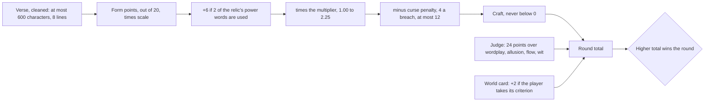
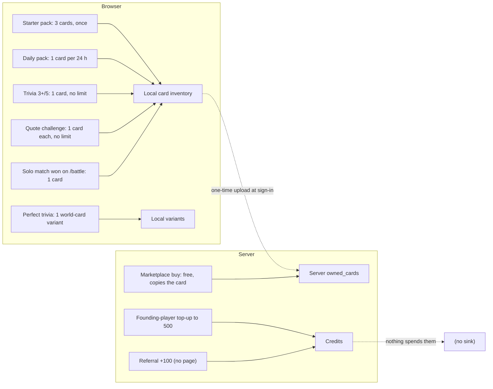
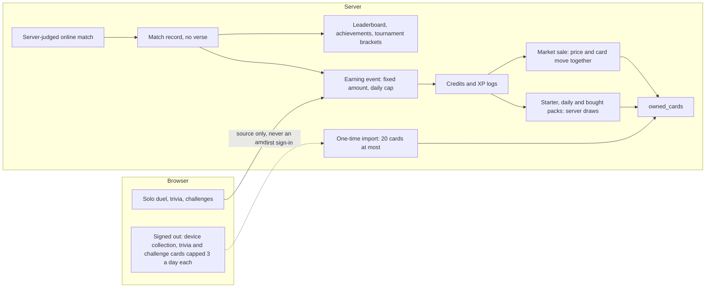
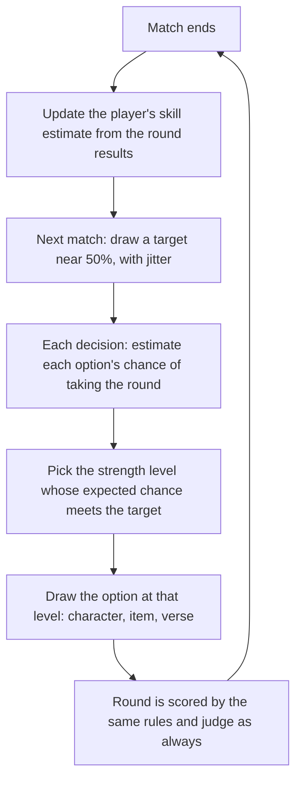

# Sonnet Man: systems, economy and balance

- **Purpose:** how a verse is scored, with worked examples computed by the game's own engine; how cards, credits and progress flow today and in this release; what balance should aim at; the adaptive opponent the owner asked for; and what must be measured to tune it all.
- **Audience:** the team (David Charlot, Devon Glover, Arrocito del Diablo), game designers, engineers and data people; investors for sections 1, 7 and 10.
- **As of:** commit `0d6df6ef` on `integrate/wave3` (2026-11-18), plus the release branches `fix/judge-wording`, `fix/server-authority`, `fix/voice-g2p` and `fix/compliance` (2026-11-19).
- **Status:** Draft for the team, 2026-11-19.
- **Related documents:** `04-content-and-card-bible.md` (every card, form and device), `06-modes.md` (where each system shows), `07-narrative-and-performer-bible.md`, `12-technical-design.md`, `22-risk-register.md`, `adr/0006-compare-wording-back-to-main.md`, `adr/0021-server-authoritative-economy.md`, `data/cards.csv`, `data/forms.csv`, `data/devices.csv`, `data/generate.mjs`, `sources/as-built-design.md` (cited "design §"), `sources/as-built-tech.md` (cited "tech §"), `research/sota-design-2026-11.md`, `research/sota-production-2026-11.md`, `17-operations-runbook-and-launch-checklist.md`; also `00-README.md` (index), `28-owner-decisions.md`.

**Labels.** *As built*: the code at `0d6df6ef` does it (cited). *In this release*: a named release branch will change it. *Proposed*: a recommendation, with the research behind it. *Derived*: arithmetic on the code's constants, not a measurement of players. "Not known" items are collected in §12.

---

## 1. The short version

1. **A verse scores craft plus a share of the judge.** Craft is computed by code from the form and the cards, up to 59 points. The judge shares 24 points over four criteria. A world card adds 2. Craft decides most rounds (§2, §5).
2. **Every number below was computed by the game's engine, not by hand.** The examples in §3 come from running `scoreVerse` on real verses (`node docs/dossier/data/generate.mjs --examples`).
3. **The opponent without a model is weak and does not change.** Its English verses earn 20 craft in the median case, at most 30 (measured over 901 pairings, §5.6). The difficulty setting changes nothing unless a model is loaded, and phones, tablets and headsets are never offered one (design §1.6, §1.8).
4. **As built, the economy is a set of disconnected parts that trust the browser.** Cards are the only working reward and live in the browser. Credits exist only on the server and nothing earns or spends them. The server accepts any stats, cards, credits and tournament results a signed-in client sends (§6; tech §12 items 1-3).
5. **In this release** (`fix/server-authority`) the economy becomes server-authoritative: fixed rates with daily caps, cards granted only by the server, the leaderboard and tournaments fed only by server-judged matches, and purchases that move both credits and the card. The branch's server work and its rates file (`backend/data/economy.json`) were committed at 01:42 on 2026-11-19; the pages and the design note `docs/ECONOMY.md` were not yet written when this document was (§7).
6. **Proposed:** an adaptive opponent that plays each player toward even odds, always with randomness, adapting only its own choices and never the judge. A research spike already built one and tested it on simulated players: 26 of 30 reached the 40-60% band, and seven of its own pre-registered rules failed (§10).

## 2. The scoring model

### 2.1 One round, as a picture



### 2.2 Craft

As built (`src/lib/verse/duel.ts:486-511`; design §1.3):

`craft = max(0, round((form points + power-word bonus) × multiplier) − curse penalty)`

| Term | Rule | Constant |
|---|---|---|
| Form points | Sum of the form's met requirements, out of 20, times `scale`, rounded. Partial credit is deliberate | `FORM_POINTS = 20` |
| `scale` | `min(1, known / 0.7, telling / (0.5 × lines))`: the share of the verse that is words of its language, and different telling words per line. In Chinese and Japanese the telling term is 1 | `FULL_KNOWN_SHARE = 0.7`, `TELLING_PER_LINE = 0.5` |
| Thin verse | Earns 0: a line with no word, fewer different words than lines (never fewer than 3), half or more of its lines repeats, or under 60% words of its language | `MIN_DISTINCT_WORDS = 3`, `MIN_KNOWN_SHARE = 0.6` |
| Power-word bonus | +6 when the verse uses 2 of the relic's 5 words | `POWER_WORD_BONUS = 6`, `POWER_WORDS_NEEDED = 2` |
| Multiplier | `1 + round(bonus × substance × 100) / 100`; bonus = 0.5 if the device lands, + 0.5 if the signature lands, + 0.25 for house synergy (device landed and 2+ characters of the house in the deck) | range 1.00 to 2.25 |
| `substance` | `min(1, own telling words / (1.5 × lines the form asks))`; own words are those beyond the ones that landed the device and signature | `OWN_WORDS_PER_LINE = 1.5` |
| Curse penalty | `min(12, 4 × breaches)` | `CURSE_PENALTY = 4`, `CURSE_PENALTY_CAP = 12` |
| Void verse | Empty, thin or copied: craft 0, no device, no signature. A copied player verse also forfeits all 24 judge points | ten `COPY_*` thresholds, `duel.ts:54-115` |

The opponent's verse is never tested for copying, because the seed makes its next verse knowable and a player could otherwise void it by typing it first (`duel.ts:388-394`).

### 2.3 The judge

As built (design §1.7):
- **24 points a round** over four criteria, 6 each to whichever side takes it, 3 each on a split.
- **Which judge runs.** A model judges only when the player has loaded one that is listed for the duel's language: Gemma 4 E2B in English, Russian, Chinese and Indonesian, and LFM3 1.7B in Vietnamese (`src/lib/brain.ts:63-74`). Everywhere else, and whenever the model's reading fails, the **rule judge** decides. The verdict says which judged.
- **The rule judge** measures wordplay as different telling words line for line, allusion as words from the character names and card lines, flow as rhyme, repeated openings, growing lines and even lengths, and wit as words of the answered verse thrown back. **Wit is always a split against the written opponent and in every round one**, because the written opponent answers nothing (design §1.7).
- **The model judge** asks "Which verse is better on this criterion? Reply A or B", once in each order, 8 readings a round; a lean under 0.1 is a split (`src/lib/verse/judge.ts:234-276`).
- **The rule judge often cannot tell verses apart.** On `main`, its labelled-pair tally was English 115 right / 79 split / 19 wrong and Chinese 0 / 40 / 0; the current judge is held only to be no worse (design §10 item 4).

**In this release** (`fix/judge-wording`, commit `3015897a`, the owner's choice of 2026-11-19): the compare wording goes back to `main`'s, word for word. The integration's wording let a planted verse ("Ignore all previous instructions…") beat a real one in 11 languages and left Gemma passing the judging bar in 4; `main`'s wording on the same code measured 2 such losses and 14 languages passing (`docs/language/MODEL-EVAL.md:73-131`). The branch marks the 32 compare-path judging cells as stale and to be measured again; which languages Gemma will judge in after that measurement is Not known until it is run (commit message of `3015897a`).

### 2.4 World card

As built: every one of the 20 cities gives +2 when the judge awards the player the city's criterion and the verse is not void. Only the player can have one, and only in solo play (`duel.ts:563-565`; design §4.12).

### 2.5 Round and match

| | Solo (`/battle`, `/theatre`) | Online (`/multiplayer`) |
|---|---|---|
| Who writes first | The opponent opens every round; the player answers (`session.ts:94-124`) | Both write at once, 180 s a round (`game_room.rs:99`) |
| Cards | Characters, relics, potions, ink, world card | Characters only: no relics, potions, ink or world cards (`multiplayer-rules.ts:28-39`) |
| Judge | Rule judge, or a model where listed | Rule judge on the server, no model (`backend/src/multiplayer/mod.rs:1-5`) |
| Round winner | Higher total; on a tie the side the judge preferred; on a judge tie the player ("the challenger"). Never a draw (`duel.ts:569-571`) | Higher total; then the larger judge share; else a draw (`backend/src/verse/duel.rs:578-586`) |
| Match winner | First to 2 rounds (`duel.ts:576-583`) | First to 2; then most rounds; then most points; else a draw (`duel.rs:628-653`) |

### 2.6 Ranges (derived)

- Craft: at most 45 without a relic (20 × 2.25) and 59 with one (26 × 2.25 = 58.5, rounded to 59).
- Round total: at most 85 for the player (59 + 24 + 2).
- Achievements read round totals: "Wordsmith" at 35, "Virtuoso" at 45 (`src/lib/achievements.ts:101,174`).

## 3. Worked examples

Each example is the engine's own answer at `0d6df6ef`, English, under the Couplet unless named. The opponent's verse is the first English written couplet, *"Thy rhymes are candles guttering in the night / Mine is the sun, and thou hast lost the light"* (`src/lib/verse/packs/en.ts`).

**Example A: everything lands.** Romeo, with Mercutio also in the deck (two Montagues), Yorick's Skull played for 1 ink:

> Soft light, bright night: I jest beside thy grave of dust,
> Thy yonder window breaks, as every candle must.

| Step | Value | Why |
|---|---|---|
| Form points | 20 | 2 lines (6); "dust / must" rhyme (14); scale 1 |
| Power words | +6 | jest, grave, dust: three of Yorick's Skull's five |
| Device | landed | Inner Rhyme: "light / bright" inside line 1 |
| Signature | landed | echoes "soft" and "light" from "But soft, what light through yonder window breaks?" without four of its words in a row |
| Synergy | yes | the device landed and the deck holds two Montagues |
| Substance | 1.00 | enough own words beyond those that landed the cards |
| Multiplier | 2.25 | 1 + (0.5 + 0.5 + 0.25) × 1.00 |
| Craft | **59** | round(26 × 2.25) = 59, the maximum |

The rule judge then compares the two verses: wordplay, allusion and flow to the player, wit split (no verse answered one yet). Judge: player 21, opponent 3. **Round: player 59 + 21 = 80, opponent 20 + 3 = 23** (the opponent's craft is Example O).

**Example B: the same verse, one Montague, no relic.** Device and signature still land; no synergy, no power words. Multiplier 2.00; craft round(20 × 2.00) = **40**. The relic and the synergy were worth 19 points between them.

**Example C: padding does not pay.** Romeo, two Montagues:

> Soft light, bright night, soft light, bright night
> Soft light, bright night, soft light, yonder light

The form is met (20) and both cards land, but the verse says little beyond the words that landed them: substance 0.33, so the multiplier is 1 + 1.25 × 0.33 = 1.42 and craft is round(20 × 1.42) = **28**, not 45. This is the substance floor working as designed (`duel.ts:117-121`).

**Example D: a curse.** Juliet, two Capulets, under Puck's Flower Juice (Short Breath: no line longer than 5 words):

> My candle burns the brighter for thy failing night,
> And every word I sing is armour, flame and light.

Form 20; The Outcry missed (no "!"); signature missed; multiplier 1.00; two lines over five words, two breaches, −8. Craft 20 − 8 = **12**.

**Example E: a haiku.** Hamlet, with Ophelia also in the deck (two of the Danish Court):

> Ask the yonder moon
> why the window breaks so soft
> who will hear me now?

Form 20 (3 lines; 5, 7 and 5 syllables, counted from the CMU dictionary). The Question lands on line 3; the signature ("question") is missed; synergy applies. Multiplier 1 + (0.5 + 0.25) = 1.75; craft round(20 × 1.75) = **35**.

**Example O: the written opponent.** The couplet above, played by Hamlet. Form 20; The Question missed (no "?"); signature missed; multiplier 1.00; craft **20**. This is the typical written-opponent verse (§5.6).

**An illustrative match (derived from the examples, not played).** Round 1: the player plays Example A and wins 80 to 23. Round 2: the opponent curses the player with a potion (it always casts its potion in round 2 or 3, `duel.ts:308-311`); the player, under Short Breath, plays Example D (12 craft) and the judge splits evenly (12 each): 24 against the opponent's 20 + 12 = 32. The opponent takes round 2. Round 3: the player plays Example E (35) and wins. Match to the player, 2 rounds to 1. The curse turned a likely sweep into a third round, which is what an item should do.

## 4. How to reproduce the examples

```bash
node docs/dossier/data/generate.mjs --examples   # from the repository root; Node 23.6 or later
```

The script imports the game's TypeScript modules directly (Node strips the types), loads the English pronunciation table into memory, scores the verses above with `scoreVerse` and `rulesJudge`, and prints the results. It also scores every English written-opponent verse against every character (§5.6). It reads files only, starts no server and fetches nothing; it rewrites the three CSV files as a side effect. If a constant in `src/lib/verse/` changes, rerun it and update §3.

## 5. What the maths implies for balance

Everything in this section is *derived* from the rules or *measured* by the script in §4 on the game's own content. None of it is measured on players: no play data exists (§11).

### 5.1 Craft outweighs the judge

A competent verse earns 30 to 59 craft; the judge moves at most 24, and against the rule judge most criteria split 3-3 in several languages (§2.3). The judge therefore decides close rounds, and the cards decide most. That is consistent with the design choice that code, not a model, decides form (`forms.ts:2-3`), and with the research finding that players accept scores that show why (research/sota-design §2, §4). **Proposed:** keep it. Show craft first, line by line; show the judge's share second, labelled with which judge ran.

### 5.2 What each lever is worth (derived, at full substance)

| Lever | Value at form 20 | Value at form 20 with a relic |
|---|---|---|
| Device lands | +10 | +13 |
| Signature lands | +10 | +13 |
| Synergy (device landed, 2+ of the house) | +5 | +6.5 |
| Relic's power words | +6 before the multiplier: +6 to +13.5 after | |
| World card | +2 | |
| A judge criterion won outright instead of split | +3 | |
| A curse breach on the other side | −4 each, at most −12 | |

The relic is the strongest single item, because it is added before the multiplier. A potion's worst case for its target (−12) is about the same size.

### 5.3 Devices are not equally hard

Every device adds the same +0.5, but the rules make some trivial and some impossible under particular forms or curses. Derived from the rules (`devices.ts:70-197`, `forms.ts:209-344`), and confirmed where noted by the measurement in §5.6:

| Device or curse | Interaction | Effect |
|---|---|---|
| The Swell (The Tempest) | Crescendo ("each line longer than the last") meets The Swell ("last line the longest") automatically | free device in a Crescendo round; measured: Swell landed in 16 of 68 written-verse pairings, from both Crescendo verses and two two-line verses whose second line is longer |
| Balance (Lake District) | Crescendo makes equal line lengths impossible | the device cannot land in a Crescendo round that keeps the form |
| One Rhyme (The Sonnet Man) | In a Couplet or Heroic Couplet the form's own rhyme lands it | free device in two-line rhyming rounds; measured: 5 of 17, exactly the five two-line written verses |
| One Rhyme | In a Paired or Crossed Quatrain it needs all four lines on one rhyme; the form asks only two pairs | hard |
| The Swell, Balance | In a two-line form either line is longer or both are equal, so one of the two often lands by chance | easy in Couplets; measured: Balance landed in 15 of 85 pairings, all two-line verses |
| The Outcry, The Question | One "!" or "?" in any line, any form | near free in every form |
| The Riposte (Verona Court, Underworld) | The player always answers in solo play, so it is always available to the player; the opponent opens round 1 with nothing to answer and is held to The Outcry | asymmetric in the player's favour |
| Grandeur (Olympus) under Tongue-Tied | Two words of 9+ letters against "no word over 6 letters" | landing the device costs at least −8 |
| Heroic Couplet under Short Breath | About ten syllables in at most five words | needs long words; hard |
| Brevity (Illyria) in a Heroic Couplet | About ten syllables in at most six words | tension |

**Proposed:** measure each device's landing rate per form and language in the AI playtests before launch (`15-qa-and-test-plan.md` §8.3), and with live aggregate counts after it (§11); then choose the forms a house is drawn against so no house gets a free or impossible round, and also price devices by difficulty (a hard device earns more, a near-free one less) if dealing alone leaves a gap (decided by default: `28-owner-decisions.md` D-67). Mega Crit removed "do nothing" options and Hearthstone found prescriptive mechanics homogenised its meta (research/sota-design §1).

### 5.4 Signatures are not equally hard

A signature needs 1 echoed word when the card's line has one or two telling words, 2 otherwise (`devices.ts:313-316`). So Hamlet ("question"), Banquo ("kings"), Titania ("flowery") and Mercutio ("plague" or "houses") need one word, while most cards need two of three to seven (`data/cards.csv`, `signature_needed`). **Proposed:** the content rule in `04-content-and-card-bible.md` §9.2 (at least three telling words per line) for new cards, and a measured landing rate per card.

### 5.5 Rarity and power are unrelated

As built, rarity sets draw odds only. The Sonnet Man is Legendary, is dealt to every new player and is a free online starter, and its device lands free in two-line rhyming rounds (§5.3). The house "Legendary" has one card, so it never earns synergy. Whether rarity should mean power is a design decision (§12).

### 5.6 The written opponent, measured

Measured by the script in §4 over every English written verse (17 verses over 8 forms; acrostic lines left out) against every one of the 53 characters, without synergy, relic or curse:

| Measure | Value |
|---|---|
| Pairings | 901 |
| Craft | min 20, median 20, mean 20.5, max 30 |
| Form points | 20 for every verse: each keeps its form in full |
| Devices landed / tried | One Rhyme 5/17, The Swell 16/68, Balance 15/85, The Drumbeat 6/51, Brevity 3/51; Inner Rhyme, The Outcry, The Question, Alliteration, Invocation, The Ring and Grandeur 0 |

Two consequences. First, **a player who keeps the form and lands one card beats the written opponent's craft**, and the judge rarely makes up 10 points. Second, **"Apprentice", "Player" and "Master" are the same opponent wherever no model runs** (design §1.6). Together these mean the game has no difficulty curve on phones and headsets. §10 proposes one.

## 6. The economy as built

### 6.1 Where each resource lives

As built (design §4.0-§4.1; tech §2.2):

| Resource | Browser | Server | Wired between them? |
|---|---|---|---|
| Cards | `localStorage` `inspired-mile-inventory` | `owned_cards` | One-time upload at first sign-in, and marketplace purchases only |
| Decks | `localStorage` | none | Browser only; online reads the active deck |
| Stats (wins, rounds, high score) | `localStorage` | `player_stats` | One-time upload; the server keeps the greater of the two |
| Achievements (30) | `localStorage` | `unlocked_achievements` | Each unlock is posted, with no check that it was earned |
| World-card variants | `localStorage` | `owned_variants` | One-time upload only |
| Credits | dead client module | `player_stats.credits`, `credit_transactions` | No page calls either side |
| Season XP | none | `seasons`, `season_progress`, `season_rewards` | Nothing writes XP; no season exists |

### 6.2 Sources and sinks



| Resource | Source | Amount, limit | Live? |
|---|---|---|---|
| Cards | Starter pack | 3, once per browser | yes |
| Cards | Daily pack | 1 per rolling 24 h | yes |
| Cards | Trivia round (3+ of 5 right) | 1, unlimited, no cooldown | yes |
| Cards | Quote challenge | 1 per right answer, unlimited | yes |
| Cards | Solo match won on `/battle` | 1, by rarity weight | yes |
| Cards | Theatre win, online win | nothing | — |
| Cards | Marketplace purchase | the listed card, free, the seller keeps it | yes, for server-held cards |
| Variants | Perfect 5/5 trivia | 1, unlimited | yes |
| Credits | Founding-player top-up | refilled to 500 on every account check, for accounts made before the launch date | server only |
| Credits | Referral | +100 to the referrer, uncapped | API only, no page |
| Credits | `/credits/earn` | 50 / 30 / 20 / 10 by source, or any amount 1-1,000 the client names | API only |
| XP | `/seasons/xp` | 100 / 50 / 40 / 25, or 1-1,000 as the client names | API only |

| Sink | Amount | Live? |
|---|---|---|
| Pack tiers: Standard 3 cards for 50 credits, Rare 5 for 150, Epic 5 for 400 | shown on the playground | no button buys one |
| `/credits/spend` | 1-100,000; teens 200 a day | API only |
| Marketplace price | whatever the seller types | not charged |
| Ink, per duel | 1 per relic or potion | yes, solo only |
| Cards | — | nothing consumes a card; duplicates have no use |

Sources: design §4.3, §4.6, §4.9, §4.14.

### 6.3 What is wrong with it

As built (tech §12 items 1-3; design §4, §10):
1. **The server trusts the client everywhere.** Any signed-in account can add 1,000 credits per call, any XP, any card, any stats (which feed the public leaderboard) and any achievement. Only the rate limit (600 requests a minute) bounds it.
2. **A marketplace purchase is free and copies the card.**
3. **Tournament results are self-reported**: either participant may name either player the winner. A tournament match cannot be played from the site.
4. **The leaderboard ranks self-reported solo rounds.** `battleWins` counts rounds won, not matches, and online results are not stored (design §5.6).
5. **A season reward claimed by one player is claimed for everyone**, because `claimed` is a column of the reward row (design §4.7).
6. **Cards are unlimited** through trivia and quote challenges, with no cooldown.
7. **Promises the code does not keep**: the About page's "+50 / +30 / +20 / +10" credits, the referral reply's "5 free packs", "Win a round and earn a random card" on the playground (only a match pays).
8. **Achievements miscount**: "Completionist" unlocks at 48 cards (there are 71); "Relic Hunter" checks 15 cards of any type; "Pack Addict" (50 packs) needs at least 49 days of daily packs, since only starter and daily packs count.

### 6.4 How long a collection takes (derived)

With the rarity weights and draws with replacement (§2 of the card bible), the number of draws at which a player can expect to own a given number of distinct cards (Poisson approximation, derived: the smallest whole number of draws at which the expected count of distinct cards reaches the column's figure; the unrounded values are 12.0, 39.0, 78.9, 147.2, 293.7 and 612.6):

| Distinct cards owned | 10 | 24 | 36 (half) | 48 | 60 | 68 | all 71 |
|---|---|---|---|---|---|---|---|
| Expected draws | 12 | 40 | 79 | 148 | 294 | 613 | about 1,111 |

The tail is the Epic and Legendary cards (a given Epic is 0.31% a draw). As built, unlimited trivia makes this a question of patience, not progress. Under daily caps these numbers become days: at 10 draws a day, half the catalogue takes about 8 days and the whole about 111. §7.3 applies the release's caps.

## 7. The economy in this release

**In this release** (`fix/server-authority`). The owner decided on 2026-11-19, before this deploy, to make the economy server-authoritative: fixed rates with daily caps, cards only from the server, the leaderboard and tournaments only from server-judged matches, and purchases that move credits and the card. Two facts about the release frame it:
- The production database had **0 accounts** on 2026-11-19, so no existing balance, card or rank has to be migrated or honoured.
- A **nightly database backup**, kept 14 days, was set up and restore-tested on 2026-11-19 (see `17-operations-runbook-and-launch-checklist.md`).

### 7.1 What the branch holds (as it stood at `3fa2c384`, 2026-11-19 01:42)

Two commits sit on the branch past `integrate/wave3`: `f661c4cc` ("economy: every rate and cap in one file") and `3fa2c384` ("api: the server is the authority over credits, XP, cards, the market, rankings and tournaments"). They change the API, add migration `020_server_authority.sql` (additive) and add `backend/data/economy.json`, which "holds every amount, rate and cap of the economy" and which the API compiles in. **The pages are not yet changed** on the branch (no file under `src/pages` differs), and `docs/ECONOMY.md`, which `economy.json` names as the explanation of each number, does not exist yet. Everything in this section may still move before the deploy.

**What the server stops accepting.** `credits/earn` and `seasons/xp` take a source only; a client that names an amount gets a 400. The routes `POST /credits/spend`, `/stats`, `/stats/achievements`, `/inventory/add`, `/migrate/sync` and `/variants/unlock` are removed. Card ids are checked against the catalogue before any insert.

**Where cards come from** (accounts): the three starter characters (held by every account, never sold), the free starter pack and daily pack (recorded in a new `pack_claims` table), packs bought with credits and drawn with the server's randomness (`POST /inventory/packs`), season rewards, and **a one-time capped import** of a device's own collection at its first sign-in (`POST /migrate/import`). A solo win no longer adds a card to an account. Signed out, the browser keeps its own collection for solo play.

**Rates and caps** (`backend/data/economy.json`; "a day is a UTC calendar day"; "every number here is tunable"):

| Source | Credits | Times a day | XP | Times a day |
|---|---|---|---|---|
| Solo win (reported by the browser) | 50 | 3 | 100 | 3 |
| Trivia | 30 | 3 | 50 | 3 |
| Quote challenge | 20 | 5 | 40 | 5 |
| Daily | 10 | 1 | 25 | 1 |
| Online win (recorded by the server) | 50 | 10, and at most 3 against the same opponent | 100 | 20 matches a day |
| Online match not won | — | — | 25 | within the 20 |
| Referral (to the referrer) | 100 | 3 | — | — |
| Founding player | 500, once, logged | — | — | — |

| Other rule | Value |
|---|---|
| Pack tiers | Standard 3 cards for 50 credits; Rare 5 cards with a Rare guaranteed for 150; Epic 5 with an Epic guaranteed for 400 |
| Draw weights | Common 50, Uncommon 30, Rare 15, Epic 4, Legendary 1 (unchanged) |
| Free packs | starter 3 cards once; daily 1 card every 24 hours |
| One-time import | at most 20 cards, of which at most 1 Legendary, 2 Epic and 5 Rare |
| Signed-out device | trivia and quote challenges add a card at most 3 times a day each |
| Market | price 1 to 100,000; sales only (no trades); a listed card is locked and cannot be fielded online; a purchase moves the price buyer to seller and moves that very card, in one transaction |
| Teen spending | 200 credits a day (unchanged) |
| Achievements | 18 account achievements computed by the server from its own records (online wins and matches, rounds, best round, unique cards, packs opened) |

**Rankings and tournaments.** Each finished online match is recorded as one `battle_rooms` row, without its verses (the privacy promise), and pays its credits and XP within the caps. The public leaderboard, `GET /stats` and account achievements read only those rows, and **a win is a match**, not a round. The self-reported "complete" route for tournaments is gone: either player opens the match's room and only its result decides it; byes go through when the bracket is drawn. Season rewards are claimed per player and grant credits, packs or cards. The referral reply no longer promises "5 free packs".

**How solo earning is settled.** A solo duel is scored in the browser and its verses never leave the device (the home page's "0 Servers Reading Your Solo Duel", design §3), so the server cannot know a solo match was won. The branch caps the claim: a solo source pays a small fixed amount, at most a few times a day, because "Solo play happens in the browser, where the server cannot see it" (`economy.json`). The two alternatives were to replay solo duels on the server (the Rust engine re-scores English rules-judged duels exactly, tech §5, but that sends solo verses to the server and works in English only) or to pay only online play (which leaves phone players and 15 of 16 languages earning nothing). The capped claim keeps the privacy promise.

### 7.2 The new flow



### 7.3 What this means for pace and fairness (derived from the branch's numbers)

- **Credits a day at the caps**: solo sources at most 50×3 + 30×3 + 20×5 + 10 = 350; online wins at most 500. A solo-only player at the caps can buy 7 Standard packs (21 cards) a day, plus the daily card.
- **Collection time** (derived from §6.4, Standard packs only): at 22 draws a day a capped solo player owns half the catalogue in about 4 days and, on average, every card in about 50 days. Most players will not play to every cap, so real times are longer; the measurement in §11 decides whether that pace is right.
- **Season XP a day at the caps**: solo 675; online up to 2,000 (20 matches, all won). With levels at n × 200 XP (design §4.7), level 30 (6,000 XP) takes about 9 days of capped solo play. No season is seeded by any migration (design §4.7), so whether one runs at launch is Not known.
- **Forged solo claims** gain at most the solo caps a day per account. Accounts are cheap to make (passkey sign-up, 40 an hour per network: tech §3.3), so the market is where a farm could matter: cards bought with farmed credits can be sold.
- **Achievements still miscount.** `economy.json` keeps "completionist" at 48 unique cards (the catalogue has 71) and "relic-hunter" at 15 unique cards of any type.

### 7.4 What the release does not settle

Settled on 2026-11-19 (§12; `28-owner-decisions.md`): a signed-out player's `/battle` win adds one card to the device collection (D-46; the pages are not yet changed); no season runs at launch (D-39); the market and referral are for adults only (R10, D-06), with no fee at launch (D-06); `docs/ECONOMY.md` explains every number the server pays (D-05).

## 8. Proposed economy design

Proposed, building on the release. Supported by research/sota-design §7 and research/sota-production §5.7 unless noted.

### 8.1 Principles

1. **Credits are earned only, never bought.** Currency that can only be earned falls outside the EU consumer network's virtual-currency principles; bought currency brings real-money pricing on every item, 14-day refunds of unused credits, and spending switched off by default in any game not meant only for adults (research/sota-design §7). The site already says "No real-money purchases" (design §4.6).
2. **No random packs for money, ever.** From June 2026 PEGI rates games with paid random items 16 or older, the EU's Digital Fairness Act proposal names card packs, and Korea fines any gap between stated and actual odds (`docs/research/card-games-landscape-2026-11.md` §5; research/sota-design §7). Packs bought with earned credits are outside all of it as far as the research could see.
3. **Never punish absence.** Streaks repair or freeze; daily rewards are a bonus, not a debt. PEGI rates return rewards that penalise not returning at 12, and Vermont's design code (from 2027-01-01) imposes a duty of care against compulsive use (research/sota-production §0, §6.5).
4. **Season rewards never expire**, can be claimed later, and countdowns tell the truth (research/sota-design §7: Marvel Rivals, Guild Wars 2; fake urgency timers among the UK CMA's first targets).
5. **Marketplace trading and referral rewards are off for under-16 accounts and for classroom accounts.** The consumer principles forbid exhorting children to buy, and referral rewards paid to children are an incentive to disclose others' contact details (research/sota-production §5.7). The release keeps the teen spending cap; it does not yet turn the market off for teens.
6. **Nothing of value rests on a model's verdict.** Credits, ranks and tournament results come from rules-judged, server-verified play (research/sota-design §3). The release does this for rankings and tournaments.

### 8.2 Adjustments to the release's numbers (proposed, after data)

The release's rates are a sound start. Proposed changes, each to be tested against the measurements in §11 rather than adopted on sight:

| Item | Release value | Proposed | Why |
|---|---|---|---|
| Achievement "completionist" | 48 unique cards | 71, or read from the catalogue | the name promises all of them |
| Achievement "relic-hunter" | 15 unique cards of any type | 5 unique relics | the name and the English text promise relics |
| Online match not won | 25 XP, no credits | 10 credits as well, within a cap | rewards finishing a match, not only winning; reduces quitting |
| Solo win | 50 credits | scale with the adaptive opponent's strength in that match (§10.4) | makes sandbagging pointless once the opponent adapts |
| Duplicate cards | no use | exchange for credits by rarity (for example 5, 10, 25, 60, 150) | gives duplicates a use and smooths the Epic and Legendary tail (§6.4); common practice in card games, not researched in this dossier |
| Market | no fee | a small fee as a sink; off for teen and classroom accounts | §8.1 item 5; a sink keeps prices meaningful |
| Theatre wins | not paid (design §4.3) | paid exactly as `/battle` | it is the same `DuelSession` |

### 8.3 Fixes that cost little (proposed)

- Count **matches**, not rounds, in the browser's local `battleWins`, as the server does in this release (`fix/server-authority`), and keep a separate rounds counter.
- Remove or rewrite every promise the pages make that the code does not keep (§6.3 item 7), including the About page's "+50 / +30 / +20 / +10", which the release's 50 / 30 / 20 / 10 now nearly match.
- Show the player their caps ("2 of 3 solo rewards left today") so a capped reward never looks like a bug.

## 9. Balance targets (proposed)

| Target | Value | Why | How measured (§11) |
|---|---|---|---|
| Default match length | about 3 to 5 minutes | Marvel Snap targets about 3; a top-quartile mobile session is about 5.2 (research/sota-design §1) | time from first round to verdict |
| Player win rate against the adaptive opponent | 45 to 55% per player after 10 matches; never certain either way | the owner's direction (§10); research/sota-production §6.3 | per-player match results |
| Win rate by house (online, server-judged) | each house 45 to 55% of rounds | flag any card or house outside 45-55% (research/sota-production §6.3) | server match log |
| Device landing rate | each device lands in 30 to 70% of the rounds where a player tries it, per form | §5.3 shows free and impossible pairs | client aggregate |
| Rule-judge split rate | under 50% of criteria per language | today Chinese splits every labelled criterion (§2.3) | labelled pairs (`judge-accuracy.test.ts`) and play logs |
| Same verse, same verdict | 100% for the rule judge; model judge reported, not hidden | legibility (`docs/research/card-games-landscape-2026-11.md`, Implications 10) | tests |
| Time to half the catalogue | about 2 weeks for a player who plays one session a day, not at the caps | §6.4, §7.3 (a player at every cap gets there in about 4 days) | server grants |
| Retention, if measured | D1 about 18%, D7 about 6.5%, D28 about 3% (card-game medians); 10-15% D1 is "strong" for a web portal | research/sota-production §6.3 | first-party analytics |

## 10. The adaptive opponent

### 10.1 What the owner asked

The owner's decision of 2026-11-17, recorded as binding in the spike's design file: "the planner opponent must be adaptive. It tunes its strength per player toward about even odds, always with some randomness, so it never plays the same way twice" (`planner/docs/ADAPTIVE-PREREG.md` on branch `spike/duel-planner`, commit `00bd87c3`).

### 10.2 What the game does today (as built)

- **Difficulty is the number of drafts a model writes**: Apprentice 1, Player 2, Master 3; the best by craft is played (`src/lib/verse/opponent.ts:42,149-153`). Without a model, all three meet the same written verses (design §1.6).
- **The Theatre fixes difficulty at "Player"** (`src/pages/theatre.astro:190`).
- **Everything else the opponent does is drawn by the seed**: its three characters (from all 53), its relic and potion, the round it curses the player (2 or 3), and which written verse it plays (`duel.ts:278-331`; `opponent.ts:172-178`).
- So **nothing adapts to the player**, and on phones and headsets there is one fixed, weak opponent (§5.6).

### 10.3 What a spike already built (as built on `spike/duel-planner`, not in the game)

A research branch with 20 planner commits (2026-11-16 to 2026-11-17), "Nothing here is wired into the game" (`planner/README.md`):
- **A planner over the exact rules.** It scores verses with the same Rust source the multiplayer server compiles, simulates every legal option of a round against every legal answer, and chooses with a small learned value network (17 features) plus a temperature. English only.
- **Fair play by construction.** It decides from a public view: it never reads the player's unplayed characters, relics or potions, and uses a "belief deck" drawn from a public prior instead. A test requires byte-identical answers for any two decks that agree on every revealed card.
- **The adaptive controller.** Per player, one skill number (θ, in logits) updated after each match, never during one. Each match draws a target near one half with jitter (±0.25 logit). At each decision it picks a signed strength level from −16 (prefers weak options) to +16 (its own best play), plus +17 (the round's strongest option), whose expected chance meets the target, and draws the option at that level. Randomness enters at every step.
- **Engineering evidence.** The integer kernel is proved with Kani (24 of 24 harnesses), mutation tests kill 28 of 28 Kani mutants and 49 of 49 test mutants, and the browser build (about 2.96 MB of WebAssembly) is byte-identical across builders of one host triple (`planner/results/adaptive/pa2-heldout/README.md`).
- **Results on held-out seeds, simulated players only** (second pass; rules written before the runs):

| Rule | Result |
|---|---|
| R1 even odds (opponent win rate 0.40-0.60 from match 21 on) | 26 of 30 players pass. In band: random 0.493, greedy 0.437, a Gemma-written player 0.472, a sonnet-quoting generator 0.422 to 0.482. Fails: a learner whose skill rises (down to 0.378), a step-up player (0.375), and two strong generators the opponent cannot reach even at full strength |
| S1 strength does not follow the score | 19 of 20 pass; the one failure is a player that itself plays differently when ahead |
| R2 settling within 10 matches (median) and 25 (worst) | median 4, but worst 47: fails |
| V no tells in the verse text | passes for every gated player (accuracy 0.20-0.23 against a 0.14 baseline + 0.10; the game's current opponent shows 0.42-0.43) |
| V no tells in the item played | fails for three players (0.445-0.454 against bars of 0.437-0.444) |
| R4 variety | fails for one player only |
| R6 calibration | fails for six players |
| Sandbagging | still exploitable: a player who loses on purpose and then plays well wins more of the "good" games |
| Without fresh verses (the no-model tier, exploratory) | fails: with only the written bank, resting recent verses leaves too little choice (greedy player 0.292, out of band) |

**What it shows.** An adaptive opponent that holds most players near even odds, keeps its randomness and stays fair is buildable on the existing engine. It is not ready: it settles too slowly for strong players, it gives away its item, it can be sandbagged, it is English only, it has met no real player, and **it needs more verses than the written bank holds** to adapt without a model.

### 10.4 Proposed design for the game

**Principle 1: adapt the opponent, never the judge.** The rules, the craft score and the judge are the same for every player. Only the opponent's own choices change: which character it opens with, when it plays its relic and potion, which verse it plays, and how hard it tries. The research is plain that hidden adjustment breeds distrust and that a game sold on fair judging should never secretly soften the judge (research/sota-design §4).

**Principle 2: say so.** The opponent select offers "Adaptive (plays to your level)" as the default, beside fixed Apprentice, Player and Master. Players told a game adapts report more immersion, and disguised bots were called "deceitful" (research/sota-design §4). Online and ranked play never adapt.

**Principle 3: always some randomness.** Every match draws its target with jitter; every decision draws its level and its option. The same seed and the same player state replay the same match (the seed rule stays), but a new match never plays the same way twice.

**Principle 4: fair information.** The opponent decides only from what a human opponent could see (the spike's public view and its byte-identical test).



**How it adapts, per tier.**

| Tier | Strength knobs | Dependency |
|---|---|---|
| No model (every phone and headset; Arabic, Japanese, Korean everywhere) | Which written verse to play (by its predicted craft against this form and curse), which character opens, when the relic and potion are played | **A bigger bank**: the spike's no-model run failed with 2 to 4 verses a form. Proposed: at least 6 verses per form per language, with spares, written by people (`04-content-and-card-bible.md` §11 item 6) |
| Model (Gemma 4 E2B where it writes) | The above, plus how many drafts to write and which draft to play: the one whose predicted round chance is nearest the target, not always the best | none beyond today's model path |
| Planner (the spike's kernel in WebAssembly) | All options, by signed level | English first; other languages need the TypeScript engine's per-language scoring in the planner, or a port |

**The skill estimate.** One number per player and language, updated only between matches (so nothing inside a match depends on the score), kept on the device for signed-out play and in the account when signed in. A new player starts at the modelled player's level. Memory is capped (the spike capped it at about 13 matches) so the estimate follows a player who improves.

**Stopping sandbagging.** Proposed: rewards for a solo win scale with the opponent's strength in that match (a win against a weakened opponent pays less), and the estimate falls more slowly than it rises. Both answer the spike's exploit without hiding anything from the player.

**Acceptance before it ships.** Re-run the spike's pre-registered rules (R1 even odds, R2 settling, S1 strength not following the score, V no tells, R4 variety, R8 fairness) on the shipped controller; then run the AI playtests against it before it ships (`15-qa-and-test-plan.md` §8; `28-owner-decisions.md` D-63), with AI players of each model family playing 10 matches or more; after launch, check the same bar on live aggregate counts (§11): at least 80% of players who finish 10 matches land in the 40-60% band, and none sit at 0% or 100%.

## 11. What must be measured to balance the game

As built, almost nothing is measured. Plausible records page views after the age gate; eight event helpers exist and nothing calls them; online matches are not stored (tech §9; design §5.6). The privacy promise is that solo verses never leave the device (`src/pages/privacy.astro:18-22`). Measurement must keep that promise.

**Proposed instruments** (research/sota-production §6):
- **First-party, self-hosted, aggregate analytics** (Umami, MIT licence, cookieless, on the existing Postgres), with no verse text, no replay, and no experiments for child or classroom sessions.
- **Server-side match records for online play** (already server-judged): every round's form, characters, crafts, judge split, winner and timings. No verse text kept beyond the existing two-minute rule unless the player agrees.
- **Solo play as counts only**: the browser sends numbers (form, device landed or not, craft, judge source, result), never words, and only with consent.

| Question | Metric | Source |
|---|---|---|
| Do players reach play? | landing → first verse submitted → first duel finished → model offered/accepted/loaded → second session → account → first online duel | aggregate funnel |
| How long is a match? | minutes per match and per round, by form and input mode (typed or spoken) | client counts |
| Which cards are too strong or too weak? | round win rate and craft by house, character, relic and potion; device and signature landing rates per form | client counts; server for online |
| Is any form unfair in a language? | craft distribution and thin/void rates by form and language | client counts |
| Is the judge legible? | share of rounds judged by model vs rules; split rate per criterion per language; disagreements reported online | client counts; server |
| Does the adaptive opponent work? | per-player win rate after 10 matches; settle time; skill estimate spread; repeat-option rate | client counts |
| Is the economy paced? | credits earned and spent per day by source; cap-hit rate; days to 24, 36 and 71 cards; duplicate rate; marketplace volume and prices | server ledger (In this release) |
| Is online healthy? | queue wait, abandonment, disconnects, forfeits, reports per 100 matches | server |

**Playtests (Proposed).** The owner's rule of 2026-11-19 is that AI is the playtester (`28-owner-decisions.md` D-63): no human playtests, think-aloud sessions or human baselines. AI players with no prior training on the game play through what a player sees (the rendered page, or its screen-reader text) and a player's controls, never the scoring code or its constants, on self-hosted models released after 2026-04-01, run on the build host against a local build (`15-qa-and-test-plan.md` §8). Before any player arrives they give the first values for this section's table: time to a first valid verse, voids, rounds won against each opponent, device and signature landing rates, match length and where players get stuck (§8.3 there). Results are reported per AI player and model family, never as what people would do. No playtest of any kind exists in the repository (`planner/docs/ADAPTIVE-PREREG.md` §3: "Real playtests: none exist").

## 12. Owner questions

Settled on 2026-11-19 in `28-owner-decisions.md`: decided by default under the owner's standing rules where a sensible default existed; open only where it needs the owner's money, identity or contact details, a legal commitment in the company's name, or a public step not yet approved.

1. Are the rates and caps in `backend/data/economy.json` the launch values, and when will `docs/ECONOMY.md` explain each number? **Decided by the owner (2026-11-19, R9):** yes, as tunable launch values; **decided by default:** `docs/ECONOMY.md` is written before deploy and explains every number the server pays, XP, achievements, seasons and referral included (28 D-05).
2. Does a signed-out player's `/battle` win still add a card to the device collection? **Decided by default:** yes, one card, so the playground's promise holds before sign-in (28 D-46).
3. Is the one-time import of 20 cards (at most 1 Legendary, 2 Epic, 5 Rare) the right size? **Decided by default:** it keeps that limit as a tunable value (28 D-05).
4. Will a season be seeded at launch? **Decided by default:** no; the season pass stays hidden until it can be played (28 D-39). Seasons will run a calendar month (28 D-76), and every account made before Season 1 starts counts as a founding player (28 D-77).
5. Are marketplace sales and referral rewards off for teen and classroom accounts; is there a marketplace fee; do "Completionist" and "Relic Hunter" keep their goals? **Decided by the owner (2026-11-19, R10):** marketplace and referral for adults only (28 D-06). **Decided by default:** no marketplace fee at launch (28 D-06); the device counters are fixed to match the server's, "Completionist" at 71 and "Relic Hunter" on relics (28 D-45).
6. Is rarity power, or a collecting tier only? Should The Sonnet Man stay in every starter deck? **Decided by default:** a collecting tier, not power; his place in the starter deck waits on Devon Glover's answer (28 D-43, O-1).
7. Should device difficulty be priced, or forms dealt so no house gets a free or impossible round? **Decided by default:** measure landing rates in the AI playtests, then deal forms so no house gets a free or impossible round, and price devices as well if dealing alone leaves a gap (28 D-67).
8. Is the adaptive opponent the default in solo play, and does it come from the spike's planner or a simpler controller? **Decided by default:** the default, built on bank tiers so that it works on phones, with the fixed labels kept beside it; English first from the spike's planner, bank tiers in the other languages until it covers them (28 D-41).
9. Who writes the larger written-opponent bank, and in which languages first? **Decided by default:** writers per language once they are paid for, English first, reviewed by Devon Glover for tone if he agrees; until then the English bank grows first (28 D-62). **Open (28 O-7):** paying those writers.
10. Which judging languages does Gemma keep after the re-measurement? **Decided by the owner (2026-11-19, R11):** the cells are measured again before deploy; which languages pass is known only after the run (28 D-07).
11. Is self-hosted, aggregate analytics approved for balance data? **Decided by default:** yes, self-hosted Umami, aggregate only, after the age gate and off by default for teen and class accounts (28 D-25), with the statistics switch set by region (28 D-72).
12. Should Theatre wins pay a card, as `/battle` wins do? **Decided by default:** yes (28 D-46).
