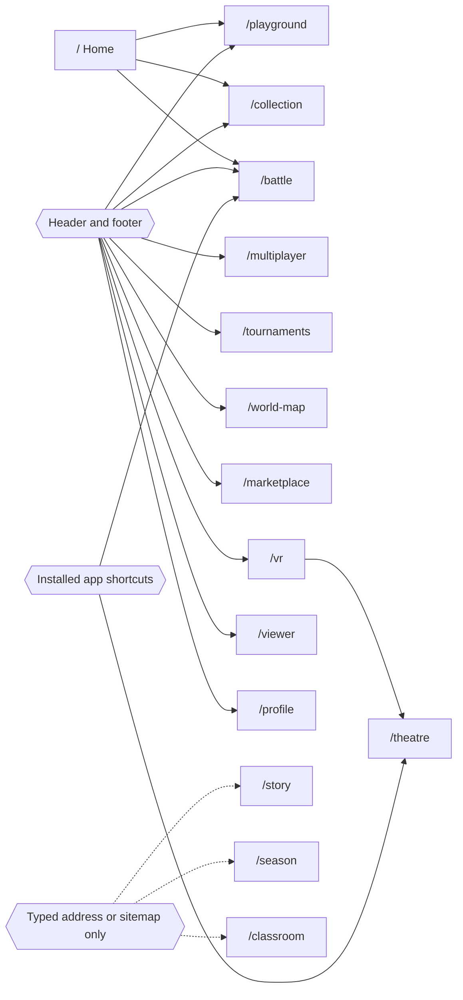
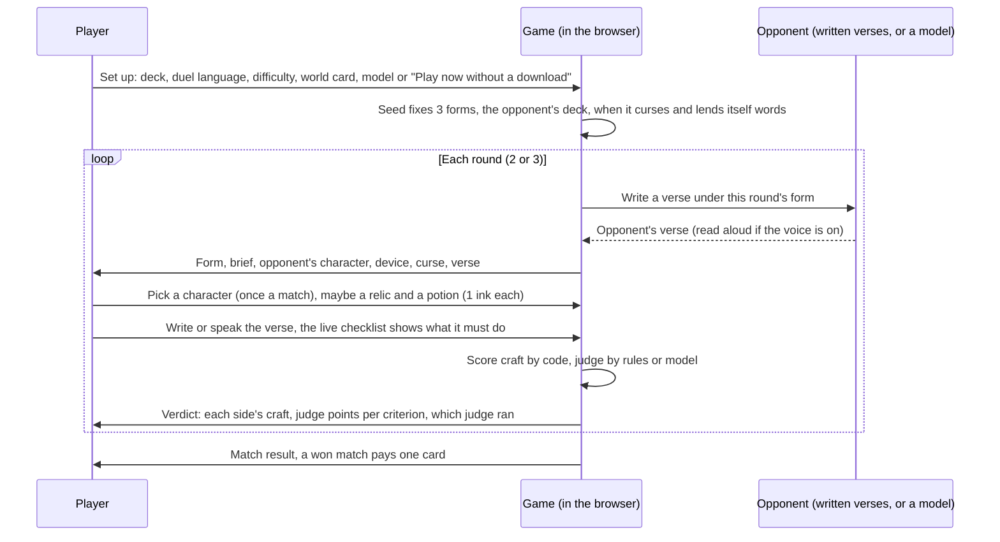

# Sonnet Man: modes and screens

- **Purpose:** one page per mode and screen of the game: what it is for, how a player reaches it, how it flows, whether it works (with the evidence), what is missing, what this release changes, and what we propose.
- **Audience:** the team (David Charlot, Devon Glover, Arrocito del Diablo), designers, engineers, QA and contractors who build or test a mode.
- **As of:** commit `0d6df6ef` on `integrate/wave3` (2026-11-18), plus the release branches `fix/judge-wording`, `fix/server-authority`, `fix/voice-g2p` and `fix/compliance` (2026-11-19).
- **Status:** Draft for the team, 2026-11-19.
- **Related documents:** `04-content-and-card-bible.md`, `05-systems-economy-and-balance.md`, `07-narrative-and-performer-bible.md`, `12-technical-design.md`, `18-trust-and-safety-plan.md`, `21-production-plan-and-roadmap.md`, `22-risk-register.md`, `sources/as-built-design.md` (cited "design §"), `sources/as-built-tech.md` (cited "tech §"), `research/sota-design-2026-11.md`, `research/sota-production-2026-11.md`, `17-operations-runbook-and-launch-checklist.md`; also `00-README.md` (index), `28-owner-decisions.md`.

**Labels.** *As built*: the code at `0d6df6ef` (cited). *In this release*: a named release branch changes it. *Proposed*: our recommendation, with the research behind it. Status words, from design §0: **Working** (reachable and does what its screen says), **Partly** (reachable, but part of its promise does nothing), **Stub** (the screen exists, the play behind it does not), **Dead** (no page reaches it). "Read from the code" means the behaviour was read, not watched running: nothing was built or opened in a browser for the fact bases.

---

## 1. The map

### 1.1 Every mode at a glance

| Mode | Page | Status (as built) | Needs an account | In the navigation |
|---|---|---|---|---|
| Battle (solo duel) | `/battle` | **Working**, the most tested page | no | yes |
| Multiplayer | `/multiplayer` | **Working** for signed-in players, English only | yes | yes |
| Theatre (3D and WebXR duel) | `/theatre` | **Working**, but pays no card and has fewer settings | no | **no** (only from `/vr` and the app shortcut) |
| Story | `/story` | **Stub**: one encounter can be read, none played | no | **no** |
| Season Pass | `/season` | **Partly**: no XP is ever earned and no season exists | yes | **no** |
| Tournaments | `/tournaments` | **Partly**: no way to create one or play a match | yes | yes |
| Classroom | `/classroom` | **Partly**: roster and assignment titles only | yes | **no** |
| Collection and decks | `/collection` | **Working**; 3D models missing for 17 of 18 cards | no | yes |
| Playground (packs, trivia, challenges) | `/playground` | **Working**; credit packs and model-written questions dead | no | yes |
| Marketplace | `/marketplace` | **Partly**: nothing earns credits; a purchase is free and copies the card | yes | yes |
| World map | `/world-map` | **Working**, display only | no | yes |
| 3D viewer | `/viewer` | **Partly**: lists 53 characters, has a model for one | no | yes |
| VR gallery | `/vr` | **Working**, display only; shows the catalogue, not the player's collection | no | yes |
| Profile | `/profile` | **Working** as local stats; the leaderboard ranks self-reported numbers | no (leaderboard is public) | yes |

Sources: design §3 (summary table and one section per page).

### 1.2 How a player gets around

As built, the header has Home, Collection, a **Play** menu (Playground, Battle Arena, Multiplayer, Tournaments), an **Explore** menu (World Map, Marketplace, VR Gallery, 3D Viewer), About and Profile; the footer repeats most of them (`src/layouts/BaseLayout.astro:211-244,486-502`). **Theatre, Story, Season and Classroom are in neither.** The desktop menus open on hover only, so a keyboard user on a wide screen cannot open them (design §8).

Other facts about reach (design §3):
- The sitemap lists `/trivia/` and `/challenges/`, which do not exist, and leaves out Theatre, World Map, Viewer and VR; every entry has `lastmod` 2026-02-16.
- The home page advertises the Theatre ("On a screen, or in a Quest 3 or Vision Pro in the Theatre") and does not link to it.
- Every API route except health, sign-in and the public leaderboard needs a session, so Marketplace, Tournaments, Season and Classroom show a signed-out visitor nothing to browse.

**Proposed** (cheap, before launch): put Theatre in the Play menu and Story there once it plays; make the menus open on focus and click as well as hover; correct the sitemap; link the Theatre from the home page.

### 1.3 What this release changes, by mode

| Mode | Change | Branch |
|---|---|---|
| Battle, Theatre | The model judge's compare wording returns to `main`'s (14 languages passed the judging bar with it, against 4) | `fix/judge-wording` |
| Battle | The English voice (Kokoro) loses its GPL eSpeak NG dependency and is rebuilt on the CMU dictionary | `fix/voice-g2p` |
| Battle, Theatre, Multiplayer | A notice of who plays and who judges before the first duel (EU AI Act Article 50(1)): on Battle and in the Theatre one of four sentences, chosen by whether a model writes, judges, both or neither; on Multiplayer, that another player and the server's fixed rules decide, and no AI plays or judges online (commits `4dc02c7f`, `13ff3148`) | `fix/compliance` |
| Battle (Vietnamese) | Gemma 4 E2B also writes the opponent's verse in Vietnamese (commit `ee2bf5ad`) | `integrate/wave3`, carried by every release branch |
| Playground, Collection, Marketplace, Profile, Tournaments, Season, Multiplayer | The server becomes the authority over credits, XP, cards, the market, rankings and tournaments; rates and caps in `backend/data/economy.json` | `fix/server-authority` |
| A new page | `/credits`, crediting the CC BY-SA data (Wiktionary-derived tables, CC-CEDICT, JMdict) and recording asset provenance; privacy-policy wording | `fix/compliance` |

Where a branch's work is not yet visible, the detail is marked pending in each section. Re-read at 02:16 on 2026-11-19: `fix/compliance` has eight commits (the notice, `/credits`, privacy and referral wording, licences), `fix/voice-g2p` two (the new English pronunciation step), and `fix/server-authority` two (the API and `economy.json`; no page changed yet).

---

## 2. Battle (`/battle`): the solo verse duel

**Purpose.** The core of the game: three rounds of verse against an opponent that runs in the browser, in any of 16 languages, with no account and no cards needed.

**How it is reached.** The Play menu ("Battle Arena"), the footer, the home page's and playground's buttons, and the installed app's shortcut.

**Flow** (as built; design §1.1-§1.2; `src/pages/battle.astro`, `src/lib/verse/session.ts`):

Set-up details: the deck is the saved active deck if it has at least three valid characters, otherwise the starter deck (The Sonnet Man, Romeo, Juliet, Yorick's Skull, Love Potion). Difficulty is Apprentice ("writes one draft"), Player ("picks the better of two", the default) or Master ("the best of three"). The duel language is remembered; `?seed=`, `?lang=` and `?brain=` override (design §3, `/battle`). No clock runs in solo play.

**Status: Working** (design §3). Evidence: `tests/duel.spec.ts` (19 tests: set-up, a full match, seeds, ink, pasting a verse back, world cards, last-round potions), `tests/card-text.spec.ts`, `tests/battle-bytes.spec.ts` (nothing heavy loads before it is needed), `tests/battle-ja-cost.spec.ts`, `tests/play-i18n.spec.ts`, the real-model tests in `tests/model/`, and `src/lib/battle-preview.test.ts` (the live checklist is the scorer).

**Gaps** (as built):
1. **On phones, tablets and headsets, and in Arabic, Japanese and Korean everywhere, the opponent is the written one**, and the three difficulties play the same verses (design §1.6, §1.8). Its English verses earn about 20 craft (`05-systems-economy-and-balance.md` §5.6), so there is no difficulty curve there.
2. **No tutorial.** Teaching happens in play: the brief, the live checklist, the note "Each character can take the stage once", and the verdict (design §8).
3. **The match can run long** for a mobile session: three rounds of written verse with no clock (research/sota-design §1: about 3 minutes is the reference match).
4. **Wit is always a split against the written opponent**, which answers nothing (design §1.7).
5. **The verdict container has no `aria-live`**, so a screen reader may not announce it; no reduced-motion support anywhere (design §8).
6. **The voice is off by default and English only** through Kokoro; other languages use the device's local voices if any (design §7.4).
7. **`battleWins` counts rounds, not matches**, which inflates "Win 25 battles" and the old leaderboard (design §4.5).

**In this release.** `fix/judge-wording` (judge wording); `fix/voice-g2p` (English voice rebuilt without eSpeak NG); `fix/compliance` (the AI notice); Gemma writes Vietnamese (`ee2bf5ad`). From `fix/server-authority`: a signed-in player's solo win earns 50 credits and 100 XP at most 3 times a UTC day, and **a solo win no longer adds a card to an account**; cards come from packs. How the battle page shows this is pending (no page is changed on the branch yet).

**Proposal.**
- **First duel in under a minute, before any model**: already true ("Play now without a download"). Keep it the default path; Poki saw conversion rise from 50% to 72% when load fell from 29.5 s to 3.7 s (research/sota-design §4).
- **Teach by writing one line.** A first round that is a scaffolded fill-in ("finish this couplet; it must rhyme with *night*") with instant code feedback, not a page of rules (research/sota-design §4).
- **Make the adaptive opponent the default** and keep the three fixed tiers beside it, labelled (`05-systems-economy-and-balance.md` §10).
- **Short forms for the quick duel**; a sonnet form for a long or ranked mode (`04-content-and-card-bible.md` §11 item 1).
- **Show craft first, line by line, then the judge's share**, and keep the verdict short and skippable (research/sota-design §1, §2, §4).
- **Add `aria-live` to the verdict and respect `prefers-reduced-motion`.**

---

## 3. Multiplayer (`/multiplayer`): duel a person

**Purpose.** A best-of-three duel against another person, scored on the server by fixed rules, so neither player's browser can decide the result.

**How it is reached.** The Play menu and the footer. It needs an account (passkey or emailed code; email is off in production, design §8).

**Flow** (as built; design §5; `backend/src/multiplayer/`):
1. **Lobby.** The deck: 3 to 5 different characters, each a starter (The Sonnet Man, Romeo, Juliet) or a card the account holds on the server; relics and potions are not played online.
2. **Find an opponent.** "Quick match" joins a first-come, first-paired queue (no rating, level or region; each request waits up to 30 s and the page gives up after 3 minutes), or "Challenge a friend" opens a private room and shows a link.
3. **Each round.** Both players write at once under the same form, 180 s a round; nothing sent counts as an empty verse. A copied verse forfeits the judge's 24 points. The server scores both verses with the rule judge (no model) and both players see the result; the page recomputes every round with the TypeScript rules and says if it disagrees.
4. **Match end.** First to two rounds; then most rounds; then most points; else a draw. A player who drops has 45 s to come back.
5. **Safety.** A short word filter on every verse; "Report your opponent's verse" under each round; opponents see each other's username only; no chat, friends, block or mute.

**Status: Working** for signed-in players (design §3). Evidence: `tests/multiplayer.spec.ts` (12 browser tests against a real API and Postgres: a whole match with server scores equal to the preview, quick match, forfeit, reconnect and reload, limits, queue timeout, socket abuse, sign-out mid-match), Rust unit tests in `game_room.rs`, `handlers.rs`, `matchmaking.rs`, `content_filter.rs`, and `backend/tests/verse_parity.rs` holding the Rust and TypeScript engines together over about 35,000 golden cases (tech §5).

**Gaps** (as built):
1. **English only, by decision**: the other languages' sound tables and segmenters could not be reproduced exactly on a server (`CLAUDE.md:134-139`).
2. **A small player pool will wait.** No asynchronous mode, no rating, no labelled AI fill.
3. **Nothing about a match is stored**, so wins do not reach the leaderboard or achievements (design §5.6).
4. **Reports are stored and never read**; no tool reviews them (design §5.7).
5. **A teen account can be paired by quick match with any adult stranger**: nothing in multiplayer reads the age tier (design §5.7).
6. **Cards won in solo play after the first sign-in cannot be fielded online**, because they stay in the browser (design §5.4).
7. **A deploy or crash ends every live match**: rooms live in one process's memory (tech §12 item 15).

**In this release** (`fix/server-authority`, server side). Each finished match is recorded as one `battle_rooms` row without its verses; an online win pays 50 credits (at most 10 a day, and at most 3 against the same opponent) and 100 XP; a match not won pays 25 XP (20 matches a day at most). The public leaderboard and account achievements read only these records, and a win is a match. A card listed on the market cannot be fielded. `fix/compliance` adds the AI notice where AI is involved; the online judge is rules, not a model.

**Proposal.**
- **Asynchronous "ghost" duels**: a server-judged duel against another player's recorded verses, so there is always a human opponent without a wait (research/sota-design §5, Backpack Battles). It requires storing verses with the author's consent, which the current two-minute rule forbids; decide that first.
- **Ratings once results are stored**: Glicko-2 suits infrequent players; the Rust crate `skillratings` implements it (research/sota-production §6.3). Show provisional ratings as provisional.
- **If an empty queue is ever filled by an AI, say so on the match card** and rank AI wins apart; hidden bots are called "deceitful" (research/sota-design §4).
- **Protect teens**: pair teen accounts only with teens or invited friends, and give reports a review queue with a statement of reasons. The UK Online Safety Act and the EU DSA reach a user-to-user service of any size (research/sota-production §0 items 5, §4.3). See `18-trust-and-safety-plan.md`.
- **Other languages online** only where the server can reproduce the browser's scoring exactly; Spanish and Polish need little or no sound data (tech §6.2), so they are the cheapest next candidates. Not measured.

---

## 4. Theatre (`/theatre`): the duel on a stage, in 3D and WebXR

**Purpose.** The same duel staged in a Babylon.js scene, on a flat screen, in passthrough on Meta Quest 3, or as a full stage on Apple Vision Pro.

**How it is reached.** Only from the VR gallery's link and the installed app's shortcut; not in the navigation, and not linked from the home page that advertises it (design §3).

**Flow** (as built; design §3, §7.5; `src/lib/xr/theatre.ts`): the same `DuelSession` as `/battle`, so the same rules. The player picks cards on the stage by pointer, controller ray or pinch; in a headset the verse is spoken (Whisper), on a flat screen it can also be typed. The scene is minimal: a dark floor, a red curtain (hidden in passthrough), text panels, buttons and the player's hand as card planes.

**Status: Working** (design §3). Evidence: `tests/theatre.spec.ts` plays a flat-screen duel through the stage, picks a card on the canvas, checks no headset button appears without WebXR, and starts an immersive session as an emulated Quest 3; `tests/theatre-bidi.spec.ts` checks right-to-left text. No real headset test is recorded.

**Gaps** (as built):
1. **A win pays no card** (no `addCard` import), though it counts in stats (design §4.3).
2. **Fewer settings than `/battle`**: difficulty fixed at "Player", the language is whatever `/battle` last stored, and a model loads only if chosen before on `/battle` (design §3).
3. **Headsets are never offered a model** (they count as handheld), so the Theatre's opponent in a headset is always the written one (design §1.8).
4. **The Theatre speaks nothing**: it imports no voice (design §7.4).
5. **No characters on stage**: no 3D models, only card planes (design §7.5).
6. **Schools cannot rely on it**: iPads cannot run WebXR, and US public-school entities owe WCAG 2.1 AA from 26 April 2027 (research/sota-design §8; `docs/research/xr-card-games-2026-11.md` §7.3).

**In this release.** The judge wording (`fix/judge-wording`) and the AI notice (`fix/compliance`) apply here, as on `/battle`. The server-authority branch's solo rewards apply only if the Theatre reports wins; whether it will is pending (`05-systems-economy-and-balance.md` §7.4, §8.2).

**Proposal.** Add it to the Play menu; pay its wins exactly as `/battle`'s; give it a language picker and the voice; test on a real Quest 3 and Vision Pro before advertising them; keep the flat duel the classroom default. The Theatre is the presentation showcase for investors and festivals, so a single strong verdict moment matters more than scenery (research/sota-design §9: effort on the verdict moment, kept short).

---

## 5. Story (`/story`): the campaign

**Purpose.** A five-act journey through Shakespeare's worlds (Verona, Elsinore, the Forest, Tempest Island, the Globe) ending in a duel with The Sonnet Man.

**How it is reached.** The typed address and the sitemap only.

**Flow** (as built; design §6.5; `src/lib/story-mode.ts`): a map of 5 acts and 19 encounters (5 easy, 7 medium, 7 hard), each naming an opponent card. Clicking an unlocked encounter shows its name, description and a short narrative. **No duel is started.**

**Status: Stub.** `completeEncounter` (`src/lib/story-mode.ts:117`) has no caller, so progress never advances and only encounter 1-1, "Street Brawl", can be read. The difficulty labels are only colours. The header promises "Progress persists to localStorage + server sync"; no server code exists for story. Tests: `tests/play-i18n.spec.ts:113-132` checks the acts, encounters and a scene in 16 languages; none plays it.

**Gaps.** Not playable; not linked; text contradicts its data (1-1 says "A Capulet servant" and is played by Tybalt; 2-1 is the Ghost's scene played by Claudius, who is also 2-3's opponent); The Sonnet Man's closing line is invented speech for a real person's persona (see `07-narrative-and-performer-bible.md` §6.2).

**In this release.** No change.

**Proposal.** Wire each encounter to a `DuelSession` with fixed forms chosen to teach, a presented, skippable intro, three stars by margin of victory, and a fixed card reward per act. The full design is `07-narrative-and-performer-bible.md` §7. Until it plays, keep it out of the navigation (as now) and the sitemap.

---

## 6. Season Pass (`/season`)

**Purpose.** A seasonal reward track: XP from play raises a level, and levels unlock rewards.

**How it is reached.** The typed address and the sitemap only.

**Flow** (as built; design §4.7): a "Season 1" badge, the season's name and dates, level, an XP bar, XP per activity (battle 100, trivia 50, challenge 40, daily 25), a reward track with Claim buttons, and a sign-in prompt.

**Status: Partly.** The API answers "No active season" unless the database holds an active season, and no migration creates one. Nothing in the client posts XP (`seasons.ts:94` `addXP` has no caller). Only `credits` rewards grant anything; the first player to claim a level claims it for everyone; the page's progress bar assumes a different level curve from the server's (level n at n × 200 XP). Tests: `tests/pages-rest.spec.ts` against a mocked API only.

**In this release** (`fix/server-authority`, server side). XP comes from sources at fixed amounts with daily caps (solo win 100 × 3, trivia 50 × 3, challenge 40 × 5, daily 25 × 1; online win 100 and other matches 25, 20 a day), logged in a new `xp_transactions` table; rewards are claimed per player and grant credits, packs or cards. Whether a season is seeded at launch is Not known: no migration inserts one.

**Proposal.** Seed a first season only when there is content to drop with it; make rewards never expire and claimable later; tell the truth in every countdown; align seasons with monthly content (new forms, characters, relics) and with Devon Glover's festival calendar (research/sota-design §7, §9; research/sota-production §6.5). Link it from the profile once it runs.

---

## 7. Tournaments (`/tournaments`)

**Purpose.** Organised competition: a list of tournaments, registration, a bracket and standings.

**How it is reached.** The Play menu and the footer. Needs an account.

**Flow** (as built; design §3, §4.8): tabs for Tournaments and Bracket; Register on an open tournament; a bracket per tournament and a standings table. Formats: single elimination and round robin, 16 players by default. A scheduler every 30 s draws the bracket once the start time passes with two or more entrants.

**Status: Partly.** The page cannot create a tournament (the API lets any signed-in user, with no role check). The scheduler never opens a game room. Results were self-reported: either participant could name either player the winner. A bye could never be completed, so a player given a bye never advanced. No page links a bracket match to a duel. Tests: mocked API rendering only; no backend test.

**In this release** (`fix/server-authority`, server side). The self-reported "complete" route is removed: either player opens the match's room and only that room's server-judged result decides it, so the match's `room_id` points at a real recorded match. Byes go through when the bracket is drawn, and five players no longer make an empty match. Who may create a tournament, and how the page shows the "open the room" step, are pending (no page changed yet).

**Proposal.** Creation for organisers only (an operator or a teacher role); English-only, server-judged rounds (as online play is); a published tie-break and an appeal path; class brackets in 10-minute blocks for classroom use; schedule headline tournaments around Devon Glover's live dates, with his approval (research/sota-design §6, §9).

---

## 8. Classroom (`/classroom`)

**Purpose.** A teacher creates a class with a join code, students join, and the teacher sets assignments.

**How it is reached.** The typed address and the sitemap only. Needs an account.

**Flow** (as built; design §3, §4.13): a gate ("I am a teacher" with three confirmations, or "I am a student" with three consents); join with a 6-character code or create a classroom; "My classrooms" with the code, members and assignments; a 4-step teacher tour. An assignment is a title and a type (trivia, challenge or battle); only the teacher creates one.

**Status: Partly.** No progress, completion, score or reward is recorded anywhere, and nothing links an assignment to a game. The tour promises "See what each student has completed, their scores and the cards they have earned" and shows "FERPA compliant", while the About page says "Classroom mode stores no grades or student work". Tests: mocked rendering, and one real-API test that a class's members and assignments are for its teacher and members only (`tests/auth.spec.ts:2586`).

**In this release.** No change. `fix/compliance` changes the privacy policy only and does not touch the classroom strings, so the "FERPA compliant" badge and the progress promise still ship unless changed separately.

**Proposal** (research/sota-design §6, §8; research/sota-production §5):
- **Remove the promises the code does not keep** ("FERPA compliant", "scores") before launch.
- **Rostering decides adoption**: Clever and ClassLink rostering and an LTI 1.3 launch; keep a no-account path for one-off lessons. Google sign-in is left out: the owner's direction of 2026-11-16 is "No passwords, no Google" (ADR 0009); offering it to schools would need the owner to revisit that.
- **The teacher's chosen cards are the lesson**: the teacher picks the forms and devices for a session; a projected "class versus the Sonnet Man" round fits the classroom habit better than one-to-one phone duels.
- **Commerce off** for student accounts: no market, no referrals, no credits for purchase.
- **Formative only**: scores are feedback, never grades. Evaluating learning outcomes is a high-risk use under the EU AI Act from 2027-12-02.
- **Teachers see and can override the judge**, line by line.
- **Accessibility**: WCAG 2.1 AA, which large US public-school entities must meet from 26 April 2027, with a published conformance report.
- **Privacy**: under the amended COPPA Rule a school may consent only for school-benefit use; keep on-device judging the classroom default, so no pupil text leaves the device.

---

## 9. Collection and decks (`/collection`)

**Purpose.** See every card, owned or locked; read a card; build and save decks.

**How it is reached.** The header, footer, home page, battle and playground.

**Flow** (as built; design §3): filters (All, Character, Relic, Potion, Owned); a grid of all 71 cards with locked overlays; a card-detail modal with ATK, DEF, HP, the rule text, a 3D model and "View in AR" for cards that have one; a World Cards tab; a deck builder (3 to 5 characters, up to 2 relics and 2 potions, owned cards only, one copy each) with a synergy preview, saved decks and an active deck; an achievements grid.

**Status: Working**, apart from the 3D files. Evidence: `tests/v1-flows.spec.ts:27-61` (71 cards), `tests/v2-world-cards.spec.ts:81-125`, `tests/pages-i18n.spec.ts`.

**Gaps** (as built):
1. **17 of the 18 configured 3D models are missing**; the one that exists (The Sonnet Man's) is a point cloud, and no iOS Quick Look file exists (design §7.6).
2. **ATK, DEF and HP are printed and do nothing** (`04-content-and-card-bible.md` §3).
3. **The card modal has no dialog role**; the card's line is shown without its source.
4. **Duplicates have no use** (design §4.2).

**In this release** (`fix/server-authority`). For a signed-in player the server is the record of owned cards: the three starter characters for everyone, cards from packs, season rewards, and a one-time import of the device's collection at first sign-in (at most 20 cards: 1 Legendary, 2 Epic, 5 Rare). How the collection page reads the server's cards is pending.

**Proposal.** Show each line's source; give the modal `role="dialog"` and focus handling; hide 3D buttons where no model exists; decide ATK, DEF and HP; give duplicates a use (`05-systems-economy-and-balance.md` §8.2); after the import, tell the player plainly which cards came across and which did not.

---

## 10. Playground (`/playground`): packs, trivia and quote challenges

**Purpose.** The collecting hub: free packs, Shakespeare trivia and fill-in-the-blank quote challenges, and the first-visit tour.

**How it is reached.** The Play menu, footer, home page ("Enter the Playground" is its first call to action), About and Collection.

**Flow** (as built; design §3, §4.3):
- **Starter pack**: 3 cards, once per browser. **Daily pack**: 1 card every 24 hours (rolling, not a calendar day).
- **Drop rates** shown: Common 50%, Uncommon 30%, Rare 15%, Epic 4%, Legendary 1%, matching the code.
- **Pack tiers "purchased with Credits"**: Standard 50, Rare 150, Epic 400 are shown, with no button to buy one.
- **Trivia**: 5 questions from 200; 3 or more right pays a card; a perfect 5/5 also pays a world-card variant. **Quote challenge**: a right answer pays a card. Neither has a cooldown.
- **First visit**: a 3-step tour (starter pack, trivia, the Battle Arena button), skippable and remembered.
- A teen's daily-spending bar, which always reads 0 because nothing spends.

**Status: Working** (free packs, trivia, challenges, tour). The credit packs and the model-written questions are dead (the playground loads no model). Evidence: `tests/v1-flows.spec.ts:64-146`, `tests/play-i18n.spec.ts:74-332`, `src/i18n/pages/play-areas.test.ts`.

**Gaps.** Unlimited cards; trivia covers Shakespeare only; the tour calls the opponent the "AI Master Thespian" and the duel a "rap battle", which neither is (design §6.10); "Win a round and earn a random card" is wrong (a match pays).

**In this release** (`fix/server-authority`, server side). For accounts, the starter and daily packs are drawn by the server and recorded (`pack_claims`); packs can be bought with credits (`POST /inventory/packs`) at the existing prices, drawn with the server's randomness; trivia pays 30 credits (3 a day) and challenges 20 (5 a day). Signed out, trivia and challenges add a card to the device collection at most 3 times a day each. The page changes are pending.

**Proposal.**
- **A shared verse of the day**: one short prompt and form, the same for everyone in each language, with a plain-text, spoiler-free share and a forgiving streak (research/sota-design §5: NYT, LinkedIn, Duolingo's streak revival).
- **Trivia for the Romantic and myth cards**, written from sources and reviewed (`04-content-and-card-bible.md` §11 item 8).
- **Retire the dead model-content path** or make it run only where its output is checked.
- **Fix the copy**: "verse duel", not "rap battle", unless Devon Glover's content makes it one; no "Master Thespian" unless that persona is built.

---

## 11. Marketplace (`/marketplace`)

**Purpose.** List cards for credits or for other cards, browse and buy.

**How it is reached.** The Explore menu and the footer. Needs an account to buy.

**Flow** (as built; design §3, §4.9): Browse, My listings, "Sell or trade"; filters and search; a listing form that takes a card from the player's *browser* inventory, sale or trade, a price (1 to 100,000) or wanted cards.

**Status: Partly.** The page and API work, but nothing earns credits, and a purchase moves no credits, leaves the seller's card in place and copies it to the buyer. The sell list comes from the browser while the server accepts only cards it holds. The About page says "card value is influenced by combat rankings"; prices are whatever the seller types. Tests: mocked rendering only; no backend test.

**In this release** (`fix/server-authority`, server side). **Sales only** (trades are no longer offered). A listing locks one owned card; a purchase, in one transaction, checks the listing, the buyer's balance and teen daily limit (200 credits), moves the price from buyer to seller (both logged) and moves that very card; cancelling unlocks it. A listed card cannot be fielded online. Price bounds stay 1 to 100,000. The page changes are pending.

**Proposal** (research/sota-production §5.7; research/sota-design §7): off for under-16 and classroom accounts; never any cash-out or transfer of credits; a small fee as a sink; price guidance from recent sales; remove the "combat rankings" claim or build it. Recognition (a verse featured in the gallery) is a safer motivator for children than trading.

---

## 12. World map (`/world-map`)

**Purpose.** The 20 cities of the world cards: each city's battle ability, attires and hairstyles, and the player's own variants there.

**How it is reached.** The Explore menu and the footer.

**Flow** (as built; design §3, §6.6): 20 city cards; a modal per city; a "Possible combinations" count (53 characters × 20 cities × 96 = 101,760). A variant equipped on `/battle` gives +2 when the judge awards its criterion.

**Status: Working** (display). Evidence: `tests/v2-world-cards.spec.ts:13-79`, `tests/pages-i18n.spec.ts`.

**Gaps.** The only way to earn a variant is a perfect trivia round, though the page says "through battles, trivia, and exploration". Every screen shows the base card's image; the 198 variant images are orphaned, in an older photoreal style, and 27 use city codes that no longer exist (design §7.2). Stale comments say "12 cities" and "18 characters".

**In this release** (`fix/server-authority`). The `/variants/unlock` route is removed. Variants stay a solo feature kept on the device; the server only lists the variants an account already holds (`backend/src/variants/handlers.rs` on the branch). How the pages present this is pending.

**Proposal.** Decide the variants' future (`04-content-and-card-bible.md` §8.4 and owner question 8): either paint them in the card style and show them, or fold the cities into the cards as a cosmetic and drop the 101,760 count. The hip-hop city framing (Brooklyn, Lagos, Kingston, Manila) is the brand's natural map for Devon Glover's touring; build it with him.

---

## 13. 3D viewer (`/viewer`)

**Purpose.** Look at a character in 3D (Gaussian splat or GLB model), and place it in a room with AR on a phone.

**How it is reached.** The Explore menu.

**Flow** (as built; design §3, §7.6): a select of all 53 characters; Splat and GLB buttons; a canvas; tiles explaining each mode.

**Status: Partly.** Only The Sonnet Man has a splat and a GLB, and the GLB is a coloured point cloud, not a mesh; any other card shows "no GLB". No `.usdz` exists for iOS. The model files date from the February 2026 build and their origin is not recorded. Tests: third-party requests and page rendering only.

**Gaps.** A promise of 53 with 1 delivered; a model of the real person's persona made by an unrecorded process (see `07-narrative-and-performer-bible.md` §6 and §8 on likeness).

**In this release.** `fix/compliance` records asset provenance (`docs/ASSETS.md`): the GLB and splat are byte-identical to output of the owner's own `efficient-genai` pipeline; the model that made the figure is not traced. The files are kept; nothing is removed.

**Proposal.** Hide the viewer, or list only cards with a model, until there are models. Any 3D model of The Sonnet Man needs Devon Glover's written consent as a likeness. If models are made, make them from the paintings, self-hosted, and record their provenance.

---

## 14. VR gallery (`/vr`)

**Purpose.** "Walk through your collection in 3D", with a mouse or in Quest 3 and Vision Pro through WebXR.

**How it is reached.** The Explore menu. It is also the only page that links to the Theatre.

**Flow** (as built; design §3, §7.6): every catalogue card on a pedestal, characters in an outer ring of radius 6 m, items in an inner ring; clicking or pinching a card names it in the status line; VR with teleportation.

**Status: Working**, display only. It shows **the whole catalogue, not the player's collection**, and the gold "name label" under each card carries no name. The header's "battle spectator" is not built. Tests: third-party requests and rendering.

**In this release.** No change.

**Proposal.** Show the player's own cards (locked ones dimmed), draw the names, and make the gallery the Theatre's lobby: walk in, pick a deck, start a duel. Or fold it into the Theatre and drop the separate page.

---

## 15. Profile (`/profile`)

**Purpose.** The player's stats, achievements, collection breakdown and the public leaderboard.

**How it is reached.** The header and the account menu.

**Flow** (as built; design §3): name (or Guest, with "local" storage), stats for wins, battles, win rate, high score, cards and trivia, achievements, the collection by house and rarity, a leaderboard of the top 50, and recent cards and achievements.

**Status: Working** as a local stats page. The leaderboard is public and ranks numbers the browser uploaded once at sign-in, in which `battleWins` counts rounds won in solo play; online wins were never recorded (design §5.6). Tests: `tests/pages-i18n.spec.ts` (16 languages).

**In this release** (`fix/server-authority`, server side). The public leaderboard, `GET /stats` and account achievements read only server-recorded online matches, and a win is a match. The 18 account achievements are computed by the server from its own records. The profile page changes are pending.

**Proposal.** Show two clearly labelled sets: "On this device" (solo practice) and "Ranked" (server-judged online results), so no one mistakes local numbers for a rank. Show a rating once one exists (§3). Show only the username on public lists, as now.

---

## 16. The other pages

| Page | Purpose | Status (as built) | In this release |
|---|---|---|---|
| `/` Home | Pitch, The Sonnet Man card, four houses, calls to action | Working (static); advertises the Theatre without linking it; "0 Servers Reading Your Solo Duel" | — |
| `/about` | Mission, team, timeline, technology, "Always Free to Play" | Working (static); promises credit amounts and a "15-second AI-generated scene" the code does not deliver | — |
| `/privacy`, `/terms` | Policy and terms, English only | Working (static) | privacy wording (`fix/compliance`) |
| `/credits` | Credits for CC BY-SA data and asset provenance | does not exist | new page (`fix/compliance`) |

Sources: design §3. The age gate covers every page except privacy, terms and about (design §8).

## 17. Owner questions

1. Which hidden modes go into the navigation at launch: Theatre now; Story, Season and Classroom only once they work?
2. Does the Theatre pay cards and earn the solo rewards, as `/battle` does?
3. Is Story to be built for launch or after? It is the most-wanted missing mode by its own copy (design §6.5).
4. Who may create tournaments: an operator only, or teachers too?
5. Is Classroom kept for launch? If so, the "FERPA compliant" and "scores" promises must go; who decides rostering (Clever, ClassLink, LTI 1.3)? Google Workspace for Education sign-in would conflict with ADR 0009 ("no passwords, no Google"): revisit that only by an explicit owner decision.
6. Are marketplace sales off for teen and classroom accounts?
7. Will online play stay English only at launch, and which language comes next?
8. Is verse text to be stored for asynchronous "ghost" duels, with the author's consent, or does the two-minute rule stay absolute?
9. Do the 3D viewer and the VR gallery stay, change, or go?
10. Are the city variants kept? If so, how are they earned once `/variants/unlock` is removed?
11. Should teen accounts be kept out of quick match with adult strangers?
