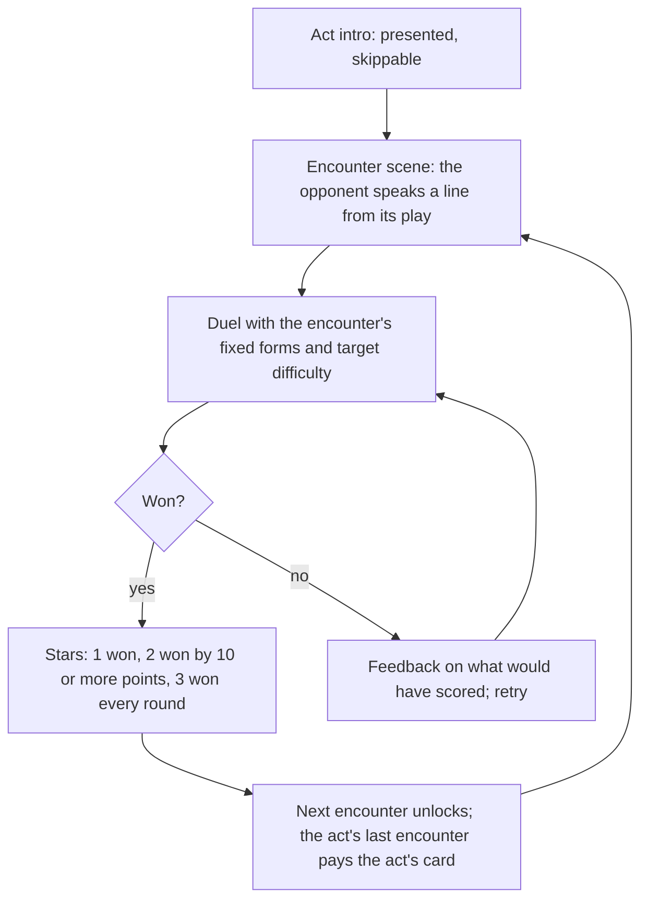

# Sonnet Man: narrative and performer bible

- **Purpose:** the world, houses and characters of the game as built; the voice and tone everything should be written in; the Sonnet Man persona and the risks around it; a design for story mode; and a talent bible for working with Devon Glover, "The Sonnet Man".
- **Audience:** the team (David Charlot, Devon Glover, Arrocito del Diablo), writers, translators, prompt authors, artists, marketing, and counsel drafting the talent agreement.
- **As of:** commit `0d6df6ef` on `integrate/wave3` (2026-11-18), plus the release branches `fix/judge-wording`, `fix/server-authority`, `fix/voice-g2p` and `fix/compliance` (2026-11-19).
- **Status:** Draft for the team, 2026-11-19.
- **Related documents:** `04-content-and-card-bible.md` (cards, lines and content rules), `05-systems-economy-and-balance.md`, `06-modes.md`, `08-art-bible.md`, `09-audio-bible.md`, `18-trust-and-safety-plan.md`, `22-risk-register.md`, `adr/0008-english-voice-g2p-from-cmudict.md`, `sources/as-built-design.md` (cited "design §"), `sources/as-built-tech.md`, `research/sota-design-2026-11.md`, `research/sota-production-2026-11.md`; also `00-README.md` (index), `28-owner-decisions.md`.

**Labels.** *As built*: the code at `0d6df6ef` (cited). *In this release*: a named release branch changes it. *Proposed*: our recommendation, with the research behind it. "Not known" items are collected in §9.

**A rule for this whole document.** Devon Glover is a real person. Nothing here states his words, views, approvals or consent. Where the game or this document needs them, it says what to ask him (§8.5). No words are attributed to him below: who wrote the About page's biography is Not known (ask him, §8.5), and the published profiles of him are summarised, not quoted.

---

## 1. The short version

1. **The game has no written world.** It has a premise in code comments ("Shakespeare characters travel through time and global cities"), 71 cards with a line and a scene each, 14 houses, 20 cities, and a 19-encounter story that cannot be played (design §6). No lore document, timeline or character sheet exists.
2. **Its voice is already clear in the interface**: theatrical, plain about what runs where, and literary in its rules (design §6.10). Older marketing copy still calls it a "rap battle" against an "AI Master Thespian", which it is not.
3. **None of Devon Glover's work is in the game**: no recording, verse, voice or music (design §6.1). But his stage name is the product's name, a Legendary card carries it, the AI opponent can be dealt that card and write verse "as" The Sonnet Man, and the story gives The Sonnet Man an invented line. These need his written agreement or a change before launch (§6).
4. **Proposed:** a story mode that teaches one form at a time across the five existing acts (§7), and a licence with Devon Glover that describes every AI use specifically, with his own counsel (§8).

## 2. The world

### 2.1 What exists (as built)

- **The duel.** "A card game where your move is a verse… duel an AI that runs in your browser" (`src/i18n/pages/home/en.ts:11`). The installed app is "Sonnet Man: the duel of verses" (`src/i18n/pages/shared/en.ts:59`).
- **The stage.** The interface speaks of a theatre: "Raising the curtain…", "Summoning your opponent…", "The stage is theirs tonight." on a loss, "Each character can take the stage once" (`src/i18n/locales/en.ts:176,196,318,341`). The 3D Theatre is a dark floor and a red curtain (design §7.5).
- **Travel.** "Shakespeare characters travel through time and global cities" (`src/lib/variants.ts:2-5`). Twenty cities each lend a +2 ability framed by hip-hop and battle-rap culture: Brooklyn "NYC roast culture, battle rap birthplace", Manila "Filipino rap battle culture" (design §6.6).
- **Houses.** Fourteen houses of characters, each a school of verse with one device (`04-content-and-card-bible.md` §4). Nine are from Shakespeare's plays, two from Romantic, Victorian and Gothic writers (Lake District, and Gothic Circle, which holds the American Poe and the novelist Mary Shelley), two from Greek myth, and one, "Legendary", holds only The Sonnet Man.
- **Story.** Five acts: The Streets of Verona, The Halls of Elsinore, The Enchanted Forest, Tempest Island, The Globe Theatre (`src/lib/story-mode.ts:32-96`).
- **The opponent.** Not one persona. In a solo duel it plays three characters drawn by seed from all 53, each prompted as "You are {card.name} in a duel of verses: theatrical, sharp, in character. Your line in the play: "{quote}"" (`src/lib/verse/opponent.ts:79`; design §6.1).

### 2.2 The world, proposed

A world bible for a card game of verse needs only a few rules. Proposed, built from what exists so nothing already shipped contradicts it:

1. **Every duel is a performance.** The duel happens on a stage before an audience; the judge is the audience's ear. This is the register the interface already uses, and it suits a game whose move is spoken or written verse.
2. **Houses are schools of verse, not armies.** A house is defined by how it speaks (its device), not by whom it fights. Montagues rhyme inside a line, the Danish Court asks, Olympus speaks in long words. Rivalries come from the plays (Montague and Capulet), never from the real world.
3. **Characters keep their own words.** A character's line from its source is canon and is never changed. Anything a character says beyond its source is the game's writing and is marked so (`04-content-and-card-bible.md` §9.2).
4. **The stage tours.** The cities are tour stops of the troupe, where a character takes on a local style. That keeps the variants' premise and gives live events (festivals, school visits) a place in the fiction.
5. **The audience is everyone.** Mixed ages, many languages, classrooms. Nothing in the world needs violence beyond the source plays, and nothing in it is about the player's identity.

Whether The Sonnet Man has a role in the world (host, headliner, or card) is for Devon Glover to choose: by default he is offered the licensed persona or the host (§6.3; `28-owner-decisions.md` D-14).

## 3. The houses as voices

As built: each house's device and "why" line are shown to the player; the art tradition is the painting style (`04-content-and-card-bible.md` §4). Proposed: a one-line voice note per house, for writers of opponent verses, story scenes and prompts. The voice notes are derived from each house's device and source; they are proposals, not canon.

| House | Device (as built) | Source | Voice note (proposed) |
|---|---|---|---|
| Montague | Inner Rhyme | Romeo and Juliet | quick, punning, playful; rhymes tumble inside the line, as Mercutio's do |
| Capulet | The Outcry | Romeo and Juliet | passionate, declarative, loud; lines end on exclamations |
| Verona Court | The Riposte | Romeo and Juliet | measured and judicial; turns your own words back on you |
| Danish Court | The Question | Hamlet | brooding, probing; answers with questions |
| Forest of Arden | Alliteration | A Midsummer Night's Dream | mischievous and musical; sound before sense |
| The Tempest | The Swell | The Tempest | builds like weather; every verse ends bigger than it began |
| Scottish Court | The Drumbeat | Macbeth | incantatory, ominous; one word hammered three times |
| Illyria | Brevity | Twelfth Night | witty, clipped, disguised; short lines that cut |
| Rome | Invocation | Julius Caesar | oratory; calls on names as witnesses |
| Lake District | Balance | Romantic and Victorian poets | calm, even, observed; lines of equal weight |
| Gothic Circle | The Ring | Romantic and Gothic writers | haunted, circular; ends where it began |
| Olympus | Grandeur | Greek myth | elevated, epic; long and lofty words |
| Underworld | The Riposte | Greek myth | patient and cold; remembers everything you said |
| Legendary | One Rhyme | the game's own | to be decided with Devon Glover (§6) |

## 4. The characters

### 4.1 What a character is today (as built)

A character is a name, one line, one scene and a painting (`04-content-and-card-bible.md` §3, §5.1). The cast is 53 characters: 11 from Romeo and Juliet, 4 each from Hamlet, A Midsummer Night's Dream and The Tempest, 3 each from Macbeth, Twelfth Night and Julius Caesar, 10 Romantic and Victorian poets, 10 figures of Greek myth, and The Sonnet Man (design §6.3). The art direction casts the paintings globally: "we are a global planet and represent everyone" (the owner, quoted at `scripts/art/build_prompts.py:3-10`), with one art tradition per house and nine backgrounds in rotation.

When a model writes for a character, it knows only the name and the line (`src/lib/verse/opponent.ts:57-84`). The written opponent's verses are not tied to a character at all; they are tied to a form (design §6.7).

### 4.2 Character sheet (proposed template)

The narrative-bible practice the research describes asks for backstory, motivation, speech patterns, sample lines, boundaries and canon control (research/sota-production §7.6). For a card game whose characters speak only in verse, a short sheet is enough:

| Field | What goes in it | Rule |
|---|---|---|
| Name and source | as `cards.ts` and `NAMES-AND-QUOTATIONS.md` hold them | canon |
| Canon line | the card's line and its source | never changed |
| Other canon lines | up to five more lines from the same source, with act.scene | public-domain text only (`04-content-and-card-bible.md` §9.2) |
| What they want in a duel | one sentence (Tybalt: to provoke; Friar Lawrence: to calm) | the game's writing, marked so |
| How they speak | the house voice (§3) and one personal habit | |
| Never | what the character must not say or be made to say | applies to model prompts too |
| Approved verses | the written-opponent verses this character may play | written by a credited person, reviewed per language |

### 4.3 Two worked sheets (proposed, for writers to copy)

**MO-002 Mercutio** (Montague, Inner Rhyme). Canon line: "A plague on both your houses!" (Romeo and Juliet 3.1). Other canon: the Queen Mab speech (1.4), which the story already cites (1-3: "I shall tell you of Queen Mab"). Wants: to win by wit, and to make the duel a game. Speaks: puns and inner rhymes, mockery of romance. Never: real-world insults; anything about the player's body, identity or family.

**DC-001 Hamlet** (Danish Court, The Question). Canon line: "To be, or not to be, that is the question." (Hamlet 3.1). Other canon: "The play's the thing / Wherein I'll catch the conscience of the king" (2.2), which story encounter 2-3 already uses. Wants: the truth. Speaks: questions, doubt, wordplay on "seem" and "be". Never: self-harm. The soliloquy's subject is a reason for care in a game for teens: the opponent's prompt and verses must not dwell on suicide (a content boundary the California companion-chatbot law makes concrete for game bots, research/sota-production §0 item 3).

## 5. Tone and voice

### 5.1 What the interface sounds like (as built)

The English copy has three registers (design §6.10):

| Register | Examples | Keep? |
|---|---|---|
| Theatrical | "Summoning your opponent…", "The stage is theirs tonight.", "Raising the curtain…", "Apprentice: writes one draft" | yes |
| Plain and privacy-forward | "The opponent runs in your browser: nothing you write leaves this device." "Judged by rule (variety, allusion, sound, and comeback), because no model is running." "If you lose the passkey, we cannot let you back in." | yes: it is the brand's honesty |
| Old marketing | "Where Cards Come Alive", "join the next evolution of trading card games", "Every card you win is yours to keep, collect, and trade." | rewrite |

**The game names itself two ways.** The manifest and home page call it a "duel of verses" and "The Verse Duel"; the playground, About page and app description call it a "rap battle", and the playground offers to "Challenge the AI Master Thespian". The rules and verdicts use literary terms throughout: form, device, signature, power words, curse, craft, judge (design §6.10).

### 5.2 Voice (proposed)

Voice is constant; tone shifts with the player's state (the Mailchimp model, research/sota-production §7.6). Four traits:

1. **Theatrical, never fussy.** Stage words for moments (curtain, stage, take a bow); plain words for instructions.
2. **Exact about what runs where.** Say which judge ran, what the model is, what leaves the device and what does not. This is already the game's best habit.
3. **On the writer's side.** Feedback names the rule and the line ("line 3 has 11 syllables"), and it is offered after a win too, so it does not read as punishment (research/sota-design §4, Duolingo's Explain My Answer).
4. **Sharp at the verse, never at the person.** Opponents trade barbs about the verse, in character. Nothing targets the player's identity, body, family or ability.

### 5.3 Tone by moment (proposed)

| Moment | Tone | Example direction |
|---|---|---|
| First visit, set-up | warm, quick, inviting | "Write two lines that rhyme. That's the whole first move." |
| Writing | calm, practical | the live checklist: what the verse must still do |
| Opponent's verse | in character, theatrical | the opponent's own voice (§3, §4) |
| Verdict, won | generous, brief | name what landed; one effect, skippable (research/sota-design §9) |
| Verdict, lost | respectful, specific | name what would have scored; never mock |
| Errors, sign-in, privacy | plain, exact, no stage words | as the current sign-in copy |
| Classroom | encouraging, formative | feedback, never a grade (`06-modes.md` §8) |

### 5.4 Words (proposed glossary)

| Use | Avoid | Why |
|---|---|---|
| verse duel, duel of verses | rap battle | the game is a verse duel; "rap" promises music and delivery the game does not have, unless Devon Glover's content makes it true |
| your opponent; the written opponent; the model | AI Master Thespian | no such persona is built; the opponent is a character drawn from 53 |
| form, device, signature, power words, curse, craft, judge, ink | combat words: attack, damage, HP | ATK, DEF and HP do nothing (`04-content-and-card-bible.md` §3) |
| "the game's own line" | "Shakespeare's line" for an invented one | `04-content-and-card-bible.md` §9.2 |
| "AI" for anything a model writes or judges | anything implying a person wrote it | EU AI Act Article 50(1): people must know they are interacting with an AI system (research/sota-production §5.4) |

### 5.5 Boundaries for every writer and every prompt (proposed)

- **No sexual content, self-harm or mental-health counselling**, from any character, model or written verse. California's companion-chatbot law excludes a game bot only if it stays on the game and cannot discuss these (research/sota-production §0 item 3).
- **No slurs or identity attacks in any language**; the online word filter is a short English list, so writers and translators are the real defence (design §5.7).
- **Hip-hop slang and gestures get a review pass**; some read as gang signalling to parents and schools (research/sota-design §9).
- **Violence only as the source names it.** The art rules already strip blood words and forbid unnamed weapons (`scripts/art/build_prompts.py:40-45,61-63`).
- **No words in a real person's mouth** (§8.4).

### 5.6 In other languages

As built, the interface is in 16 languages, the multiplayer, privacy and terms pages are English in all of them, and no native speaker has read any of it (design §8; tech §6.4). Register choices were made by the translator, for example Brazilian Portuguese for the interface while the written verses use *tu* and European turns (`docs/language/HUMAN-REVIEW.md` item 11). Proposed: a one-page voice note per language, written with its native reviewer: formal or informal address, how theatrical the language can sound, which literary register a duel verse uses, and how the stage words translate. The IGDA localisation guidance asks for specific voice notes, "don't just say 'British'": name period, region and register with samples (research/sota-production §7.6).

### 5.7 The voice the player hears (as built, and in this release)

As built: the opponent's verse is read aloud in solo battle only, when the player turns the voice on (off by default). English uses Kokoro-82M with the British male voice `bm_george` at speed 0.95, whose code comment reads "Use a British male voice for the Master Thespian character"; other languages use the device's own local voices, or nothing (`src/lib/thespian-voice.ts:14-16,143-158`; design §7.4). No recorded human voice is in the game, and no voice imitates anyone.

In this release (`fix/voice-g2p`): the English voice loses its GPL-licensed eSpeak NG dependency and is rebuilt on the CMU Pronouncing Dictionary (the owner chose "Replace before deploy"). See `adr/0008-english-voice-g2p-from-cmudict.md`, which records two open points: the CMU dictionary is American English while the voice is British (`bm_george`), so whether stress and vowels sound right is for listeners to judge; and the voice model, Kokoro-82M (2025-01-27), predates the owner's rule of models released after 2026-04-01. The branch now has its commits (`21446923`, `35f43c22`): whole CMU pronunciations in a new generated table, public-domain letter-to-sound rules for other words, and the sounds written in the British symbols Kokoro was trained on. How it sounds to a listener is Not known.

Proposed: when the opponent is The Sonnet Man card, do not read its verse in a synthetic voice at all until Devon Glover has agreed how his persona sounds (§6, §8). For the brand's voice (intros, the story finale) prefer recorded human performance: players turned against AI voice lines that replace a performer, and the research's advice is to sell the real performer and cast the AI only as sparring partner and referee (research/sota-design §3, §9).

## 6. The Sonnet Man persona

### 6.1 Where the persona appears today (as built)

| Where | What | Evidence |
|---|---|---|
| Product name | "Sonnet Man: the duel of verses"; the passkey relying party is "Sonnet Man"; the name stays English in every language | `public/manifest.json`; `backend/src/auth/handlers.rs:33-35`; `docs/language/NAMES-AND-QUOTATIONS.md:619` |
| Home page badge | "Shakespeare on the Go", marked in code as "The name of Devon Glover's programme" | `src/pages/index.astro:47-48` |
| About page | "Devon Glover" aka "The Sonnet Man", Creative Director, with a biography (author Not known) and links to his festival page and social accounts | `src/pages/about.astro:21-34`; `src/i18n/pages/about/en.ts:17,22-23` |
| Footer | links to The Sonnet Man's YouTube, X, LinkedIn and Facebook | `src/layouts/BaseLayout.astro:505-514` |
| Card SM-001 | "The Sonnet Man", the only Legendary character; line "Shall I compare thee to a summer's day?"; scene "Shakespeare's words transform into hip-hop bars as the crowd cheers"; device One Rhyme, "The Sonnet Man rides one rhyme all the way down." | `src/lib/cards.ts:33-40`; `src/lib/verse/english.ts:133` |
| Card art | a hip-hop poet and teaching artist on a stage, microphone in hand, painted as "a Black actor of African descent with deep brown skin"; the prompt names no one and asks for no likeness | `scripts/art/build_prompts.py:6,34,66-68`; design §7.2 |
| 3D model | the only model in the game is SM-001's (a point cloud and a splat) of unrecorded origin | design §7.6 |
| Starter deck and online | every new player is dealt SM-001; every account may field it online | `src/lib/verse/duel.ts:287-295`; `src/lib/multiplayer-rules.ts:59` |
| The AI opponent | can be dealt SM-001 (three characters drawn from all 53). With Gemma loaded, the model is prompted "You are The Sonnet Man in a duel of verses: theatrical, sharp, in character. Your line in the play: "Shall I compare thee to a summer's day?"", and the verse is shown under his name and, with the voice on, read in a British synthetic voice | `src/lib/verse/duel.ts:278-284`; `src/lib/verse/opponent.ts:79`; design §1.2, §7.4 |
| Story | the final encounter, "The Final Bow": "A single spotlight illuminates The Sonnet Man himself. "All the world's a stage. You have played your part well. Now — one last verse, and the curtain falls."" | `src/lib/story-mode.ts:89` |
| Plans | the brief built the product around "Devon Glover's ("The Sonnet Man") unique Shakespeare-meets-hip-hop brand", with a 100-card "Sonnet Man Special" tier and "Tour Exclusives"; content capture with his performances is marked not done | `PROJECT_BRIEF.md:5,77-82`; `src/pages/about.astro:57` |

What is **not** in the game: any recording, verse, voice or music by him (design §6.1). The repository records no review or approval by him of any content (design §6, "Could not determine").

### 6.2 Why it matters

Using a real person's name, persona, likeness or voice in trade needs his written consent in New York (Civil Rights Law §51); vague digital-replica clauses are void in New York (General Obligations Law §5-302) and California (Labor Code §927) unless the performer had counsel or union cover; and an AI opponent that writes or speaks "as" The Sonnet Man uses his name and persona in trade (research/sota-production §5.8). The EU AI Act requires players to be told they are interacting with an AI, at the latest at the first interaction (research/sota-production §5.4), which matters more when the persona is a real person: players must not think Devon Glover is writing. Hip-hop audiences reward real artists and test for fakery; AI-looking work counts against a hip-hop title (research/sota-design §9).

Four as-built points need action or his written agreement before launch:
1. **The AI writes as The Sonnet Man** whenever the opponent is dealt SM-001 and Gemma is loaded.
2. **The story puts an invented line in The Sonnet Man's mouth** ("You have played your part well…").
3. **The SM-001 painting may be read as his portrait**, whatever the prompt intended.
4. **His programme's name and his social links are used** on the site.

The owner's standing rule that the central people in generated brand imagery are Black, of Haitian descent by default does **not** apply here: it never applies to depicting a real person. How The Sonnet Man is depicted is Devon Glover's decision.

### 6.3 Options for the persona (proposed, for the owner and Devon Glover to choose)

| Option | What it means | What it needs |
|---|---|---|
| A. Licensed persona | SM-001 is Devon Glover as The Sonnet Man: his approved portrait, his own recorded or written verses; the AI never writes or speaks as him | a licence (§8.3); his recordings and verses; an approvals log |
| B. Host, not a card | The Sonnet Man introduces duels and story acts in his own recorded voice; no card, no AI persona | a licence for name, voice and likeness in recordings |
| C. A fictional figure | the card and story use a different, invented name; Devon Glover is credited as creative director only | rename SM-001 and the story line; the product name is a separate question |

Recommended (proposed): A or B, with one rule that holds under both until a licence says otherwise: **no model writes, and no synthetic voice speaks, as The Sonnet Man.**

Steps that cost little and can ship now, whichever option is chosen (proposed):
- Take SM-001 out of the opponent's draw (`opponentDeck`, `src/lib/verse/duel.ts:278-284`), or let it play only verses Devon Glover wrote or approved.
- Replace The Sonnet Man's story line with a Shakespeare line spoken by the Globe's stage, or with his own approved words.
- Label every model-written verse as AI-written at the point it appears (`fix/compliance` adds the first-interaction notice; a per-verse label goes further).
- Keep the About page biography and links only as he approves them.

## 7. Story mode: a design proposal

### 7.1 What exists (as built)

Five acts and 19 encounters, each with a name, a one-line description, a short narrative in which the opponent speaks, an opponent card and a difficulty label (easy 5, medium 7, hard 7). Most narratives quote the play ("Do you bite your thumb at me, sir?"), and in every language Shakespeare's own lines stay in English, enforced by a test (`src/i18n/pages/story/en.ts:7-8`). No encounter can be played; only 1-1 can be read (design §6.5; `06-modes.md` §5).

### 7.2 Goals (proposed)

1. **Teach one thing per encounter.** Each encounter introduces or tests one form or one device, so the campaign is the game's tutorial and a classroom unit at once (research/sota-design §4: teach by writing one line; §6: the teacher's chosen cards are the lesson).
2. **Short.** One encounter is one duel of two or three rounds, about 3 to 5 minutes (research/sota-design §1).
3. **Presented, skippable intro** for each act. The owner asks this of his other games, and the research suggests applying it here (research/sota-production §7.6, inference); it is not yet a rule for this game, and Poki requires intros to be skippable (research/sota-design §4).
4. **Fair and visible difficulty.** Easy, medium and hard become target ranges for the adaptive opponent (`05-systems-economy-and-balance.md` §10), never a hidden change to the judge.
5. **Rewards are fixed, not random.** Finishing an act earns a named card of that act's house (earned collection rewards remove the loot-box question, research/sota-design §7).

### 7.3 The encounter loop

### 7.4 The five acts, with what each encounter teaches (proposed)

The encounters and opponents are the existing ones (`src/lib/story-mode.ts`), except where a fix is marked. Forms are given for English; another language uses its nearest offered form (`data/forms.csv`).

| Encounter | Opponent | Forms (rounds) | Teaches | Fix needed |
|---|---|---|---|---|
| **Act I: The Streets of Verona** | | | rhyme and answering | |
| 1-1 Street Brawl | Tybalt (The Outcry) | Couplet, Couplet | two lines that rhyme; the opponent's "!" | description says "A Capulet servant": say Tybalt |
| 1-2 The Nurse's Riddle | The Nurse (The Riposte) | Anaphora, Couplet | the same opening word; throwing a word back | |
| 1-3 Mercutio's Challenge | Mercutio (Inner Rhyme) | Paired Quatrain, Couplet | rhyme inside a line | |
| 1-4 The Prince's Judgment | Prince Escalus (The Riposte) | Tercet, Paired Quatrain, Couplet | a full match; relics introduced | |
| **Act II: The Halls of Elsinore** | | | questions and crossed rhyme | |
| 2-1 The Ghost's Warning | Horatio (The Question), who sees the Ghost | Crossed Quatrain, Tercet | ABAB rhyme | the scene is the Ghost's but the opponent is Claudius; no Ghost card exists |
| 2-2 Ophelia's Garden | Ophelia (The Question) | Haiku, Couplet | counting syllables | |
| 2-3 The Mousetrap | King Claudius (The Question) | Crossed Quatrain, Heroic Couplet | potions introduced: curse the king | |
| 2-4 Hamlet's Soliloquy | Hamlet (The Question) | Heroic Couplet, Crossed Quatrain, Haiku | about ten syllables a line | content boundary (§4.3) |
| **Act III: The Enchanted Forest** | | | sound | |
| 3-1 Puck's Pranks | Puck (Alliteration) | Acrostic, Couplet | spelling a word down the lines | |
| 3-2 Bottom's Dream | Bottom (Alliteration) | Crescendo, Couplet | lines that grow | |
| 3-3 Titania's Court | Titania (Alliteration) | Paired Quatrain, Haiku | alliteration | |
| 3-4 Oberon's Trial | Oberon (Alliteration) | Heroic Couplet, Acrostic, Crescendo | house synergy | |
| **Act IV: Tempest Island** | | | shape | |
| 4-1 Caliban's Rage | Caliban (The Swell) | Crescendo, Tercet | the swell | Caliban's line "I know how to curse" suits the Tongue-Tied curse |
| 4-2 Ariel's Song | Ariel (The Swell) | Haiku, Couplet | song-like lines | |
| 4-3 Miranda's Wonder | Miranda (The Swell) | Couplet, Anaphora | a breather: easy target | |
| 4-4 Prospero's Final Test | Prospero (The Swell) | Crossed Quatrain, Crescendo, Heroic Couplet | every form so far | |
| **Act V: The Globe Theatre** | | | mastery | |
| 5-1 The Scottish King | Macbeth (The Drumbeat) | Anaphora, Tercet | "Tomorrow, and tomorrow, and tomorrow": repetition | |
| 5-2 Rome's Betrayal | Brutus (Invocation) | Heroic Couplet, Crossed Quatrain | calling a name | |
| 5-3 The Final Bow | to be decided with Devon Glover (§6.3) | the player's choice of three forms | everything | the line given to The Sonnet Man is invented (§6.2) |

### 7.5 The final encounter (proposed options)

The campaign was written to end with The Sonnet Man. Three ways to keep that ending honest:
- **With Devon Glover's agreement: a recite-then-remix finale.** His method, as the published profile of him describes it, is to recite Shakespeare's original lines and then turn them into hip-hop with his own lyrics (research/sota-design §9). The finale could play his recorded recitation of a sonnet's line, ask the player to write the remix under the round's form, and after the verdict show or play his own remix as a model answer. This needs his recordings, his verses and his written licence (§8).
- **With his agreement but no recordings yet:** the finale's opponent plays only verses he wrote or approved.
- **Without his agreement:** the finale is the Globe itself, a stage that speaks only Shakespeare's lines, and The Sonnet Man is not a character in the story.

### 7.6 What story mode needs built (proposed)

- `story.astro` starts a `DuelSession` with the encounter's forms and target difficulty, and calls `completeEncounter` with stars (both exist; neither is wired: design §6.5).
- Progress saved on the device, and in the account when signed in; a story reward granted by the server in this release's model (`05-systems-economy-and-balance.md` §7).
- The fixes in §7.4's last column; a Ghost card, or Horatio, for 2-1.
- The act intros: script, art and, if Devon Glover agrees, his recorded voice.
- Telemetry: start, finish and retry rates per encounter (`05-systems-economy-and-balance.md` §11).

## 8. Talent bible: working with Devon Glover

### 8.1 Who he is, from the public record

Summarised from the sources the research recorded, not from him (research/sota-design §9; research/sota-production §5.8):
- A performer and teaching artist known as "The Sonnet Man", who sets Shakespeare to hip-hop to entertain and educate (Southern Shakespeare Festival page).
- A National Endowment for the Humanities profile (Spring 2023) describes him as a Brooklyn-raised rapper and Shakespeare ambassador, trained as a mathematics educator, whose method is to recite Shakespeare's original lines and then remix them in his own lyrics; it says he has made content for Flocabulary and toured the US, Europe and Africa.
- Listings for 2026 named him at the Shakespeare Association of America's annual meeting (a workshop on teaching Shakespeare through hip-hop and poetry, and an evening performance), at a "Shakespeare in Music" festival in Stratford-upon-Avon, and at the Palm Beach Shakespeare Festival; the research did not confirm the events took place as listed.
- The NEH profile says he was raised in Brooklyn and his social handle points to New York, but where he is domiciled now is not confirmed, and that decides which state's law governs the licence (research/sota-production §5.8).

In the company (as built and per the plan): Creative Director (`src/i18n/pages/about/en.ts:22`; `PROJECT_BRIEF.md:27`). The brief describes his role as "Shakespeare content, performance, brand ambassador" (`PROJECT_BRIEF.md:27`).

### 8.2 What the game could use from him (proposed; each item needs his written agreement)

| Contribution | How the game would use it | Rights needed |
|---|---|---|
| Recorded performances (audio, video) | act intros, the story finale, a "recite-then-remix" mode, festival challenges, marketing | recording licence; name, voice and likeness in trade |
| His own verses and remixes | model answers shown after a round; the only verses the SM-001 opponent may play; a "beat the Sonnet Man" challenge of the week | copyright licence or assignment; credit line |
| Curation | approving house lines, the Sonnet Man card's text, hip-hop content, classroom material | an approvals process with turnaround times |
| Likeness | the SM-001 painting as his approved portrait, or a portrait he supplies; any 3D model | likeness licence; approval of each image |
| Voice | recorded lines (intros, verdict calls) | voice licence for recordings |
| Synthetic voice or AI persona | **only by a separate addendum**, if ever | digital-replica terms specific enough to survive New York §5-302 and California §927; consent in a separate document naming real-time generation; per-line pay and a usage report, after the SAG-AFTRA Interactive Media Agreement norm (research/sota-design §9) |
| Music | his tracks (on Spotify, Tidal and Apple Music per the About page) in menus or the Theatre | master and publishing licences |
| Teaching method | a classroom mode built on recite-then-remix, mapped to the standards (research/sota-design §6: RL.9-10.9) | credit; his review |
| Live events | tour and festival tie-ins; "Tour Exclusives" from the brief, as earned, free cards | event terms; no paid random drops (`05-systems-economy-and-balance.md` §8.1) |

### 8.3 What must be agreed (proposed term sheet, from research/sota-production §5.8)

Counsel should draft; these are the headings the research found the law and practice require:
1. **Grant:** name, "The Sonnet Man", likeness, voice (recorded; synthetic only by separate addendum), biography and any marks (check the USPTO).
2. **AI uses, described specifically:** whether any AI opponent plays "in the style of" or "as" him; which models and prompts; whether his lyrics or recordings are used to prompt or fine-tune any model; what is excluded. Default: no voice clone, no fine-tuning on his recordings.
3. **Independent counsel for him**, named in the agreement.
4. **Approvals:** persona guidelines, banned topics, sample outputs and marketing; a kill switch he can use.
5. **Labelling:** "AI, not Devon Glover" on any AI verse near his persona (this also meets Article 50(1)); no AI output presented as his statement or endorsement.
6. **Ownership of outputs, credit lines, and his moral-rights preferences** (stronger in the EU).
7. **Term and territory:** worldwide, a fixed term, a wind-down, and deletion of persona assets at the end.
8. **Termination:** morals clauses both ways; breach; change of control.
9. **Successors** under New York's post-mortem right (Civil Rights Law §50-f).
10. **Fees or royalties**, with reporting and audit. Fair pay is part of authenticity with hip-hop audiences (research/sota-design §9).
11. **Warranties and indemnities.**
12. **Classroom approval**, and no access for him to player data.

### 8.4 Working rules for the team (proposed, effective now)

1. **Never write words in his name.** No line, quote, bio, caption, tweet or verse is attributed to him unless he wrote it or approved it in writing.
2. **Never present AI output as his.** No model writes, and no synthetic voice speaks, as The Sonnet Man without the addendum in §8.2.
3. **Never imply his approval.** Do not say he endorses, reviewed or chose anything unless he did, in writing.
4. **Credit him visibly** wherever his work appears, in the form he chooses.
5. **Keep an approvals log** (§8.6). If it is not in the log, it is not approved.
6. **Ask early, in batches**, with samples and a deadline; never ship and ask afterwards.
7. **His data stays his**: no recording, lyric or image of his goes into any model's training or prompts without §8.3 item 2.

### 8.5 What to ask him

Questions for the owner to put to Devon Glover. None has an answer in the repository.

1. Does he want the game to carry his stage name as its product name, and the "Shakespeare on the Go" badge?
2. Should the SM-001 card depict him? With which portrait, and who approves each image?
3. May an AI opponent ever play as The Sonnet Man? If not, should the card be withdrawn from the opponent's draw, or play only his own verses?
4. Which option for the persona (§6.3) does he prefer: licensed persona, host, or a fictional figure?
5. Will he record performances for the game: act intros, a recite-then-remix finale, weekly challenges? Which sonnets or scenes?
6. Will he write or approve verses for the written opponent and model answers? In which languages would he want translations, and who would he trust to make them?
7. How does he want to be credited, and how does he want his biography and links to read on the About page? Did he write or approve the biography there now? (Who wrote it is not recorded.)
8. Which hip-hop content, slang or gestures does he want in a game for teens and classrooms, and which not?
9. Which of his music, if any, may the game use?
10. Which live dates in 2026-2027 could carry a game challenge or event, and what would he want there?
11. Who represents him (counsel, manager, union), and where is he domiciled for the agreement?
12. Has he seen the game? Is there anything in it now he wants changed or removed?

### 8.6 Approvals log (template)

| # | Item | What exactly (file, card, line, image, recording) | Where used | Sent to him (date) | His written decision (date, approved / changes / declined) | Record kept at |
|---|---|---|---|---|---|---|
| 1 | | | | | | |

## 9. Owner questions

Settled on 2026-11-19 in `28-owner-decisions.md`: decided by default under the owner's standing rules where a sensible default existed; open only where it needs the owner's money, identity or contact details, a legal commitment in the company's name, or a public step not yet approved.

1. Which persona option (§6.3) is proposed to Devon Glover, and by when? **Decided by default:** put options A and B to him and let him choose, C only if he declines both; until a licence says otherwise, no model writes and no synthetic voice speaks as The Sonnet Man (28 D-14). When to ask him is part of **Open (28 O-1)**.
2. Before launch, is SM-001 taken out of the opponent's draw, or restricted to approved verses? **Decided by the owner (2026-11-19, R8):** out of the opponent's draw entirely until he decides; approved verses later, if he agrees (28 D-04).
3. Is the story's closing line for The Sonnet Man replaced now? **Decided by default:** yes, with a Shakespeare line spoken by the stage now, or later with his own approved words (28 D-14).
4. Is the product's public name "verse duel" or "rap battle"? Is "Master Thespian" retired? **Decided by default:** "verse duel" until Devon Glover says otherwise; "Master Thespian" stays unless he dislikes it (28 D-37).
5. Who writes the world's few rules (§2.2) and the character sheets (§4.2)? **Decided by default:** Arrocito del Diablo (28 D-62).
6. Who is the native reviewer for each language's voice note (§5.6)? **Decided by default:** reviewers work one language at a time in document 14's order (28 D-50). **Open (28 O-7):** paying them.
7. Should the opponent's English voice change from a British male voice, and should the voice be off when the opponent is SM-001? **Decided by default:** one voice until there are measured voices to choose from (28 D-55). SM-001 is out of the AI opponent's hand entirely (R8), so its voice does not arise until Devon Glover agrees (28 D-04, D-14).
8. Is story mode (§7) in scope for launch or the first season? **Decided by default:** in scope, and finished first of the hidden systems (28 D-39).
9. Who drafts and negotiates the talent agreement, and is there a budget for his fees and recordings? **Open (28 O-1 and O-2):** whether to ask him, and a lawyer to draft it; his fees and recordings are terms of that agreement.
10. Who wrote the "game's own" lines and the written opponent's verses, and may they be credited? **Fact to find out** (28, Facts to find out, 4); no authorship is recorded (design §6).
