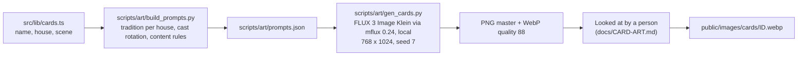
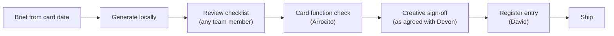

# Sonnet Man art bible

- **Purpose:** one source of truth for how Sonnet Man looks, how its pictures are made and recorded, and what to fix or make next.
- **Audience:** the team (David Charlot, founder and technical lead; Devon Glover, "The Sonnet Man", creative director; Arrocito del Diablo, co-founder for game design and card mechanics), artists, contractors and anyone running an image pipeline for the game; investors may read the summary.
- **As of:** commit `0d6df6ef` (branch `integrate/wave3`, 2026-11-18), plus the release in flight on 2026-11-19: `fix/judge-wording`, `fix/server-authority`, `fix/voice-g2p`, `fix/compliance`, and the nightly database backup.
- **Status:** Draft for the team, 2026-11-19.
- **Related documents:** `03-gdd.md`, `04-content-and-card-bible.md`, `24-marketing-press-kit-and-store-pages.md`, `09-audio-bible.md`, `10-ux-flows-and-design-system.md`, `data/design-tokens.json`, `11-accessibility-plan-and-statement.md`, `sources/as-built-design.md`, `sources/as-built-tech.md`, `research/sota-design-2026-11.md`, `research/sota-production-2026-11.md`, and in the repository `docs/CARD-ART.md` and `scripts/art/build_prompts.py`; also `00-README.md` (index), `28-owner-decisions.md`.

**How to read the labels.** **As built** means the code at `0d6df6ef` does it; the citation is a fact-base section or a `path:line`. **In this release** means a branch named in the line is doing it now; it is not built yet. **Proposed** means a recommendation, with the research behind it. **Not known** means nobody could find out from the repository; each one is also in the closing "Owner questions".

---

## 1. The look in one paragraph

**As built.** Sonnet Man is a dark-only site: warm near-black ("obsidian") pages lit by one gold accent, with headings in a high-contrast serif (Playfair Display). Into that frame it places 71 painted cards. Each of the 14 character houses is painted in a different world art tradition (a Haitian painting for the Forest of Arden, ukiyo-e for The Tempest, a Greek red-figure vase for Olympus), and the characters are cast across the world's peoples. The Sonnet Man's own card is a spray-paint street mural of a Black performer on a gold-lit stage. Around the cards sit an older, photoreal set of 198 "world card" pictures that no page shows, one 3D point cloud, and a geometric 3D theatre with no characters in it (`sources/as-built-design.md` §7).

**What that means.** The palette and the card paintings are the two strong assets. The weak points are a card frame that shows the wrong information, type that covers only Latin scripts, and a backlog of missing or unrecorded assets.

---

## 2. Pillars

**Proposed.** Five pillars, drawn from what is built and from the research. Use them to settle arguments about a picture.

| Pillar | What it means in practice | Grounds |
|---|---|---|
| **Stage light on a dark house** | Gold is the light; obsidian is the theatre around it. One accent, used for what matters now (the form, the score, the active choice). | As built palette (`src/styles/global.css:24-57`) |
| **A world gallery** | Each house keeps its own art tradition. Characters are cast across the world's peoples. | Owner direction of 2026-11-16, recorded at `scripts/art/build_prompts.py:3-10` |
| **The verse is the hero** | Pictures frame words; they never compete with the verse box or the verdict. One strong effect when a line lands, nothing that blocks the next input. | `research/sota-design-2026-11.md` §9 ("restraint in effects"), §4 |
| **Real people stay real** | Devon Glover appears only through his own approved photographs, recordings and performances, credited and paid. No generated likeness of him. | `research/sota-production-2026-11.md` §5.8; `research/sota-design-2026-11.md` §9 |
| **Readable at phone size** | Every card face and icon must read at about 160 px wide on a phone. | `research/sota-production-2026-11.md` §7.4 |

---

## 3. Brand marks and the Inspired Mile family

### The game and the company share one gold, and little else

| Item | As built | Source |
|---|---|---|
| Inspired Mile monogram, favicon | Gold "IM" in Georgia bold on a `#1a1714` rounded square | `public/favicon.svg`; `sources/as-built-design.md` §7.1 |
| Inspired Mile monogram, site header | Obsidian "IM" in Playfair Display on a gold-400 to gold-600 gradient square, beside the words "Inspired Mile" in gold | `src/layouts/BaseLayout.astro:200-206` |
| Product name | "Sonnet Man: the duel of verses"; short name "Sonnet Man" | `public/manifest.json`; `src/i18n/pages/shared/en.ts:59` |
| PWA icons | 192, 512 and maskable 512 px PNG; Apple touch icon 180 px | `public/` |
| Theme colour | `#0d0b09` (obsidian-950) for both theme and background | `public/manifest.json` |

The two monograms differ in face (Georgia against Playfair) and invert the gradient: the favicon fills its letters with the gold gradient (`#e8b420` to `#d4960f`) on a flat `#1a1714` tile, while the header sets dark letters on a gold-gradient tile. **Proposed:** draw one master mark, export it to every size, and record it in the provenance register (section 13).

### inspiredmile.com: the company page follows the imagery rule already

The company site lives in a separate repository, `inspiredmile-web`. Its design record is `notes/DESIGN.md` there. **As built** (that repository, commit `3361493`, 2026-11-17):

- **Concept.** "The page is the mile": six milestones (threshold, wonder, doubt, company, ascent, horizon), each a full-screen painting of one traveller on one pale road, ending on the Voyage Tracable constellation.
- **The traveller** is "a Black traveller of Haitian descent with deep brown skin and short natural coiled hair" (`scripts/scenes.json` there). This is the owner's imagery rule applied (section 7).
- **Tokens.** Ink `#0b0a0d`, paper `#f4efe6`, muted `#b9b1a3`, gold `#e8b420` as the one accent, emerald `#34d399` only for the Voyage star. Playfair Display for display, Inter for text. The gold is the game's gold-400 exactly.
- **Pictures.** Painted with FLUX 3 Image Klein on the owner's machines. Seven looping films were made from the paintings with self-hosted open video models: five with Kandinsky 6.0 Video (released 2026-10-06, MIT) and the two threshold films with LTX-2.5 (released 2026-08-11, LTX-2.x Community License, free under US$10M revenue).
- **Disclosure.** Every milestone says "Made by machine" where the picture is seen, as both video licences ask.
- **Motion.** All motion stops under `prefers-reduced-motion`, and every film has a pause control.
- **An open licence problem.** The five Kandinsky films are decoded by a video VAE under Tencent's Hunyuan Community License, which excludes the EU, the UK and South Korea. The notes left the remedy to the owner: block those files there, accept the risk, or remake them. Decided by default: visitors from those three places see the still paintings in place of the five films, and the five are remade with LTX-2.5 (`28-owner-decisions.md` D-68).

The company page shows a Sonnet Man card picture (`src/assets/sonnet-man.webp` there, alt text "The Sonnet Man card: a performer on a stage ringed with fire"). Its bytes differ from the game's current `public/images/cards/sm-001.webp`. Which version is meant to be current is **Not known**.

---

## 4. Palette and value rules

### The palette is three ramps and the Tailwind defaults

**As built** (`src/styles/global.css:24-57`). Every value below is in `data/design-tokens.json`. Contrast is the WCAG 2 ratio against the page background `#0d0b09`, **computed for this document** from the hex values; nothing was measured in a browser.

| Token | Hex | Where it is used | Contrast on the page |
|---|---|---|---|
| gold-300 | `#f0c94e` | headline accents, the home card's name | 12.32 |
| gold-400 | `#e8b420` | the accent: active nav, form names, scores, ink | 10.27 |
| gold-500 | `#d4960f` | primary button fill; borders at 20-50% | 7.64 |
| obsidian-100 | `#e3e1de` | body text | 15.05 |
| obsidian-300 | `#a9a197` | navigation, intros | 7.70 |
| obsidian-400 | `#908578` | notes, card quotes | 5.44 |
| obsidian-500 | `#7f7567` | small uppercase labels, checklist detail | **4.34 (fails 4.5)** |
| obsidian-600 | `#6c6157` | seed note, unmet checklist marker | **3.26 (fails 4.5)** |
| obsidian-700 | `#584e48` | panel, input and chip borders | **2.43 (fails 3.0 for controls)** |
| obsidian-900 | `#1a1714` | panels, inputs | (surface) |
| obsidian-950 | `#0d0b09` | page | (surface) |
| crimson-400 | `#f87171` | ATK, danger text | 7.10 |
| crimson-500 | `#dc2626` | danger button (white text 4.83) | 4.07 |

- **Rarity** is a coloured word on a pill: Common obsidian-400, Uncommon emerald-400, Rare blue-400, Epic purple-400, Legendary gold-400 (`src/lib/cards.ts:731-737`). Because the rarity is written, it is not shown by colour alone. The Common pill computes at about 3.6:1 against its own fill, below 4.5:1.
- **Stats** use crimson (ATK), blue (DEF) and emerald (HP), each with its label (`src/pages/collection.astro:111-113`).
- **House colours do not exist.** Every card has its own gradient and border pair; Montague's four cards use four different pairs (counted from `src/lib/cards.ts` for this document). A player cannot tell a house by colour.

### Value rules

**Proposed** (WCAG 2.2 AA; `research/sota-production-2026-11.md` §7.4, §7.11):

1. Essential text is obsidian-400 or lighter. Obsidian-500 and -600 stay only for decoration or for large text.
2. A border that marks a control (input, chip, select) is obsidian-500 or lighter, to reach 3:1.
3. Never carry meaning by colour alone. Win and loss already pair crimson and emerald with words; keep it so, because red and green are the pair most often confused.
4. Give each house one signature hue, taken from its art tradition, and use it on the card frame (section 5). This replaces the per-card random gradients.
5. Keep dark as the default. A light theme is a later accessibility option (`11-accessibility-plan-and-statement.md`).

---

## 5. Card frames

### Four frames exist, and none shows what a card does in play

**As built.** There is no single card component. Each screen draws its own.

| Where | What the frame shows | Source |
|---|---|---|
| Collection grid tile | A glass panel with the card's own tinted border; a 192 px-high band of the painting, cropped from 3:4 with `object-cover`; rarity pill (top end); card id in 60% grey mono (top start, about 2.65:1); name in Playfair; house and element; ATK, DEF and HP for characters; the English quote in two italic lines; a duplicate count | `src/pages/collection.astro:70-125` |
| Home hero card | 288 × 420 px, gold border, glow and a slow float; id, ATK, a 192 px painting band, name, "Master Thespian · Legendary", element and "Bard" tags, quote, HP and DEF, five rarity dots | `src/pages/index.astro:85-130` |
| Duel chip | A 32 × 32 px thumbnail, the name, and a 10 px line naming the device, curse or "power words" | `src/pages/battle.astro:283-301` |
| Opponent portrait | 56 × 56 px picture beside the opponent's name and device | `src/pages/battle.astro:111-118` |
| Theatre and VR gallery | Card planes showing the painting; VR planes 2 × 2.8 m with a gold name plate that carries no name | `sources/as-built-design.md` §7.5, §7.6 |

**Problems, read from the code** (not seen on a screen):

- **The stats mislead.** ATK, DEF and HP are printed on every character and play no part in a duel (`sources/as-built-design.md` §1.3).
- **What matters is hidden.** A character's device (its house's verse trick) and its signature words decide its score, but the card face shows neither. They appear only in the duel's chip and checklist.
- **The painting is cropped.** A 3:4 portrait shown as a wide band loses the top and bottom of the picture; whether faces are cut was not checked.
- **The quote has no source.** Sources exist in `docs/language/NAMES-AND-QUOTATIONS.md` but are not printed.
- **Chips load full paintings.** Each 32 px chip loads the 768 × 1024 card image, about 255 KB on average (derived from `sources/as-built-design.md` §7.1).

### A card face built for play and for phones

**Proposed.** One card component, used on every screen, in three sizes (full, tile, chip). The mechanics on it are Arrocito's to confirm; the look is Devon's to review (see the questions at the end).

| Zone | Content | Rule |
|---|---|---|
| Header | Name (Playfair, at least 16 px on the full card) and the house, with the house's signature hue | Name in the card data's own language rules (names stay in English) |
| Painting | The full 3:4 painting, at least half the card's height | No crop on the full card; a centred crop chosen per card for the tile |
| Device | Device name and its one-line rule ("End a line on a question") | Comes from `src/lib/verse/devices.ts`, translated |
| Signature | The echo words ("Echo 1 of: compare, summer") | From `signatureWords` |
| Cost | "1 ink" on relics and potions | From `duel.ts` |
| Rarity | The word, plus a corner gem whose shape differs per rarity | Not colour alone |
| Quote | The line, with its source ("Sonnet 18") | Sources from `NAMES-AND-QUOTATIONS.md` |
| Stats | Removed, or moved off the face, unless a mode gives them a use | Decision for Arrocito |

- **Sizes.** The tile must read at 160 px wide (a two-column grid on a 360 px phone): no text below 12 px, no control below 24 × 24 px (WCAG 2.2 SC 2.5.8).
- **Thumbnails.** Generate a 384 × 512 tile image and a 96 × 96 chip image from each master, so the duel loads kilobytes, not a quarter-megabyte per chip.

---

## 6. Card art as built

### How the 71 paintings were made

**As built** (`docs/CARD-ART.md:1-6`; `scripts/art/gen_cards.py:1-60`; commit `0566ca42`, 2026-11-16):

- **Tool.** FLUX 3 Image Klein, under the FLUX Kommunity License, run through mflux 0.24 on the owner's own Apple Silicon machines. No hosted service was used.
- **Settings.** 768 × 1024 px, seed 7, one image per card, saved as a PNG master and a WebP at quality 88.
- **Review.** "Every image must be looked at by a person before it is published" (`gen_cards.py:9`).
- **Not known:** the model's release date, which the owner's rule (models released after 2026-04-01) needs; and whether the FLUX Kommunity License's terms suit the game. The licence text is not saved in the repository (`sources/as-built-tech.md` §11.3).

### One world tradition per house

**As built** (`scripts/art/build_prompts.py:16-33`).

| House | Tradition | House | Tradition |
|---|---|---|---|
| Legendary (The Sonnet Man) | contemporary street-art mural | Scottish Court | Celtic illuminated manuscript |
| Montague | Italian Renaissance fresco | Illyria | Persian miniature |
| Capulet | Art Nouveau poster | Rome | Mexican muralism |
| Danish Court | German Expressionist woodcut | Lake District | Chinese shan shui ink wash |
| Forest of Arden | Haitian painting | Gothic Circle | Russian lacquer miniature |
| Verona Court | Ethiopian Orthodox icon | Olympus | Greek red-figure vase |
| The Tempest | Japanese ukiyo-e | Underworld | ancient Egyptian tomb painting |
| Relics | Mughal miniature | Potions | West African textile |

Styles "sacred to, or owned by, living Indigenous communities are deliberately not imitated" (`build_prompts.py:9-10`).

### Casting across the world's peoples

**As built.** Each character is "played by" an actor whose background the prompt names, in a fixed rotation; The Sonnet Man is always "a Black actor of African descent with deep brown skin" (`build_prompts.py:34-35,66-68`). Counted from `scripts/art/prompts.json` for this document, the 53 characters are cast as:

| Cast named in the prompt | Characters |
|---|---|
| Black, of African descent | 7 (The Sonnet Man and 6 others) |
| East Asian, South Asian, Latino, Middle Eastern, Native American, Pacific Islander | 6 each |
| white European, Southeast Asian | 5 each |

### Content rules every prompt carries

**As built** (`build_prompts.py:40-45,54-82`):

- Long, modest clothing; "suitable for all ages".
- No weapon unless the scene names one; blood words in a scene become "crimson light" or "gleaming".
- No text, lettering, border, frame, rounded corners, watermark or signature; quoted words and sentences about inscriptions are stripped from the scene, because the model paints them as letters.
- Objects are still lifes with no people and no labels.
- Every character except The Sonnet Man sits in their own historical or mythic era, with no modern objects.

### What the paintings look like

Eight different images have been viewed at full size: six for the fact base (`sources/as-built-design.md` §7.2) and two more for this document (SM-001 was viewed again).

| Card | What it shows |
|---|---|
| SM-001 The Sonnet Man | A spray-and-oil mural. A Black performer in a dark leather jacket, microphone in hand, walks a round stage under a gold spotlight between red curtains; a cheering crowd in robes and headscarves. Gold and crimson. |
| DC-001 Hamlet | Violet-and-black woodcut on Elsinore's battlements with Yorick's skull and the ghost; he holds a blade the scene does not name. |
| TP-002 Ariel | Ukiyo-e: teal robes above Hokusai-like waves, visible paper grain. |
| OL-001 Zeus | Gold on blue-black like a vase, enthroned under lightning; the corners are rounded. |
| PT-002 Witches' Brew | Three Black figures in green robes around green smoke on a kente-like ground; letter-like glyphs in the pattern. |
| FA-001 Puck | Lush, saturated greens and dappled light; Puck leaps barefoot over sleeping figures in a forest. Flat, joyful pattern in the foliage. |
| LD-001 William Wordsworth | Soft ink-wash mountains and a lake; the poet walks through daffodils holding a book, in grey-green robes. |
| MO-001 variant (Tokyo) | **Photoreal**, not painted: a young man in streetwear at a rainy neon crossing, trainers with a swoosh-like mark. |

**The set's character.** Inside a house the medium holds; across houses it deliberately changes. Every card is portrait and full-bleed, with one large central figure or a still life, and faces drawn naturalistically within each tradition.

### Known faults

**As built.** Eight faults are on record: five in `docs/CARD-ART.md:8-13` and three found in the fact base's viewing (`sources/as-built-design.md` §7.2).

| Card | Fault | Source |
|---|---|---|
| CA-001 Juliet | Cast as East Asian, painted as white | `docs/CARD-ART.md` |
| PT-003, PT-009 | Their names painted as labels | `docs/CARD-ART.md` |
| Capulet (3 cards) | An Art Nouveau ornamental border | `docs/CARD-ART.md` |
| UW-003 Medusa | Petrified victims around her | `docs/CARD-ART.md` |
| Variants | Made from the earlier artwork | `docs/CARD-ART.md` |
| DC-001 Hamlet | A blade the scene does not name | fact base §7.2 |
| OL-001 Zeus | Rounded corners | fact base §7.2 |
| PT-002 Witches' Brew | Letter-like glyphs | fact base §7.2 |

**Proposed:** repaint these eight in one pass, with the review checklist in section 13. Only seven of the 71 cards have been viewed at full size by anyone writing this dossier, so a full review pass of all 71 at full size and at tile size comes first.

---

## 7. The imagery rule

### The rule

The owner's standing rule: **in generated brand imagery, the central people are Black, of Haitian descent, by default.** The rule never applies to depicting a real person.

### How it meets the two other directions on record

Two other owner directions touch the same pictures, so the scope needs stating:

1. **"We are a global planet and represent everyone"** (2026-11-16, for the card art; `build_prompts.py:3-10`). The cards cast characters across nine backgrounds.
2. **Devon Glover is a real person.** His name, likeness and voice need his signed consent (`research/sota-production-2026-11.md` §5.8).

| Picture | Who is central | Rule that governs | As built | Kind |
|---|---|---|---|---|
| Brand imagery: the home hero, store and press art, posters, social images, trailers, the intro, the company site | an invented person | **Black, of Haitian descent, by default** | The company site's traveller follows it. The game's home hero reuses the SM-001 card (below). | As built / Proposed |
| Character cards | a literary or mythic character | the global casting rotation | 53 characters across nine casts | As built; scope decided by default (`28-owner-decisions.md` D-53) |
| The ten Romantic and Victorian poets (Wordsworth to Rossetti) | real historical people | the real-person exception: the rule does not apply | Cast like stage roles through the rotation ("played by an actor") | As built; to confirm |
| SM-001 The Sonnet Man | the stage name of a real, living person | the real-person exception, and his consent | Painted as "a Black actor of African descent"; the prompt names no one and asks for no likeness (`build_prompts.py:66-68`). Whether it is meant to depict him is **Not known**. | Decision needed |

### SM-001 needs a decision before anything else is made of it

**Proposed.** Choose one, with Devon Glover:

- **(a) The card is Devon Glover.** Replace the generated picture with art made from photographs he approves, under a signed licence that names this use. No generated likeness of him (`research/sota-production-2026-11.md` §5.8, items 1, 4 and 5).
- **(b) The card is a persona, not a portrait.** Keep a painted, clearly non-photographic figure, and record in writing, with him, that it is not his likeness and that the name is used under his licence.

Until that is settled, do not use SM-001's picture in new marketing.

### Brand pictures to make next

**Proposed.** Any new generated brand picture (store tiles, press kit, intro) casts its central person as Black, of Haitian descent, unless the brief says otherwise; it is made with self-hosted models released after 2026-04-01, looked at by a person, recorded in the register, and labelled as machine-made wherever the licence asks. A picture of Devon Glover is never generated: it comes from his own approved photographs.

---

## 8. World-card variants

### 198 pictures ship and none is shown

**As built** (`sources/as-built-design.md` §6.6, §7.2; `sources/as-built-tech.md` §11.3):

- 198 WebP files at 864 × 1152, 16 MB in all, in `public/images/variants/`.
- **Photoreal**, unlike the painted cards, and made "from the earlier artwork".
- The generator calls Z-Image Turbo through a hosted Hugging Face Space (`scripts/generate-variant-art.ts:1-12`). That is cloud inference, which the owner's rules no longer allow. The licence is not recorded.
- **Orphaned:** every screen shows the base card's painting; no page reads a variant's image.
- 27 files use city codes the catalogue no longer has, and one shows a swoosh-like trademark.
- A variant's skin tone is one of six, drawn at random when it is awarded (`src/lib/variants.ts:657-661`).

**Proposed:**

1. Take the 198 files out of the shipped build. They cost 16 MB and are seen by no one.
2. Decide whether world cards need pictures at all. Today they are a +2 bonus and a name. Decided by default: no new pictures until the card redesign gives world cards a role (`28-owner-decisions.md` D-69).
3. If they do, paint them locally in the house's own tradition, with the city as the setting, not as a photoreal costume change.
4. Drop skin tone from the random cosmetic draw. Making a character's skin tone a random collectible reads badly next to the casting rules above; if tone stays, let the player choose it.

---

## 9. 3D, XR and AR

### One model exists, and it is a point cloud

**As built** (`sources/as-built-design.md` §7.5, §7.6):

- **The Theatre** is deliberately minimal: an 8 × 8 m dark floor, a deep-red curtain, one hemispheric light, text panels in Georgia, gold accents `#e8b420`, a green or crimson verdict frame, and card planes for the hand. No characters, no models. In Quest passthrough the floor and curtain hide.
- **The VR gallery** puts all 71 catalogue cards on pedestals, characters in an outer ring and items in an inner one. Its name plates carry no text.
- **Model files.** `AR_MODELS` lists 18 GLBs; only `sm-001.glb` exists, and it is a coloured point cloud of 16,384 points, not a mesh. One Gaussian splat (`sm-001.ply`) exists out of 53 paths. No `.usdz` file exists, so iPhone Quick Look has nothing to show. Both files date from the February 2026 build and their origin is not recorded.

**Proposed:**

1. Hide the 3D and AR buttons for every card without a file, and list only cards that have one in the 3D viewer. Today 17 of 18 detail views point at a missing file.
2. Decide whether 3D cards are in scope this year. If they are, make them from the approved paintings with a self-hosted image-to-3D model released after 2026-04-01 under a licence that allows commercial use. None has been evaluated for this game; that is a research task, not a choice made here.
3. Keep the Theatre geometric. It suits the "verse is the hero" pillar and costs no art budget.

---

## 10. Typography

### Five families ship, three are used, and only Latin scripts are covered

**As built** (`src/styles/global.css:59-61,157-267`; `public/fonts/`).

| Role | Family | Where | Notes |
|---|---|---|---|
| Display | Playfair Display (upright and italic) | every heading, card names, verses | Georgia, then serif, as fallbacks |
| Body | Inter | running text | system-ui fallback |
| Mono | JetBrains Mono | ids, round label, scores, seed | |
| Unused | Outfit, Space Grotesk | nowhere | 88,232 bytes of woff2 in the repository; browsers do not fetch an unused face |

- **Subsets.** Latin and Latin-ext only. Cyrillic, Arabic, Devanagari, Thai, Chinese, Japanese and Korean fall to the device's own fonts.
- **Vietnamese.** The Latin-ext range stops short of most tone-marked letters (U+1EA0 to U+1EF1), so a Vietnamese word can mix two fonts.
- **Script rules already built:** Japanese and Chinese headings keep accented words whole; Japanese breaks between phrases and keeps small kana and ー off a line start; Korean breaks only at spaces; Arabic, Hindi and Thai lose letter-spacing; no italic is synthesised for Arabic, Hindi, Thai, Chinese, Japanese and Korean (`src/styles/global.css:106-155,270-287`).
- **Licences.** "Self-hosted Google Fonts" (`public/fonts/fonts.css:1`). No licence file ships. These families are normally under the SIL Open Font License 1.1; the repository does not record it.

**Proposed:**

1. Record each family's OFL licence file in `public/fonts/`.
2. Cover every script the game offers with self-hosted fonts, each sliced by `unicode-range` and fetched only on pages in that language: first the Cyrillic and Vietnamese subsets of the families already used (check they exist and are complete), then one family per remaining script (Arabic, Devanagari, Thai, CJK). CJK fonts are 15-40 MB per weight raw and must be sliced (`research/sota-design-2026-11.md` §8).
3. Remove Outfit and Space Grotesk.
4. Keep the verse in the display face wherever that face covers the script, so a duel looks the same in Spanish and in English.

---

## 11. UI art, icons and motion

**As built.**

- **Icons.** Inline outline SVGs (menu, chevrons, lock, speaker) whose source is not recorded; an emoji microphone on the speech button; an emoji `icon` per card used only when a picture is missing, which none is (`src/lib/cards.ts:22-24`).
- **Motion.** Card flip on hover (0.6 s), pulsing gold glow (3 s loop), a float on the home card (4 s loop), a scan line (2 s loop), a typewriter reveal, and `animate-pulse` on page badges. No `prefers-reduced-motion` rule exists (`src/styles/global.css:298-360`; `sources/as-built-design.md` §8).

**Proposed:**

1. One icon set with a recorded open licence, self-hosted, drawn at 24 px on a 2 px stroke; the microphone becomes an icon with a text label.
2. **Motion rules:** one effect confirms each accepted input within 100 ms; one strong effect when a line lands (a rhyme or the device); the verdict sequence is short and skippable and never stands between the player and the next round; every loop stops under reduced motion (`research/sota-design-2026-11.md` §4, §9). The company site already works this way.

---

## 12. Technical specifications

| Asset | As built | Proposed |
|---|---|---|
| Card painting | 768 × 1024 WebP, quality 88, 163-375 KB, mean 256 KB; 71 files, 18 MB | Keep the master. Add a 384 × 512 tile and a 96 × 96 chip, generated by script, named `<id>-tile.webp` and `<id>-chip.webp` |
| Variant picture | 864 × 1152 WebP, mean 82 KB; 198 files, 16 MB | Remove (section 8) |
| 3D | one GLB (459 KB), one PLY (918 KB) | Hide until real models exist |
| Icons | PNG 180/192/512/maskable 512, SVG favicon, ICO | One master mark (section 3) |
| Naming | `public/images/cards/<id lower-case>.webp` | Keep |
| Masters | PNGs kept beside the WebPs on the generation machine | Archive them with the prompts and seeds in a dated store. Where they are kept now is **Not known** |
| Offline | The service worker keeps images it has fetched (no total cap; 12 MiB per file) | No change |

Sources: `sources/as-built-design.md` §7.1; `public/sw.js:40,77`.

---

## 13. Provenance, review and disclosure

### Provenance register

**In this release** (`fix/compliance`, `docs/ASSETS.md`, commits `50525b46`, `ff00ef30`, `c779effd`): a record of where every shipped file came from, and a test that fails when a music, sound or 3D file is added without its line or an image folder's count changes. The table below gives the state at `0d6df6ef` and, in its last column, what the branch adds. **Proposed:** keep this table and `docs/ASSETS.md` in step.

| Asset group | Count | Made with | Licence recorded? | Review recorded? | Status |
|---|---|---|---|---|---|
| Card paintings | 71 | FLUX 3 Image Klein via mflux 0.24, local, 2026-11-16 | Named only at `0d6df6ef`. **In this release** the licence text is read from the weights' own file: commercial use of outputs is licensed only while the company and its affiliates earn **under US$5M a year** (lower than the LFM licence's US$10M, which is the threshold the owner confirmed), and output must be disclosed as AI-made where law requires | Yes, as a rule (`gen_cards.py:9`) | Shipped; 8 faults |
| Variant pictures | 198 | Z-Image Turbo through a public Hugging Face Space (a hosted service, 2026-02-14) | **In this release**: Apache-2.0 by the model card | No | Shipped, unseen; 27 use city codes the catalogue no longer has |
| 3D model and splat | 2 | **In this release**: byte-identical to output of the owner's own `efficient-genai` pipeline (2026-02-15); the model that made the figure is not traced | No | No | Shipped |
| Fonts | 5 families | Google Fonts files, self-hosted | **In this release**: OFL 1.1, files byte-identical to Google Fonts', `public/fonts/OFL.txt` now shipped | n/a | Shipped |
| Icons and monogram | about 10 | **In this release**: made in this repository; no outside source recorded or suspected | n/a | No | Shipped |
| Company-site paintings and films | 6 paintings, 7 films | FLUX 3 Image Klein; Kandinsky 6.0 Video; LTX-2.5 | Yes, in `inspiredmile-web/notes/DESIGN.md` | Yes | Live; Tencent VAE territory question open |

### Review checklist for any new picture

**Proposed.** A picture ships only when a person has checked, at full size and at tile size:

- the cast matches the prompt (Juliet shows why);
- no text, letters, glyphs, border, frame or rounded corners;
- no weapon the scene does not name; no gore; clothing modest; suitable for all ages;
- the house's tradition is kept, and no living Indigenous sacred style is imitated;
- no trademark or logo;
- it reads at 160 px wide;
- it is entered in the register with model, version, seed, prompt, date, reviewer.

### Who approves what

**Proposed.** What Devon Glover reviews, and whether he wants to, must be agreed with him; nothing here assumes his approval.

### Disclosure

**Proposed:**

- Say on `/credits` (being built **in this release**, `fix/compliance`) and in the press kit that the card art was made with an image model on the studio's own machines, directed and checked by people. The research found core players strongly negative on AI that replaces human craft (`research/sota-design-2026-11.md`, bottom line and §3); being plain about it is safer than being found out (§8, *The Alters*).
- Add machine-readable provenance to each image (for example the IPTC digital-source-type field in XMP). Whether the EU AI Act's Article 50(2) marking duty reaches art made before release, rather than content the game's AI generates for players, is **Not known** and is a question for counsel (`research/sota-production-2026-11.md` §5.4).

---

## 14. Do's and don'ts

| Do | Don't |
|---|---|
| Use gold for the one thing that matters on screen | Spread gold across every label |
| Paint each house in its own tradition | Mix traditions inside a house |
| Show the device and signature on the card | Print ATK, DEF and HP as if they mattered |
| Keep the painting whole on the full card | Crop faces to fit a band |
| Use Devon Glover's own approved photographs and recordings | Generate his face or voice |
| Cast central people in brand imagery as Black, of Haitian descent, by default | Apply that default to real people |
| Make pictures locally with recorded, dated, licensed models | Use hosted generators or unrecorded files |
| Label machine-made pictures where a licence or the law asks | Imply a person painted them |
| Stop every loop under reduced motion | Animate what the player is trying to read |

---

## 15. Asset list and gaps

| Asset | Have | Need or fix | Kind |
|---|---|---|---|
| Card paintings | 71 | 8 repaints; full review of all 71 | Proposed |
| Card thumbnails | 0 | 71 tiles, 71 chips | Proposed |
| Card frame component | 4 ad hoc frames | 1 component, 3 sizes | Proposed |
| House signature hues | 0 | 14 | Proposed |
| World-card pictures | 198 orphaned photoreal | remove; decide scope | Proposed |
| 3D models | 1 point cloud of 18 configured (17 missing) | hide buttons; decide scope | Proposed |
| Splats | 1 of 53 | as 3D | Proposed |
| iOS AR files (`.usdz`) | 0 | only if 3D stays | Proposed |
| Fonts for non-Latin scripts | 0 | Cyrillic, Vietnamese, Arabic, Devanagari, Thai, CJK | Proposed |
| Font licence files | 0 | 3 | Proposed |
| Master monogram | 2 versions | 1 | Proposed |
| Icon set | unrecorded SVGs and emoji | 1 licensed set | Proposed |
| Devon Glover photographs | 0 | only under his signed licence | Proposed |
| Brand key art (store, press, intro) | the SM-001 card reused | new pieces under the imagery rule | Proposed |
| Provenance register | partial (`docs/CARD-ART.md`) | complete | In this release (`fix/compliance`, `docs/ASSETS.md`): music, effects, 3D, images, fonts |

---

## 16. Proposals in order

| # | Proposal | Why | Section |
|---|---|---|---|
| 1 | Settle SM-001 with Devon Glover: his approved likeness, or a recorded persona | Right of publicity; brand trust | 7 |
| 2 | Hide 3D and AR buttons for the 17 missing models; remove the 198 orphaned variants from the build | Broken promises on screen; 16 MB shipped for nothing | 8, 9 |
| 3 | Complete the provenance register, with licence texts and release dates | Owner's date rule; licences; `fix/compliance` | 13 |
| 4 | Fix contrast: essential text obsidian-400 or lighter; control borders obsidian-500 | WCAG 2.2 AA | 4 |
| 5 | One card component showing device, signature, cost and source; stats off the face | Players see what decides a round | 5 |
| 6 | Card thumbnails | Speed on phones | 5, 12 |
| 7 | Repaint the 8 known faults after a full review | Quality, content rules | 6 |
| 8 | Fonts for every offered script, with licence files | 16 languages look like one game | 10 |
| 9 | House signature hues; one icon set; one monogram | Consistency | 3, 4, 11 |
| 10 | Brand key art under the imagery rule, made locally | Store, press and intro need pictures | 7 |

---

## Owner questions

Settled on 2026-11-19 in `28-owner-decisions.md`: decided by default under the owner's standing rules where a sensible default existed; open only where it needs the owner's money, identity or contact details, a legal commitment in the company's name, or a public step not yet approved.

1. Is the SM-001 card meant to show Devon Glover, and which company-site picture of The Sonnet Man is current? The first is his to answer (28 Part 3, question 3; O-1); the second is a fact to find out (28, Facts to find out, 14).
2. Does the brand-imagery default cover only brand and marketing pictures, and how are the real poets cast? **Decided by default:** brand and marketing imagery only; card characters keep the 2026-11-16 global casting; real poets and Shakespeare's characters as the house tradition casts them (28 D-53).
3. When was FLUX 3 Image Klein released, and is its US$5M revenue condition acceptable? **Decided by default:** record the condition beside the LFM one, with a repaint plan if revenue nears it (28 D-33). The release date is a fact to find out (28, Facts to find out, 5). **Open (28 O-9):** roughly what is the company's yearly revenue?
4. Where are the masters, prompts and seeds of the 71 paintings archived? **Decided by default:** archived with their prompts and seeds, recorded in `docs/ASSETS.md` (28 D-54).
5. Should the variant pictures made through a hosted service be kept, given the no-cloud-inference rule? **Decided by default:** no; the 198 variant pictures are removed (28 D-33).
6. Remove the 198 variant pictures? Should world cards have pictures? Should skin tone stay a random cosmetic? **Decided by default:** the 198 are removed (28 D-33); world cards get no new pictures until the card redesign gives them a role; skin tone leaves the random draw, and if it stays, the player chooses it (28 D-69).
7. Are 3D cards and AR in scope for the next six months? **Decided by default:** 3D and AR work comes after the duel has players; an order, not a cut (28 D-54).
8. Which model made the 3D figure, and under what terms? A fact to find out (28, Facts to find out, 9).
9. Which remedy for the company site's five Kandinsky films? **Decided by default:** stills in place of the five films for visitors from the EU, the UK and South Korea, and the five remade with LTX-2.5, which then serve everyone (28 D-68).
10. Should the stats leave the card face? **Decided by default:** yes, until they have a role in writing; they stay in the card data for the redesign. Arrocito del Diablo's weekly review may change it (28 D-42, D-49).
11. A light theme, or only a high-contrast option? **Decided by default:** a high-contrast option rather than a light theme (28 D-54).
12. Should this document state the reason for the imagery rule? **Decided by default:** it states the rule without the owner's personal background, which stays private (28 D-53).

## Questions to ask Devon Glover

Nothing in this document records his words, views or approvals. Asking him is part of `28-owner-decisions.md` O-1. Ask him:

1. Do you want The Sonnet Man card to show you? If so, which photographs may be used, what may be stylised, and what must never be made?
2. What do you want to review as creative director (card art, brand pictures, the intro), and how quickly can you turn reviews around?
3. Are there art traditions, gestures, clothing or symbols you want kept out of a game for schools?
4. May we use your stage photographs, performance footage or album art, and which of them?
5. How do you want to be credited on the cards, the credits page and the store pages?
