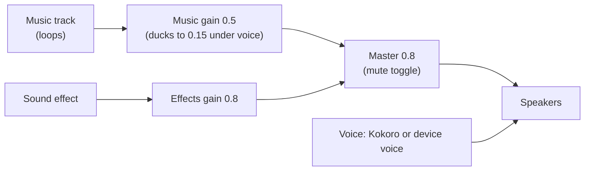

# Sonnet Man audio bible

- **Purpose:** how Sonnet Man sounds, how sound carries information, what the speech in and voice out do, which audio has no recorded right to be there, and what to make or replace next.
- **Audience:** the team (David Charlot, founder and technical lead; Devon Glover, "The Sonnet Man", creative director; Arrocito del Diablo, co-founder for game design and card mechanics), composers, sound designers, voice directors, engineers and counsel.
- **As of:** commit `0d6df6ef` (branch `integrate/wave3`, 2026-11-18), plus the release in flight on 2026-11-19: `fix/judge-wording`, `fix/server-authority`, `fix/voice-g2p`, `fix/compliance`, and the nightly database backup.
- **Status:** Draft for the team, 2026-11-19.
- **Related documents:** `03-gdd.md`, `13-ai-design-and-system-cards.md`, `14-localisation-kit.md`, `19-privacy-pack.md`, `08-art-bible.md`, `10-ux-flows-and-design-system.md`, `11-accessibility-plan-and-statement.md`, `sources/as-built-design.md` (§7.3, §7.4, §8), `sources/as-built-tech.md` (§4.3, §11), `research/sota-production-2026-11.md` (§3, §5.4, §5.8, §7.5), `research/sota-design-2026-11.md` (§8, §9); also `00-README.md` (index), `28-owner-decisions.md`.

**How to read the labels.** **As built**: the code at `0d6df6ef` does it (cited). **In this release**: a named branch is doing it now; not built yet. **Measured on a spike**: a test branch measured it; nothing of it ships. **Proposed**: a recommendation, with its research. **Not known**: nobody could find out; also listed under "Owner questions".

---

## 1. Summary

- **As built.** Four looping music tracks, fourteen short sound effects, one English synthetic voice that reads the opponent's verse (off by default), and on-device speech recognition so a player can speak a verse. Nothing a player says or writes leaves the device in a solo duel.
- **The biggest gap is rights.** As built, no licence or credit is recorded for any of the four music tracks or the fourteen effects, and two tracks carry other artists' names in their tags. **In this release** (`fix/compliance`, `docs/ASSETS.md`) those two tracks are traced byte for byte to CC0 tracks on OpenGameArt; the other two tracks and all fourteen effects remain untraced.
- **In this release** (`fix/voice-g2p`): the English voice drops a hidden GPL-3.0 component (eSpeak NG inside the `phonemizer` package) and is rebuilt on a new table of whole CMU pronunciations plus public-domain letter-to-sound rules (§6). The owner chose "Replace before deploy".
- **Pending.** Whistle, a 2026 speech recogniser, may replace Whisper base language by language, by a rule fixed in advance. It waits on the owner's test with real phone microphones.
- **Not in the game.** No recording, voice, verse or music of Devon Glover.

---

## 2. Pillars

**Proposed.** Four pillars, from the research and from what the game is.

| Pillar | In practice | Grounds |
|---|---|---|
| **The verse is the lead instrument** | Music and effects make room for words. Music ducks under any voice; no effect plays over a verse being read. | As built ducking (`src/lib/audio-manager.ts:36-38`); `research/sota-design-2026-11.md` §9 |
| **Real artists for the brand** | Hip-hop audiences reward real artists and real music and test for fakery. Devon Glover's recorded lines and beats, labelled as his, are the brand's voice. | `research/sota-design-2026-11.md` §9; `research/sota-production-2026-11.md` §3, §5.8 |
| **Synthetic voices say so** | Preset voices only, no cloning, a visible "AI voice" label. | `research/sota-production-2026-11.md` §3.2, §3.4, §5.4 |
| **Every sound has a visual twin** | No information is carried by sound alone; every channel has its own volume. | `research/sota-production-2026-11.md` §7.5; `research/sota-design-2026-11.md` §8 |

---

## 3. The audio engine

**As built** (`src/lib/audio-manager.ts`; `sources/as-built-design.md` §7.3):

- **Graph.** Web Audio: music to master, effects to master.
- **Defaults.** Master 0.8, music 0.5, effects 0.8, unmuted, music on. Kept in the browser (`inspired-mile-audio-prefs`).
- **Start.** The audio context starts on the first click on any page; music starts then, or when a duel begins.
- **Navigation.** Music fades out on internal navigation.
- **Ducking.** While the voice speaks, music falls to 0.15 over 300 ms and returns over 500 ms.
- **Player control.** One mute toggle in the header. The volume setters exist in code but no page offers them.
- **Silent pages.** The Theatre, multiplayer, story and every page other than home, playground, collection, world map and battle play no music.

The voice does not pass through the game's master gain. Kokoro plays through its own audio element (`new Audio`, `src/lib/thespian-voice.ts:97,128`) and the other languages through the browser's speech synthesis (`:158`), and the voice module reads no mute setting. So the header's mute most likely does not silence the voice (read from the code, not tested).

---

## 4. Music

### Four tracks, none with a recorded licence

**As built** (measured with `ffprobe` for the fact base, `sources/as-built-design.md` §7.3; sizes from `public/audio/music/`):

| Track | Plays | Length | Format | Size | Embedded tags |
|---|---|---|---|---|---|
| `landing-ambient.mp3` | home, on the first click, 2 s fade | 198.1 s | 192 kb/s, 44.1 kHz stereo | 4.76 MB | artist "Lasse Bührmann", title "Horror Theme 1", 2020 |
| `playground-ambient.mp3` | playground, first click | 127.9 s | 128 kb/s, 22.05 kHz mono | 2.05 MB | FFmpeg tags only; no artist (the "Logic Pro X, 2019-02-04" tag the design fact base gives it is in `battle-victory.wav`: `docs/ASSETS.md` on `fix/compliance`) |
| `collection-browse.mp3` | collection and world map, first click | 134.4 s | 128 kb/s stereo | 2.15 MB | no artist |
| `battle-beat.mp3` | solo battle, when the duel starts | 95.9 s | 275 kb/s stereo | 3.29 MB | title "Battle Theme A redone", artist "The Cynic Project", composer "cynicmusic.com" |

- A search of the whole repository for "Cynic Project", "cynicmusic" and "Bührmann" finds nothing outside the files' own tags.
- All four came in the first commit, 2026-02-13 (`sources/as-built-tech.md` §11.3).
- **What is wrong, as music.** The home page opens on a track titled "Horror Theme 1". The playground track is mono at half the sample rate. Nothing is hip-hop-led, though the brand is Shakespeare-meets-hip-hop.

**In this release** (`fix/compliance`, `docs/ASSETS.md`, commit `50525b46`):

| Track | Source found | Licence | How established |
|---|---|---|---|
| `battle-beat.mp3` | "Battle Theme A" by cynicmusic (The Cynic Project), OpenGameArt, uploaded 2013-12-15 | CC0 1.0 (the page asks for attribution to cynicmusic.com and pixelsphere.org) | downloaded file byte-identical (same sha256) |
| `landing-ambient.mp3` | "Oldschool Horror Theme" by EmoPreben, OpenGameArt, uploaded 2020-04-01 | CC0 1.0 | downloaded file byte-identical; that EmoPreben and the tagged "Lasse Bührmann" are one person is not established |
| `playground-ambient.mp3` | not found | **Not known** | re-encoded before the first commit, so no earlier tags survive |
| `collection-browse.mp3` | not found | **Not known** | as above |

The credits page says plainly which tracks are not yet traced. A test fails when a music, sound or 3D file is added without its record.

**Proposed:**

1. **Before or at launch:** find each track's licence. Where a free licence is found (for example a Creative Commons licence that allows this use), record it and credit the artist on `/credits`. Where none is found, remove the track. A silent page is better than an unlicensed one.
2. **Then:** replace the set with music made for the game, under a written licence. The strongest option is beats from, or chosen with, Devon Glover (ask him). The owner's rules exclude paid generation services, and no open music-generation model released after 2026-04-01 has been evaluated for this game.

### A music brief for the next set

**Proposed.**

| Screen | Mood | Tempo | Shape | Notes |
|---|---|---|---|---|
| Home and intro | anticipation, a stage before the lights | 80-90 BPM | 60-90 s loop | sparse; leaves room for a spoken welcome |
| Playground, collection | browsing, warm | 85-95 BPM | 90 s loop, low energy | under conversation level |
| Duel, writing | focus | 85-95 BPM | an 8-bar loop of drums and bass with no melody in the voice's range | stems so the melody drops out while the player writes or speaks |
| Duel, verdict | a short sting per outcome | tied to the loop | 1-3 s | win, loss, close round |
| Online | the duel bed, plus a clock layer in the last 30 s | same | | only where a clock exists |

- **Tempo per form.** The research suggests a beat bed under spoken verses with a tempo per form (`research/sota-production-2026-11.md` §7.5). A couplet or heroic couplet at 85-95 BPM suits a spoken bar; a haiku wants space, not a beat. These are starting points for the composer, not measurements.
- **Stems.** Deliver drums, bass, harmony and top line separately, so the game can thin the music under speech instead of only lowering it.
- **Loudness.** Pick one integrated-loudness target for all music and one for effects, measure every file with the same tool, and record both here. The research found no sourced target for web games (`research/sota-production-2026-11.md` §7.5); the team should choose and write it down.
- **Format.** Ship music as a compressed format at a consistent sample rate; keep masters as lossless files outside the shipped build.

---

## 5. Sound effects

### Fourteen effects, two never played, none recorded

**As built** (`src/lib/audio-manager.ts:7-13,229,254-263`; `sources/as-built-design.md` §7.3). All are WAV, 16-bit PCM, 44.1 kHz.

| Effect | Length | Size | Played when | Visual twin today |
|---|---|---|---|---|
| `ui-click` | 0.007 s | 0.7 KB | a card or item is picked in battle; playground and collection buttons | the chip's border changes |
| `card-shimmer` | 0.12 s | 11 KB | a card opens in the collection | the modal opens |
| `pack-open` | 0.31 s | 28 KB | a pack opens | the reveal |
| `fanfare-common` | 0.10 s | 18 KB | a Common or Uncommon card is won | the card is shown |
| `fanfare-rare` | 0.36 s | 32 KB | a Rare or Epic card is won | the card is shown |
| `fanfare-legendary` | 0.52 s | 46 KB | a Legendary card is won | the card is shown |
| `trivia-correct` / `trivia-wrong` | 0.54 / 0.10 s | 48 / 19 KB | a trivia answer | the answer is marked |
| `challenge-win` / `challenge-lose` | 0.49 / 0.17 s | 43 / 29 KB | a trivia round or quote challenge ends | the result text |
| `battle-victory` | 4.45 s | 785 KB | a solo duel is won | the verdict |
| `battle-defeat` | 0.50 s | 44 KB | a solo duel is lost | the verdict |
| `card-flip`, `ui-whoosh` | 0.50 / 0.38 s | 88 / 34 KB | **never played**, only preloaded | n/a |

- **No sound for the moments that matter most in a round:** a rhyme landing, the device landing, a curse breaking, the opponent's verse arriving, the verdict of a single round. The research's advice is one quick effect that confirms each input within 100 ms, and one strong effect when an outcome lands (`research/sota-design-2026-11.md` §4, §9).
- **Source and licence:** not recorded; the files carry only FFmpeg tags (`battle-victory.wav` alone has a Logic Pro X origin stamp) and no generator script exists (`sources/as-built-design.md` §7.3). **In this release** `docs/ASSETS.md` lists all fourteen with their sha256 and records the source of every one as **Not known**.
- **Size.** `battle-victory.wav` alone is 785 KB, more than half of all effects.

### Feedback sounds per event

**Proposed.** Each event gets a short sound and a visual twin; none lasts longer than the moment it marks.

| Event | Sound | Length | Visual twin |
|---|---|---|---|
| Character or item chosen | soft click | < 50 ms | chip highlighted and announced (`aria-pressed`) |
| A checklist item becomes met while writing | a quiet tick, at most one per second | < 100 ms | the ✓ appears |
| Opponent's verse arrives | a low stage knock | < 300 ms | the verse appears; a live region announces it |
| Submit | a breath-in swell | < 300 ms | the button shows "Judging…" |
| Rhyme or device landed (in the verdict) | one bright accent | < 400 ms | the line is highlighted |
| Curse breach | a muted thud | < 300 ms | the breached word is marked |
| Round won / lost | two-note sting up / down | 1-1.5 s | verdict headline |
| Match won / lost | a longer sting, skippable | ≤ 3 s | the result panel |
| Card won | fanfare by rarity (keep the three tiers) | ≤ 1 s | the card |
| Error (illegal move) | none; text only | | the message |

- Compress effects (a 4.45 s WAV becomes a few tens of kilobytes), keep the two unused effects out of the build, and record the source of every new effect.

---

## 6. Voices

### One synthetic English voice, off by default

**As built** (`src/lib/thespian-voice.ts`; `sources/as-built-design.md` §7.4; `sources/as-built-tech.md` §4.3):

- **Model.** Kokoro-82M v1.0 (ONNX, 8-bit), run on WebAssembly through `kokoro-js` 1.2.1, downloaded from the Hugging Face hub on first use, about 80 MB. Apache 2.0.
- **Voice.** `bm_george`, a British male preset, at speed 0.95. The comment reads "Use a British male voice for the Master Thespian character", a persona the game no longer has.
- **What is spoken.** The opponent's verse, in the solo battle only, when the player turns "Voice: Off" to on. The Theatre speaks nothing.
- **How it is spoken.** The battle page calls `speak()`, which makes the whole verse before playing any of it; a streaming function exists and is not used. On a spike, Kokoro played this way took a median of about 20 to 22 seconds before any sound on two desktop processors (measured on `spike/replacements`, `scripts/replace/README.md` there).
- **Other languages.** Kokoro speaks only English. In the other 15 languages the game uses the device's own voices, and only those the browser reports as local, at rate 0.9 and pitch 0.8. With no local voice, nothing is spoken.
- **Recorded voices.** None. No file of Devon Glover's voice exists in the repository.

| Duel language | Voice out |
|---|---|
| en | Kokoro `bm_george` |
| es fr de it pt pl ru ar hi zh ja ko vi th id | the device's local voice, if it has one; otherwise silence |

### In this release: the English voice drops eSpeak NG

**In this release** (`fix/voice-g2p`; the owner chose "Replace before deploy").

- **The defect.** `kokoro-js` depends on the `phonemizer` package, which is labelled Apache-2.0 but embeds a compiled eSpeak NG, licensed GPL-3.0-or-later, with no GPL notice. Serving it to browsers distributes GPL object code without the notice or an offer of source (`research/sota-production-2026-11.md` §3.4, checked by inspecting the package on 2026-11-19).
- **The fix.** Turn English text into phonemes the game makes itself, from the CMU Pronouncing Dictionary. The game ships only a reduction of that dictionary for the verse rules (rhyme keys and syllable counts: `src/lib/verse/pron-en.ts:5`; `scripts/build-pronunciation.mjs:8-17`), so the voice needs a second table with whole pronunciations and stress.
- **What the branch does.** On the branch (commits `21446923` and `35f43c22`, 2026-11-19 02:12): `src/lib/voice/lexicon-en.ts`, a new table generated by `scripts/build-voice-lexicon.mjs` from the same pinned cmudict commit, sha256 and SCOWL release as the verse table; for words the table lacks, the letter-to-sound rules of NRL Report 7948 (1976, a US government work), generated from a public-domain 1985 transcription (`src/lib/voice/nrl-rules.ts`); and `src/lib/voice/g2p-en.ts`, which normalises numbers, years, money and abbreviations, writes the sounds in the British symbol set Kokoro was trained on, and handles weak forms, heteronyms, compound parts and held sounds such as "skrrt". `phonemizer` is aliased to a stand-in that throws, and `scripts/check-no-espeak.mjs`, run by `npm run build`, fails if eSpeak NG reaches `dist/`. By the commit message, the Kokoro chunk falls from 2,177,801 to 857,744 bytes, and the pronunciation table is its own chunk, whose download size is **Not known** here.
- **Still to settle before deploy:** how the voice sounds. A list of 200 slang words and names was written for the measurement before any reading was heard (`scripts/voice/slang-and-names.txt`); the result is **Not known**. How it is heard is decided by default: a self-hosted speech recogniser on the build host transcribes each of the 200 words, the owner hears only the words it misses, and the voice ships when none fails; no listeners are recruited (`28-owner-decisions.md` D-09). A browser test has the real Kokoro speak a line that Whisper must hear back (`tests/voice.spec.ts`).
- **What does not change.** The device-voice path in the other 15 languages uses the browser's own speech synthesis, not `phonemizer` (read from `thespian-voice.ts`; inference).

### Candidates after this release

**Measured on a spike** (`spike/replacements`, 2026-11-17; nothing ships from it):

- Under the owner's rule of 2026-11-17, an older model in the game is replaced as soon as a newer one, released after 2026-04-01, is measured to do its job ("replace as proven", recorded in `docs/mic-test/PREREG.md` on `spike/mic-test`). Kokoro and Whisper base are both older than the cutoff.
- **Supertonic 3** (Supertone; vendor release 2026-04-29, on the Hugging Face hub from 2026-05-06; the date rule is met either way; OpenRAIL-M) passed the spike's voice tests on desktop WebGPU in English, Spanish, French, Italian, Hindi, Japanese, Korean, Vietnamese and Indonesian. It failed the time-to-first-audio test on phone-class processors, where Kokoro would stay for English and the rest would stay text only.
- **Two open questions** came out of it. Supertone's own pages now redirect to an archive and to another company, so who answers for the licence is unsettled. And OpenRAIL-M requires that output be disclosed as machine-generated and forbids impersonation without consent (`research/sota-production-2026-11.md` §3.2).

**Research only** (`research/sota-production-2026-11.md` §3.2):

- **Kitten TTS 2 nano and pico** (released 2026-11-13; Apache 2.0 for models, voices and its grapheme-to-phoneme step) speak eight languages (en, de, es, it, pt-BR, ru, hi, fr) in 4 to 17 MB per language. Whether they run in a browser is not stated by the publisher.

**Proposed:**

1. After this release, measure Kitten TTS 2 in the browser against the same pre-registered tests the spike used. If it passes, it gives eight languages a voice at a few megabytes each, with a permissive licence and no GPL step.
2. Play the voice line by line (the streaming path), so the first sound comes in about a second, not twenty.
3. Retire the "Master Thespian" framing. Give each opponent character a voice preset that suits it (or one neutral narrator), chosen with the creative director.

### Voice policy

**Proposed:**

- **Presets only.** No voice cloning path in the game, ever; no model that clones from a sample is shipped.
- **Label.** Every synthetic voice is introduced as "AI voice" where it is switched on. This also serves the EU AI Act Article 50(1) notice, which **in this release** `fix/compliance` adds for the AI opponent (its exact wording and placement are not visible yet).
- **Marking.** Article 50(2) asks providers to mark synthetic audio in a machine-readable way "as far as technically feasible". Audio that is played and never saved is hard to mark; any feature that exports or shares voiced audio must embed a marker (`research/sota-production-2026-11.md` §5.4).
- **Devon Glover's voice.** Never synthesised. His recorded lines, labelled as his, under a signed licence; any synthetic use only by a separate signed addendum that describes it specifically, with his own counsel (`research/sota-production-2026-11.md` §5.8; `research/sota-design-2026-11.md` §9).

---

## 7. Speech input

### Whisper base hears the verse on the device

**As built** (`src/lib/ear.ts`; `src/pages/battle.astro:576-625`; `sources/as-built-design.md` §8):

- **Model.** Whisper base, multilingual (`onnx-community/whisper-base`, 8-bit), about 80 MB, on WebAssembly with or without WebGPU. MIT.
- **Capture.** One channel, with the browser's echo cancellation and noise suppression on. Takes stop at 45 s. Audio is resampled to 16 kHz mono on the device, transcribed, and dropped.
- **Language.** The duel's language is passed to Whisper.
- **Result.** The transcript is added to the verse box, where the player can edit it before submitting. Typing is always available, and a typed verse is scored exactly like a spoken one.
- **Permission.** The microphone is asked for only when the player presses "Speak it". A refusal shows a message (`mic.denied`); a browser without microphone support is detected.
- **Refused on purpose.** The browser's Web Speech recognition is not used, because by default it sends audio to a server.
- **Quality.** Untested outside English. The only test is English and is skipped without a recorded sample (`tests/model/ear.spec.ts:8-29`).
- **Headsets.** In the Theatre on a headset, the verse is spoken, not typed (`src/lib/xr/theatre.ts:9-11`).

### Whistle may replace it, language by language

**Pending the owner's real-microphone test** (`spike/mic-test`; `docs/mic-test/README.md` and `docs/mic-test/PREREG.md` on that branch).

- **Whistle.** A speech recogniser from Cactus; its Hugging Face repository (`Cactus-Compute/whistle`) was created 2026-09-30. It lists English, German, French, Spanish, Italian, Dutch and Polish. It runs in the page on the Cactus 4.1.1 engine. Its licence is **Not known** from the material read for this document.
- **The test page.** `/lab/mic-test`, not linked from any page and marked not to be indexed. A person reads ten verses from the game's own packs into a phone; both recognisers transcribe each take on the phone; the page shows each word error rate and saves a results file with text and timings, never audio. About 125 MB is fetched from the site on first use.
- **The rule, fixed before any real reading.** In each language, Whistle replaces Whisper base if its mean word error rate is no more than 5 points worse, over at least ten takes of at least eight different verses from a real, unmuted microphone. Fewer takes decide nothing.
- **What has been measured so far.** Only recorded clips played into the page, never a person reading into a phone:

| Language | Whistle word error rate | Whisper base word error rate | Source |
|---|---|---|---|
| en | 0.0% | 12.5% | one human clip, fake microphone |
| es | 0.0% | 12.9% | same |
| fr | 14.9% | 25.5% | same |
| de | 37.5% | 25.0% | same |
| it | 16.7% | 28.6% | same |
| pl | 18.4% | 7.9% | same |

- On an Android phone, from synthesised clips in English, French and Polish, Whistle answered in 1.0 to 1.6 s and Whisper base in 7.6 to 8.1 s.
- One clip per language shows the pipeline works, not which recogniser is better.

**Other candidates measured on `spike/replacements`** (none ships): Parakeet Ultra, Nemotron 3.5 ASR and Gemma 4 E2B's audio input passed some languages on desktops. Whether a newer training of a pre-cutoff model counts as "released after 2026-04-01" is decided by default: only if its publisher announced it as its own release after that date (`28-owner-decisions.md` D-30).

**Research only** (`research/sota-production-2026-11.md` §3.1): Moonshine streaming models per language (repositories 2026-08-24, MIT, about 100M parameters) cover Spanish, German, Japanese, Chinese, Arabic, Vietnamese and Tagalog plus English. Chrome desktop's on-device Web Speech (since Chrome 139, with `processLocally`) keeps audio on the device; Android and ChromeOS do not have it.

**Proposed:**

1. Run the real-microphone test on at least two phones (one Android, one iPhone) in the six test languages, with recorded speech from an openly licensed public collection played through a speaker into each phone's real microphone, plus the owner's own voice if he wishes; no readers are recruited (`28-owner-decisions.md` D-70). Then wire Whistle in only where the rule says REPLACE.
2. Measure Moonshine's per-language models the same way for the languages Whistle does not cover.
3. Keep typing first-class in every language: speech must never be the only way to play, and the judge scores the verse, not the recogniser's errors.

### Microphone capture specification

**Proposed** (`research/sota-production-2026-11.md` §3.3):

| Item | Target |
|---|---|
| Permission | asked only after the player presses the speech button, with one line on why and that audio stays on the device |
| Permanent denial | detected with `navigator.permissions.query()`, with a short "how to allow" note and the typed path |
| Recording state | a clear on-screen state and a stop control; the take locks the verse it belongs to |
| Latency | under 1 s from the end of speech to the transcript on screen; a progress state for anything longer |
| Transcript | always editable before submitting |
| Noise | the browser's echo cancellation and noise suppression on (as built) |
| Children's audio | never leaves the device; transcribe in memory and discard (as built), and say so in the privacy notice |
| Limits | 45 s a take (as built) |

---

## 8. Accessibility of sound

**As built:** the opponent's verse is always on screen when it is spoken, so the voice needs no caption. Music and effects have no captions or visual cues of their own, and there is no per-channel volume (`sources/as-built-design.md` §8).

**Proposed** (`research/sota-design-2026-11.md` §8; `research/sota-production-2026-11.md` §7.5, §7.11):

- A sound panel with separate sliders for music, effects and voice, plus mono audio. The engine already has the setters.
- Every effect keeps a visual twin (section 5).
- Voice, music and effects can conflict with a screen reader; keep voice off by default, duck music under any speech, and let each channel be muted alone.
- The voice speed is adjustable (0.75 to 1.25).
- Speech input is an option, never a requirement; no penalty for typed verses or for players who stutter.

---

## 9. Asset list and budget

| Asset | Count | Size | Licence recorded | Kind |
|---|---|---|---|---|
| Music tracks | 4 | 12.2 MB | no; **in this release** two traced to CC0 (`fix/compliance`) | As built |
| Sound effects | 14 (2 unused) | 1.2 MB | no; still untraced in this release | As built |
| Kokoro-82M model and voice | 1 | about 80 MB, on first use | Apache 2.0 | As built |
| `phonemizer` with eSpeak NG | 1 | inside `kokoro-js` | GPL-3.0-or-later inside an Apache label | removed **in this release** (`fix/voice-g2p`) |
| Whisper base | 1 | about 80 MB, on first use | MIT | As built |
| Whistle and its engine | 1 | Not known alone; the lab page fetches about 125 MB (98 MB for Whistle and Whisper base together, up to 27 MB of runtime) | Not known | Pending the real-microphone test |
| Devon Glover recordings | 0 | | | Proposed, under a licence |
| New music set (4-6 loops with stems, 3 stings) | 0 | | | Proposed |
| New effects (about 12) | 0 | | | Proposed |

---

## 10. Proposals in order

| # | Proposal | Why | Section |
|---|---|---|---|
| 1 | Find a licence for every music track and effect, or remove it | No right recorded; other artists' names in the tags | 4, 5 |
| 2 | Ship `fix/voice-g2p` and check the voice by ear in English | GPL defect; owner's decision | 6 |
| 3 | Run the real-microphone test for Whistle | The owner's pre-registered rule needs it | 7 |
| 4 | Speak the verse line by line | About 20 s of silence before the voice today | 6 |
| 5 | A sound panel: three sliders and mono | Accessibility; Blizzard's diagnosis of screen-reader conflict | 8 |
| 6 | Effects for the round's key moments, each with a visual twin | Feedback within 100 ms | 5 |
| 7 | An "AI voice" label wherever the voice is switched on | Article 50; OpenRAIL-M if Supertonic is adopted | 6 |
| 8 | A new music set made for the game, ideally with Devon Glover | Brand authenticity | 4 |
| 9 | Measure Kitten TTS 2 and Moonshine in the browser | More languages with a voice and an ear | 6, 7 |

---

## Owner questions

Settled on 2026-11-19 in `28-owner-decisions.md`: decided by default under the owner's standing rules where a sensible default existed; open only where it needs the owner's money, identity or contact details, a legal commitment in the company's name, or a public step not yet approved.

1. Where did the other two tracks and the fourteen effects come from, and what happens if no source is found? **Decided by the owner (2026-11-19, R12):** remove the two untraced tracks and the two unused effects now, and replace the other effects with traced ones within a month (28 D-08). Their sources are still a fact to find out (28, Facts to find out, 9).
2. Who listens to the 200-word voice measurement, and what is the pass mark? **Decided by default:** a self-hosted speech recogniser on the build host transcribes each word; the owner hears only the words it misses; the voice ships when no word fails (28 D-09).
3. Should the header's mute also silence the voice? **Decided by default:** yes; mute silences everything, the voice included (28 D-55).
4. What is Whistle's licence, and who reads verses for the real-microphone test, on which phones, by when? Whistle's licence is a fact to find out (28, Facts to find out, 6). **Decided by default:** no one is recruited to read; recorded speech from an openly licensed public collection is played into the phones the studio already tests on, before Whistle is adopted (28 D-70, D-32).
5. Does a newer training of a model released before 2026-04-01 count under the date rule? **Decided by default:** only if its publisher announced it as its own release after 2026-04-01 (28 D-30).
6. Is Supertonic 3 acceptable? **Decided by default:** only with its use terms passed on to players and an "AI voice" label (28 D-32).
7. One voice, or a voice per character? **Decided by default:** one voice until there are measured voices to choose from (28 D-55).
8. What loudness targets should music and effects meet? **Decided by default:** one integrated-loudness target for music and one for effects, measured with one tool (28 D-55).
9. A composer or sound designer, or made in-house? **Decided by default:** CC0 or made in-house until a composer is paid for (28 D-55). **Open (28 O-7):** will you pay for a composer, and how much?

## Questions to ask Devon Glover

Nothing here records his words, views or approvals. Asking him is part of `28-owner-decisions.md` O-1. Ask him:

1. Would you record lines for the game (an intro, round calls, the final encounter), and on what terms?
2. Would you make or choose beats for the duel, and may they ship in a free web game used in schools?
3. Do you want the opponent's AI voice to sound unlike you, so no player mistakes it for you?
4. Which of your released music, if any, may the game or its trailers use?
5. How should your recordings be credited and labelled in the game?
