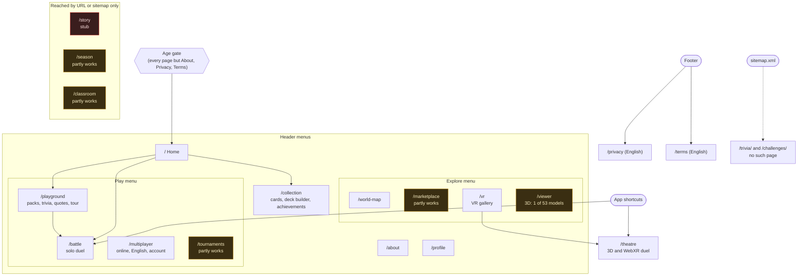
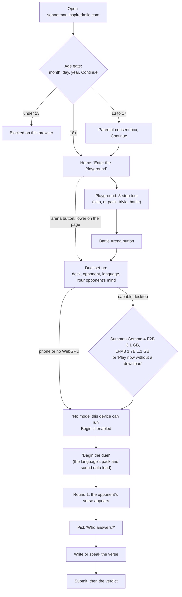
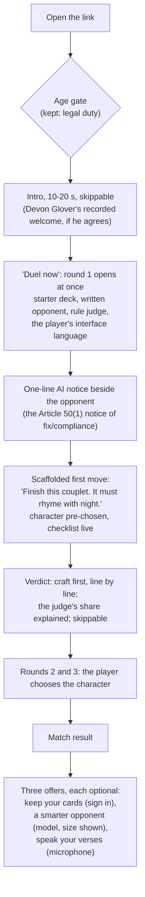
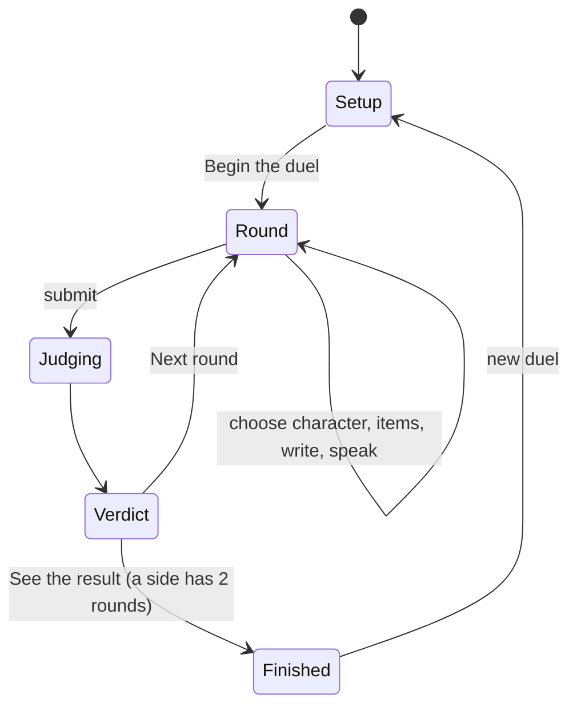

# Sonnet Man UX flows and design system

- **Purpose:** map every screen and path a player takes, show the first-time flow as built and as proposed, specify the duel screen, and set down the design system as tokens.
- **Audience:** the team (David Charlot, founder and technical lead; Devon Glover, "The Sonnet Man", creative director; Arrocito del Diablo, co-founder for game design and card mechanics), designers, front-end engineers, testers and accessibility reviewers.
- **As of:** commit `0d6df6ef` (branch `integrate/wave3`, 2026-11-18), plus the release in flight on 2026-11-19: `fix/judge-wording`, `fix/server-authority`, `fix/voice-g2p`, `fix/compliance`, and the nightly database backup.
- **Status:** Draft for the team, 2026-11-19.
- **Related documents:** `data/design-tokens.json` (the tokens), `03-gdd.md`, `05-systems-economy-and-balance.md`, `06-modes.md`, `14-localisation-kit.md`, `08-art-bible.md`, `09-audio-bible.md`, `11-accessibility-plan-and-statement.md`, `sources/as-built-design.md` (§1, §3, §8), `sources/as-built-tech.md` (§1, §4), `research/sota-design-2026-11.md` (§1, §4), `research/sota-production-2026-11.md` (§2.2, §7.7), and `docs/ECONOMY.md` once `fix/server-authority` writes it; also `00-README.md` (index), `28-owner-decisions.md`.

**How to read the labels.** **As built**: the code at `0d6df6ef` does it (cited). **In this release**: a named branch is doing it now; not built yet. **Proposed**: a recommendation, with its research. **Not known**: nobody could find out; also listed under "Owner questions". Nothing in this document was seen in a browser: screens are described from the code.

---

## 1. Summary

- **The core works and is hard to find.** The solo duel on `/battle` is the most complete and most tested screen. But the home page's first button leads to the Playground; the duel is linked lower on the home page and inside the Play menu.
- **The first verse takes about eight to ten taps** from a link on a phone (derived from the code, not timed), and on a capable desktop the player must first decide about a 1 to 3 GB download.
- **Four pages are off the menus** (Theatre, Story, Season, Classroom): Story, Season and Classroom are reachable only by URL, and the Theatre only from `/vr` and the app shortcut (`src/pages/vr.astro:22`). The desktop menus open on hover only.
- **Proposed:** a "Duel now" path that starts round one on the rule judge and the written opponent with no download, a scaffolded first line, a short skippable verdict, and the model offer after the first match.
- **The design system is small and consistent:** three colour ramps, three type families, five components. Its gaps are contrast on small text, no focus style, no reduced motion and no semantic layer. All of it is in `data/design-tokens.json`, in the W3C Design Tokens Community Group format.

---

## 2. Screen map

### Eighteen pages, four of them off the menus

**As built** (`src/pages/*.astro`; `src/layouts/BaseLayout.astro:200-244,425-445,486-502`; `public/sitemap.xml`; `public/manifest.json`; `sources/as-built-design.md` §3).

| Page | Purpose | Reached from | Status (as built) |
|---|---|---|---|
| `/` | landing: pitch, The Sonnet Man card, houses | logo, Home | working |
| `/battle` | solo duel | Play menu, footer, home and playground buttons, app shortcut | **working, most tested** |
| `/theatre` | the same duel in 3D and WebXR | only `/vr` and the app shortcut | working; no card reward |
| `/multiplayer` | online duel, English only | Play menu, footer | working; needs an account |
| `/collection` | cards, decks, world cards, achievements | header, footer, home | working; 17 of 18 3D views missing |
| `/playground` | free packs, trivia, quote challenge, tour | Play menu, footer, home | working |
| `/story` | five-act campaign | URL and sitemap | **stub**: nothing can be played |
| `/season` | season pass | URL and sitemap | partly: earns no XP |
| `/tournaments` | brackets | Play menu, footer | partly: cannot be created or played from the page |
| `/classroom` | teacher and student roster | URL and sitemap | partly: no progress tracking |
| `/marketplace` | sell and trade for credits | Explore menu, footer | partly: credits never earned |
| `/profile` | stats, achievements, leaderboard | header, account menu | working locally |
| `/world-map` | 20 cities of world cards | Explore menu, footer | working, display |
| `/viewer` | 3D view, AR on phones | Explore menu | partly: one model |
| `/vr` | VR gallery of every card | Explore menu | working, display |
| `/about` | mission, team | header, footer | working |
| `/privacy`, `/terms` | legal, English only | footer, age gate, sign-in | working |

**In this release** (`fix/server-authority`): cards come only from the server, and the leaderboard and tournaments take results only from server-judged matches; purchases move credits and the card. This changes what `/playground`, `/collection`, `/marketplace`, `/profile` and `/tournaments` can do for a signed-out player. The branch changes the API only, not the pages (05 §7.1): signed out, the browser keeps its own collection for solo play (trivia and quote challenges add a card at most 3 times a day each), and at first sign-in a one-time import moves at most 20 of those cards into the account. A solo win no longer adds a card to an account. How the pages will present this is **Not known** until they are changed. **In this release** (`fix/compliance`): a new `/credits` page, linked from every footer and from `/about`, and the who-plays-and-judges notice before the first duel.

---

## 3. Navigation as built

- **Header, desktop** (from the `md` breakpoint): Home, Collection, a **Play** menu (Playground, Battle Arena, Multiplayer, Tournaments), an **Explore** menu (World Map, Marketplace, VR Gallery, 3D Viewer), About, Profile; then the interface-language select, Sign In or the account badge, and the mute toggle. Both menus open on **hover only** (`group-hover`); no `focus-within`, so a keyboard user cannot open them (`BaseLayout.astro:213-240`).
- **Header, phone**: logo, language, Sign In, mute and a menu button that shows a list with "Play" and "Explore" as group labels. The menu button does not report whether the menu is open (no `aria-expanded`; `BaseLayout.astro:413,587-591`).
- **Footer**: Collection, Playground, Battle, Multiplayer, Marketplace, Tournaments, World Map, Profile, About, Privacy, Terms.
- **App shortcuts** (installed PWA): Battle and Theatre.
- **No skip link**; the page has one `<main>` (`BaseLayout.astro:464`).

**Proposed navigation.**

| Change | Why |
|---|---|
| A primary **Duel** item in the header, outside any menu, on every screen size | The duel is the game; today it is two levels deep |
| Menus open on click and on keyboard focus, with `aria-expanded` | Keyboard users; WCAG 2.1.1 |
| Theatre listed under Play ("Duel in 3D") on devices with WebGL | The home page advertises it and does not link it |
| Hide Story, Season and Tournaments from every list until each can be played end to end; remove `/trivia/` and `/challenges/` from the sitemap | Pages that cannot keep their promise erode trust |
| Classroom gets its own entry point for teachers (a link on About and in the footer) once progress tracking exists | School procurement (`research/sota-design-2026-11.md` §6) |
| A skip link to the main content | WCAG 2.4.1 |

---

## 4. The first-time flow as built

### About eight to ten taps to the first verse on a phone

**As built** (`sources/as-built-design.md` §8; `src/pages/battle.astro:455-560,1015-1061`). Tap counts are derived from the code, for a phone, taking the shortest path; nothing was timed.

| Step | Taps (phone) | Notes |
|---|---|---|
| Age gate | 4 to 5 | three selects and Continue; a teen adds a checkbox |
| Home to Battle | 1 to 3 | the arena button lower on the home page (1); or the first call to action, "skip" on the Playground tour, then Battle Arena (3) |
| Begin the duel | 1 | enabled at once on a phone |
| Choose a character | 1 | required before submit |
| Submit | 1 | |
| **Total before writing** | **about 8 to 10** | derived |

What the player meets on the way:

- **No tutorial in the duel.** Teaching is the form's brief, the live checklist "What your verse must do", the craft count, and the verdict (`sources/as-built-design.md` §8).
- **No AI notice.** "The opponent runs in your browser: nothing you write leaves this device" says where it runs, not that it is an AI (`src/i18n/locales/en.ts:174`). **In this release** (`fix/compliance`): the EU AI Act Article 50(1) notice; where and how it is shown is not visible yet.
- **Music** starts on the first click.
- **No match timer** in solo play; online rounds have 180 s.

### How long a match is: not measured

A match is two or three rounds. Each move is a short form of 2 to 4 lines (couplet, tercet, quatrain, haiku, anaphora, crescendo, epistrophe) or an acrostic of 3 to 4 lines in English; the verse box takes at most 600 characters and 8 lines (`sources/as-built-design.md` §1.2, §1.4). The research's warning about "a three-round duel of full sonnets" (`research/sota-design-2026-11.md` §1) does not describe the game as built: no form is a sonnet. How long a real player takes is **Not known**: no timing has been measured.

---

## 5. The first-time flow, proposed

### First verse in under a minute, before any model loads

**Proposed.** The research is direct: the first input decides (conversion to play rose from 50% to 72% when load fell from 29.5 s to 3.7 s on Poki), no model may sit on the path to the first verse, intros must be skippable, and the first lesson should be a line to write, not rules to read (`research/sota-design-2026-11.md` §4; `research/sota-production-2026-11.md` §2.2, §7.7).

| Element | Specification | Grounds |
|---|---|---|
| Entry | A "Duel now" button is the home page's first action and the app's start screen | Poki: "minimize UI screens and menus" |
| Start | Round 1 begins with no choice of difficulty, language or model; the defaults are shown and changeable later | First input within seconds |
| Intro | 10 to 20 s, skippable at once, never shown twice | Proposed (the owner asks this of his other games; research/sota-production §7.6); Poki |
| AI notice | One line at the opponent's first verse: the opponent and judge are AI running on this device; "not Devon Glover" if his name is anywhere on screen | EU AI Act Art 50(1), 50(5); `research/sota-production-2026-11.md` §5.4, §5.8 |
| First move | A given first line and a one-line task; the checklist shows the rhyme being found as the player types | "Teach forms by writing one line" (`research/sota-design-2026-11.md` §4) |
| Verdict | Craft first, as reasons per line ("line 2 ends on *light*: rhymes with *night* ✓"); then the judge's 24 points per criterion; a "Skip" that goes to the next round | Duolingo Explain My Answer; Pocket's slow flips (`research/sota-design-2026-11.md` §1, §4) |
| After the match | Offers, never gates: sign in to keep cards; download a model, with size, progress, resume and "your browser will keep it"; try the microphone | `research/sota-production-2026-11.md` §2.2, §3.3 |
| Target | First verse submitted within 60 s of landing; a match within 5 minutes | `research/sota-production-2026-11.md` §7.7; `research/sota-design-2026-11.md` §1 |

Notes:

- **Card rewards for a first match.** In this release a solo win adds no card to an account (`fix/server-authority`; 05 §7.1); whether the page still adds one to a signed-out device collection is for the page work to settle (Owner questions). The flow above assumes the offer to sign in comes with the result.
- **Measure, then tune.** Record two timings on the device, never sent unless analytics consent exists: landing to first submit, and match length. Five moderated playtests on phones before changing the round count.
- **Short matches stay short.** Keep the 2-4 line forms as the default; if a long form (a sonnet) is ever added, make it a separate long mode.

---

## 6. The duel screen

### Anatomy, top to bottom

**As built** (`src/pages/battle.astro:95-171,283-301,631-662,836-960`).

| # | Region | Content | Element |
|---|---|---|---|
| 1 | Round bar | round label (mono, uppercase), form name (gold, Playfair), "You N · N Opponent", the model badge | `#round-label`, `#form-name`, `#player-score`, `#ai-score`, `#ai-model-badge` |
| 2 | Brief | what the form asks | `#form-brief` |
| 3 | Opponent | 56 px portrait, "Your opponent plays", name, device; a crimson curse notice when cursed; the verse in Playfair, in the duel's language and direction (`lang` set) | `#opponent-*`, `#opponent-curse`, `#opponent-verse` |
| 4 | Hand | "Who answers?" chips (picture, name, device), the ink count; relics and potions at "1 ink each" with a plain note of what each does | `#hand-characters`, `#ink`, `#hand-items`, `#item-note` |
| 5 | Verse | labelled textarea, 600 characters, `dir="auto"`, Playfair 18 px | `#verse-input` |
| 6 | Checklist | "What your verse must do": each requirement with ✓, ○ or ✗ and points; device and signature; detail from the verse in 11 px; "Craft so far" | `#live-checks`, `#live-craft` |
| 7 | Actions | "Speak it" (microphone, `aria-pressed`), "Voice: Off/On", submit | `#mic-btn`, `#voice-toggle`, `#submit-verse` |
| 8 | Verdict | your verse; the round headline (emerald or crimson, with words); each side's craft breakdown (form points, power words, device, signature, synergy, multiplier, curse, void, craft, judge); who took each criterion; who judged (model or rules); "Next round" or "See the result" | `#verdict`, `#next-round` |
| 9 | Seed | "Match seed N. The same seed and deck draw the same forms." | `#seed-label` |
| 10 | Stats | three tiles under the duel | |

On screens from `md` up, the verse box takes three fifths and the checklist two fifths of a row; on a phone they stack, so the checklist sits below the box.

### States

**As built.** The page moves through four views: `setup`, `round`, `verdict`, `finished` (`battle.astro:266`).

| Area | States (as built) |
|---|---|
| Model ("Your opponent's mind") | checking; no WebGPU; no model for this device; offer (one or two models, or play now); downloading with a progress bar and "kept by your browser"; ready; failed, falling back to smaller models and then the written opponent |
| Hand | waiting (before the opponent's verse); available; chosen (gold or purple border); used (dimmed, inert) |
| Items | affordable; too dear (dimmed); potion barred in the last round; "a gamble" warning when either side can win this round |
| Microphone | idle; recording (`aria-pressed=true`); transcribing; refused (`mic.denied`); unsupported |
| Voice | off (default); loading; speaking (music ducks) |
| Submit | disabled until a character is chosen and the verse holds a letter; illegal moves explained in words |
| Model judge | lines that address the judge are listed as "not read" before submitting |
| Language data | loading before round 1 (up to 5-6 s for Japanese on a throttled phone, `sources/as-built-tech.md` §8) |

**Proposed state fixes:**

- The **verdict** gets a polite live region, so screen readers announce the result.
- The **hand chips** become real buttons with `aria-pressed`. Today they are `div` elements with a click handler and no keyboard access, so a keyboard-only player cannot choose a character and therefore cannot submit (`battle.astro:283-301,707-712`; read from the code, not tested). This blocks the core loop and comes first (`11-accessibility-plan-and-statement.md`).
- **Judging** gets a visible "Judging…" state when a model judges, and the smooth scroll to the next-round button follows reduced motion.

### The duel on a phone

**As built** (read from the classes; not seen on a device):

- The page is one column, with the checklist under the verse box. While the on-screen keyboard is open, the checklist is likely out of view (inference).
- The screen is kept awake during a duel (`src/lib/pwa.ts:13`).
- The "Voice" toggle is bare 12 px text with no padding: its hit area is probably under 24 px tall (estimated from the classes).
- Phones are offered no model, so the opponent is always the written one and difficulty changes nothing (`sources/as-built-design.md` §1.6).

**Proposed:**

- A sticky bottom bar on phones holding the hand, the craft count and submit; the checklist collapses to "3 of 4 met" above the keyboard and opens on tap.
- Every control at least 24 × 24 px, and 44 px for the duel's main actions.
- On phones, hide the difficulty select (it does nothing without a model) or label it as such.

---

## 7. Other flows

### Sign-in

**As built** (`sources/as-built-design.md` §8; `sources/as-built-tech.md` §3): a passkey ("No password to remember… fingerprint, face, or screen lock"), or an emailed six-digit code where the server has email turned on (it is off in production). A first sign-in offers once to copy the browser's collection, stats and achievements to the account. Passkeys meet WCAG 2.2's accessible-authentication criterion (3.3.8).

**Proposed:** offer sign-in after the first match, with the reason in one line ("Keep your cards on every device"); keep solo play open without an account.

### Online duel

**As built** (`sources/as-built-design.md` §5): English only, account required; "Quick match" or "Challenge a friend" with a link; both write at once with a 180 s round clock and a 45 s reconnect grace; scored on the server by rules; a report button. **In this release** (`fix/server-authority`): the leaderboard and tournaments count only server-judged matches.

**Proposed:** show the clock as text as well as a bar; offer an extended clock for players who need it (WCAG 2.2.1); label any AI stand-in opponent as AI on the match card (`research/sota-design-2026-11.md` §4).

### Model download

**As built:** a consent prompt with the model's name and size, a progress bar, "Downloaded once from Hugging Face and kept by your browser", a persistence request after load, and fallbacks on failure (`battle.astro:68-87,500-547`; `src/lib/pwa.ts:5-9`).

**Proposed:** move the offer after the first match; show resume after an interrupted download; say plainly what changes with a model ("writes back to your verse in 12 languages; judges in N"); never offer it where it does not change play.

### Collection and decks

**As built:** filters, a grid of 71 with locked overlays, a detail modal (3D for one card), a deck builder of 3-5 characters, up to 2 relics and up to 2 potions from owned cards, with saved decks and an active deck. The grid's cards are `div` elements with click handlers (no keyboard access; `collection.astro:70-76`).

**Proposed:** cards as buttons; the detail modal as a dialog with focus moved into it and returned on close; the card face of `08-art-bible.md` §5.

### Error, empty and offline states

| Situation | As built | Proposed |
|---|---|---|
| Offline | banner "You're offline — Collection and Trivia still work. Multiplayer requires internet"; `offline.html` for unknown pages | also say solo duels work once the language has loaded (offline solo play is untested, `sources/as-built-tech.md` §1.5) |
| No WebGPU / no model | status text; Begin enabled | unchanged |
| Microphone refused | `mic.denied` message | add how to allow it, and keep the typed path in view |
| Signed out on account pages | sign-in prompts; lists are empty | a one-line explanation and one action per page |
| Missing 3D model | "no GLB" in the viewer; the collection modal points at a missing file | hide the 3D control (`08-art-bible.md` §9) |

---

## 8. The design system

### Tokens

**As built.** The theme is one `@theme` block in `src/styles/global.css:24-62` (Tailwind 4), plus five utilities and a few animations. Pages use Tailwind classes directly. Every value is now in `data/design-tokens.json`, in the W3C Design Tokens Community Group format, first stable version 2025.10 (`research/sota-production-2026-11.md` §7.7). Each token records its source line and whether it is as built or proposed.

| Group | As built | Proposed additions |
|---|---|---|
| Colour | gold 50-900, obsidian 50-950, crimson 50-900; Tailwind default emerald, blue, purple for rarity and stats | a semantic layer: `surface.*`, `text.*`, `border.control`, `focus.ring` (all text aliases pass 4.5:1) |
| Type | display Playfair Display, body Inter, mono JetBrains Mono; Tailwind sizes xs to 5xl; 10 px and 11 px one-offs | a 12 px minimum; per-script families (`08-art-bible.md` §10) |
| Space | Tailwind's 0.25 rem unit; `section-padding` 1 / 1.5 / 2 rem across, 4 / 6 rem down; 4 rem fixed header | a 24 px minimum target |
| Radius | sm 0.25, lg 0.5, xl 0.75, 2xl 1 rem, full | |
| Blur and shadow | panel blur 12 px, menu blur 16 px; `glow-gold` | |
| Motion | 150, 300 and 600 ms transitions; loops of 2, 3 and 4 s; music duck 300 / 500 ms | 100 ms feedback ceiling; 0 ms under reduced motion |

### Contrast, computed

Computed for this document from the token values against the page (`#0d0b09`) and the glass panel (about `#151210`); not measured in a browser.

| Pair | Ratio | WCAG AA |
|---|---|---|
| obsidian-100 body text | 15.05 | pass |
| obsidian-300 secondary text | 7.70 | pass |
| obsidian-400 notes | 5.44 (5.16 on glass) | pass |
| obsidian-500 small labels, checklist detail | 4.34 (4.12 on glass) | **fail** for small text |
| obsidian-600 seed note, unmet mark | 3.26 (3.10 on glass) | **fail** |
| gold-400 accent | 10.27 | pass |
| obsidian-950 on gold-500 (primary button) | 7.64 | pass |
| white on crimson-500 (danger button) | 4.83 | pass |
| obsidian-700 control borders | 2.43 | **fail** (3:1 for controls) |
| Common rarity pill | about 3.6 | **fail** |

### Components

**As built** (`src/styles/global.css:82-129`; pages):

| Component | Definition | States | Gaps |
|---|---|---|---|
| `btn-primary` | gold-500 fill, obsidian-950 text, 0.5 rem radius, 1.5 × 0.75 rem padding | hover gold-400 with a gold shadow; disabled | no focus style |
| `btn-secondary` | 2 px gold-500 outline, gold-400 text | hover 10% gold fill | no focus style |
| `btn-danger` | crimson-500 fill, white text | hover crimson-600 | no focus style |
| `card-glass` | obsidian-900 at 60%, 12 px blur, obsidian-700 border at 50%, 0.75 rem radius | | border below 3:1 |
| `text-gradient` | gold-400 → gold-300 → gold-500 clipped to text | | |
| `section-padding` | responsive padding | | |
| `glow-gold` | two soft gold shadows | | |
| Pill / badge | rounded-full, text on a 10-20% fill of the same hue | | Common pill contrast |
| Select, textarea | obsidian-900 fill, obsidian-700 border, 0.5 rem radius; textarea focus: gold-500 border at 50% with the outline removed | | weak focus indicator; border below 3:1 |
| Card chip | 32 px picture, name, 10 px sub-line, obsidian-700 border | waiting, chosen, used | not a button; 10 px text |
| Modal | collection card modal; playground trivia and challenge dialogs | Escape closes the collection modal | only the playground's dialogs have `role="dialog"` |

**Proposed components and rules:**

1. **Focus.** Every interactive element gets a 2 px gold-400 focus ring with a 2 px offset, shown on keyboard focus (`:focus-visible`). Remove `focus:outline-hidden`.
2. **Button.** One button component with primary, secondary, danger and quiet variants, each at least 24 px tall (44 px in the duel's action bar).
3. **Toggle.** One toggle for voice, microphone and settings, with `aria-pressed` and a visible on/off word.
4. **Card.** One card component in three sizes (`08-art-bible.md` §5).
5. **Dialog.** One dialog: `role="dialog"`, a label, focus moved in and returned, Escape to close, background inert.
6. **Status.** One polite live region per page for verdicts, downloads and errors.
7. **Semantic colours.** Pages use `text.muted` and `border.control`, not raw ramp steps, so contrast is fixed in one place.

### Script and direction rules already in the system

**As built**, and to keep (`src/styles/global.css:106-155,270-287`; `sources/as-built-design.md` §8):

- Logical properties throughout (`start`/`end`, `ms-`, `ps-`, `border-s`), so Arabic mirrors.
- `dir="auto"` on verses; the opponent's verse carries the duel language's `lang`.
- Japanese breaks between phrases; Korean breaks at spaces; no letter-spacing in Arabic, Hindi or Thai; no synthesised italic in six scripts; accented heading words kept whole in Japanese and Chinese.
- Multiplayer, Privacy and Terms are English, marked `lang="en" dir="ltr"`.

### Text expansion

**Proposed** (`research/sota-production-2026-11.md` §7.7, §7.12): every label must fit 40% longer text than English in Latin scripts and stay on one line or wrap cleanly; buttons wrap rather than truncate; card names stay in English (as built). The existing translated-layout tests (`tests/pages-i18n.spec.ts`, `tests/play-i18n.spec.ts`) are the place to assert it.

---

## 9. Usability testing

**Proposed.** Nothing in the repository records a usability test with players.

| Round | Who | What | Measures |
|---|---|---|---|
| 1, before changing the first-time flow | 5 players aged 13+, on their own phones, one at a time | from a link to the end of a first match, thinking aloud | taps and seconds to first submit; where they hesitate; whether they understand why they won or lost |
| 2, after the "Duel now" flow | 5 new players | the same task | the same, against round 1 |
| 3, classroom | 2 teachers, 1 class | create a class, students join and duel | time to a class of students in a duel |
| 4, accessibility | screen-reader, keyboard-only and low-vision players | a match | completion; blockers (`11-accessibility-plan-and-statement.md`) |

Celia Hodent's usability heuristics (signs and feedback, clarity, form follows function, consistency, minimum workload, error prevention and recovery, flexibility) are the checklist for reviewing recordings (`research/sota-production-2026-11.md` §7.7).

---

## 10. Proposals in order

| # | Proposal | Section |
|---|---|---|
| 1 | Make the hand chips and collection cards real buttons; add a focus ring everywhere | 6, 8 |
| 2 | "Duel now" as the first action; round one with no download | 5 |
| 3 | Verdict: craft first, line by line, skippable, announced to screen readers | 5, 6 |
| 4 | Fix contrast through a semantic colour layer | 8 |
| 5 | Menus open on click and focus; a Duel item in the header; a skip link | 3 |
| 6 | Hide pages that cannot be played end to end; fix the sitemap | 2, 3 |
| 7 | A phone layout with a sticky action bar | 6 |
| 8 | Model offer after the first match | 5, 7 |
| 9 | Five-player phone playtests, before and after | 9 |

---

## Owner questions

1. In this release (`fix/server-authority`, 05 §7.1) a signed-out browser keeps its own collection for solo play, and a solo win adds no card to an account; trivia and quote challenges add a card to the device at most 3 times a day each. Should a first solo win still give a signed-out player a card, as the playground promises?
2. `fix/compliance` shows the notice as one sentence under "Your opponent's mind" on the battle page, under the Theatre's status line, and on the multiplayer page (commit `13ff3148`). Is that placement final, or should it also sit beside the opponent's first verse, as this document's flow proposes?
3. Should Story, Season and Tournaments be hidden until they can be played?
4. Is "Duel now" on the home page acceptable as the first action, ahead of the Playground?
5. Should an intro open the game, as the owner's other games do? Who appears in it?
6. Who will run the first five playtests, and with whom (age 13+, consent)?
7. Should the Theatre be in the main navigation?

## Questions to ask Devon Glover

Nothing here records his words, views or approvals. Ask him:

1. Would you record a short, skippable welcome for the first duel?
2. Should the first lesson use a line of yours, or a line of Shakespeare's?
3. In your classroom work, what is the first verse task that works with a new student?
4. Would you take part in, or watch, the first playtests?
