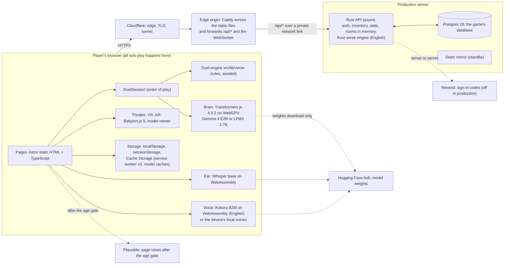
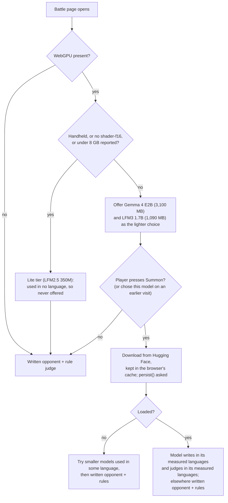
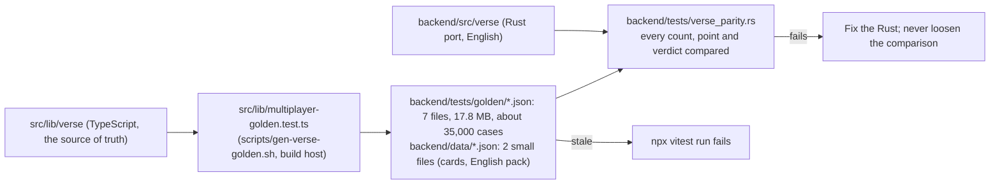

# Sonnet Man: technical design

**Purpose:** how Sonnet Man is built, why, and what in it is weakest, so that an engineer can work on it without first reading the code.

**Audience:** David Charlot (founder, technical lead); future engineers, contractors and coding agents; Arrocito del Diablo and Devon Glover for the parts that touch play; investors for the summary and the debt table.

**As of:** commit 0d6df6ef (branch `integrate/wave3`, 2026-11-18), plus the release branches `fix/judge-wording`, `fix/server-authority`, `fix/voice-g2p` and `fix/compliance` (2026-11-19).

**Status:** Draft for the team, 2026-11-19.

**Related documents:** `03-gdd.md`, `05-systems-economy-and-balance.md`, `18-trust-and-safety-plan.md`, `19-privacy-pack.md`, `22-risk-register.md`, `26-sota-gap-analysis.md`, `adr/README.md` (the decisions behind this design), `13-ai-design-and-system-cards.md`, `14-localisation-kit.md`, `15-qa-and-test-plan.md`, `16-analytics-and-tracking-plan.md`, `17-operations-runbook-and-launch-checklist.md` (internal: real hosts and commands), `sources/as-built-tech.md`, `sources/as-built-design.md`, `research/sota-production-2026-11.md`, `research/sota-design-2026-11.md`, the repository's `CLAUDE.md`; also `00-README.md` (index), `28-owner-decisions.md`.

---

## How to read this document

Every statement is one of three kinds:

- **As built**: true of the code at 0d6df6ef. It cites the fact base (`tech §n` is `sources/as-built-tech.md`, `design §n` is `sources/as-built-design.md`) or a `path:line` in the repository.
- **In this release**: decided by the owner on 2026-11-19 and being made on the named branch. Not built yet; not live.
- **Proposed**: a recommendation of this document, with the research behind it (`prod-research §n` is `research/sota-production-2026-11.md`, `design-research §n` is `research/sota-design-2026-11.md`).

Where a fact is missing, the text says **Not known** and the question is in the closing list. Internal host names and addresses are deliberately left out; they are in `17-operations-runbook-and-launch-checklist.md`.

Jargon used below, in one line each:

- **WebGPU**: the browser interface that lets a page use the graphics chip; the models need it.
- **WebAssembly (WASM)**: compiled code that runs in any modern browser at near-native speed, without the graphics chip.
- **Passkey**: a sign-in key kept by the phone or computer (Face ID, fingerprint, screen lock), standardised as WebAuthn.
- **Golden vectors**: a large set of inputs with the answers one program gives, stored as files so a second program can be held to the same answers.
- **Migration**: a numbered SQL file that changes the database schema, applied once, in order.

---

## 1. Summary

1. **A static web game with the AI inside the browser.** The site is static pages (Astro). The duel's rules, the opponent, the judge, speech recognition and the English voice all run on the player's device. No server runs a model (tech §4; ADR 0001).
2. **Every duel works with no model at all.** Without a model, a written opponent plays prepared verses and a rule-based judge decides, in all 16 languages. A model is an upgrade a capable desktop may download (tech §4.4; ADR 0002).
3. **One Rust API for accounts and online play.** A single Rust process (axum, Postgres) handles passkey sign-in, collections, statistics and online duels. Online rounds are scored on the server by a Rust copy of the English rules, held to the browser's TypeScript by about 35,000 golden cases (tech §1.2, §5; ADR 0012).
4. **Privacy promises are enforced by tests.** A browser test fails on any request to another site that is not listed in an allowlist the privacy policy mirrors; the server's verse retention is held to the policy's "two minutes" by a compile-time check (tech §1.4, §2.3).
5. **The biggest weakness is trust in the client.** As built, the server believes the client about credits, XP, statistics, cards and tournament results. **In this release** (`fix/server-authority`) the economy becomes server-authoritative (section 7.5).

---

## 2. Context, goals and non-goals

### Goals (as built, from `CLAUDE.md` and the owner's direction of 2026-11-16)

- Play a three-round verse duel in any of 16 languages with no install, no account and no download.
- Run all AI on the device; never send a solo verse or a voice recording anywhere (`CLAUDE.md:639-644`; `src/pages/privacy.astro:18-22`).
- Score an online round exactly as the player's own browser previews it.
- Keep every third-party request listed, tested and named in the privacy policy.
- Use each model only in the languages where it was measured to work (`CLAUDE.md:500-510`).

### Non-goals (as built)

- **Cloud inference.** Removed on purpose; the old multiplayer judge called a cloud model and is gone (commit 8d113da8, 2026-11-16).
- **Online duels outside English.** Decided 2026-11-17: the server cannot reproduce the other 15 languages' sound tables and word segmentation exactly (`CLAUDE.md:134-139`; ADR 0013).
- **Horizontal scale.** One API process holds every live room in memory (tech §1.2).
- **Native apps.** The game is a Progressive Web App (PWA: a site that can be installed and works offline in part); no store build exists.

---

## 3. Architecture

### 3.1 Component diagram (as built)



**What carries player text off the device (as built).** Only the path browser → Cloudflare → origin → API, and only for online verses. No arrow carries a solo verse, audio or model output off the device (tech §1.6; `src/pages/privacy.astro:18-22`).

### 3.2 Where each responsibility lives

| Responsibility | Where (as built) | Source |
|---|---|---|
| Rules of a duel: forms, devices, scoring, judge, opponent | browser, `src/lib/verse/` | tech §1.1; `CLAUDE.md:29-32` |
| Who plays when | `DuelSession` (`src/lib/verse/session.ts`), shared by `/battle` and `/theatre` | `CLAUDE.md:110-111` |
| Opponent verse and model judging | browser, `src/lib/brain.ts` | tech §4.1 |
| Speech to text | browser, `src/lib/ear.ts` | tech §4.3 |
| English voice | browser, `src/lib/thespian-voice.ts` | tech §4.3 |
| Anonymous game state | browser `localStorage` | `src/lib/storage-backend.ts:1-8` |
| Accounts, sessions, limits | API, `backend/src/auth/` | tech §3 |
| Collection, stats, credits, seasons, marketplace, tournaments, classroom, referral | API + Postgres | tech §2.2 |
| Online duel: pairing, rooms, scoring | API, `backend/src/multiplayer/`, `backend/src/verse/` | tech §2.3, §5 |

---

## 4. Client

### 4.1 Stack and pages (as built)

- **Astro 7.4.12 with static output** (no server rendering); 18 pages in `src/pages/` (tech §1.1).
- **Page logic is TypeScript inside each page's `<script>` block.** React 19 is installed but no page mounts a React component, and the one component is imported nowhere (tech §1.1). Treat React as removable.
- **Tailwind 4** for styling; the stylesheet is imported once, in `BaseLayout.astro` (`CLAUDE.md:597`).
- **Babylon.js 9** draws the Theatre (flat screen, Quest passthrough or VR, Vision Pro VR) and the VR gallery; **model-viewer 4.4** shows AR card scenes (tech §1.1).
- **Largest pages:** `battle.astro` (1,111 lines) and `multiplayer.astro` (954) (tech §1.1).

### 4.2 The duel engine (as built)

The rules are pure, seeded functions (the same seed and the same verses always give the same result):

| Module | What it decides |
|---|---|
| `forms.ts` | whether a verse keeps its form (line count, rhyme, syllables); never a model (design §1.4) |
| `devices.ts` | what each card does (signature echo, house device, power words, curses) |
| `duel.ts` | the round's score: craft plus judge |
| `judge.ts` | how a model's preference is read; the rule-based judge |
| `opponent.ts` | the written opponent and the model's prompt |
| `session.ts` | the order of play, shared by every front end |
| `packs/<lang>.ts`, `sound/`, `stem/`, `function-words/` | per-language data, loaded on demand |

A round is scored nowhere else (`CLAUDE.md:110-111`). Per-language data and its loading are in `14-localisation-kit.md`.

### 4.3 Model tiers and loading (as built)



Source: `src/lib/brain.ts:116-164,219-268`; `src/pages/battle.astro:516-547` (tech §4.1). Consequences:

- **Phones, tablets and headsets get no model** (tech §4.1, §12 item 5). See `13-ai-design-and-system-cards.md` section 8 for the gap and the candidates.
- **The model is never loaded without the player's action**, except the same model the player chose before (`brain.ts:230-238`).
- **Generation settings:** thinking off, temperature 0.8, top-k 50, repetition penalty 1.1, 96 new tokens (`brain.ts:287-304`).
- **Model weights are not pinned to a revision** (tech §4.1). A change on the hub reaches players unmeasured. **Proposed:** pin each repository to a commit with Transformers.js's `revision` option, and re-run the evaluation cells before moving the pin.

### 4.4 Speech and voice (as built)

- **Ear:** Whisper base (multilingual, q8, about 80 MB) on WebAssembly; takes up to 45 s, resampled to 16 kHz mono on the device; the duel's language is passed to Whisper (tech §4.3). The browser's Web Speech recognition is not used, because by default it sends audio to a server (ADR 0007).
- **Voice:** Kokoro-82M (q8) through kokoro-js 1.2.1, British male voice `bm_george` at 0.95 speed, English only. Other languages use only voices the browser reports as local (tech §4.3).
- **kokoro-js carries its own Transformers.js 3.8.1 and onnxruntime-web 1.22.0-dev** beside the main runtime (onnxruntime-web 1.31.0-dev, a nightly pre-release) (tech §4.3, §11.4).
- **In this release** (`fix/voice-g2p`): kokoro-js's pronunciation step, which embeds a compiled eSpeak NG under the GPL-3.0 (prod-research §3.4), is replaced by the game's own (ADR 0008): a new generated table of whole CMU pronunciations, from the same pinned cmudict commit as the verse rules' reduced table (which keeps only rhyme keys and syllable counts), plus the public-domain NRL letter-to-sound rules for other words (commits `21446923`, `35f43c22`). A build check, `scripts/check-no-espeak.mjs`, fails if eSpeak NG reaches `dist/`. The new table's download size is Not known until the branch is built for deploy.

### 4.5 Storage (as built)

| Store | What it holds | Source |
|---|---|---|
| `localStorage` | anonymous game state (cards, stats, achievements, decks), the age-gate result, preferences, the remembered model | `src/lib/storage-backend.ts:1-8`; tech §1.6 |
| `sessionStorage` | an online duel's seat and the unsent draft (`inspired-mile-mp-seat`) | `CLAUDE.md:179-184` |
| Cache Storage (service worker v3) | static files only, fetched without credentials | tech §1.5 |
| Transformers.js cache | model weights, same origin, never touched by the service worker | `public/sw.js:14-16,182-189` |

**Local first, then sync.** Signing in switches storage to the API; `/migrate/sync` copies the browser's state into the account, adding to it (tech §2.2). As built the server accepts whatever the browser sends; **in this release** (`fix/server-authority`) cards come only from the server.

### 4.6 Service worker and offline (as built)

- **Version 3** keeps only responses it fetched itself without credentials, from static paths: build files cache-first; images, fonts, audio and icons stale-while-revalidate; pages network-first with a kept copy or `offline.html`; never anything under `/api`, never another origin, nothing over 12 MB (tech §1.5).
- **On sign-out** it deletes everything not on its static list (`public/sw.js:28-30,153-170`).
- **It replaced v2,** which stored signed-in API answers (including the email address) past sign-out and would have deleted downloaded models on update (tech §10.5; ADR 0017).
- **Offline solo play is not tested** (tech §1.5). **Proposed:** a Playwright test that loads a duel, goes offline and plays three rounds against the written opponent.

### 4.7 Requests to other sites (as built)

The page may contact exactly: Plausible (after the age gate) and the Hugging Face hub and its storage hosts (on a model, microphone or voice request). Every runtime that defaults to a public CDN is served from the site itself instead (about 90 MB under `dist/ort/` and `dist/vendor/`), and a library upgrade that moves those files stops the build (tech §1.4; ADR 0016). `tests/third-party.spec.ts` loads every page in every age-gate state and fails on any request the allowlist lacks (`CLAUDE.md:610-615`).

---

## 5. API

### 5.1 Process (as built)

- **Rust 1.100.0 pinned, edition 2024;** axum 0.8.9, sqlx 0.9.0, tokio 1.54.1, webauthn-rs 0.6.2, jsonwebtoken 12 (HS256), governor 0.10.4; 411 locked crates (tech §1.2).
- **One process, one database.** It loads its environment file, refuses to start on bad configuration (exit code 2), opens a pool (default 25 connections), runs pending migrations from `./migrations`, and listens on its configured port (tech §1.2; the value is in 17 §1.2).
- **Built inside the whole repository**, because it compiles in files the browser also reads: the English pronunciation table, the Unicode confusables and the generated card and English data. `scripts/check-api-build.sh` proves the list of needed files is complete (`CLAUDE.md:195-203`). There is no container image.
- **Background tasks in the same process:** tournament scheduler every 30 s, room sweep every 15 s, sign-in and unused-account purges every 10 minutes by default (tech §1.2).

### 5.2 Request path (as built)

Every request passes, outermost first: a run-to-completion wrapper (a request is never cut off part-way through a transaction), tracing, CORS (one exact origin, with credentials), a per-client rate limit (600 a minute per IPv4 address or IPv6 /64) and a 1 MB body limit (tech §2). Every route outside `/auth`, `/health` and `/stats/leaderboard` needs a live session.

### 5.3 Routes (as built)

All under `/api/v1` (tech §2.1–2.2).

| Area | Routes | What the server trusts (as built) | In this release |
|---|---|---|---|
| Health | GET `/health` | n/a | |
| Sign-in | `/auth/methods`, `/auth/passkey/{signup,login,register,verify}/{begin,finish}`, `/auth/passkeys`, `/auth/email/{request,verify}`, `/auth/email/add/{request,verify}`, `/auth/logout`, `/auth/logout/all`, `/auth/me`, `/auth/age-tier` | server-side checks throughout (section 7) | |
| Leaderboard | GET `/stats/leaderboard` (public) | top 50 by client-reported wins | from server-judged matches only (`fix/server-authority`) |
| Inventory | `/inventory`, `/inventory/add`, `/inventory/stats` | any card id, any source | `/inventory/add` removed; cards only from the server: starter characters, free starter and daily packs (`pack_claims`), packs bought with credits (new `POST /inventory/packs`, drawn with the server's randomness), season rewards; card ids checked against the catalogue |
| Variants | `/variants`, `/unlock`, `/eligible` | base card must be owned | `/unlock` removed; variants stay a solo, on-device feature |
| Stats, achievements | `/stats`, `/stats/achievements` | counters raised to the client's numbers; achievements claimed by id | POST routes removed; `GET /stats` and 18 account achievements computed from the server's own match records |
| Migration | `/migrate/sync`, `/migrate/status` | copies the browser's cards and stats, additively | `/migrate/sync` removed; new `POST /migrate/import`, once per account, at most 20 cards (1 Legendary, 2 Epic, 5 Rare) |
| Multiplayer | `/multiplayer/ws`, `/queue`, `/rooms`, `/create-private`, `/join/{token}`, `/report` | nothing a client sends is read as a score | |
| Marketplace | `/marketplace` and `/{id}`, `/list`, `/my`, `/{id}/cancel`, `/{id}/buy` | a purchase moves no credits and leaves the seller the card | a listing locks the card; a purchase checks the listing, balance and teen limit and moves the price and that very card in one transaction; sales only |
| Tournaments | `/tournaments`, `/create`, `/{id}`, `/register`, `/bracket`, `/leaderboard`, `/matches/{id}/complete` | either player names either player the winner | `/complete` removed; either player opens the match's room (`POST …/room`) and only its result decides; byes go through when the bracket is drawn |
| Credits | `/credits`, `/earn`, `/spend`, `/age-verify`, `/limits` | `earn` adds the client's amount (1 to 1,000) | `/spend` removed; `earn` takes a source only (an amount is a 400) and pays the fixed rate within its daily cap (`backend/data/economy.json`) |
| Seasons | `/seasons/current`, `/xp`, `/rewards`, `/claim/{level}` | XP is the client's amount | `xp` takes a source only, fixed amounts with daily caps, logged in a new `xp_transactions` table; rewards claimed per player (`season_reward_claims`) |
| Classroom | `/classroom`, `/{id}/members`, `/join`, `/{id}/assignments` | roster only for members; only the teacher assigns | |
| Referral | `/referral`, `/redeem` | one redemption; referrer +100 credits; reply promises "5 free packs" the server never grants | referrer's 100 credits logged and capped at 3 a day; the reply no longer promises packs |

### 5.4 Online play (as built)

```mermaid
sequenceDiagram
  participant A as Player A (browser)
  participant S as API: room (in memory)
  participant B as Player B (browser)
  A->>S: WebSocket (session cookie, Origin checked)
  B->>S: WebSocket
  A->>S: JoinRoom (lang must be "en", deck 3 to 5 held characters)
  B->>S: JoinRoom
  S->>A: MatchStart (seed, three forms)
  S->>B: MatchStart
  loop three rounds, 180 s each
    S->>A: RoundStart
    S->>B: RoundStart
    A->>S: SubmitVerse (settled text, at most 2,000 bytes)
    S->>B: OpponentSubmitted (no text yet)
    B->>S: SubmitVerse
    S->>S: score both with the Rust engine (craft + rule judge)
    S->>A: RoundResult (both verses, full breakdown)
    S->>B: RoundResult
    A->>A: auditRound: recompute with the TypeScript rules
  end
  S->>A: MatchComplete
  S->>B: MatchComplete
  Note over S: room answers for 90 s, then is swept within 15 s;<br/>nothing about the match is written to the database
```

Limits and timers (tech §2.3): messages ≤6 KB; 30 messages per 10 s; join within 30 s; connection ≤45 minutes; 500 rooms on the server, 3 per account, 40 per network; 45 s to reconnect; 60 s for a paired opponent to arrive; a compile-time assertion holds "90 s linger + 15 s sweep ≤ 120 s", the policy's two minutes. Quick match waits up to 30 s per request and the page gives up after 3 minutes.

The session is re-checked before acting on a message (an answer is good for 1 s) and every 15 s while in a room; a database that cannot answer in 3 s is not taken for a sign-out (tech §2.3).

**What is missing (as built):** no match result is stored, so no rating, no history and no server-side source for the leaderboard or tournaments (tech §2.3). **In this release** (`fix/server-authority`) the leaderboard and tournaments come only from server-judged matches; each finished match is handed to a recorder (`multiplayer/results.rs`) that writes one `battle_rooms` row without any verse, pays online credits and XP within the caps, and, for a tournament room, records the result and advances the bracket (commit `3fa2c384`).

---

## 6. Data model

### 6.1 Core tables (as built, migrations 001 to 019)

```mermaid
erDiagram
  users ||--o{ webauthn_credentials : "has passkeys"
  users ||--o{ auth_sessions : "signed in on"
  users ||--o{ owned_cards : holds
  users ||--o{ owned_variants : holds
  users ||--|| player_stats : has
  users ||--o{ unlocked_achievements : earned
  users ||--o{ credit_transactions : "earn and spend log"
  users ||--o{ card_listings : sells
  users ||--o{ tournament_entries : enters
  tournaments ||--o{ tournament_entries : has
  tournaments ||--o{ tournament_matches : has
  users ||--o{ season_progress : progresses
  seasons ||--o{ season_progress : has
  classrooms ||--o{ classroom_members : has
  classrooms ||--o{ classroom_assignments : has
  users ||--o{ content_reports : files
```



| Table | Holds | Notes |
|---|---|---|
| `users` | id (UUID), generated username `bard-<12 hex>`, optional email, `age_tier` adult/teen/unknown, declared tier | legacy Google, wallet, password and house columns unused (tech §2.4) |
| `webauthn_credentials` | public key, counter, backup flags, label, last used | at most 20 per account |
| `auth_sessions` | one row per signed-in browser; expiry, fresh-proof time and method, revoked | 7-day sessions |
| `auth_challenges`, `signup_attempts`, `email_login_codes`, `email_code_failures` | ceremony state, limits, code HMACs and wrong guesses | purged on short schedules (6.2) |
| `owned_cards`, `owned_variants` | collection | `card_id` is VARCHAR(16) but the API accepts 20 characters, so a long id gives a 500 (tech §12 item 21) |
| `player_stats`, `unlocked_achievements` | counters, credits balance, achievements | `mp_*` columns never written |
| `credit_transactions` | earn and spend log; teen limit counts it | |
| `card_listings`, `trades` | marketplace | |
| `tournaments`, `tournament_entries`, `tournament_matches` | brackets | `room_id` references the unused `battle_rooms` |
| `seasons`, `season_progress`, `season_rewards` | season pass, level = XP / 200, max 30 | |
| `classrooms`, `classroom_members`, `classroom_assignments` | rosters, join codes, assignments | no grades or student work stored |
| `referral_codes`, `referral_redemptions` | referrals | |
| `content_reports` | reporter, room id, reason ≤500 characters | no route reads them |
| Unused | `battle_rooms`, `battle_turns`, `house_leaderboard`, `wallet_nonces`, NFT columns | dead schema (tech §12 item 17) |

### 6.2 Retention in code (as built)

Expired challenges are deleted every sweep (they live 5 minutes); begun sign-ups after 2 hours and finished ones after a day; email codes after a day (a code is good for 10 minutes); wrong-guess rows after 2 days; sessions a day after they end; passkey-only accounts that never played and left no trace after 30 days. Everything else is kept until deleted (tech §2.4).

**There is no account-deletion endpoint,** and several tables reference `users` without `ON DELETE CASCADE`, so a manual deletion must delete child rows first (tech §2.4). The privacy policy offers deletion on request (`src/pages/privacy.astro:149,192`). **Proposed:** a `DELETE /auth/account` route behind a fresh proof, and a migration that adds `ON DELETE CASCADE` where the child row has no reason to outlive the account (credit log kept anonymised if the economy design needs it).

### 6.3 Migrations (as built)

Migrations only add; a rollback puts the old binary back and leaves `./migrations` as it is; `scripts/check-migrations.sh` says before a swap whether the new binary would refuse to start (`CLAUDE.md:577-585`; ADR 0020). Migrations 018 and 019 are pending on production (tech §10.3). **In this release** `fix/server-authority` adds `020_server_authority.sql` (56 lines; it only adds: `xp_transactions`, `pack_claims`, `season_reward_claims` and new columns, per the commit message).

---

## 7. Security

### 7.1 Sign-in and sessions (as built)

- **No passwords, no Google.** Passkeys (discoverable, no username) are primary; a 6-digit emailed code creates an account, signs in where there is no passkey, and recovers (tech §3.1; ADR 0009).
- **Email is off in production** (no mail key), so email endpoints answer 503 and the interface hides email. Production had 0 accounts on 2026-11-19, so no email-only account is locked out.
- **Sessions are server-side rows;** the cookie's HS256 token names a row and is good only while it is live; 7 days (tech §3.2; ADR 0010).
- **Cookie** `__Host-im_token` on https, HttpOnly, Secure, SameSite=Strict.
- **Fresh proof** (a passkey assertion or emailed code within 5 minutes) to add or remove a passkey or add an email.
- **The signing secret is mandatory** (at least 32 bytes; the API exits otherwise). Main fell back to a public constant (tech §0).
- **The relying-party ID must never change** once passkeys exist; it would orphan every one (`CLAUDE.md:266-267`).

### 7.2 Abuse limits (as built)

Limits are per **network**, at three widths: the request rate per IPv4 address or IPv6 /64; codes, guesses, ceremonies and rooms per IPv4 address or IPv6 /48; sign-ups per IPv4 /24 or IPv6 /48 (tech §3.3; ADR 0011). **No site-wide ceiling refuses everyone:** at a ceiling only a network that already had a small share is refused. Limits are checked under advisory locks in the inserting transaction. The full table of values is in tech §3.3.

### 7.3 Who the client is (as built)

Forwarding headers (`CF-Connecting-IP`, `X-Forwarded-For`) are believed only from a configured list of trusted proxies, optionally only with a shared proxy secret. The API logs, whatever its log level, which peers it trusts and which peer's headers it ignored. If the real proxy is missing from the list, every visitor shares one rate allowance (tech §3.4). The proxy secret is not configured in any proxy whose configuration could be read (tech §3.4). **Proposed:** set it before launch, because the proxy's machine is also a shared build host (`CLAUDE.md:282-285`).

### 7.4 Headers, errors, CORS (as built)

- **No Content-Security-Policy** anywhere (tech §3.5). **Proposed:** a CSP that allows `self`, the Hugging Face hub and its storage hosts for `connect-src`, and Plausible (or its replacement) for `script-src` and `connect-src`; `wasm-unsafe-eval` for the runtimes. Test it with the third-party suite.
- The production proxy adds `nosniff`, `X-Frame-Options DENY`, a referrer policy and HSTS; whether the live origin sends the same is Not known (tech §3.5).
- A 500 never carries database text; pages never show raw error messages, and every API answer maps to a sentence in 16 languages, enforced by a unit test (tech §3.5).

### 7.5 Trust in the client: the economy

**As built** the server believes the client about almost everything of value (tech §12 items 1-3):

- credits: any account can add up to 1,000 per call by naming the amount;
- XP and statistics: raised to the client's numbers; the public leaderboard reads them;
- cards: any card id can be added or "migrated", which also lets an account field any character online;
- marketplace: a purchase is free and duplicates the card;
- tournaments: either participant can name either player the winner.

**In this release** (`fix/server-authority`, owner decision 2026-11-19; the branch writes `docs/ECONOMY.md`): fixed earn rates with daily caps; cards granted only by the server; the leaderboard and tournaments fed only by server-judged matches; purchases that move both credits and the card. This document does not restate the rates; `docs/ECONOMY.md` on that branch is the source.

**Proposed, after the release:** no new feature reads a number the client sent. A single ledger table (every credit, XP and card movement with its reason and the server event that caused it) makes audits and refunds possible; the WIP files on the branch suggest it is being built that way (Not known until merged).

### 7.6 Threats and their status

| Asset or promise | Threat | As built | In this release | Proposed |
|---|---|---|---|---|
| Accounts | credential theft | passkeys, no passwords | | |
| Sign-in availability | one network fills the challenge table | ceilings that never refuse everyone | | alert on ceiling notices (doc 17) |
| Sessions | forged token | mandatory secret, server-side rows | | rotate the secret yearly; it signs everyone out |
| Rate limits | spoofed client address | trusted-proxy list | | set the proxy secret |
| Economy, leaderboard | client-reported values | trusted | server-authoritative (`fix/server-authority`) | ledger and audit query |
| Judge (solo) | verse addressing the judge | structural defences; compare-wording regression | compare wording back to main's (`fix/judge-wording`) | red-team set in CI (doc 15) |
| Judge (online) | any | rules only, no model | | |
| Online verses | harmful content to another player | short English word list; reports stored, never read | | moderation cascade and a review tool (doc 13 §6, doc 17) |
| Privacy promises | a new third-party request | allowlist test | | CSP as a second wall |
| Player data at rest | loss | none recorded before 2026-11-19 | nightly backup, 14 days, restore-tested 2026-11-19 | off-host copy (doc 17) |

---

## 8. Online parity: one score in two languages

The browser previews with TypeScript; the server scores with Rust. They must agree exactly, or a player sees one score and gets another.



- **What is ported** (as built): cleaning, words, syllables and rhyme by sound, forms, devices, signature echo, curses, power words, the substance floor, the copy test, `scoreVerse`, the rule judge and round resolution, for English (tech §5).
- **What is not ported:** display strings, the model judge, the written opponent, single-player set-up.
- **Shared data is one file each,** compiled into the binary; numbers compared as exact doubles (tech §5).
- **The browser audits every round** the server sends and says so when one disagrees (`auditRound`).
- **Known gap:** the server's Unicode tables (16) can be older than the browser's (17). A verse with a character the server does not know is refused (`unknown_character`), never mis-scored. Browsers older than the server were not tested (tech §5).
- **Why English only:** the other 15 languages depend on sound tables, the Japanese analyser and the browser's word segmenter, which the server could not reproduce exactly (ADR 0013). **Proposed path to more online languages**, in order of cost: Polish, Korean, Vietnamese and Arabic first (their spelling shows the sound, so no table is needed: tech §6.2), then the table languages; never Chinese, Japanese or Thai until segmentation is done by one shared implementation (for example the same segmenter compiled to WebAssembly for both sides).

---

## 9. Performance budgets

### 9.1 What was measured (as built)

| What | Size | Source |
|---|---|---|
| `/battle` for a visitor who never starts a duel | 1.68 MB body, 1.39 MB gzip, 38 responses | tech §8 (2026-11-16) |
| An English duel, written opponent | 7.79 MB body, 5.92 MB gzip, 49 responses | tech §8 |
| A Japanese duel, written opponent | 62.2 MB body, 23.1 MB compressed, measured **before** the dictionary was cut to 4.7 MB compressed | tech §8 |
| Japanese duel started at once, throttled phone emulation | waits 5 to 5.7 s for the dictionary | `CLAUDE.md:485-488` |
| Self-hosted runtimes | about 90 MB, on use only | tech §8 |
| Models | Gemma 3,100 MB; LFM3 1,090 MB; LFM2.5 295 MB; Whisper ~80 MB; Kokoro ~80 MB | tech §8 |
| `public/` | 48 MB, of which card and variant art 33 MB and music 12 MB | tech §8 |

**What is enforced (as built):** `tests/battle-bytes.spec.ts` asserts what is not fetched on a first load; no byte ceiling is enforced (tech §8).

### 9.2 Budgets (proposed)

| Budget | Target | Why (research) |
|---|---|---|
| Model bytes before the first match | **0** (already true; keep it a test) | "The first match must not wait for a model" (prod-research §0 item 7; design-research finding 2: Poki's conversion to play rose from 50% to 72% when median load fell from 29.5 s to 3.7 s) |
| First load of `/battle`, compressed | ≤ 1.5 MB, as a byte ceiling in `battle-bytes.spec.ts` | locks in today's 1.39 MB |
| Everything fetched before a first duel can start, any language, compressed | ≤ 20 MB | CrazyGames' mobile homepage limit (prod-research §2.2) |
| Time until the player can type a first verse, emulated Fast 4G and 4× slower CPU | ≤ 3 s in English; ≤ 6 s in any language | Poki: players leave after 10 s (prod-research §2.2) |
| Judge step | under 1 s, or a progress state | Nielsen's 1 s flow limit (prod-research §3.3) |
| End of speech to transcript, desktop | under 1 s | prod-research §3 "For Sonnet Man" |
| Model download | size shown before, progress, resume, `persist()`, never blocking the page | web.dev "Client-side AI performance" (prod-research §2.2) |
| Model memory on a phone | 0.3 to 0.8 GB if a phone model ever ships | iPhone Safari kills a tab near 2 GB (tech §4.4; `docs/research/in-browser-ai-2026-11.md`) |
| API | p95 under 200 ms for REST and under 500 ms from the second verse to both round results | a starting value of this document, no external source; measure first |

**Proposed next steps:** re-measure the Japanese duel after the dictionary cut; measure real download times on real networks (never done: tech §8); add byte ceilings per language to the browser suite.

---

## 10. Hosting (general terms)

- **Edge:** Cloudflare terminates TLS and reaches the site through a tunnel (tech §1.3).
- **Static site:** served by Caddy on an edge-origin machine that the tunnel reaches; an identical copy is kept on the production server as a standby. Both are synced with `rsync --delete` (tech §1.3, §10.1).
- **API and database:** on the production server only, an Apple Silicon Mac (arm64 macOS); the origin forwards `/api/*` and the WebSocket to it over a private network link. The API runs as a launchd service with its environment file outside the web root (tech §1.3).
- **Model weights:** fetched by the player's browser from the Hugging Face hub, not from the site (tech §1.3).
- **Deploys are by hand** (tech §10.1); the steps are in `17-operations-runbook-and-launch-checklist.md`. A deploy restarts the API and ends every live online match.
- **Backups (as of 2026-11-19, done by the release, not recorded in this repository):** a nightly database dump on the production server, kept 14 days, with a restore tested on 2026-11-19. Details in doc 17.

---

## 11. Observability (summary)

As built: an error-level API log plus "operator notices" written whatever the log level (trusted proxies, ignored headers, ceiling banners); a health route; a production smoke suite run by hand; Plausible page views. No uptime check, alerting, error reporting or product events exist (tech §9, §10.4). The proposals are in `16-analytics-and-tracking-plan.md` (events and KPIs) and `17-operations-runbook-and-launch-checklist.md` (monitoring and alerts).

---

## 12. Alternatives considered

Each is recorded as an ADR in `adr/`.

| Choice | Alternative rejected | Why (source) |
|---|---|---|
| Models in the browser | cloud LLM judge (main's multiplayer judge) | owner direction 2026-11-16; privacy promise; cost per player (ADR 0001) |
| Transformers.js 4.3.2 | WebLLM 0.2.88 | the only runtime with builds of LFM3, LFM2.5, Gemma 4 and Whisper (`docs/research/in-browser-ai-2026-11.md` line 147; commit ae20b599) |
| Whisper on WebAssembly | browser Web Speech | sends audio to a server by default (ADR 0007) |
| Rules-only online judge in Rust | a model on the server | no cloud inference; online scores must be reproducible (ADR 0012) |
| Passkeys and email codes | Google sign-in, passwords | owner direction 2026-11-16 (ADR 0009) |
| Generated, pinned language data | hand-written tables, one model's output | owner's rule on authoritative sources (ADR 0015) |

---

## 13. Technical debt, ranked

Ranked by risk to players, data and the company. "Status" says whether this release closes it.

| Rank | Debt | Risk | Status | Next step |
|---|---|---|---|---|
| 1 | Economy, leaderboard and tournaments trust the client; free duplicating purchases (tech §12 items 1-3) | cheating, a meaningless leaderboard, worse if credits ever cost money | **In this release** (`fix/server-authority`) | add the missing handler tests (doc 15) |
| 2 | Gemma's judging fell to 4 languages under the integration's compare wording, with an injection winning in 11 (tech §12 item 4) | the judge can be told who wins | **In this release** (`fix/judge-wording`): main's wording back; the 32 compare cells are set aside and must be measured again before the lists change | re-run the cells; the lists follow the measurement |
| 3 | kokoro-js ships GPL-3.0 eSpeak NG object code with no notice or source offer (prod-research §3.4) | licence breach on every page that speaks | **In this release** (`fix/voice-g2p`) | check the built bundle holds no eSpeak code (doc 17) |
| 4 | CC BY-SA data shipped without credit (tech §12 item 8) | licence breach | **In this release** (`fix/compliance`: a `/credits` page) | keep CC BY-SA tables as separate data files (prod-research §5.10) |
| 5 | No EU AI Act Article 50(1) notice; no 50(2) machine-readable marking (prod-research §5.4) | regulatory | 50(1) **in this release** (`fix/compliance`); 50(2) **not in any release branch** | marking plan in doc 13 §7; assume due at this deploy (13 §7.2) |
| 6 | No backups recorded (tech §12 item 11) | total data loss | **Done 2026-11-19** (nightly, 14 days, restore tested) | an off-host copy; a monthly restore drill |
| 7 | No monitoring or alerting (tech §10.4) | outages found by players | open | doc 17 §6 |
| 8 | No CSP; proxy secret unset (tech §12 item 12) | script injection has no second wall; spoofable client address from the proxy host | open | section 7.3, 7.4 |
| 9 | No moderation beyond an English word list; reports never read (tech §2.3) | legal duties once verses reach other players (prod-research §4.3) | open | doc 13 §6; doc 17 incident playbook |
| 10 | Phones, tablets and headsets get no model (tech §12 item 5) | the product's AI is desktop-only | open | doc 13 §8 |
| 11 | Model weights unpinned (tech §12 item 7) | an unmeasured model reaches players | open | pin revisions (section 4.3) |
| 12 | Three of five shipped models predate the owner's 2026-04-01 rule: LFM2.5 350M, Whisper base, Kokoro-82M (prod-research §2.3, §3; `docs/research/in-browser-ai-2026-11.md`) | conflicts with a standing rule | open | owner decision; candidates in doc 13 §8 |
| 13 | No account-deletion route; no cascades (tech §12 item 16) | slow, error-prone deletion requests | open | section 6.2 |
| 14 | Plausible's hosted service is a paid third party (prod-research §6.1) | conflicts with "free and self-hosted only" | open | doc 16 §5 |
| 15 | Deploy-route ambiguity: `deploy.sh` would content-hash `sw.js` and the runtime `.wasm` (tech §10.3) | a broken service worker or model runtime after a deploy | open | doc 17 §4 |
| 16 | Half the evaluation matrix open (30 of 96 cells), one run each, one machine (tech §12 item 6) | model lists rest on thin evidence | open | doc 13 §9 |
| 17 | API log rotation unrecorded against the 30-day promise (tech §12 item 13) | a broken privacy promise | open | doc 17 §6 |
| 18 | One in-memory API: a deploy or crash ends every live match (tech §12 item 15) | lost matches | open, acceptable at 0 users | store a match snapshot only if online play grows |
| 19 | No tests for the database-backed economy handlers (tech §7.1) | regressions in the new economy | partly in this release: `fix/server-authority` adds 11 Rust unit tests (economy 8, ledger 1, bracket 1, progress 1) and no integration test of the handlers | doc 15 §7 |
| 20 | Two model runtimes shipped, one a nightly pre-release (tech §12 item 18) | breakage, size | open | move kokoro to the main runtime when the voice changes |
| 21 | No in-game check of the model's verse language (tech §12 item 19) | English verse in an Italian duel 9 times in 100 | open | a rule-based check built from the game's own pinned script and function-word data (`docs/language/PROVENANCE.md`): it needs no model. fastText `lid.176` (tech §4.2) dates from 2017 under CC BY-SA 3.0 and fails the post-2026-04-01 model rule |
| 22 | Schema and validation mismatch: 20-character card ids into VARCHAR(16) (tech §12 item 21) | a 500 instead of a 400 | **in this release**: `fix/server-authority` checks card ids against the catalogue before any insert | confirm with a test that a long id gets a 400 |
| 23 | Server and browser Unicode versions differ (tech §12 item 20) | refused verses on newer characters | open, handled by refusal | test an older Safari |
| 24 | Dead code and schema: NFT, wallet, house leaderboard, battle rooms, React, eight analytics helpers (tech §12 item 17) | confusion, larger attack surface | open | a clean-up migration and commit |
| 25 | Small inconsistencies: cookie name in the policy, Plausible domain, the referral "5 free packs" (tech §12 item 24) | trust | **in this release** (`fix/compliance`, commit `2df321b1`): the policy names `__Host-im_token` and `__Host-im_code` and the Plausible domain; the referral reply no longer promises packs | |
| 26 | Offline solo play untested; the VR gallery imports the whole Babylon core (tech §12 item 25) | unknown | open | section 4.6; measure the gallery bundle |

---

## 14. Owner questions

Settled on 2026-11-19 in `28-owner-decisions.md`: decided by default under the owner's standing rules where a sensible default existed; open only where it needs the owner's money, identity or contact details, a legal commitment in the company's name, or a public step not yet approved.

1. Which commit is live now, and does production still set the old cloud-model key? A fact for the operator to check before deploy (28, Facts to find out, 1; D-10).
2. Will `fix/server-authority` add more migrations than `020_server_authority.sql` before deploy? Answered as far as the branch goes: it adds that one, additive. Any further one is recorded when it lands.
3. Does `docs/ECONOMY.md` cover only credits and cards, or everything the server pays? **Decided by default:** everything the server pays, XP, achievements, seasons and referral included (28 D-05).
4. Should machine-readable marking of AI output join this release? **Decided by the owner (2026-11-19, R6):** yes (28 D-01).
5. What happens to the three models that predate the 2026-04-01 rule? **Decided by default:** remove LFM2.5 now; keep Whisper base and Kokoro until a newer model is measured to do each job, reviewed each quarter (28 D-28).
6. Replace the hosted analytics with a self-hosted tool? **Decided by default:** self-hosted Umami, and the hosted script removed (28 D-25). Whether a hosted account exists and is paid is a fact to find out (28, Facts to find out, 7).
7. Set the proxy secret before launch? **Decided by the owner (2026-11-19, R16):** the live origin's proxy block is brought into site-ops first, then the secret is set (28 D-10).
8. Remove React, and drop the dead NFT and wallet schema? **Decided by default:** yes, both (28 D-39).
9. Turn email sign-in on, or stay passkey-only? **Decided by default:** emailed codes go through Resend, as the owner directed on 2026-11-16, once its account and key exist; passkey-only until then (28 D-24). **Open (28 O-11):** will you set up the Resend account?
10. How large must online play get before a match should survive a deploy? **Decided by default:** store match snapshots only once analytics show a deploy would end real matches (28 D-61).
