# Sonnet Man: localisation kit

**Purpose:** everything a translator, a native reviewer or an engineer needs to work on Sonnet Man's 16 languages: what each language has, how its text and data are made, what is still wrong, how to add a language, and how human review should start.

**Audience:** the team (David Charlot; Devon Glover, creative director; Arrocito del Diablo, game design); native reviewers, translators and language-QA testers; engineers.

**As of:** commit 0d6df6ef (`integrate/wave3`, 2026-11-18), plus the release branches `fix/judge-wording`, `fix/server-authority`, `fix/voice-g2p` and `fix/compliance` (2026-11-19).

**Status:** Draft for the team, 2026-11-19.

**Related documents:** `11-accessibility-plan-and-statement.md`, `12-technical-design.md`, `13-ai-design-and-system-cards.md`, `15-qa-and-test-plan.md`, `20-legal-and-licence-register.md`, `27-glossary.md`, `adr/0015-generated-language-data-pinned-sources.md`, and in the repository `docs/language/` (`GLOSSARY.md`, `HUMAN-REVIEW.md`, `QA-REPORT.md`, `PROVENANCE.md`, `PHONETICS.md`, `NAMES-AND-QUOTATIONS.md`, `CONTENT-PROVENANCE.md`, `MODEL-EVAL.md`), `scripts/lang/README.md`, the repository's `CLAUDE.md` ("Languages"); also `00-README.md` (index), `28-owner-decisions.md`.

---

## How to read this document

- **As built**: true at 0d6df6ef; cites `tech §n` (`sources/as-built-tech.md`), `design §n` (`sources/as-built-design.md`) or a `path:line`.
- **In this release**: decided 2026-11-19, on the named branch; not live.
- **Proposed**: this document's recommendation, citing `prod-research §n` (`research/sota-production-2026-11.md`) or `design-research §n` (`research/sota-design-2026-11.md`).

Words used below:

- **Locale / language code:** the two-letter code the game uses (`es`, `ar`…).
- **Interface strings:** the game's own sentences (buttons, notes, verdicts).
- **Pack:** a language's duel data: acrostic words, forbidden letters, power words, and the written opponent's verses.
- **Form:** what a verse must do (a couplet, a haiku), checked by code.
- **LQA (linguistic quality assurance):** a native speaker checking text in the running game.
- **Transcreation:** rewriting for effect, not word for word, as verse needs.

**The one fact to hold onto:** no string, verse, name or scene in any language has been read by a native speaker. The translations and the written opponent's verses were written by a language model and checked by tools (tech §6.4). Section 12 is the plan to change that.

---

## 1. The 16 languages at a glance (as built)

| Code | Language | Script, direction | Interface | Solo duel | Online | Forms in the draw | Gemma writes / judges (as built) | Grammar tool |
|---|---|---|---|---|---|---|---|---|
| en | English | Latin, LTR | source | yes | **yes** | 9 (no epistrophe) | yes / yes | LanguageTool, Hunspell |
| es | Spanish | Latin, LTR | yes | yes | no | 10 | yes / no | both |
| fr | French | Latin, LTR | yes | yes | no | 10 | yes / no | both |
| de | German | Latin, LTR | yes | yes | no | 10 | yes / no | both |
| it | Italian | Latin, LTR | yes | yes | no | 10 | yes / no | both |
| pt | Portuguese (Brazil) | Latin, LTR | yes | yes | no | 10 | yes / no | both |
| pl | Polish | Latin, LTR | yes | yes | no | 10 | yes / no | both |
| ru | Russian | Cyrillic, LTR | yes | yes | no | 10 | yes / yes | both |
| ar | Arabic | Arabic, **RTL** | yes | yes | no | 8 (no syllable forms) | no / no | both |
| hi | Hindi | Devanagari, LTR | yes | yes | no | 10 | yes / no | Hunspell only |
| zh | Chinese (Simplified) | Han, LTR | yes | yes | no | 11 with jueju (6 if its sound data fails) | yes / yes | LanguageTool only |
| ja | Japanese | Kana and kanji, LTR | yes | yes | no | 10 (5 if its sound data fails) | no / no | LanguageTool only |
| ko | Korean | Hangul, LTR | yes | yes | no | 10 | no / no | Hunspell only |
| vi | Vietnamese | Latin with tones, LTR | yes | yes | no | 11 with lục bát | no / no (LFM3 judges); **in this release** Gemma also writes (commit ee2bf5ad) | Hunspell only |
| th | Thai | Thai, LTR | yes | yes | no | 8 (no syllable forms; 4 if its sound data fails) | yes / no | Hunspell only |
| id | Indonesian | Latin, LTR | yes | yes | no | 10 | yes / yes | Hunspell only |

Sources: `src/i18n/index.ts:34,57`; design §1.4, §8; tech §6.5; `docs/language/QA-REPORT.md:9-31`. The judging column will change when the compare-path cells are measured again under main's wording (**in this release**, `fix/judge-wording`; ADR 0006).

**What stays English in every language (as built):** the multiplayer, privacy and terms pages (marked `lang="en" dir="ltr"` so an Arabic page does not lay them out right to left); 160 attire and hairstyle names; proper names where no source gives a local form (design §8). Online duels are English only by decision (ADR 0013).

---

## 2. What "localised" covers (as built)

| Layer | Files | Made from | Held by |
|---|---|---|---|
| Core interface (layout, age gate, sign-in, battle, Theatre) | `src/i18n/locales/<lang>.ts` (16 files, 564 KB) | translated by a model from `en.ts`; checked by tools | `src/i18n/i18n.test.ts`: no missing key, no empty value, same `{placeholders}` |
| Page areas (home, about, collection, profile, world map, playground, story, classroom, marketplace, tournaments, season, viewer, VR, shared, PWA…) | `src/i18n/pages/<area>/<lang>.ts` (2.8 MB) | the same; place names from CLDR or Wikidata | `pages.test.ts`, `pages-rest.test.ts`, `tests/pages-i18n.spec.ts` |
| API error sentences | the `shared` area | one sentence per error code | `src/lib/api-errors.test.ts` reads `backend/src` and fails on a new answer without 16 sentences |
| Install manifest and offline page | `public/manifest.json` (`*_localized`), `public/offline.html` | generated from the `shared` area by `scripts/pages-rest/build-static.mjs` | the script refuses when the manifest's English differs |
| Card names, quotations, scenes, houses | `src/lib/cards-i18n/` (15 generated modules, 928 KB) | Wikidata labels; Wikisource translations where found; lines translated for the game, marked | `checks.test.ts` fails when text changes without the tool checks re-run |
| Duel packs | `src/lib/verse/packs/<lang>.ts` (140 KB) | written by a model; held to the forms by code | `verse.test.ts`; `scripts/mutate-packs.mjs` |
| Function words (not "telling" words) | `src/lib/verse/function-words/<lang>.ts` | stopwords-iso 1.1.0 + Wiktionary closed-class words | generated, pinned |
| Stems (what counts as the same word) | `src/lib/verse/stem/` | Snowball for es fr de it pt pl ru ar hi id; rules for vi tones, ko particles; segmenter words for zh ja th | `accidents.test.ts` |
| Sound data (rhyme, syllables) | `src/lib/verse/sound/` | Wiktionary (kaikki.org, WikiPron), Unihan, CC-CEDICT, IPADIC, JMdict | `measure.mjs` digests; `mutate-sound.mjs` |
| Judge words and number words | `src/lib/verse/judge-words.ts` | CLDR 49 number rules; Wiktionary translations | ADR 0005 |
| Trivia (200 questions) and quote challenges | `src/i18n/pages/trivia/`, `challenges/` | translated; challenges need at least 8 published lines in the language, else English lines | `play-areas.test.ts` |

Sources: tech §6.1; `CLAUDE.md:332-560`.

---

## 3. The pipeline

```mermaid
flowchart LR
  subgraph Sources["Published sources, pinned by version and sha256"]
    CLDR["Unicode CLDR 49"]
    WD["Wikidata labels"]
    WK["Wiktionary via kaikki.org, WikiPron"]
    DIC["CMUdict, CC-CEDICT, Unihan, JMdict, IPADIC"]
    WS["Wikisource translations"]
    PLAT["AOSP, Mozilla, Apple and Google help<br/>(evidence for UI words)"]
  end
  Sources --> GEN["Build scripts<br/>(refuse a different file)"]
  GEN --> DATA["Generated modules:<br/>sound tables, judge words, function words,<br/>card text, place names"]
  MT["Model translation of en.ts<br/>and the packs"] --> STR["Locale and area files"]
  DATA --> UNIT["Unit tests (vitest):<br/>keys, plurals, punctuation, glossary,<br/>untranslated strings, bidi controls"]
  STR --> UNIT
  UNIT --> HOST["Build host, offline tools:<br/>LanguageTool 6.6, Hunspell 1.7.2,<br/>back-translation (MADLAD-400 3B) + two similarity models,<br/>second-model review (Gemma 4 26B-A4B)"]
  HOST --> TRIAGE["Fix, or accept with a reason<br/>in docs/language/allow/"]
  TRIAGE --> REPORT["docs/language/QA-REPORT.md<br/>(generated)"]
  REPORT -.-> HUMAN["Native review<br/>(not yet done: section 12)"]
```



How it is run (as built, `CLAUDE.md:548-560`): a new or changed string goes into all 16 locales; the unit tests run; then on the build host `bash scripts/lang/run.sh grammar|meaning|review`; every hit is fixed or recorded with its reason in `docs/language/allow/`; `node scripts/lang/report.mjs` regenerates the report. A second model's correction is adopted only if it survives the tools (`HUMAN-REVIEW.md` item 20).

**Each tool was given known-bad input first,** because a checker that cannot flag a wrong sentence says nothing by staying silent (`QA-REPORT.md`, "What each tool covers").

---

## 4. Sources and licences

| Source | Used for | Licence | Duty | Status |
|---|---|---|---|---|
| Unicode CLDR 49.0.0 | plural rules, number words, quotation marks, list patterns, month capitals, minimal pairs | Unicode License v3 | keep the notice with copies or in the documentation | Proposed: on `/credits` |
| Wikidata | card and place names, form items | CC0 (main namespaces) | none; credit is courteous | |
| English Wiktionary (via kaikki.org, WikiPron) | sound tables, judge words, closed-class words, form names, glossary words | **CC BY-SA 4.0** (and GFDL) | attribution; adapted data stays CC BY-SA, as separate data files | **In this release:** credited on `/credits` (`fix/compliance`) |
| CC-CEDICT | Chinese readings | **CC BY-SA 4.0** | as above | **In this release** |
| JMdict / JMnedict (jmdict-simplified 3.6.2) | Japanese katakana words and names | **CC BY-SA 4.0** | as above | **In this release** |
| mecab-ipadic (inside kuromoji 0.1.2) | Japanese analysis | NAIST licence | the notice must travel with the dictionary files | Not known whether the cut files carry it |
| kuromoji 0.1.2 | Japanese analyser | Apache-2.0 | notice | |
| CMU Pronouncing Dictionary (pinned commit) | English rhyme and syllables; **in this release** the English voice too | BSD-style | notice kept as the data's first lines | |
| SCOWL 2020.12.07 | marks for names and fragments | SCOWL notice | reproduced in the generated file | |
| Unihan, UTS #39 confusables 18.0.0 | Chinese data; look-alike letters | Unicode License v3 | notice | |
| stopwords-iso 1.1.0 | function words | MIT | notice | |
| Snowball (jsstemmer 3.2.0) | stems | BSD 3-clause | notice | |
| Wikisource | published translations of Shakespeare | texts public domain; transcriptions CC BY-SA 4.0 | attribution for transcriptions | **In this release** (`/credits` covers CC BY-SA data; whether Wikisource is listed: Not known) |
| OpenCC | old-kanji modern readings | Apache 2.0 | notice | |
| AOSP strings, Mozilla l10n, one sentence each from Apple and Google help | evidence for interface words (passkey, sign in) | Apache 2.0, MPL 2.0, quotation as evidence | evidence kept in `docs/language/sources/` | |
| OpenSubtitles frequency lists | tests only | | | not shipped |
| espeak-ng | an independent cross-check of the sound tables | GPL-3.0 | none: build-host tool, output used as test data | not shipped |

Sources: tech §6.3, §11.2; `docs/language/PROVENANCE.md`; prod-research §5.10. **Proposed** (prod-research §5.10): keep every CC BY-SA-derived table a separate data file, never compiled into code, so ShareAlike reaches the data and not the program; credit each source with its licence, a link and a "modified" note.

---

## 5. Per-language status: what is built and what is still not right

"Names missing" counts card names for which no source gave a local form (the English is shown); "lines" counts, of 71 card lines, those taken from a published translation against those translated for the game (`docs/language/NAMES-AND-QUOTATIONS.md:470-488`). "Quote challenges" needs at least 8 published lines (design §8).

| Code | Sound data a duel fetches | Names missing; lines published / new | Quote challenges in own language | Still not right (evidence) |
|---|---|---|---|---|
| en | CMU-derived table, 1.46 MB (0.47 MB brotli) | source | 104 | only language online |
| es | small exception table | 4; 29 / 42 | 31 | Gemma's form-keeping 34/100, at the bar's noise; one injection pair lost under every wording |
| fr | pronunciation table (1.0 MB) | 1; 51 / 20 | 32 | "World card" reworded to *Carte Monde* (`HUMAN-REVIEW.md` item 12) |
| de | pronunciation table (1.29 MB) | 5; 50 / 21 | 27 | coinages *Schauerkreis*, *Arkan* to review |
| it | stress table (290 kB) | 5; 51 / 20 | 35 | Gemma answers in English in 9/100 plays; *passkey* against *chiave d'accesso* (item 8) |
| pt | small exception table | 13; 6 / 65 | 0 (plays English lines) | interface Brazilian *você*, verses use *tu* and European turns (item 11) |
| pl | none (spelling shows sound) | 12; 28 / 43 | 31 | case after numbers written by the translator (item 5); *internal rhyme* name not sourced (item 25) |
| ru | stress table (3.72 MB, 515 kB gzip) | 2; 34 / 37 | 22 | case after numbers (item 5); "Drown" as a noun (item 24); *Героический стих* names a metre (item 25) |
| ar | none | 13; 0 / 71 | 0 | no syllable forms; six-form counts written by the translator (item 4); masculine verb agreement with every card name (item 14); acrostic and alliteration names corrected (item 25) |
| hi | small exception table | 12; 0 / 71 | 0 | no grammar checker; quatrain name चौपदी against चौपाई (item 3); कविता chosen for "verse" (item 22) |
| zh | character readings (514 kB) | 3; 0 / 71 | 22 | Gemma's commentary at the bar (10/110); 双手 for "hand" (item 27); list separator ", " (item 28); five foreign-name pieces still invoke a card (commit c22b035a) |
| ja | kuromoji with IPADIC cut to 4.7 MB compressed + JMdict lists 0.38 MB | 7; 13 / 58 | 10 | Gemma's form 22/100; a first duel waits 5 to 5.7 s for the dictionary on a throttled phone; only Tsubouchi's Romeo and Juliet on Aozora |
| ko | none | 9; 0 / 71 | 0 | no grammar checker; particle hedge after English names (item 13); 나 / 내 address (item 21) |
| vi | none | 19; 0 / 71 | 0 | tone-mark placement *khoá* against *khóa* (item 9); quatrain names (item 3) |
| th | word-ending table (346 kB) | 26; 0 / 71 | 0 | no syllable forms; no grammar checker; the translator's least sure language (item 2); ซีด for "seed" also means "pale" (item 18); eleven foreign-name pieces still invoke a card and segmentation cannot tell them apart (commit c22b035a) |
| id | small exception table | 14; 0 / 71 | 0 | no grammar checker; six evaluation excerpts replaced over copyright |

Sources: tech §6.2, §6.5; design §8; `docs/language/HUMAN-REVIEW.md` (item numbers above).

**Every language** shares these open points: the written opponent's verses have been held to their forms by code and to nothing else (`HUMAN-REVIEW.md` item 1); register was chosen once by the translator (German and Italian *du*/*tu*, French *vous*, Spanish *tú*, Portuguese *você*, Japanese です・ます, Korean 해요체, Hindi आप: item 6); the legal sentences of the age gate and sign-in need a native reader and a lawyer (item 7).

---

## 6. Right-to-left (Arabic)

As built:

- **Direction:** `<html>` gets `lang` and `dir="rtl"` for Arabic (`src/i18n/index.ts:17,57,276`). Arabic is the only RTL language.
- **English pages stay left to right:** multiplayer, privacy and terms mark their body `lang="en" dir="ltr"` (`tests/english-pages-rtl.spec.ts`).
- **Mixed text is isolated:** a quotation goes through `quoted()` (CLDR's marks, the line in `<bdi>`), so an English line keeps its punctuation on an Arabic page; each Latin run inside Arabic text is a U+2068/U+2069 isolate (26 story strings, 300 trivia strings); signed numbers go through `signedLtr()` (Arabic had shown +50 as 50+); a count out of a total is written `{n}/{total}` without spaces (`CLAUDE.md:353-358`; `docs/language/CONTENT-PROVENANCE.md`).
- **The verse box** has `dir="auto"` (design §8).
- **No synthesised italic** in ar, hi, th, zh, ja and ko: their fonts have none, and Arabic came out slanted (`global.css`).
- **Fonts:** non-Latin scripts use the device's system fonts; only Latin subsets are self-hosted (tech §8).
- **Tests:** Arabic layout tests in `tests/play-i18n.spec.ts:132-332` and `tests/theatre-bidi.spec.ts`; the manifest's Arabic direction is a mutation the tests catch (`docs/language/pages-rest.md`).

Still not right: list items joined with ", " instead of "،" (item 28); verbs always masculine beside a card's name (item 14); no syllable forms, so haiku and the heroic couplet never appear in an Arabic duel. **Proposed:** test Arabic on a real iPhone and Android phone (never done: `15-qa-and-test-plan.md` §6); join lists with `Intl.ListFormat` where the grammar allows, or the language's own separator; have a native reader choose verb forms per card (gendered card metadata exists only as names today).

---

## 7. Chinese, Japanese, Korean and Thai

As built:

| Concern | How it is handled | Source |
|---|---|---|
| Word boundaries | Chinese and Thai: the browser's `Intl.Segmenter`; Japanese: kuromoji with IPADIC; Korean: spaces, with particles treated as stop words (Kiwi used offline) | `CLAUDE.md:425-433` |
| Japanese loanwords | a katakana run counts as a word when IPADIC, JMdict or JMnedict has it whole, by length rules measured on random kana | `CLAUDE.md:73-81` |
| Syllables | Chinese: a character is a syllable; Japanese: kana sounds (haiku asks "Write in kana so the sounds can be counted"), kanji read by the analyser; Thai: no syllable forms (`THAI_COUNTED = false`: "the table covers too little of free Thai text") | design §1.4 |
| Rhyme | Chinese, Japanese and Thai offer rhyming forms only once their sound data is loaded; the battle page awaits it | `rhyme.ts:32-35`; `battle.astro:1027` |
| Native forms | jueju in Chinese (4 lines of 5 or 7 characters; tone and rhyme not checked); lục bát in Vietnamese | design §1.4 |
| Line breaks on pages | `word-break: auto-phrase` and `line-break: strict` on `:lang(ja)`; `word-break: keep-all` on `:lang(ko)`; a browser test fails on a break inside a word | `CLAUDE.md:383-387` |
| Line breaks in the Theatre | `src/lib/xr/line-break.ts`: segmenter words, no closing punctuation opening a line, no opening bracket ending one, Thai ๆ and ฯ kept | `CLAUDE.md:605-608` |
| Punctuation | full-width in Chinese and Japanese; no space after a name in Chinese (`cjkSpaceProblems`) | `CLAUDE.md:548-556` |
| Plurals | Chinese, Japanese, Korean, Thai and Indonesian have no CLDR plural categories, so they keep a bare `{n}` | `CLAUDE.md:542-547` |
| Korean particles | chosen by rule from the last sound wherever the spelling gives it; a hedge `이(가)` stays after English names | `HUMAN-REVIEW.md` item 13 |
| Names invoking a card | Chinese: not beside a transliteration character (`carriesOn`, `foreignAround`); Thai: only where the letters beside it are words the invocation knows | `CLAUDE.md:446-454` |

Still not right: five Chinese and eleven Thai foreign-name pieces still invoke a card, and word segmentation cannot tell that class apart in Thai (commit c22b035a); a Japanese first duel waits 5 to 5.7 s on a throttled phone if started at once; Thai segmentation is untested across browsers (tech §6.2). **Proposed:** measure the Japanese duel's bytes again after the dictionary cut; test Chinese, Japanese and Thai segmentation in Safari and Firefox, since the forms depend on the browser's segmenter.

---

## 8. Message rules (as built)

- **Counts are ICU plurals** with exactly the categories CLDR gives the language (Arabic six, Polish and Russian four); a form joins its number to its noun as CLDR's minimal pairs do (French, Spanish, Italian, Portuguese `many`: `{n} de crédits`) (`CLAUDE.md:378-382,542-547`).
- **Never "(s)" or a gender hedge such as "(a)":** rephrase (`CLAUDE.md:546-547`). A count is written "label: number" where nouns would agree with it.
- **Numbers, dates and lists** come from `Intl` (`num`, `day`, `list`); never Intl's "unit" lists, since Chinese and Japanese put nothing between their items.
- **Quotations** go through `quoted()` with the language's marks from CLDR.
- **Placeholders** must be identical to English in every translation (`i18n.test.ts`).
- **Punctuation rules** per language are unit tests: French no-break spaces, Spanish ¿ ¡, full-width CJK, the Hindi danda, Vietnamese tone placement as Android places it (`quality.test.ts`).
- **Hidden and bidirectional control characters** fail the tests.
- **The duel engine returns message keys, never sentences**; `english.ts` renders them for the model's prompt, which is always English (`CLAUDE.md:410-415`).

**Proposed** (prod-research §7.12): when the string format is next revisited, consider Unicode MessageFormat 2.0 (stable since CLDR 47, specified in LDML Part 9, CLDR 49) or Project Fluent, which has a Rust implementation (`fluent-rs`) that would let the API and the pages share one format. Not urgent: the current ICU plural syntax works and is tested.

---

## 9. The glossary

**One word per thing.** `docs/language/glossary.json` (rendered as `docs/language/GLOSSARY.md`) gives each language's word for **27 terms** and **13 form and device names**, with the source of each and the stems also accepted. `src/i18n/quality.test.ts` fails on a string that uses another word. The pages-rest areas have their own **21 terms** in `docs/language/pages-rest-terms.json`, with a test that fails when a recorded source does not bear a verdict out (`CLAUDE.md:388-399`).

| Group | Terms |
|---|---|
| Play | verse (what the player writes: a short poem of two to four lines), line, card line (a character's famous line), character (the counting unit in Chinese and Japanese), round, duel, craft, judge, opponent, written opponent / written verse |
| Cards | ink, curse, relic, potion, deck, signature, power words |
| Sound | syllable, rhyme |
| Account and device | passkey, sign in, sign out, microphone, download, screen lock |
| Names | Shakespeare, Mercutio |
| Forms and devices (with Wikidata items) | Couplet (Q4779829), Paired Quatrain and Crossed Quatrain (Q570948), Tercet (Q1353779), Anaphora (Q486050), Acrostic (Q173287), Epistrophe (Q963102), Haiku (Q37707), Heroic Couplet (Q2714966), Jueju (Q537198), Lục Bát (Q1755587), Alliteration (Q484495), Inner Rhyme (Q2098331) |

A key decision recorded there: in the Romance languages, German, Polish and Russian the cognate of "verse" means one line, so the player's text is a strophe or stanza (*estrofa*, *strophe*, *Strophe*, *strofa*, *строфа*) and a line is a *verso*, *vers* or *wers* (`GLOSSARY.md`, "verse"). 58 of 195 form names are marked "not sourced" (`HUMAN-REVIEW.md` item 3).

**Do-not-translate list (as built, by practice):** the product name "Sonnet Man" (named after Devon Glover's persona "The Sonnet Man": `PROJECT_BRIEF.md:5,67`; the same in every language); "Shakespeare on the Go" (the name of Devon Glover's programme: `src/pages/index.astro:47-48`); model names (Gemma 4 E2B…); the 160 attire and hairstyle names (left in English: design §8). **Proposed:** write this list into `glossary.json` as its own section so the tests hold it.

**Style guide per language (proposed):** today the register choices live in `HUMAN-REVIEW.md` item 6. Move them, with the vendor-term choices of item 8 and the tone-mark choice of item 9, into one short style sheet per language that a reviewer signs off.

---

## 10. Culturalisation notes (proposed)

The IGDA's best-practice guide names four variables to check: history, religion, ethnicity and geopolitics (prod-research §7.12). For Sonnet Man the live risks are:

- **Card names and art:** gods and historical figures (Zeus, Roman counterparts) are named from Wikidata with rules that refuse the wrong pantheon (`CLAUDE.md:454-455`); a native reader should still check how each reads.
- **Power words** chosen as a theme noun or a verb ("Drown") change both meaning and the stem rule (item 24).
- **Hip-hop register:** the game's tone in each language has not been set by anyone with that culture's ear. Devon Glover's view of how his style should travel is not recorded; it is a question for him (section 14).
- **Shakespeare editions:** published translations from Wikisource keep the edition's spelling and date; copyright of six Indonesian excerpts was doubtful, and they were replaced (`MODEL-EVAL.md:36-38`). Folger texts are non-commercial only and are not used (prod-research §0 item 9).

---

## 11. How to add a language

A language is "added" only when every row below is done; until then it must not appear in `LOCALES`. File paths are as built.

| Step | Do | Where | Check |
|---|---|---|---|
| 1 | Add the code to `LOCALES`; add it to `RTL` if it is written right to left | `src/i18n/index.ts:34,57` | `i18n.test.ts` |
| 2 | Translate every key of `en.ts`; plural keys with exactly CLDR's categories; save CLDR's minimal pairs | `src/i18n/locales/<lang>.ts`; `docs/language/sources/` | `i18n.test.ts`, `quality.test.ts` |
| 3 | Translate every page area, including `shared` (API errors, credits, offline page, manifest names) and `pwa` | `src/i18n/pages/<area>/<lang>.ts` | `pages.test.ts`, `pages-rest.test.ts`, `api-errors.test.ts` |
| 4 | Regenerate the manifest and the offline page | `node scripts/pages-rest/build-static.mjs` | the script's own refusal |
| 5 | Add the glossary entries (27 terms, form names, the 21 page terms), each with its source | `docs/language/glossary.json`, `pages-rest-terms.json` | `quality.test.ts`, `pages-rest-terms.test.ts` |
| 6 | Add the language's punctuation and spelling rules to the mechanical checks | `scripts/lang/lib/` | `quality.test.ts` |
| 7 | Function words from stopwords-iso and Wiktionary closed-class words | `scripts/build-function-words.mjs`; `scripts/language/fetch/closed_class.py` | generated, pinned |
| 8 | A stemmer (Snowball if one exists) or a stated rule for "the same word" | `src/lib/verse/stem/` | `accidents.test.ts` |
| 9 | Rhyme and syllable rules; a sound table if spelling does not show the sound, from Wiktionary or a dictionary, pinned | `rhyme.ts`, `text.ts`, `lang.ts`; `scripts/sound/build.mjs` | `scripts/sound/measure.mjs --write`; `crosscheck.mjs` against the independent espeak-ng corpus; `mutate-sound.mjs` |
| 10 | Decide the forms: which rhyming, syllable and native forms the language can be checked on | `forms.ts` (`formsFor`) | `verse.test.ts` |
| 11 | Judge words and number words | `scripts/build-judge-words.mjs` (CLDR RBNF, Wiktionary) | the grade-path tests |
| 12 | The duel pack: acrostic words, forbidden letters, power words, at least two written verses per form (more is better) | `src/lib/verse/packs/<lang>.ts` | `verse.test.ts` (every verse keeps its form); `mutate-packs.mjs` |
| 13 | Card text: names from Wikidata, lines from published translations, the rest translated and marked; declined name forms where the language declines | `scripts/language/build_card_text.py`; `scripts/language/translated/<lang>.txt`; `check/declension.py` | `checks.test.ts`; `accidents.test.ts`; `run.sh names` and `forms` |
| 14 | Judge pairs (sets A, B, P and I) | `scripts/judge-pairs.mjs` | `judge-accuracy.test.ts` (rule judge at least main's accuracy); `judge-pairs.test.ts` |
| 15 | Trivia (200) and, if 8 or more published lines exist, quote challenges | `src/i18n/pages/trivia/`, `challenges/` | `play-areas.test.ts` |
| 16 | Model cells for every model, or nothing: an unmeasured language gets the written opponent and the rules | `scripts/model-eval/run.mjs`, `analyze.mjs`, `copy-lists.mjs` | `model-eval.test.ts` |
| 17 | Tool QA on the build host: grammar, spelling, back-translation, second-model review; record exceptions | `bash scripts/lang/run.sh grammar\|meaning\|review`; `docs/language/allow/` | `QA-REPORT.md` regenerated |
| 18 | Layout: line breaks, direction, font coverage, the Theatre's panels | `tests/pages-rest.spec.ts`, `play-i18n.spec.ts`, `theatre.spec.ts` | browser suite |
| 19 | Voice and ear: Whisper's language code; local voices only | `ear.ts`, `thespian-voice.ts` | `tests/model/ear.spec.ts` (English only today) |
| 20 | Provenance and credits: every source in `PROVENANCE.md`; licence duties on `/credits` | `docs/language/PROVENANCE.md`; the `/credits` page (**in this release**) | review |
| 21 | Native review (section 12) before the language is announced | | sign-off record |

**Rough cost:** the existing 15 languages took the agents' work of 2026-11-16 to 11-18 (659 commits across all workstreams: tech §0); no per-language effort was recorded. Not known for a new language.

---

## 12. Human review plan (proposed)

### 12.1 Why, and what first

No native speaker has read any language (tech §6.4). Tools cover grammar in only some languages (none for Hindi, Korean, Vietnamese, Thai and Indonesian; no spelling dictionary for Chinese and Japanese: `QA-REPORT.md`), and no tool can say whether a verse scans, rhymes to a native ear or is funny rather than odd (`HUMAN-REVIEW.md` item 1). Players punish bad or undisclosed machine translation in public, language by language (design-research §8). `docs/language/HUMAN-REVIEW.md` already lists 28 items in priority order; it is the reviewer's first page.

### 12.2 Who

Per language, two people:

1. **A native reader with a literary ear** (a poet, a teacher of literature, a translator of verse) for the written opponent's verses, form names, card lines and register;
2. **A native player** for the interface in play, through a think-aloud session (section 12.4).

The legal sentences of the age gate and sign-in also need a lawyer's reading (item 7). How reviewers are found and paid is the owner's decision (section 14); the owner's "free and self-hosted" rule concerns software and assets, not people.

### 12.3 Which languages first

**Proposed order**, for the owner to change once player data exists (`16-analytics-and-tracking-plan.md` tracks the language mix):

| Round | Languages | Why |
|---|---|---|
| 1 | Spanish, Portuguese (Brazil) | both have Gemma writing and full tool coverage, so the reviewer's time goes to verse and voice rather than grammar; Portuguese has an open register question that only a Brazilian reader can settle (item 11) |
| 2 | Thai, Hindi | the least tool coverage; Thai is the translator's least sure language (item 2); Hindi has open form-name and word choices (items 3, 22) |
| 3 | Arabic, Korean, Vietnamese, Indonesian | Arabic's RTL and agreement (items 4, 14); Korean particles and address (items 13, 21); Vietnamese tone placement (item 9); Indonesian has no grammar tool |
| 4 | French, German, Italian, Polish, Russian, Chinese, Japanese | full or partial tool coverage; specific items (5, 8, 12, 24, 25, 27, 28) |

The research suggests a localisation kit for the first two languages before a vertical slice (prod-research §8, tier 1), which matches round 1.

### 12.4 How

1. **Send the kit:** this document, the language's rows of `GLOSSARY.md`, its `HUMAN-REVIEW.md` items, the pack file, its card text with sources, and screenshots of every page at phone and desktop width (the browser suite can produce them on the build host).
2. **Read first, then play:** the reader marks the pack and the card lines; the player plays three duels and the main pages while thinking aloud, observed by a team member. Five users per round find about 85% of usability problems; three rounds of five beat one of fifteen (prod-research §6.4).
3. **Record every finding** in a sheet: key or file, current text, issue type (meaning, grammar, register, form, culture, layout), proposed text, severity (blocks play, misleads, reads oddly, preference).
4. **Feed changes back through the pipeline:** a reviewer's change goes through the same tools, and a native reader may overrule a tool, with the reason recorded (`HUMAN-REVIEW.md` item 20).
5. **Sign-off:** a language is "reviewed" when no "blocks play" or "misleads" finding is open, and the reader signs the language's style sheet (section 9). Proposed record: `docs/language/review/<lang>.md`.

### 12.5 What a reviewer can decide and what they cannot

- **Can:** wording, register, form names, which published translation to quote, whether a written verse is good enough.
- **Cannot alone:** game rules that the wording reveals (the 双手 bonus rule, item 27; power-word forms, item 24): those go to Arrocito del Diablo as design questions.
- **Never:** Devon Glover's own lines or persona. None of his work is in the game today (design §6.1). If any is added, it is transcreated per language with his approval, not translated by a model.

### 12.6 LQA bug template (proposed)

```
Language:            (code)
Where:               page or screen, key or file, line
What the player sees: (exact text or screenshot)
Problem type:        meaning / grammar / register / form / culture / layout / scoring
Why it is wrong:     (one or two sentences)
Proposed text:
Severity:            blocks play / misleads / reads oddly / preference
Source, if any:      (dictionary, published translation, CLDR)
```

**Scoring bugs** (a verse that rhymes to a native ear and is scored as not rhyming, or the reverse) go to the engineers with the verse and the expected result: they become test cases in the language's sound tests.

---

## 13. Known limits to say out loud

For the store page, the press kit and the in-game language picker (proposed, design-research §2: publish each language's limits as Semantle names its model's gaps):

- Online duels are English only.
- Arabic and Thai have no syllable forms; Chinese, Japanese and Thai need their sound data before rhyming forms appear.
- The AI opponent writes in 12 languages (13 in this release) and judges in fewer, on capable desktops only.
- Speech recognition is measured only in English.
- No language has been reviewed by a native speaker yet.

---

## 14. Owner questions

1. Who are the native reviewers, how are they found, and is there a budget to pay them?
2. Is the proposed review order (section 12.3) right, or does the team know where its first players will come from?
3. Should the Portuguese interface stay Brazilian (as built) or the verse move to Brazilian *você*?
4. Should "Sonnet Man" and "Shakespeare on the Go" be written into the glossary's do-not-translate list?
5. (Answered in this release: `/credits` names Wikisource, the Unicode data, the browser's CLDR plural rules and the NAIST notice for mecab-ipadic, which is now served beside the dictionary.) Has a reviewer read the page's "adapted" wording for each table?
6. Should a language be hidden from the picker until it is reviewed, or shown with a "not yet reviewed" note?
7. For Devon Glover: how should his Shakespeare-meets-hip-hop style read in other languages, and does he want a say in each language's tone? (Nothing here assumes his answer.)
8. For Arrocito del Diablo: should power words be theme nouns or direct translations (item 24), and should the Chinese 双手 rule stand (item 27)?
