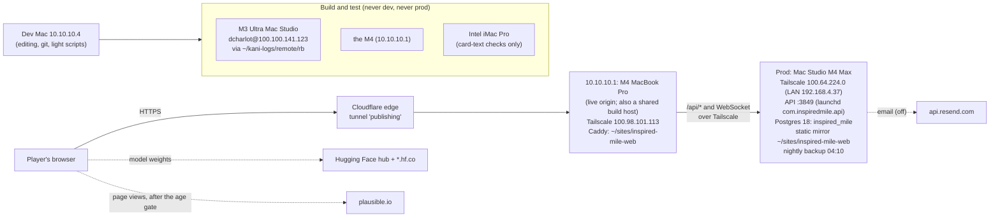

INTERNAL: do not share outside the company

# Sonnet Man: operations runbook and launch checklist

**Purpose:** where Sonnet Man runs, how to deploy it and roll it back, how its database is backed up and restored, what is monitored and what is not, what to do in an incident, and the checklist for the release of 2026-11-19.

**Audience:** David Charlot (operator); any engineer or contractor given operator access. Not for investors, players or the public: this document names real hosts, addresses and secret names.

**As of:** commit `5121f941` (Deploy 1, 2026-11-23) plus Deploy 2 (`docs/dossier` `e09c3a5c` and `fix/server-authority` `1d8472ad`, 2026-11-23). On 2026-11-23 the live origin for `sonnetman.inspiredmile.com` migrated to GCP **`openie-core-1` (`34.26.11.244`, Debian 12 `x86_64`, GLIBC 2.36: Caddy `/etc/caddy/conf.d/openie-dynamic.caddy` -> `/Users/dcharlot/sites/inspired-mile-web` and `localhost:3849`; systemd `openie-inspiredmile.service` -> `/Users/dcharlot/sites/inspired-mile-api/inspired-mile-api` on Postgres 15 `inspired_mile`)**, with the Mac mirrors (`100.98.101.113` and `100.64.224.0`) kept in sync alongside it.

**Status:** Draft for the team, 2026-11-19.

**Related documents:** `12-technical-design.md`, `15-qa-and-test-plan.md`, `16-analytics-and-tracking-plan.md`, `18-trust-and-safety-plan.md`, `19-privacy-pack.md`, `22-risk-register.md`, `adr/0019-build-host-no-github-actions.md`, `adr/0020-additive-migrations-binary-rollback.md`, the repository's `CLAUDE.md` ("Where it runs", "Building the API", "Build and test", "Sign-in"), `backend/.env.production.template`, the operations repository `site-ops` (`deploy/manifest.toml`, `Caddyfile`); also `00-README.md` (index), `28-owner-decisions.md`, `29-postmortem-and-incident-templates.md`.

---

## How to read this document

- **As built**: true at 0d6df6ef or recorded in `CLAUDE.md` ("verified 2026-11-16"); cites `tech §n` (`sources/as-built-tech.md`) or a `path:line`. `site-ops/` paths are the operations repository at `/Users/dcharlot/data-share/vibe-coding/site-ops/`.
- **Done 2026-11-19**: reported done by the release lead on 2026-11-19 and not recorded in either repository (the database backup).
- **In this release**: decided 2026-11-19, on the named branch; not live.
- **Proposed**: this document's recommendation.
- **Verify**: a command or path written here from the record, not run by the author of this document (who had no ssh access). Check it the first time it is used and correct this file.

Commands are written for the operator's shell on the development Mac unless they start with `ssh`. Never run builds or tests on the development Mac or on production (owner rule).

---

## 1. Topology (as built)



### 1.1 Hosts and what each does

| Host | Address | Role for Sonnet Man | Source |
|---|---|---|---|
| Cloudflare | n/a | edge, TLS; tunnel "publishing" terminates on 10.10.10.1 | `CLAUDE.md:564-566` |
| M4 MacBook Pro | `10.10.10.1`; Tailscale `100.98.101.113` | **live origin**: its Caddy serves `~/sites/inspired-mile-web` and forwards `/api/*` (with the WebSocket) to `100.64.224.0:3849` over Tailscale. Its Caddy configuration is **not in site-ops** (tech §3.4). Also a shared build host | `CLAUDE.md:564-576`; `backend/src/auth/client_ip.rs:11-14,37-50` |
| Prod, Mac Studio M4 Max | Tailscale `100.64.224.0` (preferred: it follows the host across network changes); LAN `192.168.4.37`. **`10.10.10.5` is dead** | API, database, static mirror, backups. Its own Caddy (`~/sites/Caddyfile`, launchd `io.cbio.caddy`) has a `sonnetman` block proxying `/api/*` to `localhost:3849`; standby only, since the tunnel routes the domain to 10.10.10.1 | `CLAUDE.md:567-573`; `site-ops/Caddyfile:4005-4022`; `site-ops/deploy/manifest.toml:11-23` |
| M3 Ultra Mac Studio | `dcharlot@100.100.141.123` | the build host (Metal GPU for the model tests); reached through `~/kani-logs/remote/rb`; root `/Volumes/macos_4TB_external_1/wai-build/`; every command runs under `memguard` (64 GB default) | owner's global rules; `CLAUDE.md:205-215` |
| Intel iMac Pro | Not recorded here | card-text tool checks only; **never build the release binary there** (prod is arm64) | `CLAUDE.md:575-576`; `docs/language/NAMES-AND-QUOTATIONS.md:447` |
| Dev Mac (MacBook Pro M5 Max) | `10.10.10.4` | editing, git, light scripts; **no builds or tests** | owner's global rules |
| Hugging Face | `huggingface.co`, `*.hf.co` | model weights, fetched by browsers | `tests/third-party-allowlist.ts:26-67` |
| Plausible | `plausible.io` | page views after the age gate | `src/layouts/BaseLayout.astro:71-90` |
| Resend | `api.resend.com` | sign-in codes; **off** (no key in production) | `backend/src/auth/mailer.rs:10` |

### 1.2 Services, paths, ports

| Service | Where | Detail |
|---|---|---|
| API binary | prod `~/sites/inspired-mile-api/` | binary (cargo package `inspired-mile-api`; the deployed file name: **verify**), `migrations/` (read at start-up from the working directory), `.env` (outside the web root on purpose) |
| API service | prod launchd `com.inspiredmile.api` | port 3849, binds `0.0.0.0`; plist path not recorded (**verify**: likely `~/Library/LaunchAgents/com.inspiredmile.api.plist`) |
| API logs | prod `~/sites/logs/inspiredmile-api*.log` | rotation **not recorded** (section 6.4) |
| Database | prod Postgres 18, database `inspired_mile` | how Postgres is run (Homebrew service or other): **verify**; `DATABASE_URL` needs an explicit user |
| Static site (live) | 10.10.10.1 `~/sites/inspired-mile-web` | served by that host's Caddy |
| Static mirror | prod `~/sites/inspired-mile-web` | same files; `.git` and `.env*` answered 404 by prod's Caddy |
| Prod web-server log | prod `~/sites/logs/caddy-errors.log` | client addresses masked to /16 (IPv4) and /32 (IPv6), 5 MiB files, deleted 30 days after they roll (`site-ops/Caddyfile:18-41`) |
| Backups | prod `~/backups/inspired_mile/` | `backup.sh`, LaunchAgent `com.inspiredmile.db-backup` at 04:10 daily, 14 days kept (**done 2026-11-19**) |
| site-ops manifest | `site-ops/deploy/manifest.toml:1267-1276` | entry `sonnetman`: `host = "10.10.10.1"`, `mirror_hosts = ["100.64.224.0"]`, `type = "static"`, `build_cmd = "npm run build"`, `dist_dir = "dist"`, `prod_path = "inspired-mile-web"`; **no `no_cache_bust`** (section 4.5) |
| Source | `git@github-personal:dcharlot65-personal/inspired-mile-web.git`, branch `main` | a website-family repository: GitHub personal account, no GitHub Actions (`CLAUDE.md:646-649`) |

### 1.3 Environment (`~/sites/inspired-mile-api/.env` on prod)

Names only; never paste values into any document. Source: `backend/src/config.rs`; `backend/.env.production.template`; `CLAUDE.md:263-313`.

| Variable | Required | Default | Notes |
|---|---|---|---|
| `DATABASE_URL` | yes | | must name a user (sqlx 0.9) |
| `JWT_SECRET` | **yes** | | at least 32 bytes; not the template placeholder or the old development constant; the API exits with code 2 otherwise. **Changing it signs everyone out.** Email-code HMACs use a key derived from it |
| `PORT` | | 3849 | |
| `CORS_ORIGIN` | | `http://localhost:4321` | set to `https://sonnetman.inspiredmile.com` |
| `WEBAUTHN_RP_ID` | | `inspiredmile.com` | **never change once passkeys exist: it orphans every one** |
| `WEBAUTHN_ORIGIN` | | `https://sonnetman.inspiredmile.com` | comma-separated; each https (or http on localhost) and on the RP ID |
| `TRUSTED_PROXIES` | | `127.0.0.1,::1,10.10.10.1,100.64.224.0,100.98.101.113` | `100.98.101.113` is the M4's Tailscale address, the peer prod sees (checked 2026-11-16). Leave unset to use the default |
| `PROXY_SECRET` | no | unset | 32+ characters (`openssl rand -hex 32`); when set, set it **first** in every Caddy that proxies `/api` here (`reverse_proxy … { header_up X-Proxy-Secret <secret> }`): the live origin's Caddy (10.10.10.1, outside site-ops) by hand; prod's own `sonnetman` block only through `site-ops/Caddyfile`, diffed against live prod first and deployed with `deploy/deploy.sh --caddy` (owner rule: never edit prod's Caddyfile directly); then here, then restart |
| `RUST_LOG` | | errors only | template: `info`; operator notices are written whatever it says |
| `RATE_LIMIT_PER_MINUTE` | | 600 | per IPv4 address or IPv6 /64 |
| `SIGNUP_GLOBAL_PER_HOUR` | | 300 | logs `SIGN-UP CEILING HIT` |
| `SIGNUP_BEGINS_GLOBAL_PER_HOUR` | | 1500 | logs `SIGN-UP BEGIN CEILING HIT` |
| `AUTH_CHALLENGES_MAX` | | 50000 | logs `SIGN-IN CHALLENGE CEILING HIT` |
| `UNUSED_ACCOUNT_PURGE_DAYS` | | 30 | 0 = never |
| `MAINTENANCE_INTERVAL_SECONDS` | | 600 | |
| `DB_MAX_CONNECTIONS` | | 25 | |
| `LAUNCH_DATE` | | 2026-04-01 | accounts created before it are raised to 500 credits on `/auth/me` (tech §2.1) |
| `RESEND_API_KEY`, `EMAIL_FROM` | no | unset | unset: email endpoints answer 503 and the UI hides email |
| **Remove** `LLM_API_KEY`, `LLM_API_URL` | | | main's cloud multiplayer judge; gone from this code (tech §10.3) |
| **Never set** `TEST_ONLY_LIMIT_RACE_DELAY_MS`, `DEV_INSECURE_JWT_SECRET`, `DEV_EMAIL_LOG` | | | test-only; the first two are refused with an https origin |

---

## 2. Before any deploy

1. **Gates green on the build host** for the exact commit (doc 15 §4):

   ```bash
   cd /Users/dcharlot/data-share/vibe-coding/inspired-mile-web   # the checkout at the deploy commit
   RB='export PATH=$HOME/.cargo/bin:/opt/homebrew/bin:$PATH;'
   ~/kani-logs/remote/rb . -- "$RB npm ci && npx vitest run && npm run build && npx playwright test"
   ~/kani-logs/remote/rb . -- "$RB cd backend && cargo test --release && cargo build --release"
   ~/kani-logs/remote/rb . -- "$RB scripts/check-api-build.sh"
   # only when the model path changed (prompts, brain.ts, judge.ts, referee.ts, session.ts):
   ~/kani-logs/remote/rb . -- "$RB TIERS=lite,standard,grand npx playwright test -c playwright.model.config.ts"
   ```

   One `rb` per checkout at a time. Never `pkill -f 'astro dev'` on a build host.

2. **After any change to `src/lib/verse/`, `src/lib/cards.ts` or `src/lib/multiplayer-rules.ts`**, regenerate the golden files first and commit them:

   ```bash
   ~/kani-logs/remote/rb --pull . -- "$RB npm ci && scripts/gen-verse-golden.sh"
   ~/kani-logs/remote/rb . -- "$RB cd backend && cargo test --release"
   ```

3. **Record the commit being deployed** and the gate results (section 9, the deploy log).

---

## 3. Building the artefacts

- **The static site** is `dist/` from `npm run build` (no secrets, no `PUBLIC_*` variables needed: `CLAUDE.md:217`).
- **The API binary** must be built on Apple Silicon (prod is arm64 macOS), inside the whole repository (it compiles in `src/lib/verse/pron-en.ts` and `confusables.ts`), with `--locked`.
- **How the binary and `dist/` travel from the build host to prod and to 10.10.10.1 is not recorded.** `rb` runs in a snapshot with its own target directory; whether `rb --pull` returns `dist/` or the binary is **not known**. Until it is recorded, one workable route (**proposed, verify**) is a clean clone on the M4, which is Apple Silicon and already a build host:

  ```bash
  ssh dcharlot@10.10.10.1 'set -e
    mkdir -p ~/build && cd ~/build
    [ -d inspired-mile-web ] || git clone git@github-personal:dcharlot65-personal/inspired-mile-web.git
    cd inspired-mile-web && git fetch && git checkout --detach <COMMIT>
    export PATH=$HOME/.cargo/bin:/opt/homebrew/bin:$PATH
    npm ci && npm run build
    cd backend && cargo build --release --locked'
  ```

  The M4 is also the live origin: build when traffic is low, and never leave a dev server running there. Write the route actually used into this section after the release.

---

## 4. Deploy

Order: **back up, check migrations, swap the API, then sync the static site.** A deploy restarts the API and ends every live online match (rooms are in memory).

### 4.1 Back up first

```bash
ssh dcharlot@100.64.224.0 '~/backups/inspired_mile/backup.sh && ls -lt ~/backups/inspired_mile/ | head -3'
```

Whether `backup.sh` may be run by hand at any time (and where it writes) is **verify**; it was written and restore-tested on 2026-11-19.

### 4.2 Check the migrations on prod

```bash
# copy the new migrations beside the live ones, and the check script
rsync -a backend/migrations/ dcharlot@100.64.224.0:~/sites/inspired-mile-api/migrations.new/
scp scripts/check-migrations.sh dcharlot@100.64.224.0:~/sites/inspired-mile-api/
ssh dcharlot@100.64.224.0 'cd ~/sites/inspired-mile-api && ./check-migrations.sh migrations.new -d inspired_mile'
```

It exits 1 when the new API would refuse to start: a migration changed after it was applied (`VersionMismatch`), an applied one missing (`VersionMissing`), or a half-applied one (`Dirty`). Do not continue on exit 1.

### 4.3 Review the environment

```bash
ssh dcharlot@100.64.224.0 "cut -d= -f1 ~/sites/inspired-mile-api/.env"    # names only, never print values
```

Against section 1.3: `JWT_SECRET` present and at least 32 bytes; `LLM_API_KEY` and `LLM_API_URL` removed; `DATABASE_URL` names a user; `CORS_ORIGIN` is the site.

### 4.4 Swap the API binary

Replace by writing a new file and renaming it, never an in-place copy (an in-place copy can leave macOS killing the process for a code-signing mismatch), then `bootout` + `bootstrap` (`CLAUDE.md:574-576`).

```bash
scp <path>/backend/target/release/inspired-mile-api \
    dcharlot@100.64.224.0:~/sites/inspired-mile-api/inspired-mile-api.new
ssh dcharlot@100.64.224.0 'set -e; cd ~/sites/inspired-mile-api
  cp -p inspired-mile-api inspired-mile-api.prev          # keep for rollback
  chmod +x inspired-mile-api.new
  mv inspired-mile-api.new inspired-mile-api               # rename, not copy over
  rsync -a migrations.new/ migrations/                     # adds files; never delete an applied one
  launchctl bootout gui/$(id -u)/com.inspiredmile.api || true
  launchctl bootstrap gui/$(id -u) ~/Library/LaunchAgents/com.inspiredmile.api.plist'   # plist path: verify
```

Then:

```bash
ssh dcharlot@100.64.224.0 'curl -s http://localhost:3849/api/v1/health; echo
  grep -h "TRUSTED_PROXIES" ~/sites/logs/inspiredmile-api*.log | tail -1'
curl -s https://sonnetman.inspiredmile.com/api/v1/health; echo
```

Expect `ok` twice, and the start-up line `TRUSTED_PROXIES: ... believed only from <list>` naming `100.98.101.113`. If the log later shows `ignored CF-Connecting-IP / X-Forwarded-For from <peer>` and that peer is the proxy, add it: otherwise every visitor shares one allowance (`CLAUDE.md:274-281`).

### 4.5 Sync the static site

```bash
# snapshot the live copies first (rollback)
ssh dcharlot@10.10.10.1   'rsync -a --delete ~/sites/inspired-mile-web/ ~/sites/inspired-mile-web.prev/'
ssh dcharlot@100.64.224.0 'rsync -a --delete ~/sites/inspired-mile-web/ ~/sites/inspired-mile-web.prev/'
# then sync the new build to both (from wherever dist/ was built)
rsync -av --delete --exclude=.git/ dist/ dcharlot@10.10.10.1:~/sites/inspired-mile-web/
rsync -av --delete --exclude=.git/ dist/ dcharlot@100.64.224.0:~/sites/inspired-mile-web/
```

**Do not use `site-ops/deploy/deploy.sh sonnetman` yet.** The manifest entry has no `no_cache_bust`, so `deploy.sh` would content-hash every `.js`, `.wasm` and `.css` in `dist/` (`site-ops/deploy/deploy.sh:117-176,543-551`), including `sw.js` (registered by its literal name: `src/layouts/BaseLayout.astro:1508`) and the self-hosted onnxruntime `.wasm`, whose file name the page checks against a list (`src/lib/model-runtime.ts:29-35`). **Proposed:** add `no_cache_bust = true` to the `sonnetman` entry in `site-ops/deploy/manifest.toml` (the holodeck entry above it already does), test once, then switch to `deploy.sh`. Which route produced the live build is not recorded (tech §10.3).

Check after the sync:

```bash
curl -sI https://sonnetman.inspiredmile.com/sw.js | head -1          # 200
curl -s  https://sonnetman.inspiredmile.com/ | grep -c '<title>'       # 1
ls dist/ort/ | head                                                      # the runtime file names the page expects
```

### 4.6 After the deploy

```bash
~/kani-logs/remote/rb . -- "$RB PROD_URL=https://sonnetman.inspiredmile.com npx playwright test"
```

Optionally one real passkey sign-up against the live site (`scripts/prod-passkey-check.mjs`), which **creates an account to delete** afterwards (section 7.8).

---

## 5. Rollback

**API.** Put the previous binary back and **leave `./migrations` as it is**: every migration only adds, and sqlx refuses to start if the folder lacks a migration the database has (`CLAUDE.md:582-585`; ADR 0020).

```bash
ssh dcharlot@100.64.224.0 'set -e; cd ~/sites/inspired-mile-api
  mv inspired-mile-api.prev inspired-mile-api
  launchctl bootout gui/$(id -u)/com.inspiredmile.api || true
  launchctl bootstrap gui/$(id -u) ~/Library/LaunchAgents/com.inspiredmile.api.plist
  curl -s http://localhost:3849/api/v1/health'
```

Rolling back to main's binary after this release: main reads `JWT_SECRET` too (and falls back to a public constant if it is missing: keep it set); this release's sessions will not parse under main, so everyone is signed out again.

**Static site.** Sync the snapshot back on both hosts:

```bash
ssh dcharlot@10.10.10.1   'rsync -a --delete ~/sites/inspired-mile-web.prev/ ~/sites/inspired-mile-web/'
ssh dcharlot@100.64.224.0 'rsync -a --delete ~/sites/inspired-mile-web.prev/ ~/sites/inspired-mile-web/'
```

The service worker fetches pages network-first, so returning visitors get the rolled-back pages on their next load.

**Database.** Restore only for data loss or corruption, never as part of a code rollback (section 6.3).

---

## 6. Database backup and monitoring

### 6.1 The backup (done 2026-11-19)

| Item | Value |
|---|---|
| Script | `~/backups/inspired_mile/backup.sh` on prod |
| Schedule | LaunchAgent `com.inspiredmile.db-backup`, daily at 04:10 |
| Kept | 14 days |
| Restore tested | 2026-11-19: the 06:11Z dump restored into a scratch database with matching row counts; the 08:20Z copy fetched from the Studio, decrypted on the dev Mac, byte-identical (sha256 `4592e9d6…`) to prod's dump |
| Dump format and names | `pg_dump -Fc` (custom format), checked with `pg_restore --list` before it is kept; `inspired_mile-<UTC yyyymmddThhmmssZ>.dump`, written as `.partial` and renamed; log in `backup.log` beside it |
| Off-host copy (done 2026-11-19, owner decision R16) | Each dump is encrypted with gpg to public key `4F40996E5A957F7F7BD9E2366C1A31705D45DC89` and streamed to the build Studio (`100.100.141.123`), `/Volumes/macos_4TB_external_1/backups/inspired_mile/inspired_mile-<stamp>.dump.gpg`, kept 14 days, `received.log` beside it. Prod pushes with `~/.ssh/inspiredmile_backup_push`, a key the Studio's `authorized_keys` restricts (`restrict,command=...`) to `~/inspiredmile-backup-recv.sh`, which takes only a name matching the dump pattern and refuses empty input (tested: shell commands, paths, empty and port forwards refused). A failed push is logged as `FAILED to copy` and never stops the local backup |
| The private key | Generated on the dev Mac 2026-11-19: keyring `~/.gnupg-inspiredmile-backup`, export and restore steps in `~/inspired-mile-backup-key/` (`README.txt`). The owner is to keep `inspired-mile-db-backup-SECRET.asc` offline (it has no passphrase); without it the Studio copies cannot be read |

**Gaps (proposed fixes):**

- **Freshness alarm:** nothing says if the 04:10 job stops or the push starts failing. Check daily that the newest dump and the newest Studio copy are less than 26 hours old, and alert on a `FAILED to copy` line (section 6.4).
- **Privacy:** a deleted account survives in backups for up to 14 days; added to `src/pages/privacy.astro` ("Data Retention") in Deploy 2 (2026-11-23).

### 6.2 Restore drill (proposed: monthly, and after any change to `backup.sh`)

```bash
ssh dcharlot@100.64.224.0 'set -e
  ls -lt ~/backups/inspired_mile/ | head -3
  createdb inspired_mile_restore_test
  # restore the newest dump: pg_restore -d inspired_mile_restore_test <file>  (custom format)
  #                     or:  psql -d inspired_mile_restore_test -f <file>     (plain SQL)   -- format: verify
  psql -d inspired_mile_restore_test -c "SELECT COUNT(*) FROM users; SELECT MAX(version) FROM _sqlx_migrations;"
  dropdb inspired_mile_restore_test'
```

Record each drill in section 9.

### 6.3 Restoring production (data loss only)

1. Stop the API (`launchctl bootout gui/$(id -u)/com.inspiredmile.api`).
2. Dump the damaged database first (`pg_dump -Fc inspired_mile > ~/backups/inspired_mile/damaged-<date>.dump`).
3. Restore the chosen dump into a new database, check it (as 6.2), then swap names (`ALTER DATABASE inspired_mile RENAME TO inspired_mile_damaged; ALTER DATABASE inspired_mile_restored RENAME TO inspired_mile;`) with no connections open.
4. Run the migration check against the restored database before starting the API (section 4.2).
5. Start the API; check health; note the data lost since the dump.

### 6.4 Monitoring and what to add

**Installed 2026-11-19 (owner decision R16):** an uptime check on the build Studio, `~/inspiredmile-uptime/check.sh`, LaunchAgent `com.inspiredmile.uptime`, every 5 minutes: the public page and `https://sonnetman.inspiredmile.com/api/v1/health` must answer 200. Two failures in a row send "Sonnet Man is down" (repeated at most every 6 hours while it stays down) and recovery sends "Sonnet Man is back up"; every check that fails is logged in `uptime.log` beside it. Alerts go by email through Resend (the owner's choice) once `~/inspiredmile-uptime/alert.env` on the Studio holds `RESEND_API_KEY`, `ALERT_FROM` (an address on a domain verified in Resend) and `ALERT_TO`; until then each alert is logged as "not sent (no alert.env)". Tested with a dead address (alert on the second failure, none on the third, recovery noted). It does not touch the Studio's external volume, so the volume-consent dialog that holds launchd jobs there does not apply.

**API log rotation (done 2026-11-19):** `~/sites/logs/rotate-inspiredmile.sh` on prod, LaunchAgent `com.inspiredmile.log-rotate`, daily at 04:20: each API log is appended to `<name>.<UTC yyyymmdd>` and truncated in place (launchd holds it open for append), and copies older than 30 days are deleted, as the privacy policy promises. Tested: the API kept running and kept writing.

**Before this, as built:** no uptime check, alert or dashboard named the site (tech §10.4). What exists: `GET /api/v1/health` ("ok"); operator notices in the API log; the production smoke suite run by hand; prod's Caddy error log.

**Log lines to know** (`CLAUDE.md:274-291`; `backend/.env.production.template`):

| Line | Meaning | Action |
|---|---|---|
| `TRUSTED_PROXIES: ... believed only from <list>` | written at start-up whatever `RUST_LOG` says | check on every deploy |
| `ignored CF-Connecting-IP / X-Forwarded-For from <peer>` | a peer sent forwarding headers but is not trusted (at most once per 10 minutes per peer) | if the peer is the proxy, add it to `TRUSTED_PROXIES` |
| `... a trusted proxy, because the request had no matching X-Proxy-Secret` | `PROXY_SECRET` set but a proxy is not sending it | add `header_up X-Proxy-Secret` to that Caddy |
| `SIGN-UP CEILING HIT`, `SIGN-UP BEGIN CEILING HIT`, `SIGN-IN CHALLENGE CEILING HIT` | a site-wide ceiling reached; only networks that already had a share are refused | look for a flood; raise the ceiling only if the traffic is real |

**Proposed checks** (run from a machine that is neither prod nor 10.10.10.1, every 5 minutes; the alert channel is the owner's choice):

| Check | Command | Tells apart |
|---|---|---|
| Public page | `curl -fsS -o /dev/null https://sonnetman.inspiredmile.com/` | edge, tunnel or origin down |
| Public API | `curl -fsS https://sonnetman.inspiredmile.com/api/v1/health` | origin-to-prod link or API down |
| API direct | `curl -fsS http://100.64.224.0:3849/api/v1/health` (over Tailscale) | API down versus the path to it |
| Database | `ssh dcharlot@100.64.224.0 'pg_isready -d inspired_mile'` | database down |
| Backup fresh | newest file in `~/backups/inspired_mile/` younger than 26 h | backup job stopped |
| Disk | free space on prod's data volume above 15% | dumps and logs filling the disk |
| Ceiling notices | grep the API log for `CEILING HIT` in the last hour | abuse |

Whether the fleet's existing telemetry hub on prod can run these checks and alert is **not known**; it should be checked before building anything new.

**Proxy secret (owner decision R16, not yet done):** the site's front proxy is the M4's Caddy (`10.10.10.1`), whose configuration is not in site-ops. The owner chose to bring it into site-ops first, add `header_up X-Proxy-Secret` there, deploy it the site-ops way, and only then set `PROXY_SECRET` on prod (setting it first would make every visitor one client). It matters only once the new API ships, since `main`'s API does not read it.

**Error reporting:** none. Proposed: GlitchTip (doc 16 §5).

---

## 7. Incident response

### 7.1 Roles and severity

- **Incident lead:** David Charlot. There is no on-call rota; the team should agree who acts when he is unreachable (section 11).
- **Severity:** S1 data loss, security breach, broken privacy promise or site down; S2 wrong scores, online results, or sign-in broken for a class of users; S3 a feature misbehaving with a workaround; S4 cosmetic (doc 15 §9).

**Afterwards:** every S1 or S2, and every AI-output, player-content, licence or privacy incident whatever its severity, gets a blameless review written with Template B of `29-postmortem-and-incident-templates.md` within five working days.

**First 15 minutes for an S1 or S2:** note the time; run the checks of section 6.4 to place the failure; roll back if the last deploy is the likely cause (section 5); take a database dump before touching data; write what you see in section 9 as you go.

### 7.2 Playbooks

**Site down (page and API both fail publicly).**
1. `ssh dcharlot@10.10.10.1 'pgrep -fl cloudflared; pgrep -fl caddy'`: the tunnel and the origin's Caddy.
2. Check Cloudflare's dashboard for the "publishing" tunnel's health.
3. **There is no tested failover.** Prod holds a mirror and a `sonnetman` Caddy block, but the domain's public hostname routes to the tunnel on 10.10.10.1. Pointing it at prod's tunnel is a dashboard change that has never been tried; do it only if 10.10.10.1 cannot be brought back, and record it.

**Pages load, API fails.**
1. `ssh dcharlot@100.64.224.0 'launchctl print gui/$(id -u)/com.inspiredmile.api | grep -E "state|last exit"'`.
2. Last exit 2: configuration refused (`JWT_SECRET` missing or short, a test-only variable set with an https origin). Read the log's last lines.
3. A migration error at start-up: run the check script (section 4.2) against the folder in place.
4. If the last deploy caused it: roll back (section 5).

**Every visitor gets 429 (rate limited).** The proxy's address is probably not trusted, so all visitors count as one client. Look for `ignored CF-Connecting-IP` in the log; fix `TRUSTED_PROXIES`; restart.

**Database down.** `pg_isready`; restart Postgres by the method it was installed with (**verify** which); never delete files under the data directory by hand.

**Sign-in flood.** Ceiling notices in the log. The ceilings refuse only networks that already had a share, so ordinary players keep signing in. Watch; do not lower a ceiling to "refuse everyone": that design was removed on purpose (`CLAUDE.md:292-296`).

**A model misbehaves or fails to load for many players.** Model weights are not pinned (doc 12 §4.3), so a change on Hugging Face reaches players directly. Mitigation: ship a build that removes the model from `MODELS` in `src/lib/brain.ts` (every duel still plays with the written opponent and the rules), or pins a known revision; then re-run the evaluation cells.

**Harmful content reported in an online duel.** Reports are rows in `content_reports` (reporter, room, reason up to 500 characters, status); no tool reads them, and the room's verses are gone two minutes after the match (ADR 0014).

```sql
SELECT id, reporter_id, room_id, reason, status, created_at
FROM content_reports WHERE status = 'pending' ORDER BY created_at DESC;
```

If a report suggests child sexual exploitation: preserve the row and the related log lines, and take legal advice at once on reporting to NCMEC's CyberTipline, which US law requires of a covered provider with actual knowledge "as soon as reasonably possible", with preservation for one year (prod-research §4.3; whether the game is a covered provider is unresolved). Proposed before online play grows: a written takedown process, a named responsible person, and NCMEC registration (prod-research §4.3).

**A secret leaks.** `JWT_SECRET`: generate a new one, set it, restart; everyone is signed out. `PROXY_SECRET`: change it in every proxying Caddy first, then the API. A Resend key: revoke it at Resend.

**A data request (access or deletion).** The policy promises an answer within 30 days. There is no deletion endpoint, and these tables reference `users` without `ON DELETE CASCADE`: `migration_log`, `battle_rooms`, `battle_turns`, `card_listings`, `trades`, `tournament_entries`, `tournament_matches`, `tournaments.created_by`, `season_progress`, `classrooms`, `classroom_members`, `referral_codes`, `referral_redemptions`, `content_reports`, `credit_transactions` (from the migrations). **Proposed:** write and test a deletion script on a restored copy (section 6.2) before the first request arrives; a manual deletion must remove or anonymise child rows first. Note that the person's data remains in backups for up to 14 days.

**Liquid AI revenue threshold.** If Voyage Tracable LLC and its affiliates approach US$10M a year, remove LFM3 and LFM2.5 from `MODELS` or obtain a licence (`docs/MODEL-LICENCES.md`).

**Never** change `WEBAUTHN_RP_ID` to fix anything: it orphans every passkey.

---

## 8. Launch checklist for the release of 2026-11-19

Tick each item and write who did it and when in section 9.

### 8.1 Code

- [ ] `fix/judge-wording` merged: main's compare wording; set I pairs; the 32 compare cells measured again, `analyze.mjs` and `copy-lists.mjs` run, `model-eval*.test.ts` green, judging lists derived (never hand-edited).
- [ ] `fix/server-authority` merged (`f661c4cc`, `3fa2c384`): fixed earn rates with daily caps in `backend/data/economy.json`; cards only from the server; leaderboard and tournaments only from server-judged matches; purchases move credits and the card. On 2026-11-19 02:16 `docs/ECONOMY.md` was not yet on the branch and no page had changed: confirm both, and that the pages no longer call the removed routes (`/credits/spend`, `/stats` POST, `/inventory/add`, `/migrate/sync`, `/variants/unlock`, `/tournaments/.../complete`), or they will fail against the new API. Handler tests (doc 15 §7.1): the branch has 11 unit tests and none for the handlers.
- [ ] `fix/voice-g2p` merged (commits `21446923`, `35f43c22`): English voice pronunciation from a new CMU table plus NRL rules. `npm run build` now runs `scripts/check-no-espeak.mjs`, which must pass; as a second check, `grep -rlE 'eSpeakNG|phonemizer' dist/ | head` prints nothing.
- [ ] After merging `fix/compliance` and `fix/voice-g2p` together: `/credits` no longer lists "eSpeak NG (GPL-3.0-or-later) inside kokoro-js's phonemizer" (added in `50525b46`), and does list the CMU notice and the NRL source for the voice.
- [ ] `fix/compliance` merged (eight commits, `4dc02c7f` to `d9b966b1`): `/credits` page for every model, dataset, font, library and asset; the Article 50(1) notice in 16 languages; privacy wording (cookie names, Plausible domain) and the referral reply; `docs/ASSETS.md`; `credits.test.ts` and `ai-notice.spec.ts` green.
- [ ] The three commits on `integrate/wave3` past 0d6df6ef are included (ee2bf5ad: Gemma 4 E2B writes Vietnamese; c22b035a: docs, the common base of the four release branches; 32fcddbb: the Theatre's camera on a phone).
- [ ] Golden files fresh; `verse_parity.rs` green.

### 8.2 Gates (doc 15 §4)

- [ ] vitest, build, Playwright green on the build host for the deploy commit.
- [ ] cargo test and release build green; `scripts/check-api-build.sh` green.
- [ ] Real-model suite green (the judge wording changed, so it is required this time).
- [ ] Language checks run for every string the branches changed (`scripts/lang/run.sh grammar`, `meaning`).

### 8.3 Production, before the swap

- [ ] Record which commit is live now (Not known: tech §13).
- [ ] `SELECT COUNT(*) FROM users;` is 0, as recorded on 2026-11-19. If not 0, also run the email-only check: `SELECT COUNT(*) FROM users u WHERE NOT EXISTS (SELECT 1 FROM webauthn_credentials c WHERE c.user_id = u.id);`. A non-zero answer means accounts that cannot sign in while email is off.
- [ ] A fresh backup taken (section 4.1), and the newest nightly dump present.
- [ ] `.env` reviewed (section 4.3): `JWT_SECRET` set and at least 32 bytes; `LLM_API_KEY` and `LLM_API_URL` removed; `DATABASE_URL` names a user.
- [ ] Decide `PROXY_SECRET` (section 11); if set, add `header_up` first to the live origin's Caddy (10.10.10.1, outside site-ops) by hand; prod's own `sonnetman` block only through `site-ops/Caddyfile`, diffed against live prod first and deployed with `deploy/deploy.sh --caddy` (owner rule: never edit prod's Caddyfile directly).
- [ ] Migration check exits 0 for 018, 019 and `020_server_authority.sql` from `fix/server-authority` (additive: `xp_transactions`, `pack_claims`, `season_reward_claims`, new columns on `battle_rooms` and `card_listings`).
- [ ] Disk space on prod above 15%.

### 8.4 Deploy

- [ ] API swapped by rename, `bootout` + `bootstrap` (section 4.4); `.prev` kept.
- [ ] Health `ok` locally and publicly; `TRUSTED_PROXIES` line names `100.98.101.113`.
- [ ] All sessions end on this deploy (tokens without a session id stop parsing); with 0 accounts this affects nobody.
- [ ] Static site synced to 10.10.10.1 and prod by `rsync` (not `deploy.sh`); `.prev` snapshots kept.
- [ ] `/sw.js` answers 200 under its own name; the runtime files under `/ort/` and `/vendor/` keep their names.

### 8.5 After the deploy

- [ ] Production smoke suite green.
- [ ] One real passkey sign-up (`scripts/prod-passkey-check.mjs`), then that account deleted.
- [ ] `/credits` reachable, linked from the footer or about page, and listing Wiktionary, CC-CEDICT and JMdict with CC BY-SA 4.0.
- [ ] The Article 50(1) notice shows before the first model verse or verdict, in at least English, Arabic (right to left) and Japanese.
- [ ] The privacy page shows the new wording; check the cookie name (`__Host-im_token`), the 30-day log promise and the credits sentences (doc 16 §3).
- [ ] An English duel with voice on speaks (Kokoro with the new pronunciation step).
- [ ] The battle page's language picker shows the judging and writing lists as the re-measured cells decided.
- [ ] Online quick match: two browsers play an English match to the end; a non-English language is refused with the English-only note.
- [ ] Marketplace purchase between two test accounts moves credits and the card (then delete both accounts).
- [ ] Watch the log for an hour: no `ignored CF-Connecting-IP` from the proxy; no ceiling banners.

### 8.6 Open items this release does not close (decide and date)

- [ ] **EU AI Act Article 50(2)** machine-readable marking of AI verse and speech: in no release branch. The cautious reading is that it applies **from this deploy**, since the in-browser models reached the public after 2026-08-02; 2026-12-02 is the latest date and only for systems on the market before then (doc 13 §7.2). **Owner decision before deploy:** add the minimal marking (a `data-ai-generated` attribute naming the model on each model-written verse, and the method written down) to this release, or deploy without it and record why (`28-owner-decisions.md`).
- [ ] **Online play is user-to-user content now:** UK Online Safety Act risk assessment (drafted in doc 18 §9, needs sign-off), a takedown process, a named responsible person, block and mute, teens kept from adult strangers, NCMEC registration (prod-research §4.3). **Owner decision before deploy:** open quick match to the public now, or keep online play invite-only (private rooms) until these exist (`28-owner-decisions.md`).
- [ ] **Monitoring and alerting** (section 6.4); **off-host backup copy** (section 6.1); **API log rotation** (section 6.4).
- [ ] **Content-Security-Policy** (doc 12 §7.4).
- [ ] **`no_cache_bust = true`** in the site-ops manifest entry (section 4.5).
- [ ] **Model weights pinned** to revisions (doc 12 §4.3).
- [ ] **Three models older than the owner's 2026-04-01 rule** (doc 13 §5).
- [ ] **Hosted Plausible** against the "free and self-hosted" rule (doc 16 §5).
- [ ] **Vermont Age-Appropriate Design Code** review of seasons, streaks and notifications before 2027-01-01 (prod-research §0 item 4).

---

## 9. Deploy and drill log

| Date | Who | What (deploy, rollback, drill, incident) | Commit | Gates file or result | Notes |
|---|---|---|---|---|---|
| 2026-11-19 | | database backup set up; restore tested | n/a | | 14 days kept, 04:10 daily |
| 2026-11-23 | David Charlot | Deploy 1 (R1, R4, R5, R6–R8, R11–R14) + origin migrated to GCP `openie-core-1` (`34.26.11.244`) | `5121f941` | vitest, cargo, Playwright, prod-smoke green | Migrations 1..19 on Postgres 15 (`34.26.11.244`) and Postgres 18 (`100.64.224.0`); 0 users |
| 2026-11-23 | David Charlot | Deploy 2 (`docs/dossier` + `fix/server-authority`: R2, R9, R10; `ECONOMY_LIVE = true`) | `main` (post-`1d8472ad`) | vitest, cargo, check-api-build, Playwright, prod-smoke green | Migrations 20 (`020_server_authority.sql`) and 21 (`021_tournament_deadlines.sql`) applied on `34.26.11.244` and `100.64.224.0`; static synced to `34.26.11.244`, `100.98.101.113`, `100.64.224.0` |

---

## 10. Facts to verify and write back into this file

1. The deployed binary's file name in `~/sites/inspired-mile-api/`, and the launchd plist's path.
2. How Postgres 18 is run on prod, and its data directory.
3. `backup.sh`: dump format, file names, compression, whether it may be run by hand.
4. How `dist/` and the binary reached the hosts for the last deploy (rsync or `deploy.sh`), and from which machine.
5. The live origin's Caddy block for the site on 10.10.10.1 (it is not in site-ops) and the response headers it sends.
6. Which commit is live now, and whether prod's `.env` sets `LLM_API_KEY` (main's multiplayer judge calls a cloud model when it does).

---

## 11. Owner questions

Settled on 2026-11-19 in `28-owner-decisions.md`: decided by default under the owner's standing rules where a sensible default existed; open only where it needs the owner's money, identity or contact details, a legal commitment in the company's name, or a public step not yet approved.

1. Set the secret that stops a spoofed visitor address from the front proxy, for this release? **Decided by the owner (2026-11-19, R16):** the live origin's proxy settings are brought into site-ops first, then the secret is set (28 D-10, D-61).
2. Where should the off-machine backup copy live, and how should it be encrypted? **Decided by the owner (2026-11-19, R16):** done on 2026-11-19, an encrypted copy on a second machine, restore-tested (section 6.1; 28 D-10).
3. How should monitoring alert, and who acts when David Charlot cannot be reached? **Decided by the owner (2026-11-19, R16):** alerts by email from the uptime check installed that day. **Open (28 O-11):** will you set up the email-sending account (Resend) and say which inbox the alerts go to? **Decided by default:** David Charlot is the only operator until a second person is hired; the rollback stays written step by step (28 D-10).
4. Bring the live origin's proxy settings for the site into site-ops, so they are versioned with the rest? **Decided by the owner (2026-11-19, R16):** yes, first (28 D-61).
5. Rehearse a failover to the mirror once, so it is a real standby? **Decided by default:** yes, once (28 D-61).
6. Who is the named person for online-content reports and takedowns, and when is the company registered with the US child-safety reporting line? **Decided by default:** David Charlot reads reports daily and is the responsible person until a second person is trained (28 D-16, D-22). **Open (28 O-6):** may the company register with NCMEC's CyberTipline, with you named as the person responsible?
7. Add machine-readable marking of AI output to this release? **Decided by the owner (2026-11-19, R6):** yes (28 D-01).
