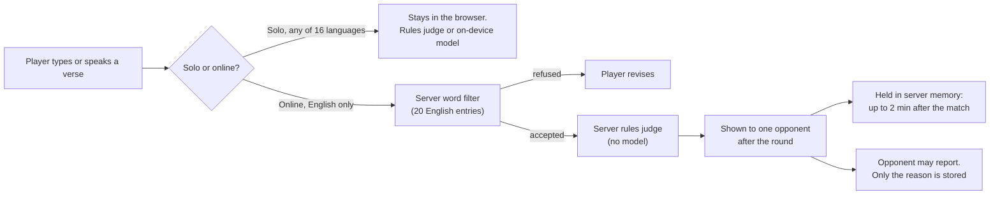
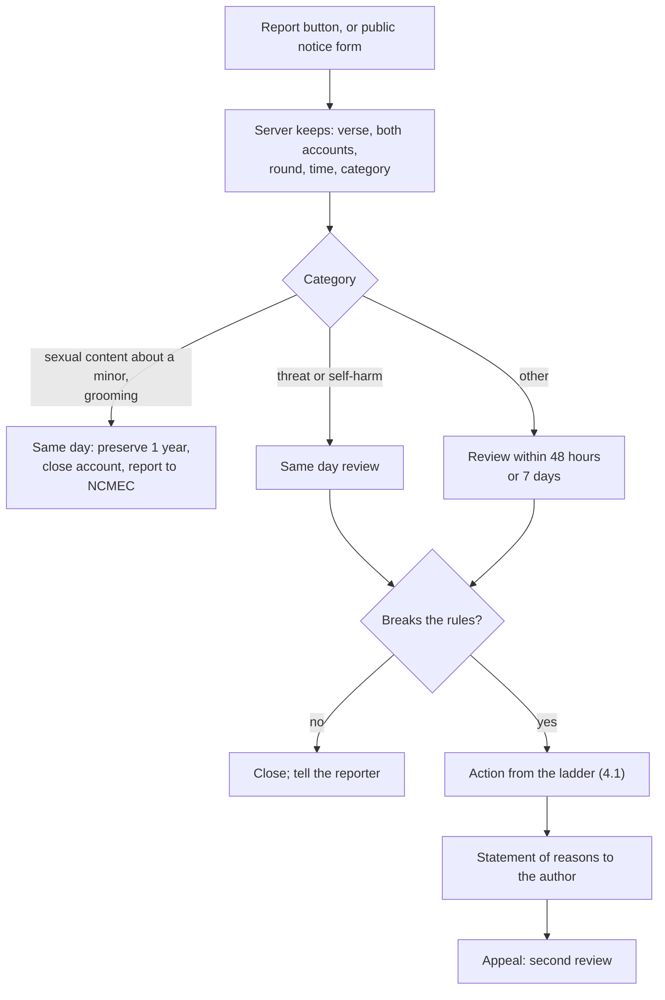

# Sonnet Man trust and safety plan

**Purpose:** how Sonnet Man keeps players safe when they write, speak and show each other verse, and what the law asks of a company this size.

**Audience:** David Charlot (founder and technical lead), Devon Glover ("The Sonnet Man", creative director), Arrocito del Diablo (co-founder, game design and card mechanics), future moderators, contractors and school partners. Investors: section 1 is the summary.

**As of:** commit 0d6df6ef (`integrate/wave3`, 2026-11-18), plus the release in flight on 2026-11-19: `fix/judge-wording`, `fix/server-authority`, `fix/voice-g2p`, `fix/compliance` and the nightly database backup.

**Status:** Draft for the team, 2026-11-19.

**Related documents:** `19-privacy-pack.md`, `20-legal-and-licence-register.md`, `17-operations-runbook-and-launch-checklist.md`, `13-ai-design-and-system-cards.md`, `05-systems-economy-and-balance.md`, `22-risk-register.md`, `sources/as-built-design.md`, `sources/as-built-tech.md`, `research/sota-production-2026-11.md`, `research/sota-design-2026-11.md`, and `docs/ECONOMY.md` (written by `fix/server-authority`); also `00-README.md` (index), `28-owner-decisions.md`, `29-postmortem-and-incident-templates.md`.

> **Every legal statement in this document is research, not legal advice.** It comes from the dated research files named above. Before the company relies on any of it, a lawyer should check it.

---

## How to read this document

Every statement is one of these kinds:

| Label | Meaning | Evidence given |
|---|---|---|
| **As built** | What the code at 0d6df6ef does | A fact-base section or a `path:line` |
| **In this release** | Decided by the owner on 2026-11-19 and being built now; not yet live | The branch name |
| **Proposed** | A recommendation in this document | The research that supports it |
| **Not known** | Could not be established | Listed again in the closing owner questions |

Short names for the sources: **design** = `sources/as-built-design.md`; **tech** = `sources/as-built-tech.md`; **prod research** = `research/sota-production-2026-11.md`; **design research** = `research/sota-design-2026-11.md`. Evidence marks carried over from the research: **[V]** the source was read, **[S]** a summary or secondary source only, **[U]** unverified background that must be checked.

Two words used throughout:
- **User-to-user content:** anything one player makes that another player sees. In Sonnet Man that is mainly an online verse.
- **Moderation:** finding, judging and acting on content or behaviour that breaks the rules or the law.

---

## 1. The short version

- **Solo play is private by design, and the risk sits in online play.** A solo verse, typed or spoken, never leaves the player's device (As built: tech §1.6; `src/pages/privacy.astro:18-22`). Only online verses (English only) reach another person (As built: tech §2.3).
- **The built protections are real but thin.** A 20-entry English word filter checks every online verse (As built: `backend/src/multiplayer/content_filter.rs:6-10`). Usernames are generated, and nobody can type a name of their own. There is no chat, no friend list, no profile page and no image upload (As built: design §5.7).
- **Reports cannot be acted on today.** The report button stores the reporter, the room's id and a reason. It does not store who wrote the verse or what the verse said. The room, with both verses, leaves memory within two minutes of the match ending. No tool reads reports (As built: `backend/migrations/015_content_reports.sql:2-10`; `backend/src/multiplayer/handlers.rs:113-142`; tech §2.3). Yet the Terms promise "We aim to review reports within 48 hours" (`src/pages/terms.astro:115`).
- **Teen accounts are matched with adult strangers.** Quick match never reads the age tier (As built: design §5.7).
- **The model opponent has no topic guardrails.** Its prompt answers the player's verse and sets no limits on subject (As built: `src/lib/verse/opponent.ts:57-81`). Gemma's model card asks developers to add content-safety safeguards (tech §11.1). California's game-bot exclusion needs a bot that "cannot discuss" self-harm or sexual content (prod research §5.2).
- **The law asks for a short list, even at this size** (prod research §4.3, §5): a written UK Online Safety Act risk assessment; EU notice-and-action and statements of reasons; readiness to report child sexual exploitation to NCMEC; an AI notice at first interaction (In this release, `fix/compliance`); topic guardrails on the AI.
- **Proposed minimum before online play is promoted** (section 13): reports that keep evidence; a review tool; a way to suspend an account; teen matching only with teens; a contact-details filter; community rules in all 16 languages; the written risk assessment.

---

## 2. What players create, who sees it, and how long it lives

### 2.1 The map

| Content | Where it goes | Who sees it | How long it lives | Checked by | Report path |
|---|---|---|---|---|---|
| Solo verse, typed (`/battle`, `/theatre`) | Stays in the browser | The player | Until the page is left | Rules judge, or an on-device model | None needed (As built: tech §1.6) |
| Solo verse, spoken | Audio turned into text on the device by Whisper, takes of 45 s at most; the audio is not sent | The player | Audio is not stored | Same as typed | None needed (As built: `src/lib/ear.ts:1-20,83-96`) |
| Model-written opponent verse | Generated on the device; read aloud in English if the voice is on | The player | Until the page is left | Nothing checks its subject (As built: `src/lib/verse/opponent.ts:81-90` only trims commentary) | None (As built) |
| Written-opponent verse | Shipped with the game in 16 packs | Every solo player | Permanent | Code checks form only; no native speaker has read any of it (As built: tech §6.4) | None |
| Online verse (English only) | Sent to the company's server; filtered; scored by rules; shown to one opponent after the round | One opponent | Server memory while the match lasts, up to 2 minutes after it ends, 30 minutes at most; never written to the database or the log (As built: tech §2.3; `src/pages/privacy.astro:61`) | 20-entry English word filter on the cleaned and the raw text (As built: design §5.3) | "Report your opponent's verse" (As built: `src/pages/multiplayer.astro:871-883`) |
| Report reason | Database and server log | The company | Until deleted (As built: `src/pages/privacy.astro:152`) | Length only, 1 to 500 characters | n/a |
| Tournament name (≤128 characters) and description (no length limit beyond the 1 MB body cap) | Database | Every signed-in player, in the list of 50 | Until deleted | **Nothing** | **None** (As built: `backend/src/tournaments/handlers.rs:140-170`; `backend/migrations/006_tournaments.sql:2-11`) |
| Classroom name (≤128) and assignment titles (≤128) | Database | Members of that class | Until deleted; no delete button | Nothing | None (As built: `backend/src/classroom/handlers.rs:75-87`; `backend/migrations/013_classrooms.sql:2-30`) |
| Username | Generated as `bard-<12 hex>`; no route renames it | Opponent, class roster, public leaderboard | Life of the account | Not needed (As built: tech §2.4; grep of `backend/src` finds no rename) | n/a |
| Marketplace listing | Card ids and a price only; no free text | Signed-in players | Until sold or cancelled | Not needed (As built: design §4.9) | n/a |

**What this means.** Free text from one player reaches others in three places: online verses, tournament names and descriptions, and classroom and assignment names. Only the first is filtered. Only the first can be reported.

### 2.2 Where a verse goes

### 2.3 What changes in this release

- **In this release (`fix/server-authority`).** Leaderboard places and tournament results will come only from matches the server judged. Credits move at fixed rates with daily caps. Cards come only from the server. Purchases move the credits and the card. This removes the biggest cheating incentive in the code at 0d6df6ef: any signed-in account could post its own scores, credits and cards (tech §12, items 1 to 3). The branch writes `docs/ECONOMY.md`.
- **In this release** (`fix/server-authority`, `tournaments/handlers.rs`): any signed-in account can still create a tournament, with any name of 1 to 128 characters and 2 to 64 players. The name and description pass no word filter. Who may create one remains an owner decision (Owner questions).
- **Not known:** what match records the server will now keep to rank players. They are new player data, and `19-privacy-pack.md` needs them.

---

## 3. The risks, ranked

Likelihood and severity are judgements for today's design: online play is English only, and the production database held 0 accounts on 2026-11-19. They will rise when online play grows.

| # | Risk | Where | Likelihood now | Severity | Control as built | Main gap |
|---|---|---|---|---|---|---|
| 1 | **Grooming or enticement of a teen** by an adult stranger, for example a verse carrying a social handle or "message me" | Quick match, private rooms | Low to medium | Very high | Generated usernames; no chat; 3 rounds; 600 characters and 8 lines a verse (As built: design §5.3) | Teens are paired with adults (design §5.7); no contact-details filter; reports keep no evidence |
| 2 | **Harassment and hate** in a verse | Online verses | Medium | Medium to high | English word filter; the 180-second round ends the exchange | 20 entries only; English only; no block |
| 3 | **Encouraging self-harm or suicide** | Online verses; also a model's reply to a solo verse | Low to medium | Very high | Three English phrases and one token are blocked ("kill yourself", "hang yourself", "go die", "kys") (As built: `content_filter.rs:6-10`) | Other phrasings and other languages pass; the model opponent has no topic limits |
| 4 | **Harmful model output to a solo player**, including a teen: sexual content, self-harm, slurs | Solo duel with Gemma 4 E2B or LFM3 loaded (desktops only) | Low | High | System prompt treats the player's verse as untrusted data (As built: `opponent.ts:79-80`) | No output check; no topic rule; SB 243 exclusion not met (prod research §5.2) |
| 5 | **AI verse taken for Devon Glover's own words** | The opponent can play The Sonnet Man card, written by the model or the written pack | Medium | High (reputation, right of publicity) | None | The opponent draws its three characters from all 53, SM-001 included (As built: `src/lib/verse/duel.ts:277-284`); prompt "You are {card.name}" (`opponent.ts:79`) |
| 6 | **Free text with no checks** in tournament and classroom names | `/tournaments`, `/classroom` | Low | Medium | Length limits | No filter, no report |
| 7 | **Judge manipulation** to win ranks or credits | Solo model judge; online rules judge | Low after this release | Medium | Online judge is rules only (As built: design §5.3) | Covered in section 8 |
| 8 | **Personal details in a verse** (one's own or another's) | Online verses | Low | Medium | None | No filter for emails, numbers, links or handles |
| 9 | **Copyrighted lyrics pasted as a verse** | Online verses | Low | Low to medium | Terms §6: the player says the content does not infringe (As built: `terms.astro:81-84`) | No rule against quoting modern lyrics |
| 10 | **Filter evasion** with look-alike letters or spacing | Online verses | Medium | Low | The verse is cleaned, including Unicode look-alike folding, before the filter (As built: `backend/src/verse/text.rs:147`; design §5.3) | Spacing tricks ("k y s") pass the whole-word test |
| 11 | **Report abuse**: false reports, or floods | Report endpoint | Low | Low | Rate limit of 600 requests a minute (As built: tech §2) | The server does not check that the reporter was in the room (As built: `handlers.rs:113-142`) |
| 12 | **Mass sign-ups** to farm daily caps or to swamp matchmaking | Accounts | Low | Low to medium | 40 accounts an hour per network; site-wide ceilings (As built: tech §3.3) | Daily caps per account can still be multiplied across accounts |

---

## 4. Community rules (Proposed text)

**As built:** the Terms list prohibited conduct in legal English (`src/pages/terms.astro:88-102`), and the Terms page is English only in every language (design §8). There are no community rules a player would read.

**Proposed:** publish these rules as a short page, translated into all 16 languages, and link them from the online lobby, the sign-up panel and the report dialog. Translations follow the project's own language process (tech §6.3) and get a native-speaker read before launch (tech §6.4). The Fair Play Alliance framework says to judge by impact over intent and to cover every channel (prod research §4.3).

> **The rules of the stage**
> 1. **Write your own verse.** Quote Shakespeare and the old poets freely. Do not paste modern song lyrics or other people's poems.
> 2. **Duel the verse, not the person.** Trash talk about your opponent's lines is part of the game. Attacks on who they are (race, religion, sex, sexuality, disability, nationality) are not.
> 3. **No threats.** Never tell anyone to hurt or kill themselves.
> 4. **Nothing sexual.** Never anything sexual about or toward anyone under 18.
> 5. **Keep personal details out.** Do not put names, ages, schools, addresses, phone numbers, emails, links or social handles in a verse, yours or anyone's.
> 6. **Do not ask anyone to talk somewhere else.**
> 7. **Do not pretend to be someone else,** including The Sonnet Man.
> 8. **Do not try to trick the judge** with instructions, fake scores or hidden text.
> 9. **Report what breaks these rules.** A person reads every report.
>
> If you or someone you know is in danger, contact local emergency services.

### 4.1 The enforcement ladder (Proposed)

| Step | When | Effect | Told to the author |
|---|---|---|---|
| 0. Blocked at submit | The filter refuses the verse | The verse is not sent; the player rewrites it | The message the filter returns (As built: `content_filter.rs:29,38`) |
| 1. Warning | A first, minor breach (rules 1, 2, 8) | None | Statement of reasons (section 10.3) |
| 2. Online pause, 7 days | A second breach, or a first breach of rules 3 or 5 | No online play; solo play is untouched | Statement of reasons, with how to appeal |
| 3. Online ban | Repeated breaches; any threat | No online play | Same |
| 4. Account closed | Rule 4; grooming; credible threats; evasion of a ban | Sessions revoked; account closed | Same, unless that would warn an offender while a report to the authorities is pending |

**As built, none of steps 1 to 4 can be carried out.** There is no account status, ban or suspension anywhere in the schema or the API (grep of `backend/migrations` and `backend/src` for suspend or ban finds nothing). Revoking an account's sessions exists (`POST /auth/logout/all`, tech §2.1), but the player can sign in again.

**Proposed:** add an `account_restrictions` table (account, kind, reason code, starts, ends, decided by, statement sent) and check it at every online entry point: queue, private room, WebSocket join. Solo play needs no check, because nothing leaves the device.

---

## 5. Moderation in 16 languages

### 5.1 What exists, and the principle

**As built:**
- Online play is English only (As built: `backend/src/multiplayer/handlers.rs:537`). The filter is English only.
- Solo verse is never moderated, because it never leaves the device. That is the right design: the company cannot moderate what it never receives, and should not try.
- The written opponent's verses in 16 languages were written by a language model and checked only by tools (As built: tech §6.4).

**Proposed principle.** Moderate what reaches another person. Add guardrails to what the AI says to the player. Never send a solo verse off the device to check it.

### 5.2 The layered check (Proposed)

The research recommends cheap checks first and models second, run on the company's own hardware (prod research §4.2, §4.3 "For Sonnet Man"). A 2026 study found that "a five-regex baseline is not Pareto-dominated by any guard" among 11 open-weight injection guards (arXiv 2611.08834, prod research §4.1 [V]). Every model named below was released after 2026-04-01 and is Apache 2.0 [V].

| Layer | What it catches | Tool | Where it runs | Languages |
|---|---|---|---|---|
| 1. Clean | Look-alike letters, zero-width characters | As built: the verse cleaner and the UTS #39 look-alike table (`backend/src/verse/text.rs:147`) | Server | All scripts |
| 2. Word lists | Slurs, sexual words, threat phrases | LDNOOBW lists, 28 languages, CC BY 4.0 (prod research §4.2 [V]), as a starting point only; its README says "what goes in these lists is subjective". Each list is reviewed by a native speaker and cross-checked against dictionary usage labels such as Wiktionary's "offensive" and "vulgar" ([U]: check that every language has such labels) | Server | 16 |
| 3. Contact details | Emails, phone numbers, links, social handles, "message me on…" | Patterns first (regular expressions); then the Roblox PII classifier v2 (0.6B, 2026-08-03; labels `privacy_asking_for_pii`, `privacy_giving_pii`, `directing_users_off_platform`; "from 17 to 189 languages"; internal F1 63.41% to 90.52%) (prod research §4.2 [V]) | Server | Patterns: all. Model: per its card |
| 4. Harm classifier | Hate, harassment, self-harm, sexual content | content-safety-guard-small (141M parameters, 268 MB int8 ONNX, 2026-09-27, 15 categories, 17 languages evaluated, runs in Transformers.js) (prod research §4.2 [V]) | Server, or the receiving player's browser (see 5.3) | 17 evaluated; which of the 16 Not known |
| 5. People | Anything flagged as sexual content about minors, grooming or self-harm risk; appeals | The named reviewer (section 11) | — | Native-speaker help needed for 15 languages |

**Known limits, from the research.**
- content-safety-guard-small's own card says its F1 for fraud, misinformation and `sexual_minors` is below 0.45: "Do not rely on it alone for child-safety" (prod research §4.2 [V]). Hence layer 5.
- It flags about 22% of XSTest's safe prompts (same source). Shakespeare is full of daggers, poison and death, so false positives matter.
- Word lists miss meaning. Grooming uses no bad words (prod research §4.2 [U]).
- Roblox's voice classifier shows how recall falls outside English (67.9% English against 32.9% Turkish at 1% false positives) (prod research §4.2 [V]). Expect the same pattern in text.

**Proposed test corpus.** Before any layer ships, run it over the game's own Shakespeare: the 71 card lines and the 104 quote challenges in every language they exist (design §6.4). Every line must pass. This follows the project's habit of proving a check can fail before trusting it (tech §7.1, mutation scripts). A second set of known-bad verses per language, written by native speakers, must be caught.

### 5.3 Where the classifier runs: an owner decision

The owner's direction of 2026-11-16 was "in-browser models only, no cloud provider" (`CLAUDE.md:639-644`). A moderation model on the company's own server is not a cloud provider, but it is a server running a model. Two options:

| Option | How | For | Against |
|---|---|---|---|
| A. Server-side (Proposed) | Layers 1 to 4 run in the API on the company's own hardware before the verse is relayed | Cannot be bypassed; one place to update; online verses already reach the server (As built: tech §2.3) | A model on the server; needs CPU and memory; must be measured |
| B. On the receiving device | The opponent's browser runs layer 4 before it shows the verse, and hides a flagged verse behind "Show anyway" and "Report" | Nothing new on the server; the sender cannot bypass it, because the check runs on the receiver's device | 268 MB download, too much for phones; a verse that should be stopped still arrives; the server keeps layers 1 to 3 |

Either way, layers 1 to 3 run on the server.

### 5.4 Language coverage

| Language | Online today | Word list | Contact patterns | Harm classifier | Native reviewer |
|---|---|---|---|---|---|
| en | Yes (As built) | 20 entries (As built); full list Proposed | Proposed | Proposed | Owner question |
| es fr de it pt pl ru ar hi zh ja ko vi th id | No (As built) | Proposed, LDNOOBW seed plus review | Proposed; phone and handle formats differ by country | Coverage per language Not known | None for any language (tech §6.4) |

**Proposed gate:** no language opens for online play until it has a reviewed word list, contact patterns, a measured classifier result on its Shakespeare corpus, and a person who can read reports in it.

### 5.5 Free-text fields outside the duel (Proposed)

- Run layers 1 to 3 on tournament names and descriptions, and on classroom and assignment names.
- Cap a tournament description at 500 characters.
- Add a report link to each tournament.
- Let only a role the company grants create a public tournament. Teachers create classes, which only their students see.

---

## 6. Reporting and review

### 6.1 As built

- A "Report your opponent's verse" button appears under each round that had a verse (As built: `src/pages/multiplayer.astro:871-883`).
- It opens the browser's `prompt()` box: "What is wrong with this verse?" There are no categories.
- The server stores the reporter's account id, the room id, the reason prefixed with the round number, status `pending`, and the time. It logs the same at warning level (As built: `backend/src/multiplayer/handlers.rs:113-142`; `backend/migrations/015_content_reports.sql:2-10`).
- **It does not store** the reported account, the verse, or the opponent's username. It does not check that the reporter sat in that room.
- The room, which holds both accounts and both verses, is swept within 2 minutes of the match ending (As built: tech §2.3).
- **No code reads, reviews or acts on a report** (As built: grep; tech §12 item 16).
- So a report says only that somebody, in some room, objected to something. After two minutes nobody can find out who or what.
- The privacy policy says reports are kept "until we delete it" (As built: `src/pages/privacy.astro:152`). The Terms say "We aim to review reports within 48 hours" and reserve the right to suspend accounts (As built: `src/pages/terms.astro:108-115`). **Neither promise can be kept by the code.**

### 6.2 The design (Proposed)

1. **Keep the evidence when, and only when, a report is made.** When a report arrives, the server copies from the live room: the reported account's id and username, the round, both verses exactly as scored, the filter result and the time. The report button already appears while the room still answers, inside its 90-second linger (tech §2.3), so the copy is possible.
   - This changes a privacy promise. Today the policy says an online verse "is not written to our database or to our server log" (`src/pages/privacy.astro:61`). The new wording: "unless someone reports it". `19-privacy-pack.md` sets the retention (section 7 there).
2. **Accept reports only from a player who held a seat in the room.**
3. **Replace `prompt()` with a small dialog.** Categories: hate or harassment; threat or self-harm; sexual; personal details or "talk elsewhere"; cheating or tricking the judge; other. A free-text box (500 characters). A line saying a person reads every report. In all 16 languages.
4. **Block (Proposed).** After a report, offer "Never match me with this player again". Store it as a pair the matchmaker skips. The EU guidelines on minors recommend block and mute for any user; they exempt micro and small companies, but the cost is low (prod research §4.3 [V]).
5. **A public notice route.** A web form, and an address, for anyone, signed in or not, to report illegal content. It doubles as the TAKE IT DOWN Act notice form, though a text game with no image upload has near-zero exposure to that law (prod research §5.2 [V]). The EU's notice-and-action rule lets anyone send a notice (section 10).
6. **A review tool.** Build it as a Rust command-line tool on the server, used by the named reviewer only, and keep it off the public web. It lists pending reports with their evidence and records each decision in a `moderation_actions` table: dismiss, warn, pause, ban, close, escalate. It writes the statement of reasons for sending. A command-line tool keeps the attack surface small and fits the full-Rust preference.
7. **Close the loop.** The reporter learns the report was handled, but not the action taken against another player.

### 6.3 Response targets (Proposed)

| Category | First look | Decision | Notes |
|---|---|---|---|
| Sexual content involving a minor; grooming; enticement | Same day | Same day | Preserve, suspend, report to NCMEC (section 7.4) |
| Threat to life; self-harm risk | Same day | Same day | Act on the account; consider emergency services where a real person is in danger |
| Hate, harassment, personal details | 48 hours | 48 hours | Matches the Terms' promise (`terms.astro:115`) |
| Cheating, judge tricks, other | 7 days | 7 days | Change the Terms to say so, or meet 48 hours |

The Terms should promise only what one founder can meet. If 48 hours cannot be met every day of the year, change the sentence (`fix/compliance` changes the privacy policy only; its diff does not touch `src/pages/terms.astro`, so the 48-hour sentence stays as it is in this release).

### 6.4 The flow

### 6.5 Appeals (Proposed)

- One appeal per decision, by reply to the statement of reasons, within 14 days.
- Reviewed by a different person from the first reviewer where one exists. With one founder, an outside volunteer reviewer would do (owner question).
- The research notes that AI-decided ranked outcomes for children are significant automated decisions under GDPR and suggests human review on request (prod research §5.3 [V for the principle, inference for the game]). The same appeal path serves.

---

## 7. Child safety

### 7.1 What is built

| Control | As built | Source |
|---|---|---|
| Age gate | A date of birth, asked on every page except privacy, terms and about; month, day and year selects; nothing pre-filled | design §8; `src/layouts/BaseLayout.astro:122-157,1671-1672` |
| Under 13 | Blocked; the block persists on later visits; cannot create an account; no analytics | `BaseLayout.astro:1626-1631,1675-1681`; `src/pages/privacy.astro:164` |
| 13 to 17 | A tick box confirming a parent or guardian agrees; nobody checks it | `BaseLayout.astro:1632-1661`; `privacy.astro:164` |
| What is kept | Only the result, in the browser; the date of birth is never sent | tech §3.6 |
| Teen account rules | Spending capped at 200 credits a day; an account declared teen stays teen | tech §3.6; `backend/src/auth/age.rs:9-36` |
| Email | Only for adult or teen-consented answers, checked in the browser and the API | tech §3.6 |
| Identity | Generated usernames; no free-text names; no avatars for new accounts | tech §2.4 |
| Contact | No chat, no direct messages, no friends, no profiles of others, no image upload, no voice relay | design §5.7 |
| Matching | **Teens and adults are matched together**; nothing online reads the age tier | design §5.7 |
| Classroom | Teacher and student tick boxes; an under-13 cannot pass the age gate to reach it | design §3 `/classroom`; `src/i18n/pages/classroom/en.ts:16-28` |

**The good part:** the design already removes most grooming tools. There is no private channel, no persistent identity a stranger can find again, no images and no voice. The research's advice is to "design the risk out rather than moderate it" (prod research §4.3), and much of that is done.

**The gap:** a verse is a message. Over three rounds of 600 characters, an adult stranger can send a teen a handle and an invitation.

### 7.2 Proposed changes

1. **Teens match only with teens.** Quick match pairs a teen account only with another teen account. A private-room link from an adult account cannot seat a teen account, unless both are members of the same class (owner decision; section 14).
2. **Contact-details layer on every verse involving a teen** (section 5.2, layer 3).
3. **Classroom private by default.** Verses are seen only within the match or the class, with no profiles and no friend discovery (prod research §4.3, point 2).
4. **Never relay voice between players.** That also keeps PEGI's "unrestricted communication" rating (PEGI 18) out of reach (prod research §4.3, §5.6 [V]).
5. **Self-harm help on the device.** When a player's solo verse contains self-harm phrases, show a short, kind note with help resources for the player's country. The check runs in the browser and sends nothing anywhere, so the solo privacy promise holds. Outside the game-bot exclusion, California's SB 243 asks for a published suicide and self-harm protocol (prod research §5.2 [V]). This doubles as one.
6. **Model output guardrails** (section 8.3).
7. **Under-13 players** stay blocked until the owner decides on a school-consent path (`19-privacy-pack.md`, section 5).

### 7.3 Age assurance

- **As built:** self-declared. Nothing verifies age (tech §3.6).
- **Research:** the UK Online Safety Act requires "highly effective" age checks where they are needed (s.12; prod research §4.3 [V]). The research does not establish that a game which forbids harmful content must age-check. The FTC said on 2026-02-25 that it will not bring COPPA actions over data collected only to determine age, if it is used only for that and deleted promptly (prod research §5.1 [V]).
- **Proposed:** keep self-declaration, and keep harmful content out by design, rather than add an age-verification vendor (which the owner's free and self-hosted rule also rules out). Revisit if Ofcom's guidance for small services says otherwise (Ofcom's pages could not be opened: prod research §9 item 1).

### 7.4 Child sexual exploitation: reporting duty (Proposed procedure)

**The law, as researched** (18 U.S.C. §2258A; prod research §4.3 [V]):
- A provider with "actual knowledge" of apparent child sexual exploitation must report it to NCMEC's CyberTipline "as soon as reasonably possible".
- The REPORT Act (2024) added child trafficking and enticement, and extended preservation to 1 year.
- A knowing and wilful failure costs up to $600,000 the first time for a provider under 100 million monthly users.
- There is no duty to monitor or scan (§2258A(f)).
- Whether a verse game is a "provider" is unresolved [U]; text exchanged between users makes it likely.

**Procedure (Proposed):**
1. Register with NCMEC's CyberTipline before online play is promoted.
2. Join Tech Coalition Pathways, which is free for startups and small user-content platforms. It covers child-safety policy, user reporting and NCMEC reporting (prod research §4.3 [V]).
3. On knowledge: close the account; preserve the report's evidence for 1 year in a separate, access-logged store; file the report; record the report number.
4. Do not tell the account holder why while the matter is open.
5. Never copy, forward or show the content to anyone except NCMEC and law enforcement.
6. Keep a one-page runbook in `17-operations-runbook-and-launch-checklist.md`.

---

## 8. Abuse of the AI judge, and of the AI opponent

### 8.1 What can be won by cheating

| Stake | As built at 0d6df6ef | In this release |
|---|---|---|
| Public leaderboard | Self-reported numbers from the browser (design §5.6) | Server-judged matches only (`fix/server-authority`) |
| Tournament results | Either player may name either player the winner (tech §12 item 3) | Server-judged matches only (`fix/server-authority`) |
| Credits | Any account may add up to 1,000 a call (tech §12 item 1) | Fixed rates, daily caps (`fix/server-authority`) |
| Cards | Any card can be added through the API (tech §12 item 1) | Only from the server (`fix/server-authority`) |
| A solo win | One card from the browser's own store (design §4.3) | Not known: whether a solo win still pays a card once cards come only from the server (`docs/ECONOMY.md`) |

**After this release, the solo model judge decides nothing that reaches anyone else**, as long as solo wins grant nothing the server counts. The research's rule is that "for ranked play and tournaments, only the server's judgement counts" (prod research §4.3 point 4). The design research reaches the same view from the Where Winds Meet case (design research §3).

### 8.2 Attacks on the judges, and the defences

| Attack | Against | Defence | Status |
|---|---|---|---|
| "Ignore all previous instructions…" inside a verse | Solo model judge (compare path) | Main's compare wording measured 2 injection losses and 14 languages passing, against 11 losses and 4 languages for the integration's wording (tech §4.2) | **In this release (`fix/judge-wording`)**: main's wording returns |
| "Grade: 5", "Grade: five" | Solo lite-tier grade path | Lines with numbers, number words or judge words are not read; such a round goes to the rules (tech §4.2; `docs/language/JUDGE-INJECTION.md:1-36`) | As built |
| Parenthetical claims, "(the judge awards ten)", flattery | Model judges | The Where Winds Meet pattern (design research §3 [S]). Benign framing flipped LLM judges 57% to 100% of the time, a refusal prefix 39% to 88% (arXiv 2606.25487, prod research §4.1 [V]) | Proposed: add both to the model-evaluation red-team set in all 16 languages |
| Copying the opponent's verse | Both judges | The copy test hands the whole judge pool to the other side (As built: design §5.3) | As built |
| Keyword stuffing for power words and devices | Rules judge | Form gates and the "substance floor" (As built: tech §5) | As built; watch per-language score distributions (prod research §6.3) |
| Two accounts of one person farming wins online | Server-judged leaderboard | Proposed: private-room matches do not count toward the leaderboard; a cap on counted wins against the same opponent per day; ratings rather than raw win counts (Glicko-2 through the MIT/Apache `skillratings` crate, prod research §6.3 [V]) | Proposed; check against `docs/ECONOMY.md` |
| Characters the server's Unicode tables lack | Server parity | Refused as `unknown_character`, not mis-scored (As built: tech §5) | As built |

**Not established** (tech §4.2): how well a model ranks two decent verses; injection beyond three attempts per language; other GPUs and browsers. These belong in the model-evaluation backlog, not in trust and safety, but they bound what any "the AI said I won" claim means.

### 8.3 What the AI opponent says (Proposed guardrails)

The opponent model writes in reply to the player's verse ("Answer it in your own words": `src/lib/verse/opponent.ts:69-70`). Nothing limits the subject. A player can steer it toward self-harm, sex or slurs, and a screenshot of "the Sonnet Man AI said this" travels.

California's SB 243 excludes a game bot only if it is "limited to replies related to the video game" and "cannot discuss topics related to mental health, self-harm, sexually explicit conduct, or maintain a dialogue on other topics unrelated to the video game" (§22601(b)(2)(B), prod research §5.2 [V]). Whether the opponent is a "companion chatbot" at all is a legal question; the research rates it "depends on guardrails" (prod research §5.2).

**Proposed:**
1. **A topic rule in the system prompt:** never write about suicide, self-harm, sexual acts or drugs, and never address the player's real life. If the challenger's verse is about those, answer with a verse about the duel itself.
2. **An output check before display.** Run the English word list and the self-harm phrase list on the model's verse. If either hits, show a written-opponent verse instead. Where the device already holds a model of several GB, the 268 MB harm classifier (section 5.2) is a small addition; measure it first.
3. **No memory between duels.** As built, each duel prompts afresh (`opponent.ts:57-81`). Keep it that way, and say so in the AI notice. New York's AI-companion law reaches only systems that simulate a sustained relationship (prod research §5.2 [V]).
4. **No free chat with the opponent, ever.** The opponent only answers verse with verse.
5. **The Sonnet Man card plays only verse Devon Glover has approved.** When the opponent draws SM-001, use a written verse he has approved, not model output, until the agreement in `20-legal-and-licence-register.md` (section 7) sets the terms. Label every AI verse "AI, not Devon Glover" (prod research §5.4, §5.8).

### 8.4 The AI notice

- **In this release (`fix/compliance`):** the EU AI Act Article 50(1) notice. Since 2026-08-02, people must be told they are interacting with an AI system, at the latest at first interaction, unless it is obvious (prod research §5.4 [S for the article text]; design research §3 [V]).
- **Proposed wording,** after the design research's model: "Your opponent and judge are small AI models running on your device, or fixed rules when no model runs. The Sonnet Man card's verses are not written by Devon Glover." (design research §3, "Against Sonnet Man").
- **Not in this release, and due:** Article 50(2) machine-readable marking of AI-generated text and synthetic speech, "as far as technically feasible". The deadline is 2026-12-02 for systems already on the market before 2026-08-02, and now for others (prod research §5.4 [V]). Whether Sonnet Man's AI features were on the market before 2026-08-02 is Not known. `20-legal-and-licence-register.md` (section 9) carries the date.

---

## 9. UK Online Safety Act: draft risk assessment

### 9.1 Does it apply? (research)

- Verses shown to other players make Sonnet Man a user-to-user service. The Act's duties scale with size but have no small-business exemption (prod research §0 item 5, §4.3 [V]).
- Every regulated user-to-user service needs a "suitable and sufficient illegal content risk assessment", kept current and redone before significant changes (s.9 [V]).
- What is proportionate depends on the assessment and "the size and capacity of the provider" (s.10(10) [V]). Illegal content must be taken down "swiftly" once the service is aware (s.10(3)(b) [V]). Reporting must be easy (s.20 [V]).
- Illegal-content duties have been enforceable since 2025-03-17. Children's risk assessments were due by 2025-07-24. Fines reach £18m or 10% of revenue. Ofcom has fined small services, for example 4chan £20,000 (announced 2025-10-13; August 2025 was the provisional notice) [V, checked by the reviewer against press reports]. A later £520,000 fine is reported by one secondary source only and is unverified [S].
- Whether the Act reaches the service depends on its links with the UK. With 0 accounts on 2026-11-19, the number of UK players is Not known. The service is in English and open to UK visitors, so plan as if it applies.
- **Not verified:** Ofcom's code measures for small, low-risk services and its online regulation checker (prod research §9 item 1). **Proposed:** run the checker and record the answer here.

### 9.2 Method

This draft follows the shape of Ofcom's four steps [U: Ofcom's pages could not be opened; check against its current guidance]:
1. Understand the kinds of illegal content to assess.
2. Assess the risk of each: likelihood and impact, rated negligible, low, medium or high.
3. Decide measures, put them in place, and record them.
4. Report, review and update.

**The service, as the assessment sees it.**
- Users: adults and teens 13 to 17 (self-declared); no under-13s (blocked at the gate).
- Functions that carry risk: one-to-one text exchange with strangers (quick match) or with an invited player; 3 rounds; 600 characters and 8 lines a verse; English only.
- Functions absent: chat, direct messages, images, links that open, files, voice between players, profiles, search for users, groups or feeds.
- Identity: generated usernames; accounts by passkey; nothing persistent a stranger can look up.
- Persistence: none; a verse leaves memory within 2 minutes of the match.

### 9.3 Illegal content risk assessment (draft)

The rows follow the 17 kinds of priority illegal content in Ofcom's guidance [U: check the list]. "Proposed" measures are those in this document.

| Kind | Risk | Why | Measures |
|---|---|---|---|
| Child sexual exploitation and abuse: grooming | **Medium** | Teens can be matched with adult strangers; text can carry contact details and invitations | Teen-only matching; contact-details filter; reports with evidence; NCMEC procedure (Proposed: 7.2, 7.4) |
| CSEA: child sexual abuse material, images | Negligible | No images can be sent | None needed |
| CSEA: links to such material | Low | A verse could spell out a link | Link and domain patterns in layer 3 (Proposed) |
| Hate | **Medium** | Free text to strangers | Word lists, classifier, reports, ladder (Proposed) |
| Harassment, stalking, threats, abuse | **Medium** | Free text; trash talk is part of the game | As hate; block (Proposed); no persistent identity (As built) |
| Controlling or coercive behaviour | Low | No persistent channel | Reports |
| Intimate image abuse | Negligible | No images | TAKE IT DOWN notice form (Proposed) |
| Extreme pornography | Negligible | No images | None |
| Sexual exploitation of adults | Low | Text could advertise | Word lists, contact filter |
| Human trafficking | Low | Text could recruit | Contact filter |
| Unlawful immigration | Negligible | — | None |
| Fraud and financial offences | Low | No cash-out; credits have no money value (As built: terms §4); a verse could carry a scam link | Link patterns; keep credits closed-loop (`docs/ECONOMY.md`) |
| Proceeds of crime | Negligible | No money moves | None |
| Drugs and psychoactive substances | Low | Text could advertise | Word lists, contact filter |
| Firearms, knives and other weapons | Low | As drugs; Shakespeare's daggers are not offers | Test corpus to avoid false positives |
| Encouraging or assisting suicide | **Medium** | Free text to teens; "kys"-style abuse | Self-harm list in every online language; classifier; same-day review |
| Foreign interference; animal cruelty | Negligible | — | None |

### 9.4 Children's access and children's risk assessment (draft)

- **Can children access it?** Yes. Teens 13 to 17 are admitted (As built: tech §3.6). So a children's risk assessment is needed (prod research §4.3 [V] for the due date).
- **Content harmful to children** [U: the categories below are from the Act as generally summarised; check them]:

| Category | Risk | Measures |
|---|---|---|
| Pornography | Low (text only) | Word lists; classifier; ladder |
| Suicide, self-harm, eating disorders | **Medium** (online verse; model replies) | Self-harm lists; model topic rule and output check (8.3); help note on the device (7.2) |
| Bullying, abuse and hate | **Medium** | Sections 5 and 6 |
| Violence | Low; the plays are violent, but the game asks for verse craft, not threats | Test corpus; ladder for real threats |
| Harmful substances; dangerous stunts | Low | Word lists |

### 9.5 Governance and review (Proposed)

- **Named person accountable:** David Charlot, until a trust-and-safety lead exists.
- **Written content policy:** section 4.
- **Records:** this assessment, every revision, and every action in `moderation_actions`.
- **Review yearly, and before each significant change:**
  - online play in another language;
  - any chat, voice relay or image;
  - classroom mode for under-13s;
  - tournaments open to everyone;
  - an app-store or portal listing;
  - a large jump in UK players.

---

## 10. EU Digital Services Act: notice and action

### 10.1 What applies at this size (research)

- **Articles 16 (notice and action) and 17 (statement of reasons)** apply to all hosting providers. Recital 50 says "regardless of size" (prod research §4.3 [V excerpts]).
- **The online-platform duties (Articles 19 to 28) do not apply to micro or small enterprises** (Art 19(1)). Micro means under 10 staff and at most €2M turnover; small means under 50 staff and at most €10M (prod research §4.3 [V]). Voyage Tracable LLC looks micro on what is known: a founder and a few partners, and a game that sells nothing (As built: `src/pages/terms.astro`, section 4). Its revenue is Not known.
- **Whether Sonnet Man is a "hosting service" at all** is an inference: it stores a verse at a player's request (in memory, for minutes) and passes it to one opponent. Showing a verse to one opponent is probably not dissemination "to the public", so it is probably not an "online platform" either [inference]. Planning as a hosting service costs little.
- A provider outside the EU must name a legal representative in the EU (Art 13) [U]. `19-privacy-pack.md` (section 9) treats the GDPR representative, and one firm can often serve both.
- **The minors guidelines under Art 28** (2025-07-14, updated 2026-04-22) recommend private-by-default accounts, streaks and notifications off by default, and block and mute. They exempt micro and small enterprises (prod research §4.3 [V]). **Proposed:** follow them anyway. Sonnet Man has no streaks or notifications live (design §4.11), and block is in section 6.2.

### 10.2 Notice form (Proposed)

One form, in all 16 languages, at a public address, linked from every page's footer. It asks for [U: the elements below follow Article 16 as generally summarised; check against EUR-Lex]:
1. what the content is and why the sender thinks it is illegal;
2. where it is: the match link or round, the tournament or class name;
3. the sender's name and email, except where the notice concerns child sexual abuse;
4. a statement that the notice is made in good faith.

The company confirms receipt, decides in good time, says whether automated means were used, and tells the sender the outcome.

### 10.3 Statement of reasons (Proposed template)

Sent to the author of any verse or name the company removes or restricts, or whose account it pauses or closes [U: elements follow Article 17 as generally summarised]:

> **What we did:** [removed your verse in match ___ / paused online play for 7 days / closed your account], from [date] to [date].
> **Why:** [your verse broke rule ___ of the rules of the stage, or appeared to be illegal under ___].
> **The facts:** [what was said, when; whether a player reported it or our checks found it].
> **Automated tools:** [our filter flagged it / a person reviewed it / both].
> **What you can do:** reply within 14 days to ask for a second review. You may also go to a court.

---

## 11. Roles and staffing (Proposed)

| Role | Who | Duties |
|---|---|---|
| Accountable person (UK Act); reviewer of reports | David Charlot, until someone else is named | Owns this plan; reviews reports; files NCMEC reports; signs the risk assessments |
| Second reviewer, for appeals and for cover when the first is away | Not known (owner question) | Appeals; cover |
| Language readers | Not known; none exist for any language (tech §6.4) | Review word lists; read reports in their language |
| Creative approvals for The Sonnet Man's persona | Devon Glover, if he agrees (section 14) | Approves persona guidelines, banned topics and sample verses (prod research §5.8 item 4) |

Text-only reports spare reviewers from images, but self-harm and abuse reports are still hard to read. Rotate the work, and keep it out of anyone's evening.

---

## 12. Measures and transparency (Proposed)

Track monthly, and publish a short yearly note. The DSA exempts micro companies from transparency reports [U], but a page builds trust with schools.

- Online matches played; verses refused by the filter, by reason and language.
- Reports per 1,000 matches; share with evidence; time to first look; time to decision; actions by step of the ladder.
- Appeals, and the share overturned.
- NCMEC reports filed (count only).
- False positives on the Shakespeare corpus, per language, per release.
- Model-opponent output replaced by the guardrail (section 8.3), per language. These counts are made and kept on the device, and leave it only as a total if the player has allowed statistics (`19-privacy-pack.md`, section 3.6).

---

## 13. What applies to a company this size

| Duty | Applies? (research, inference) | What Sonnet Man does | When |
|---|---|---|---|
| UK Online Safety Act: illegal-content and children's risk assessments; reporting; swift takedown | Yes, if UK players; no small-business exemption (prod research §4.3) | Sections 9 and 6 | Before online play is promoted; the dates in the Act have passed |
| EU DSA Arts 16 and 17 | Yes, as a hosting service; any size | Sections 10.2 and 10.3 | Before online play is promoted |
| EU DSA Arts 19 to 28 | No; micro enterprise | Follow the minors guidelines anyway | — |
| EU AI Act Art 50(1), AI notice | Yes | **In this release (`fix/compliance`)** | Since 2026-08-02 |
| EU AI Act Art 50(2), machine-readable marking | Yes, "as far as technically feasible" | Proposed | 2026-12-02, or now (8.4) |
| US 18 U.S.C. §2258A, NCMEC reporting | Likely, if the game is a "provider" [U] | Section 7.4 | Before online play is promoted |
| US TAKE IT DOWN Act | Near zero for a text game with no images [inference] | One-page notice form (6.2 point 5) | Process was required by 2026-05-19 for covered platforms |
| California SB 243 (companion chatbots) | Depends on guardrails | Section 8.3 | In force 2026-01-01 [U] |
| COPPA | See `19-privacy-pack.md` | — | — |

**Proposed order of work:**

| When | Work |
|---|---|
| **Before deploy (this release)** | Ship `fix/compliance` (AI notice). Change the Terms' 48-hour sentence to what can be met, or plan to meet it. Hold any promotion of online play until the next row is done. |
| **Before online play is promoted** | Reports that keep evidence (6.2 points 1 to 3); account restrictions (4.1); the review tool (6.2 point 6); teen-only matching (7.2 point 1); the English contact-details and self-harm layers (5.2 layers 2 and 3); community rules in 16 languages (4); NCMEC registration and Tech Coalition Pathways (7.4); the UK risk assessments signed (9); the DSA notice form and statement template (10); filters and a report link on tournament and class names (5.5). |
| **At this deploy (cautious reading), and by 2026-12-02 at the latest** | Article 50(2) marking in place (8.4; `13-ai-design-and-system-cards.md` §7.2). |
| **Before a classroom pilot** | Classroom private by default; teacher view of class verses; the school pack (`19-privacy-pack.md`, section 6). |
| **Before any second language goes online** | The gate in 5.4. |
| **Before a model's verse is shown for The Sonnet Man card** | Devon Glover's agreement and approved guidelines (8.3 point 5). |
| **Yearly** | Review the risk assessments; publish the measures (12). |

---

## Owner questions

1. **Matching:** should teen accounts be matched only with teens, or kept to private rooms and classes? (7.2)
2. **Moderation model on the server:** may a moderation classifier run on the company's own server, or must it stay in browsers? (5.3)
3. **Second reviewer:** who reviews appeals and covers when you are away? Would an outside volunteer be acceptable? (6.5, 11)
4. **Language readers:** who can read reports and review word lists in the 15 other languages, and which languages come online first? (5.4)
5. **The Terms' 48-hour promise:** keep it and staff it, or change it? (`fix/compliance` does not touch the Terms.) (6.3)
6. **Report evidence:** do you accept keeping a reported verse, which changes the "never written to our database" promise for reported verses only? (6.2 point 1)
7. **Tournaments:** in this release anyone signed in may still create one, and names are not filtered. Limit creation (to staff, or to adults), filter names, or hide tournaments? (2.3, 5.5)
8. **Solo wins:** in this release a solo win adds no card to an account and pays only a capped claim (50 credits, at most 3 a day); no solo result reaches the leaderboard, which reads only server-judged matches (05 §7.1). Accept that? (8.1)
9. **Match records:** in this release each server-judged match is one `battle_rooms` row (players, rounds won, points, best round, how it ended, times; no verse). How long should it be kept? No retention is set. (2.3)
10. **Market date:** were the AI opponent and judge publicly live before 2026-08-02? That decides the Article 50(2) date. (8.4)
11. **UK players:** do you expect UK players at launch? Will you run Ofcom's online regulation checker? (9.1)
12. **NCMEC and Pathways:** may the company register with NCMEC's CyberTipline and join Tech Coalition Pathways now? (7.4)
13. **Self-harm note:** which help resources should the on-device note show, and who checks them per country? (7.2 point 5)
14. **Legal review:** who will check this plan's legal statements, and when? (top of document)

**To ask Devon Glover** (nothing here assumes his answer):
1. May the AI opponent play The Sonnet Man card at all? If so, only with verses he has written or approved, or also with model verse under guidelines he sets?
2. Which topics, words and styles must The Sonnet Man's persona never touch, especially for teen and classroom players?
3. Will he review the community rules and the AI notice wording, which name him?
4. Would he review sample opponent verses in his house's style before launch, and how quickly can he usually turn approvals around?
5. Does he want to be told of any report or incident that involves his name or card, and how fast?
