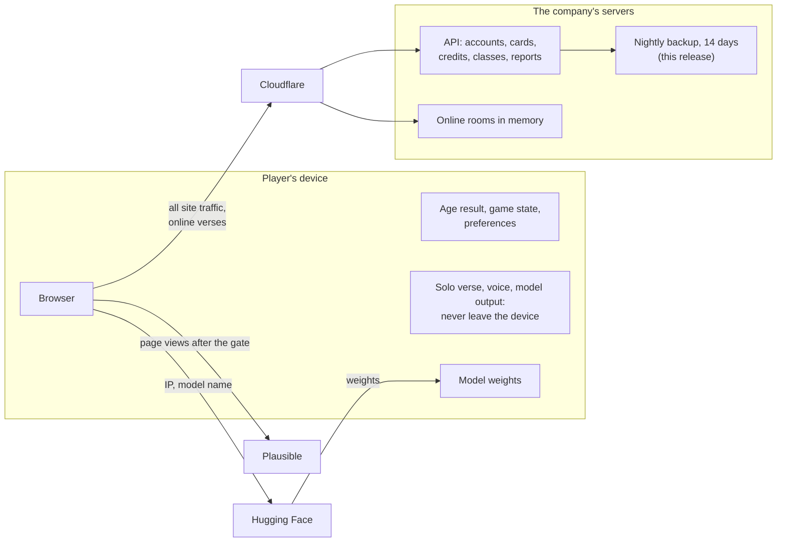

# Sonnet Man privacy pack

**Purpose:** what personal data Sonnet Man holds, where, for how long and why; the draft impact assessment, the COPPA pack and the school pack built on that inventory; and what must change before children and schools are served.

**Audience:** David Charlot (founder and technical lead, proposed privacy lead), Devon Glover (creative director), Arrocito del Diablo (co-founder, game design), future contractors, school and district reviewers (sections 6 and 7), counsel, and investors (section 1).

**As of:** commit 0d6df6ef (`integrate/wave3`, 2026-11-18), plus the release in flight on 2026-11-19: `fix/judge-wording`, `fix/server-authority`, `fix/voice-g2p`, `fix/compliance` and the nightly database backup.

**Status:** Draft for the team, 2026-11-19.

**Related documents:** `18-trust-and-safety-plan.md`, `20-legal-and-licence-register.md`, `17-operations-runbook-and-launch-checklist.md`, `11-accessibility-plan-and-statement.md`, `12-technical-design.md`, `13-ai-design-and-system-cards.md`, `22-risk-register.md`, `sources/as-built-tech.md`, `sources/as-built-design.md`, `research/sota-production-2026-11.md`, `research/sota-design-2026-11.md`, `docs/ECONOMY.md` (written by `fix/server-authority`); also `00-README.md` (index), `28-owner-decisions.md`.

> **Research, not legal advice.** Every statement in this pack about what a law requires comes from the dated research files and is marked "(research)". A lawyer must check it before the company relies on it. The draft programmes and policies in sections 5 and 7 are starting texts for that review, not finished legal documents.

---

## How to read this pack

| Label | Meaning |
|---|---|
| **As built** | What the code at 0d6df6ef does, with a fact-base section or `path:line` |
| **In this release** | Decided by the owner on 2026-11-19 and being built; not yet live; the branch is named |
| **Proposed** | A recommendation here, with the research that supports it |
| **Not known** | Could not be established; repeated in the owner questions |

Short names: **tech** = `sources/as-built-tech.md`; **design** = `sources/as-built-design.md`; **prod research** = `research/sota-production-2026-11.md`; **design research** = `research/sota-design-2026-11.md`. Evidence marks from the research: **[V]** read at the source, **[S]** secondary, **[U]** unverified.

Terms used:
- **Personal data:** anything about an identifiable person, including an IP address or an account id.
- **Controller:** the company that decides why and how data is used. Here, Voyage Tracable LLC (DBA Inspired Mile).
- **Processor:** a company that handles data on the controller's behalf, such as a delivery network.
- **DPIA:** data protection impact assessment, a written check of the risks a service poses to people's data, done before launch.

---

## 1. The short version

- **The design is privacy-first, and that is the pack's strongest asset.** Solo verse, voice and model output never leave the device (As built: tech §1.6; `src/pages/privacy.astro:18-22`). A passkey account needs no name, email or password (As built: tech §3.1). The date of birth is checked in the browser and never sent (As built: tech §3.6).
- **The production database held 0 accounts on 2026-11-19.** No legacy Google data, no children's data and no email addresses exist yet. Every change below can be made before the first real player.
- **There is no way to delete an account,** although the policy and the Terms offer deletion (As built: tech §2.4; `src/pages/privacy.astro:149`; `src/pages/terms.astro:30,190`). Fifteen tables reference a user without a delete rule, so a manual delete fails too (section 8).
- **Some public statements are not true of the code:** the classroom tour's "FERPA compliant" badge and its promise that teachers see each student's progress; the student's tick box "my teacher can see my progress"; the cookie's name; the referral system the policy describes (section 10).
- **COPPA:** the site is built for 13 and over and blocks under-13s with a neutral age screen (As built). The amended COPPA Rule has been fully enforceable since 2026-04-22 (research). If classroom mode is opened to under-13s, the written security programme, the written retention policy and the school-consent limits in section 5 become mandatory, and commerce features must be off for school accounts (research: prod research §5.1).
- **Schools need more than privacy:** a data agreement, accessibility to WCAG 2.1 AA (US public-school deadlines from 2027-04-26), sign-in through school systems, and scores that stay formative (research: design research §6, §8; prod research §5.4).

---

## 2. Who is responsible

| Role | Who | Status |
|---|---|---|
| Controller | Voyage Tracable LLC, a Florida LLC, DBA Inspired Mile, Sarasota, FL | As built: `src/pages/privacy.astro` (Overview); `src/layouts/BaseLayout.astro:521` |
| Privacy contact | A personal email address of the founder, on the policy and the Terms | As built: `src/pages/privacy.astro` (Contact) |
| Privacy lead and COPPA security coordinator | David Charlot | Proposed |
| EU and UK representatives | None | Proposed: appoint (research, section 9) |

**Proposed:** publish a role address such as a privacy mailbox on the company's own domain, so requests do not depend on one person's personal inbox.

---

## 3. Data inventory

Built from the migrations (`backend/migrations/001` to `019`), the handlers and the browser code. Retention marked "As built" is what the code enforces; anything else is "kept until deleted".

### 3.1 On the player's device

| Store | What it holds | Personal? | Purpose | Cleared when | Source |
|---|---|---|---|---|---|
| `localStorage` game state | Cards (`inspired-mile-inventory`), decks, stats, achievements, variants, story progress, preferences (language, duel language, chosen model, audio, onboarding flags) | Not identifying on its own; on a shared device it shows what the last player did | Anonymous play; preferences | When the player clears site data | tech §1.1; design §4.1 |
| `localStorage` age result | `adult`, `teen-consented` or `blocked`; never the date of birth | Yes (age band) | Age gate | Site data cleared | tech §3.6; `BaseLayout.astro:1525` |
| `localStorage` signed-in user | `inspired-mile-user`: the account object from `/auth/me` (id, generated username, email if any, created date) | Yes | Shows who is signed in | On sign-out | As built: `src/lib/storage-backend.ts:16-17,64-80` |
| `sessionStorage` online seat and draft | The room, deck, invitation flag, and the unsent verse | Yes, while it lasts | Survive a reload mid-match | When the battle ends, or when the tab is closed | `src/pages/privacy.astro` ("What You Write and Say"); design §5.2 |
| Cookie | `__Host-im_token` (or `im_token` on plain http): a signed token naming a server session; HttpOnly, Secure, SameSite=Strict; 7 days | Yes | Sign-in | Sign-out, expiry | tech §3.2 |
| Cache Storage | Static files (service worker v3, never `/api`); downloaded model weights | No | Speed, offline | Sign-out removes non-static entries; weights stay until site data is cleared | tech §1.5 |
| Microphone audio | Up to 45 s, resampled on the device, turned into text by Whisper | Yes (voice) | Spoken verse | Not stored; discarded after transcription | tech §4.3; `src/lib/ear.ts:20,83-96` |

### 3.2 On the company's server: the database

| Table | Personal data | Purpose | Retention as built | Source |
|---|---|---|---|---|
| `users` | id; generated username; age tier and declared tier; optional email; unused legacy columns: `google_id`, `google_email`, `display_name`, `avatar_url`, `password_hash`, `wallet_address`, `house_allegiance` | The account | Until deleted. Passkey-only accounts that never played, never had an email and left no trace are purged after 30 days (default) | tech §2.4; `backend/src/auth/passkeys.rs:1056-1130` |
| `webauthn_credentials` | Passkey public key, counter, backup flags, a device label (for example "Chrome on macOS"), last used | Sign-in | With the account (cascade) | `017_passwordless_auth.sql:5-15` |
| `auth_sessions` | Session id, created, expires, when and how last verified, revoked | Sign-in | 1 day after the session ends; sessions last 7 days | tech §2.4; `backend/src/auth/sessions.rs:228-239` |
| `auth_challenges` | Ceremony state; the network key: **a full IPv4 address** or an IPv6 /48 | Sign-in; abuse limits | Deleted every sweep; lives 5 minutes | tech §2.4; `019_limits_and_declared_age.sql:7-17` |
| `signup_attempts` | Network key: an IPv4 /24 or an IPv6 /48 | Sign-up limits | Begun: 2 hours; finished: 1 day | tech §2.4 |
| `email_login_codes` | Email address, inbox key, an HMAC of the code (not the code), the requester's network key, age tier, attempts | Email sign-in | 1 day (a code is good for 10 minutes) | `017_passwordless_auth.sql:47-63`; tech §2.4 |
| `email_code_failures` | **The email address guessed at**, which may not be the guesser's, and the guesser's network key | Guess limits | 2 days | `018_sessions_and_limits.sql:46-54`; tech §2.4 |
| `owned_cards`, `owned_variants`, `unlocked_achievements`, `player_stats` | Cards, variants, achievements, counters, credit balance | Play | Until deleted (cascade with the account) | `001_initial.sql:13-61` |
| `credit_transactions` | Each earn or spend: amount, direction, source, time | Economy; teen spending cap | Until deleted | `016_age_tier.sql:6-13` |
| `migration_log` | Each copy of browser data into the account | Support | Until deleted | `001_initial.sql:65-71` |
| `card_listings`, `trades` | Seller, buyer, card, price | Marketplace | Until deleted | `005_marketplace.sql:2-21` |
| `tournaments`, `tournament_entries`, `tournament_matches` | Creator, entrants, pairings, winners; free-text name and description | Tournaments | Until deleted | `006_tournaments.sql`; `008_tournament_creator.sql` |
| `season_progress` | XP, level, claims | Season pass | Until deleted | `011_seasons.sql:14` |
| `classrooms`, `classroom_members`, `classroom_assignments` | Teacher; class name; join code; members with role and join date; assignment titles, types, due dates | Classroom | Until deleted; **no delete button** (As built: `privacy.astro:154`) | `013_classrooms.sql:2-30` |
| `referral_codes`, `referral_redemptions` | Who holds a code; who redeemed whose | Referral (no page uses it) | Until deleted | `014_referrals.sql:2-15`; design §4.10 |
| `content_reports` | Reporter's account id, room id, reason (≤500 characters), status | Safety | Until deleted | `015_content_reports.sql:2-10` |
| `battle_rooms`, `battle_turns`, `house_leaderboard`, `wallet_nonces` | None written | Unused | — | tech §2.4 |

**In this release (`fix/server-authority`):** cards come only from the server, so more of each player's collection will live in `owned_cards`. Leaderboards and tournaments will be built from server-judged matches, so the server must keep some record of each match. **Not known:** which tables and columns the branch adds, and their retention. `docs/ECONOMY.md` on that branch should say. Add them to this table before deploy.

### 3.3 In server memory

| What | Personal data | How long | Source |
|---|---|---|---|
| Online rooms | Both accounts' usernames, decks, verses, scores | While the match lasts; up to 2 minutes after it ends; any room is swept at 30 minutes | tech §2.3; `src/pages/privacy.astro:61` |
| Matchmaking queue | Account id | Up to 30 s a request | design §5.1 |
| Rate limiter | IPv4 address or IPv6 /64 | One minute windows | tech §2 |

A restart clears all of it (tech §1.2).

### 3.4 Logs

| Log | What it holds | Retention | Source |
|---|---|---|---|
| Web server access logs at the edge | IP address, page, time, browser type | The policy promises no more than 30 days (`privacy.astro:131,153`). One server's error log rolls at 30 days with IPs cut to /16. **Not known** for the server that serves the site's pages, whose configuration is outside the operations repository | tech §9 |
| API log | Errors; operator notices, including which proxy's forwarding header was ignored; every report (reporter, room, reason) | **Not known:** no rotation is recorded (tech §9) | `backend/src/multiplayer/handlers.rs:131-136`; tech §9 |

### 3.5 Backups

**In this release (operations, done and restore-tested 2026-11-19):** a nightly copy of the database, kept 14 days. A deleted account therefore survives in backups for up to 14 days. The policy does not say so yet (section 10).

### 3.6 Other companies

| Company | Role | What it receives | When | Source |
|---|---|---|---|---|
| Cloudflare | Processor (delivery network, TLS) | Everything between the browser and the site, including sign-in requests, a typed email address and online verses | Always | `privacy.astro` ("Other Companies Involved"); tech §1.3 |
| Plausible (hosted by Plausible, loaded from `plausible.io`) | Processor (page statistics) | Page address **including the query string**, referrer, IP address, browser type, possibly window width | Every page, only after the age gate is passed as adult or teen-consented | tech §9; `BaseLayout.astro:71-90`; `privacy.astro:89-100` |
| Hugging Face | Independent; serves the model files | IP address, browser type, the referring site, the model requested | When a player asks for a model, the microphone or the voice | tech §1.4, §9 |
| Resend | Processor (email) | An email address and the code message | Only if email sign-in is turned on; **off in production** | tech §3.1 |
| Google Scene Viewer | Independent | The 3D model's web address | Only if the player taps "View in AR" on Android | tech §1.4 |

**A leak to fix.** A private-room invitation is a link of the form `/multiplayer?room=<id>`, and the room id is the invitation (As built: `src/pages/multiplayer.astro:445-448`; design §5.1). Plausible receives the page address with its query string. So the analytics company receives live invitation tokens. **Proposed:** send Plausible the page address without the query string, or move the room id out of the query.

**Proposed: bring statistics in house.** The owner's standing rule is free and self-hosted. Umami (MIT, "does not use any cookies") would run on the Postgres already in place (prod research §6.1 [V]). Whether the company pays for Plausible's hosted service is Not known. In the UK, aggregate statistics may run without consent if the user is told and can object simply and for free (PECR Schedule A1, in force 2026-02-05; research). Offer a visible statistics switch, on by default for adults, **off by default for teen and classroom accounts** (Children's code standard 7, below). Never record verse text, and never turn on session replay (prod research §6.2, §6.3).

### 3.7 How data moves

---

## 4. Draft data protection impact assessment

**Why one is needed (research).** The UK Children's code requires a DPIA for a service likely to be used by children, started early and finished before launch, covering age range, age assurance, profiling, nudges and harms, and consulting children and parents or recording why not. The ICO's template is Annex D of the code (prod research §7.22 item 6 [V]). Sonnet Man admits players aged 13 to 17 and offers a classroom mode for schools (As built: tech §3.6; design §3). The steps below follow the usual ICO order [U: check against the current template].

### Step 1. The need

High-risk signals present: children (13 to 17) admitted; a mode built for schools; speech input; AI that judges a child's work; play between strangers; 16 languages, worldwide.

### Step 2. The processing

- **Nature:** sections 3.1 to 3.6.
- **Scope:** 0 accounts on 2026-11-19. Expected volume Not known. Data categories: identifiers, age band, optional email, IP-derived network keys, gameplay records, class rosters, reports. No special-category data is collected. Voice is processed on the device only.
- **Context:** players are adults and teens, worldwide. Teens can be matched with adults online (As built: design §5.7). Schools may direct students to use it.
- **Purposes:** to run the game and accounts; to keep sign-in safe and stop abuse; to run classes; to count page views; to handle reports.

### Step 3. Consultation (Proposed)

- Five-player think-aloud rounds, as the playtest research recommends, including 3 or 4 students with consent and 3 or 4 teachers (prod research §6.4 [V]). Ask what they expect to happen to their verses and their voice.
- Parents: a short survey through a pilot school.
- Devon Glover, on how his name and persona appear to young players (`18-trust-and-safety-plan.md`, questions to ask him).
- Record who was asked, what they said and what changed.

### Step 4. Necessity and proportionality

| Question | Answer |
|---|---|
| Lawful bases (research: prod research §5.3) | Contract: accounts and play. Legitimate interests: security, abuse limits, anti-cheat, reports. Consent: optional statistics in the EU, marketing, referrals |
| Minimisation | Passkey accounts with a generated name and no email (As built). Date of birth never sent (As built). Solo play stays on the device (As built). Legacy columns are unused and should be dropped (Proposed) |
| Accuracy | Age is self-declared (As built); see risk R2 |
| Retention | Section 7 |
| Rights | Section 8. Self-service deletion and export do not exist (As built) |
| Processors | Section 3.6. Proposed: written terms with each (data processing agreements); self-hosted statistics |
| Transfers | Data is held by a US company on US hardware. A non-EU controller collecting directly from people abroad is covered by GDPR through Article 3(2) (research); how that interacts with the transfer rules needs counsel [U] |
| AI decisions about children | After this release, online results come from fixed rules on the server, and the verdict shows its reasons (As built: design §5.3; In this release: `fix/server-authority`). Offer human review on request (research: prod research §5.3) |

### Step 5. Risks

Likelihood: remote, possible, probable. Severity: minimal, significant, severe. Overall: low, medium, high.

| # | Risk to people | Likelihood | Severity | Overall |
|---|---|---|---|---|
| R1 | A teen is contacted by an adult stranger through online verses | Possible | Severe | **High** |
| R2 | An under-13 lies at the age gate and plays online | Probable | Significant | **High** |
| R3 | A player's personal details reach an opponent inside a verse | Possible | Significant | Medium |
| R4 | A player cannot get their data deleted | Probable once anyone asks | Significant | **High** |
| R5 | Schools rely on false statements ("FERPA compliant", "teacher sees progress") | Probable | Significant | **High** |
| R6 | The statistics company receives private-room invitation tokens and full page addresses | Probable | Minimal | Low |
| R7 | Hugging Face learns a player's IP address and chosen model | Certain on download | Minimal | Low |
| R8 | A breach of the database exposes emails, network keys and passkey public keys | Remote to possible | Significant | Medium |
| R9 | On a shared school computer, the next student sees the last one's game state, email or unsent verse | Possible | Minimal | Low |
| R10 | Logs or backups keep data longer than promised | Possible | Minimal | Low |
| R11 | Report evidence, if kept (`18-trust-and-safety-plan.md` §6.2), is kept too long or seen too widely | Possible | Significant | Medium |
| R12 | A child's voice is uploaded | Remote: audio stays on the device (As built) | Severe | Low |
| R13 | Design that keeps children playing compulsively (streaks, seasons, notifications) | Remote now: streaks are dead code, no notifications (design §4.11) | Significant | Low |

### Step 6. Measures

| Risk | Measure | Status | Residual |
|---|---|---|---|
| R1 | Teen-only matching; contact-details filter; reports with evidence; NCMEC procedure | Proposed (`18-trust-and-safety-plan.md` §5 to §7) | Medium |
| R2 | Neutral date-of-birth screen; persistent block; no personal data needed for an account | As built | Medium |
| R2 | A school-consent path, if under-13s are to be served (section 5) | Proposed | Medium |
| R3 | Contact-details filter on online verses | Proposed | Low |
| R4 | Deletion endpoint, schema change, manual procedure until then (section 8) | Proposed | Low |
| R5 | Remove the false statements; publish an honest school summary (section 6) | Proposed; `fix/compliance` does not change the classroom strings (its diff does not touch them) | Low |
| R6 | Strip query strings; self-hosted statistics; off by default for teens and classes | Proposed | Low |
| R7 | Disclosed in the policy | As built | Low |
| R7 | Serve weights from the company's own origin | Proposed; owner question, size and cost Not known | Low |
| R8 | The security programme in section 5.3 | Proposed | Low |
| R9 | Sign-out clears the user object, the seat and non-static caches | As built (tech §1.5; `storage-backend.ts:76-80`) | Low |
| R9 | A "Remove my data from this device" button; shorter sessions for class accounts | Proposed | Low |
| R10 | Set and test API log rotation at 30 days; state backup retention | Proposed | Low |
| R11 | 90-day retention for report evidence, 1 year only when reported to NCMEC; access limited to the reviewer | Proposed | Low |
| R12 | Never upload audio; say so in the policy (As built: `privacy.astro` "What You Write and Say") | As built | Low |
| R13 | Duty-of-care review before any streak, season or notification ships (Vermont, from 2027-01-01; research) | Proposed | Low |

### Step 7. Sign-off (Proposed)

- **Approved by:** David Charlot, as privacy lead.
- **Residual high risks:** none, if the measures above ship before online play is promoted. R1 and R2 stay at medium.
- **Prior consultation:** if a high risk remains, ask counsel whether the regulator must be consulted first [U].
- **Review:** yearly, and before each change listed in `18-trust-and-safety-plan.md` §9.5.

### UK Children's code: the 15 standards against the build

The standards are listed in the research (prod research §5.3 [V]). Status is As built unless marked.

| # | Standard | Where Sonnet Man stands | Proposed |
|---|---|---|---|
| 1 | Best interests of the child | Strong base: solo play private by design | This DPIA |
| 2 | DPIA | None until this draft | Finish and sign |
| 3 | Age-appropriate application | Self-declared age bands; the teen experience differs only by a spending cap (tech §3.6) | Teen defaults: teen-only matching, statistics off, marketplace and referrals off below 16 (design research §7) |
| 4 | Transparency | Policy and Terms are English only and written for adults (design §8) | A plain summary for teens in 16 languages, shown at the moment it matters: microphone, model download, online play |
| 5 | Detrimental use of data | No profiling, no ads | Keep it so; duty-of-care review for streaks and seasons |
| 6 | Policies and community standards | The Terms promise reviews in 48 hours and suspensions; neither exists (`terms.astro:108-115`) | Build them, or change the promise (`18-trust-and-safety-plan.md` §6) |
| 7 | Default settings | Voice off by default; microphone only on a press (design §8). Statistics on after the gate | Statistics off by default for teen and class accounts |
| 8 | Data minimisation | Strong: passkey-only, no name, no date of birth sent | Drop the unused legacy columns |
| 9 | Data sharing | No marketing sharing (`privacy.astro`, "Data Storage") | Processor terms; self-hosted statistics |
| 10 | Geolocation | None collected; network keys are for security only | Keep it so |
| 11 | Parental controls | None | If added, tell the child when a parent can see their activity |
| 12 | Profiling | None | Rating-based matchmaking, if built, documented as necessary for the service |
| 13 | Nudge techniques | The age gate is neutral; the model download prompt states its size and offers "Play now without a download" (design §8) | No streak loss, no countdowns, no "last chance" offers to teens |
| 14 | Connected toys and devices | Not applicable | — |
| 15 | Online tools | No self-service access, export or deletion | Section 8 |

---

## 5. COPPA pack

### 5.1 Where Sonnet Man stands (research and As built)

- **The rule (research: prod research §5.1 [V]).** The amended COPPA Rule was published 2025-04-22, took effect 2025-06-23 and has been fully enforceable since 2026-04-22. New in it:
  - separate parental consent for disclosure to third parties, unless the disclosure is integral to the service;
  - a written information security programme (§312.8(b));
  - a written data retention policy, published in the online notice; no indefinite retention (§312.10);
  - voiceprints are now personal information;
  - an exception for a child's audio file used only to answer the child's request and deleted at once (§312.5(c)(9));
  - a new definition of "mixed audience";
  - the online notice must name the internal operations for which a persistent identifier is collected (§312.4(d)(3)).
- **As built, Sonnet Man is a 13-and-over service.** Under-13s are blocked by a date-of-birth screen with nothing pre-filled, and the block persists (design §8). The policy says the service "is not directed at children under the age of 13" (`privacy.astro`, "Children's Privacy").
- **Whether COPPA reaches it anyway** turns on whether the service is directed to children in part, a mixed audience, or knows a user is under 13. A Shakespeare game with a classroom mode and a teaching artist could be read as appealing to children; Devon Glover's school work reaches grades 3 to 12 (design research §6 [S]). That is a question for counsel. The research states: "Classroom mode means the game knowingly serves children under 13" (prod research §5.1, inference). That holds only if the company opens classes to under-13s.

### 5.2 The decision to make first

| | Option A: stay 13 and over (as built) | Option B: open classroom mode to under-13s with school consent |
|---|---|---|
| Age gate | Keep as is | A school-consent path that does not depend on a child's word |
| COPPA duties | Mainly: collect nothing from under-13s; delete promptly if found. The security programme and retention policy are good practice | All of 5.3 to 5.6 are required |
| Schools served | Secondary and older students only | Primary and middle schools too |
| Cost | Low | High: school consent flow, agreements, commerce off, audits |

**Proposed:** Option A for this release and the first classroom pilot (with 13+ students), and both written documents below adopted now anyway. They cost little, they are what schools ask for, and the research lists them as "already due" if children are served (prod research §8, tier 0).

### 5.3 Draft written information security programme (§312.8(b))

The research summarises the rule's elements as "a designated coordinator, a yearly risk assessment, safeguards, testing, and a yearly review" (prod research §5.1 [V]).

> **Inspired Mile information security programme, draft 1 (2026-11-19)**
>
> **1. Scope.** All personal data Sonnet Man holds, listed in section 3 of the privacy pack, on every system that stores or carries it.
>
> **2. Coordinator.** David Charlot. He owns this programme, keeps the risk register, and signs the yearly review.
>
> **3. Yearly risk assessment.** Done each November and before any significant change. The first assessment found:
> - no Content-Security-Policy on the site (tech §3.5);
> - the optional shared secret between the proxy and the API is not configured in any proxy configuration that can be read (tech §3.4);
> - model weights are fetched without a pinned revision, so code from outside can change what runs on a player's device (tech §4.1, §12 item 7);
> - one model runtime is a nightly pre-release (tech §11.4);
> - no monitoring or alerting for the site (tech §10.4);
> - API log rotation is not recorded (tech §9);
> - until this release, the economy trusted numbers sent by the browser (tech §12 items 1 to 3; fixed in `fix/server-authority`);
> - who holds administrative access to the production database is not written down (Not known).
>
> **4. Safeguards in place.**
> - No passwords: passkeys, or a 6-digit emailed code stored only as an HMAC (tech §3.1, §2.4).
> - Server-side sessions, 7 days, revocable, in an HttpOnly, Secure, SameSite=Strict cookie (tech §3.2).
> - A fresh proof, from the last 5 minutes, before adding or removing a passkey or adding an email (tech §3.2).
> - The token-signing key must be at least 32 bytes, or the API will not start (tech §0).
> - Per-network and site-wide limits on sign-up, codes, guesses and rooms (tech §3.3).
> - CORS to one exact origin; errors never carry database text (tech §3.5).
> - The service worker never stores API answers (tech §1.5).
> - The date of birth never leaves the browser; solo verse and voice never leave the device (tech §3.6, §1.6).
> - Nightly backups kept 14 days, restore-tested on 2026-11-19 (In this release, operations).
>
> **5. Safeguards to add, in order.**
> 1. Pin each model to a revision and check what is fetched.
> 2. Add a Content-Security-Policy.
> 3. Configure the proxy-to-API secret.
> 4. Rotate API logs at 30 days.
> 5. Encrypt backups and limit who can read them.
> 6. Give the API a least-privilege database user.
> 7. Log every use of the moderation and support tools.
> 8. Check dependencies for known flaws on the build host before each release (`cargo deny` and `cargo audit` for Rust; `npm audit` for the site).
> 9. Add self-hosted uptime and error alerts.
>
> **6. Testing and monitoring.** The sign-in suite (101 browser tests against a real API: tech §7.1), the configuration refusals (tech §3.2) and the restore test run before each release. A yearly review checks each safeguard by hand.
>
> **7. Service providers.** Cloudflare, Plausible, Hugging Face and, if turned on, Resend. Before using one: read its security terms; sign data processing terms where it handles personal data for us; record what it receives (privacy pack section 3.6).
>
> **8. Incidents.** On a suspected breach: contain; work out what data and whose; record a timeline; tell affected people, parents and schools as the law requires; fix the cause; review this programme. State breach-notification laws apply and have not been researched (owner question).
>
> **9. Yearly evaluation.** Each November, the coordinator reviews this programme against the year's changes and incidents, records what changed, and signs.

### 5.4 Draft written data retention policy (§312.10)

The rule asks for a written policy that states the purposes for collecting children's data, the business need for keeping it, and when it is deleted, published in the online notice, with no indefinite retention (prod research §5.1 [V]). Sonnet Man's schedule is in section 7 and serves for every player. The text to publish:

> **How long we keep your data.** We keep each kind of data only as long as the game needs it, then delete it. Account data stays while your account is open, and is deleted within 30 days of your asking us to delete it; copies in our backups are gone 14 days after that. Sign-in records are deleted within 1 to 2 days. Online verses are held in memory only, and gone within 2 minutes of the match ending, unless a player reports one; a reported verse is kept for 90 days, or 1 year if the law requires us to keep it. Server logs are kept for 30 days. A class is deleted when its teacher asks, or 12 months after it was last used. The full table is in our privacy policy.

The figures in that text are Proposed (section 7). Each needs code before it is published.

### 5.5 Notices and consent (if Option B is taken)

- **Online notice additions (research).** Name the internal operations behind each persistent identifier (§312.4(d)(3)): the session token (sign-in), the passkey credential id (sign-in), the network key (abuse limits), the account id (game records). Name third parties or their categories.
- **Third-party disclosure.** Separate parental consent is needed for disclosure to third parties unless integral to the service (research). Cloudflare is integral. Statistics are not: **Proposed:** no third-party statistics for under-13 or school accounts at all.
- **Audio (research).** Voice kept on the device is not collected. If audio were ever uploaded, the audio exception is doubtful for a signed-in child, because other personal data is present (prod research §5.1). **Proposed:** never upload audio; that is already the design (As built).
- **Email for a child.** An email address is online contact information; collecting it from a child generally needs consent first (`docs/research/in-browser-ai-2026-11.md` §7 [U]). **Proposed:** no email for school accounts; passkeys or school sign-in only.
- **Verifiable parental consent outside school.** Not proposed. The FTC's accepted methods need checking if this ever changes [U].

### 5.6 School consent limits (research)

From the FTC's COPPA FAQ, section N (prod research §5.1 [V]):
- A school may consent in place of parents only where data is collected "for the use and benefit of the school, and for no other commercial purpose".
- The operator must give the school full notice and, on request, let it review and delete the data.
- The consent method must reach the school, "not a child pretending to be a teacher".
- If data is also used commercially, "the school cannot consent on behalf of the parent" (N.5).
- Schools should choose vendors at the institution level.

**What that means for school accounts (Proposed, research: prod research §5.1 "Applies"; design research §6, §7):**
- No marketplace, no buying of credits, no referrals, no model training on their data, no third-party statistics.
- No quick match with strangers; classes play inside the class.
- No public leaderboard listing.
- A teacher's tick box is not a school's consent. As built, the teacher confirms authority and parental consent with three tick boxes (`src/i18n/pages/classroom/en.ts:16-22`). A school-level agreement (section 6.3) is the consent method.

---

## 6. Classroom and school pack

### 6.1 What classroom mode does today (As built)

- A teacher ticks three boxes, creates a class, and gets a 6-character join code (design §3 `/classroom`; `backend/src/classroom/handlers.rs:56-60`).
- A student ticks three boxes and joins with the code. Every student needs an account, which can be a passkey with a generated username (`privacy.astro`, "Classroom & Educational Use").
- The teacher sees members' usernames, roles and join dates, and posts assignment titles of type trivia, challenge or battle (design §4.13).
- **No progress, completion or score is recorded.** Nothing links an assignment to a game (design §4.13).
- **No delete button** for a class (`privacy.astro:154`).
- Under-13s cannot pass the age gate to reach the page (design §8).
- No sign-in through school systems, no LMS link (design research §6).

### 6.2 Statements to correct before any school sees the game (Proposed)

| Statement | Where | Problem | Fix |
|---|---|---|---|
| "FERPA compliant" badge | Teacher tour, `src/i18n/pages/classroom/en.ts:80` | FERPA duties fall on schools; nothing has been assessed. The policy itself says FERPA is "for the school to decide" (`privacy.astro:180`) | Remove |
| "See what each student has completed, their scores and the cards they have earned" | Teacher tour, `classroom/en.ts:78` | Nothing records progress (design §4.13) | Remove until built |
| "I understand that my teacher can see my progress and what I do in the classroom" | Student tick box, `classroom/en.ts:27` | Same | Reword to what the teacher actually sees: your username and when you joined |
| "Classroom Mode stores no grades or student work" | About page, `src/i18n/pages/about/en.ts:69` | True today; contradicts the tour | Keep, and make the tour match |

**In this release (`fix/compliance`)** revises the privacy-policy wording only. Its diff does not touch the classroom strings (`src/i18n/pages/classroom/*`), so "FERPA compliant" and the progress promise still ship unless they are changed separately before deploy.

### 6.3 What a school agreement must cover (Proposed)

Built from the COPPA school-consent limits (section 5.6), England's guidance and the procurement research (design research §6 [V]):

1. **Parties and purpose:** the school or district and Voyage Tracable LLC; use limited to the school's educational purpose; no commercial use of student data.
2. **Data:** exactly the class data in section 3.2, plus the accounts' generated usernames. No email for students.
3. **Switched off for student accounts:** marketplace, credits purchases, referrals, third-party statistics, public leaderboard, quick match with strangers.
4. **AI:** models run on the student's device; no student verse is sent to the company except in online matches; **no student work is used to train any model.** England's Department for Education says schools "must not allow or cause students' original work to be used to train generative AI models" without permission (design research §6 [V]).
5. **Scores are formative, not grades.** The EU AI Act lists systems that "evaluate learning outcomes" as high-risk from 2027-12-02 (Annex III 3(b), research: prod research §5.4). Keep classroom scores out of grading, say so here, and assess the Article 6(3) derogation with counsel.
6. **Review and deletion:** the school may see and delete its data at any time; the company deletes a class's data at the end of the agreement and confirms in writing.
7. **Security:** the programme in section 5.3; breach notice to the school.
8. **Processors:** the list in section 3.6.
9. **Where data is held:** the United States.
10. **US law:** FERPA's "school official" route and state student-privacy laws are for counsel; neither was researched in depth [U]. The US National Data Privacy Agreement was not opened by the research [U].
11. **Accessibility:** a conformance report against WCAG 2.1 AA. ADA Title II applies to public schools from 2027-04-26 for entities of 50,000 people or more and 2028-04-26 for smaller ones, and vendor tools are not excepted (design research §6, §8 [V]).

### 6.4 What districts look for (research)

- Single sign-on through Clever (60% of US students monthly) or ClassLink, and an LTI 1.3 link for Canvas (design research §6 [V]). The research also lists Google; Google sign-in is left out: the owner's direction of 2026-11-16 is "No passwords, no Google" (ADR 0009); offering it to schools would need the owner to revisit that.
- A privacy certificate: 45% of the 2026 EdTech Top 40 hold a 1EdTech or iKeepSafe certification (design research §6 [V]).
- Evidence: 52.5% of the Top 40 have at least ESSA Level IV evidence (design research §6 [V]).
- **Proposed:** sign-in through school systems before a district pilot; a certification bid after the first pilot.

### 6.5 One-page summary for schools (Proposed draft)

> **Sonnet Man in your classroom: what happens to student data**
>
> - **Students write and speak verse in a duel against an AI opponent that runs on their own device.** Their verses, voices and the AI's answers are not sent to us in solo play.
> - **An account needs no name and no email.** A passkey and a generated username such as "bard-4f2a9c" are enough.
> - **What we store for a class:** its name, its join code, who is in it (username, role, date joined) and the titles of the activities you set. We do not store grades or student work.
> - **Switched off for student accounts:** buying, trading, referrals, outside analytics, public rankings, and matches with strangers.
> - **No student work trains any AI model.**
> - **Scores are for practice, not grades.** Each verdict shows the rule behind it.
> - **You can delete your class at any time,** and we delete everything at the end of our agreement.
> - **Ages:** students must be 13 or older.
> - **Contact:** [privacy mailbox].

Every line is either true today or must be made true before the summary is used: switching commerce off for student accounts, class deletion and school sign-in are Proposed.

### 6.6 Teacher checklist (Proposed)

1. Sign the school agreement (6.3).
2. Create the class; share the code through your learning platform, not a public page.
3. Tell students not to put real names, schools or personal details in verses.
4. Use solo duels for class work. Online play is English only and, after the changes in `18-trust-and-safety-plan.md` §7.2, will keep students inside the class.
5. Delete the class at the end of term.

---

## 7. Retention schedule

| Data | As built | Proposed | Why |
|---|---|---|---|
| Account (`users`, passkeys) | Until deleted; empty passkey accounts purged at 30 days | Until the player deletes it; accounts with no sign-in for 24 months deleted after a notice | No indefinite retention (COPPA §312.10, research) |
| Sessions | 1 day after end; sessions last 7 days | Same; 1 day for class accounts on shared computers | Shared devices |
| Ceremonies, sign-up attempts, codes, wrong guesses | 5 min to 2 days | Same | Already minimal |
| Cards, variants, stats, achievements, season progress | Until deleted | With the account | Play |
| Credit transactions | Until deleted | 24 months, or with the account if sooner | Teen spending cap needs one day; disputes need more |
| Marketplace listings and trades | Until deleted | 24 months, or anonymised when either party deletes | The other party's history |
| Tournaments and their matches | Until deleted | 24 months after the tournament ends | Records |
| Server-judged match records | Not built. **In this release** (`fix/server-authority`): one `battle_rooms` row per match, no verse; no retention set | The rating's need, at most 24 months | To be set with `docs/ECONOMY.md` (not yet written) |
| Classes, members, assignments | Until deleted; no button | Teacher deletes at any time; auto-deleted 12 months after last use | School agreements |
| Referral codes and redemptions | Until deleted (no page uses them) | Drop the tables, or 12 months | Dead feature |
| Content reports | Until deleted | 90 days after closing; 1 year where an NCMEC report is filed (REPORT Act preservation, research: prod research §4.3) | Safety, then minimise |
| Reported-verse evidence | Not kept (As built) | As content reports | `18-trust-and-safety-plan.md` §6.2 |
| Online rooms in memory | ≤2 minutes after the match; 30 minutes at most | Same | Already minimal |
| Edge access logs | Promised ≤30 days | 30 days, checked on every server | Policy promise |
| API log | Not known | 30 days | Policy promise |
| Backups | **In this release:** 14 days | 14 days | Disclose it |
| Statistics | Plausible's own terms | Self-hosted, aggregate, 25 months at most | CNIL's tightened exemption caps data at 25 months (research: prod research §6.2 [V, secondary]) |
| Unused legacy columns | Empty (0 accounts) | Drop in a migration | Minimisation |

---

## 8. The account-deletion gap, and other rights

### 8.1 What is promised and what exists (As built)

- The policy: "You may request deletion at any time" (`privacy.astro:149`), with rights of access, rectification, deletion, portability and restriction, answered within 30 days (`privacy.astro:192-198`).
- The Terms: "You may delete your account at any time by contacting us" (`terms.astro:190`); under-13 accounts found will be terminated and their data deleted (`terms.astro:30`).
- **There is no deletion endpoint** (tech §2.4).
- **A manual delete of a `users` row fails** while any of these rows exist, because they reference the user with no delete rule (from `backend/migrations`):

| Cascades with the user (no change needed) | Blocks deletion of the user |
|---|---|
| `owned_cards`, `owned_variants`, `player_stats`, `unlocked_achievements`, `webauthn_credentials`, `auth_challenges`, `email_login_codes`, `auth_sessions` | `migration_log` (`001:67`), `battle_rooms` and `battle_turns` (`004:5-7,18`), `card_listings` (`005:4`), `trades` (`005:17`), `tournament_entries` (`006:17`), `tournament_matches` (`006:29-31`), `tournaments.created_by` (`008:2`), `season_progress` (`011:14`), `classrooms` (`013:4`), `classroom_members` (`013:15`), `referral_codes` (`014:4`), `referral_redemptions` (`014:12`), `content_reports` (`015:4`), `credit_transactions` (`016:8`) |

- The purge of empty accounts handles only accounts that left no trace (tech §2.4).
- Apple requires in-app account deletion where accounts can be created, if the game ever ships as an app (guideline 5.1.1(v), research: prod research §1.2 [V]).

### 8.2 Design (Proposed)

1. **A migration that sets a delete rule on every reference:**
   - Cascade: `migration_log`, `season_progress`, `classroom_members`, `credit_transactions`, `tournament_entries`, `referral_codes`, `referral_redemptions`.
   - Set to null (keeps the other party's history without the deleted person): `trades.buyer_id`, `card_listings.seller_id` (and close their listings), `tournament_matches` players and winner, `tournaments.created_by`, `content_reports.reporter_id`.
   - Classes the person teaches: delete the class with its members and assignments, after a warning that names the class.
   - Drop the unused tables (`battle_rooms`, `battle_turns`, `house_leaderboard`, `wallet_nonces`) rather than fix them.
   - Columns made nullable where needed. Every migration so far only adds (tech §10.2 step 7); this one changes constraints, so test the rollback path.
2. **`DELETE /api/v1/auth/account`**, behind the existing fresh-proof rule (a passkey or code from the last 5 minutes: tech §3.2), with a typed confirmation. One transaction. It revokes every session and clears the cookie.
3. **"Download my data"**, `GET /api/v1/auth/export`: the account's rows as JSON, for portability.
4. **"Remove my data from this device"** in settings: clears the site's local storage, session storage and caches. Downloaded models are kept unless the player ticks a box, because they are 0.3 to 3.1 GB (tech §4.1).
5. **What deletion cannot reach at once,** stated in the policy: backups (gone within 14 days), logs (30 days), and report evidence kept under a legal duty.
6. **Until the endpoint ships:** an operator procedure in `17-operations-runbook-and-launch-checklist.md` that deletes from the blocking tables in a safe order inside one transaction, and records the request and the date done. With 0 accounts today, the endpoint can ship before anyone needs it.

### 8.3 Handling a rights request (Proposed)

| Step | What |
|---|---|
| 1. Receive | Through the privacy mailbox, or a signed-in request form, which proves who is asking better than an email can |
| 2. Verify | Passkey-only accounts have no email: ask the requester to sign in and use the in-game tool. For a parent asking about a teen, ask for a signed-in request from the teen's account plus the parent's contact |
| 3. Acknowledge | Within 30 days. The UK requires complaints to be acknowledged within 30 days (DUAA, research: prod research §5.3 [V]) |
| 4. Act | Within the policy's 30 days |
| 5. Record | Date, request, action, who did it |

---

## 9. Laws beyond COPPA (research)

| Law | Applies? (research, inference) | What it asks | Source |
|---|---|---|---|
| **GDPR (EU)** | Yes: an account service offered in 16 languages | Lawful bases (section 4, step 4); Article 8 consent ages for consent-based features; a representative in the EU in writing, because the processing is not "occasional" | prod research §5.3 [V] |
| **UK GDPR and the Children's code** | Yes, for UK players | The 15 standards (section 4); a DPIA; a UK representative ([U] that UK GDPR has the same rule) | prod research §5.3 |
| **UK Data (Use and Access) Act 2025** | Yes | Children's needs taken into account (meeting the Children's code "should already satisfy" this); complaints acknowledged within 30 days; statistics without consent under PECR Schedule A1 with a simple way to object | prod research §5.3, §6.2 [V] |
| **EU ePrivacy rules on device storage** | Yes | The EDPB's 2024 guidelines reach identifiers in localStorage and IndexedDB, not just cookies. Game state the player asked for is likely strictly necessary [U]; statistics are not | prod research §6.2 [V] |
| **Vermont Age-Appropriate Design Code** | **Likely, from 2027-01-01**, if Vermont players: no revenue threshold | A duty of care against compulsive use; highest-privacy defaults; no notifications to minors from midnight to 6 a.m. | prod research §5.2 [V for status, S for scope] |
| **New York Child Data Protection Act** | Applies to New York minors | Teen data only where strictly necessary or with informed consent | prod research §5.2 [V] |
| **Connecticut Data Privacy Act, minors' provisions** | "Most likely state privacy law to apply" if any known child data is processed | No design that significantly increases minors' use; no targeted ads; impact assessments | prod research §5.2 [V, threshold U] |
| California AADC; Maryland Kids Code; Nebraska AADC | Probably not: below their thresholds | — | prod research §5.2 [S] |
| Colorado and Arkansas minors' laws | Check | Not researched | prod research §5.2 [U] |
| Florida, the company's home state | Not researched | — | Owner question |

**GDPR ages of digital consent** (research: prod research §5.3 [S, dated 2021]): 13 in Belgium, Denmark, Estonia, Finland, Latvia, Malta, Portugal, Sweden and the UK; 14 in Austria, Bulgaria, Cyprus, Italy, Lithuania and Spain; 15 in Czechia, France and Greece; 16 in Croatia, Germany, Hungary, Ireland, Luxembourg, the Netherlands, Poland, Romania and Slovakia. Re-check each before relying on it. The core game rests on contract, not consent, so these ages matter for optional statistics, marketing and referrals. **Proposed:** keep all three off for anyone the gate marks as a teen.

---

## 10. Changes needed in the published privacy policy

**In this release (`fix/compliance`, commit `2df321b1`)** rewrites some privacy-policy wording. It covers item 1 (it names `__Host-im_token`, and adds the emailed-code cookie `__Host-im_code`) and item 12 (the notice is shown in the game, not in the policy). It does not cover the other items, which remain to do; item 4 becomes true with `fix/server-authority`. Check each before deploy.

| # | Today (As built) | Change |
|---|---|---|
| 1 | Names the cookie `im_token` (`privacy.astro:81`) | Production uses `__Host-im_token` (tech §12 item 24). **Done in this release** (`fix/compliance`) |
| 2 | Describes legacy Google accounts' data | 0 accounts exist; remove, and drop the columns |
| 3 | Describes a referral system (`privacy.astro:75`) | No page offers it (design §4.10); remove, or describe it when it ships |
| 4 | Says credits are "earned through gameplay" | True once `fix/server-authority` lands (fixed rates, daily caps); add the caps and that credits are never sold |
| 5 | Does not mention IP-derived network keys in the sign-in tables | Name them, their purpose and their 5-minute to 2-day life |
| 6 | Does not mention backups | 14 days |
| 7 | Says the analytics company receives the full address | Strip query strings (section 3.6), then say so |
| 8 | Says online verses are never written to the database | Add the report exception, if adopted (`18-trust-and-safety-plan.md` §6.2) |
| 9 | Says nothing of server-judged match records | Add them (`fix/server-authority`) |
| 10 | English only, adult register (design §8) | A plain teen summary in all 16 languages (Children's code standard 4) |
| 11 | The personal contact address | A role mailbox |
| 12 | No AI notice | **In this release (`fix/compliance`):** the EU AI Act Article 50(1) notice |
| 13 | No retention policy in the COPPA sense | Publish section 5.4's text once each figure is built |
| 14 | No mention of the internal operations behind identifiers | Name them (section 5.5) |

---

## Owner questions

1. **Under-13s:** Option A (13 and over) or Option B (school consent for under-13s)? (5.2)
2. **Statistics:** does the company pay for Plausible's hosted service? May it move to self-hosted Umami, off by default for teen and class accounts? (3.6)
3. **Email:** Resend is a hosted third-party service and email sign-in is off. Will email stay off, or is a self-hosted sender wanted? (3.6)
4. **Model files:** should the weights be served from the company's own servers, to end the Hugging Face disclosure? Size and hosting cost are Not known. (Step 6, R7)
5. **Match records:** in this release each match is one `battle_rooms` row without verses (players, rounds won, points, best round, end reason, times). How long should it be kept: 24 months, or less? (3.2, 7)
6. **API logs:** how are they rotated today? (3.4)
7. **Database access:** who holds administrative access to the production database? (5.3)
8. **Report evidence:** accept keeping a reported verse for 90 days, or 1 year where the law requires? (7)
9. **Inactive accounts:** delete after 24 months without sign-in? (7)
10. **Representatives:** appoint EU and UK representatives, which costs money? When? (9)
11. **Counsel:** who reviews this pack, the COPPA "directed to children" question, FERPA, state student-privacy laws, breach-notification laws and Florida's own laws? (5.1, 5.3, 6.3, 9)
12. **Market start:** in which countries will the game be promoted first? That decides which laws in section 9 matter first.
13. **`fix/compliance` scope:** it covers items 1 and 12 of section 10 and none of the classroom strings in 6.2. Should the other twelve policy items and the classroom strings be done before this deploy, or right after?
14. **Schools:** is a school pilot planned, with which school, and in which month? That sets the order of sections 6.2 to 6.4.

**To ask Devon Glover** (nothing here assumes his answer):
1. Will his school and festival partners want to pilot classroom mode, and what do they require of a vendor's privacy terms?
2. Does he want his name on the school summary (6.5), and if so, with what wording?
3. Should young players see his biography and social links (the about page links his YouTube, X, LinkedIn and Facebook accounts: design §6.1)?
