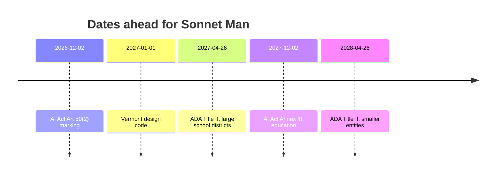
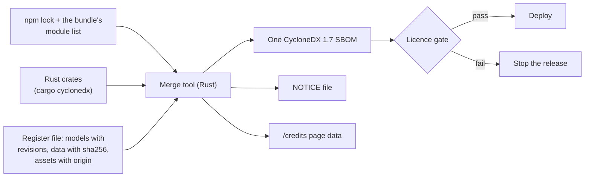

# Sonnet Man legal and licence register

**Purpose:** one place that lists every right Sonnet Man depends on and every duty it carries, how each duty is met, and every legal date ahead.

**Audience:** David Charlot (founder and technical lead, proposed keeper of this register), Devon Glover ("The Sonnet Man", creative director), Arrocito del Diablo (co-founder, game design and card mechanics), counsel, future contractors, school partners and platforms, and investors (sections 1, 4 and 7).

**As of:** commit 0d6df6ef (`integrate/wave3`, 2026-11-18), plus the release in flight on 2026-11-19: `fix/judge-wording`, `fix/server-authority`, `fix/voice-g2p`, `fix/compliance` and the nightly database backup.

**Status:** Draft for the team, 2026-11-19.

**Related documents:** `18-trust-and-safety-plan.md`, `19-privacy-pack.md`, `17-operations-runbook-and-launch-checklist.md`, `07-narrative-and-performer-bible.md`, `08-art-bible.md`, `09-audio-bible.md`, `13-ai-design-and-system-cards.md`, `22-risk-register.md`, `sources/as-built-tech.md` (section 11 is the source of most rows here), `sources/as-built-design.md`, `research/sota-production-2026-11.md` (sections 3.4, 5 and 7.20), `research/sota-design-2026-11.md`, `docs/MODEL-LICENCES.md`, `docs/CARD-ART.md`, `docs/language/PHONETICS.md`, `docs/language/PROVENANCE.md`; also `00-README.md` (index), `28-owner-decisions.md`.

> **Research, not legal advice.** Statements about what a licence or a law requires come from the dated research files or from the licences as recorded in the repository. Items marked [U] are unverified background. Counsel should review the register before the company relies on it.

---

## How to read this register

| Label | Meaning |
|---|---|
| **As built** | True of the code and files at 0d6df6ef, with a fact-base section or `path:line` |
| **In this release** | Decided by the owner on 2026-11-19 and being built; not yet live; the branch is named |
| **Proposed** | A recommendation here, with the research behind it |
| **Not known** | Could not be established; repeated in the owner questions |

Short names: **tech** = `sources/as-built-tech.md`; **design** = `sources/as-built-design.md`; **prod research** = `research/sota-production-2026-11.md`; **design research** = `research/sota-design-2026-11.md`; **card-games file** = `docs/research/card-games-landscape-2026-11.md`. Evidence marks: **[V]** read at the source; **[S]** secondary; **[U]** unverified.

Two terms:
- **Distribution:** handing a copy of something to someone else. Serving a file to a browser counts. Most licence duties start at distribution. Code that only runs on the company's own server is usually not distributed.
- **SBOM** (software bill of materials): a machine-readable list of every component that ships, with its version, source and licence.

---

## 1. The short version

1. **Three licence defects are being fixed in this release.**
   - The English voice's `phonemizer` package embeds eSpeak NG, which is GPL-3.0-or-later, under an Apache label (prod research §3.4). **In this release (`fix/voice-g2p`):** the voice's pronunciation step is rebuilt on the CMU dictionary and eSpeak NG is removed before deploy.
   - The site gives no credit for the CC BY-SA data it ships (tech §11.2). **In this release (`fix/compliance`):** a `/credits` page.
   - Asset provenance is unrecorded (tech §11.3). **In this release (`fix/compliance`):** asset provenance work.
2. **Assets with no recorded licence remain the largest open item.** None is recorded for the four music tracks (two carry other artists' tags), the 14 sound effects, the 3D model and splat, or the 198 variant images. The card art's licence (FLUX Kommunity License) is named but its text is not saved (tech §11.3; design §7).
3. **Liquid AI's LFM licence stops at US$10M group revenue, counting affiliates under common control.** An investor who takes control could push the group over it. The owner confirmed on 2026-11-17 that the company is under it (`docs/MODEL-LICENCES.md:6-16`). Leaving costs little: LFM3 is used only to judge Vietnamese (tech §4.1).
4. **There is no written agreement with Devon Glover in the repository,** although the product, a domain, a card and possibly AI verse use his persona (design §6.1). New York and California law make vague digital-replica terms void (prod research §5.8). This agreement is the keystone of the register (prod research §7.20).
5. **Trade marks are unsearched.** Nobody has recorded who owns "Sonnet Man", "The Sonnet Man", "Shakespeare on the Go" or "Inspired Mile", or whether any is registered. The free public registers are searched now (decided by default, `28-owner-decisions.md` D-15); paying for a full search and registering is open (O-4).
6. **Machine-readable marking of AI output (EU AI Act Article 50(2)) should be treated as due at this deploy.** The grace period to 2026-12-02 covers only systems on the market before 2026-08-02; the in-browser models reached the public later, so the cautious reading is that it applies already (`13-ai-design-and-system-cards.md` §7.2; prod research §5.4). Adding it to this release is an owner decision (`28-owner-decisions.md`). The calendar is in section 9.

---

## 2. How to keep this register

- **Keeper:** David Charlot (Proposed).
- **Review:** at every release that adds a dependency, a model, a data source or an asset; and each November with the security review (`19-privacy-pack.md` §5.3).
- **Proposed:** move the tables in sections 4 to 8 into one machine-readable file in the repository. The SBOM tool (section 11) would read it and write the `/credits` page and a NOTICE file from it, so the three never drift apart.

Columns used below: **what** it is; **where** it runs or ships; **licence**; **duties** the licence or law imposes; **how met** today; **gap** and fix.

---

## 3. The company's own rights

| Item | As built | Gap | Proposed |
|---|---|---|---|
| Legal entity | Voyage Tracable, LLC, a Florida LLC, DBA Inspired Mile, Sarasota, FL (`src/layouts/BaseLayout.astro:521`; `src/pages/terms.astro:17`) | The member paperwork and operating agreement were not complete at the last roadmap update (`ROADMAP.md:14`, unticked) | Finish it; record who owns what the members make |
| The game's code | No LICENSE file in the repository; no `license` field in `package.json` (checked); so all rights reserved by default [U] | No NOTICE file for third-party code | Add a short proprietary notice and a generated NOTICE file (section 11) |
| Work by team members and contractors | The about page lists four people: David Charlot, Devon Glover, Arrocito del Diablo and Treston Knight (`src/pages/about.astro:11-49`) | **Not known:** whether any signed IP assignment exists | IP assignment or licence from each person who contributes code, designs, card mechanics, writing or art (prod research §7.20 lists "contractor IP assignments") |
| Code and text written with AI agents, and AI-generated art | The research describes the studio as "one founder working with AI agents" (prod research, scope); all 71 card paintings were made with an image model (design §7.2). How much of the code an agent wrote is Not known | How far US copyright protects AI-generated material is unsettled; the Copyright Office has said purely machine-generated material is not protected [U, not in the research] | Counsel to advise what the Terms may claim; keep records of human direction and selection (the art prompts are already kept: `scripts/art/prompts.json`) |
| Players' verses | Players keep ownership and grant a non-exclusive, worldwide, royalty-free licence to operate the service (`src/pages/terms.astro:78-84`) | No rule against pasting modern lyrics | Add "do not quote copyrighted lyrics" (prod research §7.20; `18-trust-and-safety-plan.md` §4) |
| Terms of service | English only in every language; Florida law; courts in Sarasota County (`terms.astro:7,197-199`) | Consumer protections in some countries cannot be removed by a choice of law [U]. Section 5 describes premium pack tiers that cannot be bought (design §4.0) | Counsel review; translate; align with `docs/ECONOMY.md` (In this release, `fix/server-authority`) |

---

## 4. Models

Weights are downloaded by the player's browser from the Hugging Face hub, not from the company's site (`docs/MODEL-LICENCES.md:3-4`). The research treats shipping weights to browsers as distribution (prod research §5.10), so this register does too.

**The owner's date rule** is to use only AI models released after 2026-04-01, and never to name one whose release cannot be found.

| Model | Where | Licence | Duties | How met (As built) | Released after 2026-04-01? | Gap and fix |
|---|---|---|---|---|---|---|
| **Gemma 4 E2B** (`onnx-community/gemma-4-E2B-it-ONNX`, q4f16, 3,100 MB) | Browser, desktops with WebGPU; writes in 12 languages and judges in 4 at 0d6df6ef (tech §4.1); main's compare wording, restored **in this release (`fix/judge-wording`)**, measured 14 languages passing (tech §4.2) | **Apache 2.0**: the card lists "License: apache-2.0" (prod research §2.1 [V]). Earlier Gemma generations were under Google's own Gemma Terms of Use with a prohibited-use policy [U]; Gemma 4 is not | Give users a copy of the licence; keep NOTICE attributions; mark modified files (no modification here) (prod research §5.10). The card also asks developers to "implement appropriate content safety safeguards" (tech §11.1), a request, not a licence condition | Not met: no licence shown on the site. No safeguards on model output (`18-trust-and-safety-plan.md` §8.3) | Yes, 2026-04-02 (prod research §2.1 [V]) | Show the licence on `/credits`. **Not known:** whether the ONNX conversion repository carries the same licence; check its card |
| **LFM3 1.7B** (`onnx-community/LFM3-1.7B-ONNX`, 1,090 MB) | Browser, desktops; judges Vietnamese only | **LFM Open License v1.0** | See below | Owner confirmed the company is under the threshold on 2026-11-17 (`docs/MODEL-LICENCES.md:6-16`) | **Yes**: announced 2026-10-27 (`docs/research/in-browser-ai-2026-11.md` §0; liquid.ai/blog/lfm3) | Licence copy on `/credits`; the revenue check (below) |
| **LFM2.5 350M** (`LiquidAI/LFM2.5-350M-ONNX`, 295 MB) | Listed in `MODELS` but used in no language, so never offered (tech §4.1) | LFM Open License v1.0 | As LFM3 | As LFM3 | **Not known** | Remove it from `MODELS`: it ships nothing and carries a licence |
| **Whisper base** (`onnx-community/whisper-base`, q8, ~80 MB) | Browser, speech to text | **MIT** (prod research §5.10 [V]) | Keep the copyright and permission notice | Not met: not on the site | **No**: older (prod research §2, "For Sonnet Man": "Older defaults such as Kokoro and Whisper do not" qualify) | Notice on `/credits`. Successor candidate after the cutoff: Moonshine Streaming per language (MIT, repos 2026-08-24, 7 languages besides English; browser speed unmeasured) (prod research §3.1 [V]) |
| **Kokoro-82M v1.0** (`onnx-community/Kokoro-82M-v1.0-ONNX`, q8, ~80 MB), through kokoro-js | Browser, English voice | **Apache 2.0** weights, trained partly on CC BY data (prod research §5.10 [V]) | Licence copy; NOTICE | Not met | **No**: no release since 2025-02-27 (prod research §2.1 [V]) | Licence on `/credits`. Successor candidate: Kitten TTS 2 nano or pico (Apache 2.0, 2026-11-13, 8 languages, 4 to 17 MB a language; browser use not stated) (prod research §3.2 [V]). The GPL item is in section 6 |
| Build-host models, not shipped: MADLAD-400 3B, all-MiniLM-L6-v2, LaBSE, Gemma 4 26B-A4B QAT | Offline language checks (`HF_HUB_OFFLINE=1`) | Apache 2.0 (tech §11.1) | None to players: nothing ships | — | Gemma 4 26B-A4B: yes (Gemma 4 family). The other three: **no** [U on dates] | Decided by default (2026-11-19): the date rule covers build-host models too; these are recorded and replaced as proven (`28-owner-decisions.md` D-30) |

### 4.1 The LFM US$10M condition

From the licence as researched (prod research §5.10 [V]):
- The "Threshold" is "annual revenue of 10 million United States dollars ($10,000,000) or more". The summary says "exceeds", so the boundary wording is inconsistent.
- The licensee includes affiliates under 50% common control.
- Above the threshold, commercial use "is not licensed". There is no grace period, and the licence does not say how revenue is measured.
- Redistribution duties: a copy of the licence, notices on modified files, retained notices, NOTICE attributions.

**Proposed procedure:**
1. **Each January, and before any financing, merger or acquisition,** the keeper records the group's revenue for the last 12 months, counting every entity under common control, against US$10M. An investor taking control brings its own group's revenue with it.
2. **The exit is cheap.** LFM3 judges only Vietnamese (tech §4.1) and LFM2.5 is used nowhere. Removing both from `MODELS` leaves the game playing everywhere with Gemma 4 E2B where a device runs it, and the written opponent and rule judge elsewhere (`docs/MODEL-LICENCES.md:12-16`).
3. **Do not adopt Liquid d1-2B as the judge** without this check: it is also under the LFM licence (prod research §2.3 [V]).

### 4.2 Pinning

Model weights are not pinned to a revision (As built: tech §4.1). A licence can change on the hub as easily as the weights can. **Proposed:** pin each model to a commit, record the licence file's hash at that commit in the register, and check both at every release (section 11).

---

## 5. Data shipped with the game

These tables are what lets the game judge rhyme, syllables and words in 16 languages. Most are fetched by a duel only when needed (tech §8). Generated files pin their source by sha256 and refuse a different one (`CLAUDE.md:87-94`).

| Data | Where it ships | Licence | Duties | How met (As built) | Gap and fix |
|---|---|---|---|---|---|
| **CMU Pronouncing Dictionary** (pinned commit) → `src/lib/verse/pron-en.ts`; also compiled into the API | Browser (English duels); server | BSD-style, © 1993–2015 Carnegie Mellon University | Keep the notice and disclaimer (prod research §5.10 [V]) | Notice kept as the data's first lines (`src/lib/verse/pron-en.ts:1-30`) | Add to `/credits`. **In this release (`fix/voice-g2p`):** the English voice also uses it; the same notice applies |
| SCOWL 2020.12.07 (marks only) | Browser | SCOWL's notice | Reproduce the notice | Reproduced in the generated file (`scripts/build-pronunciation.mjs:32-40`) | Add to `/credits` |
| **Unicode**: CLDR 49 (incl. number words), Unihan, confusables 18.0.0 | Browser; server (confusables) | Unicode License v3 | Keep "this copyright and permission notice" with copies or in the documentation; no promotional use of Unicode's name (prod research §5.10 [V]) | Named in source headers (`src/lib/verse/confusables.ts:1-8`) | Full notice on `/credits` |
| **Wiktionary pronunciations** via kaikki.org and WikiPron → sound tables for es it pt de ru id fr th hi | Browser | **CC BY-SA 4.0** (and GFDL) | Attribution: keep copyright, licence and disclaimer notices and a link, and say what was changed. ShareAlike: the adapted tables stay CC BY-SA (prod research §5.10 [V]) | Each generated module names its source and licence in its header (`docs/language/PHONETICS.md:536-541`). **No credit on the site** (tech §11.2) | **In this release (`fix/compliance`):** `/credits` page. **Proposed:** ship each table as a separate data file under CC BY-SA, not inside code modules, so ShareAlike reaches only the data (prod research §5.10) |
| Wiktionary judge words and closed-class words | Browser | CC BY-SA 4.0 | As above | Header in `src/lib/verse/judge-words.ts` | As above |
| **CC-CEDICT** → Chinese words that settle a reading | Browser | CC BY-SA 4.0 | As above | Header in `src/lib/verse/sound/data/zh.ts` | As above |
| **JMdict and JMnedict** (EDRDG), via jmdict-simplified 3.6.2 → `src/lib/verse/sound/jmdict/words.dat.gz`, `names.dat.gz` | Browser (Japanese duels) | CC BY-SA 4.0 (EDRDG) | As above. The EDRDG's own licence also asks for a specific acknowledgement and a link [U: check the EDRDG licence page] | Each list says so in its header (`PHONETICS.md`, sources table) | As above, plus the EDRDG wording |
| **mecab-ipadic** 2.7.0, cut to what the engine reads → `src/lib/verse/sound/ipadic/*.dat.gz` | Browser (Japanese duels) | **NAIST licence**: free use and redistribution with the notice | "The notice must travel with the dictionary files" (`PHONETICS.md:539-541`) | **Not met:** only a source comment (`src/lib/verse/sound/ja.ts:7`); no notice beside the ten `.dat.gz` files | Ship the NAIST licence text as a file in the same folder as the dictionary, and on `/credits`. **Not known:** whether `fix/compliance` covers it |
| kuromoji 0.1.2 (the Japanese analyser) | Browser | Apache 2.0 | Licence; NOTICE | Not shown | `/credits`; NOTICE file |
| Wikisource transcriptions → card lines in published translations (fr 51, it 51, de 50, ru 34, es 29, pl 28, ja 13, pt 6 of 71) | Browser | Texts public domain; transcriptions CC BY-SA 4.0 (tech §11.2) | Attribution for the transcriptions | Sources recorded line by line in `docs/language/NAMES-AND-QUOTATIONS.md`, not on the site | `/credits`, with a link to the provenance list. Faithful transcriptions may carry little new copyright in the US [inference, prod research §5.9] |
| stopwords-iso 1.1.0 | Browser | MIT | Keep the copyright and permission notice | Named in headers (`src/lib/verse/function-words/de.ts:1-6`) | `/credits` |
| Snowball stemmers (jsstemmer 3.2.0) | Browser | BSD 3-clause | Keep notice and disclaimer | Named in header (`src/lib/verse/stem/index.ts:4-6`) | `/credits` |
| OpenCC JPVariants table (used to build Japanese card text) | Build step; its output ships | Apache 2.0 [U] | Licence; NOTICE for the derived text [U] | Named in `src/lib/cards-i18n/index.ts:40` | `/credits` |
| Wikidata labels (card names) | Browser | CC0 1.0 | None; credit as a courtesy (prod research §5.10) | `docs/language/PROVENANCE.md` | `/credits` |
| Facts from a zh.wikipedia article and a Chinese Ministry of Education notice | Rhyme groups | CC BY-SA and a government notice; only facts used (`PHONETICS.md`, sources table) | Facts are not copyrightable (CC FAQ, prod research §5.10 [V]) | Recorded | None |
| AOSP, Mozilla, Apple and Google strings | Not shipped: evidence for word choices, kept in `docs/language/sources/` | Apache 2.0, MPL 2.0, quotations | None while not shipped | `docs/` is not deployed | Keep it so |
| OpenSubtitles frequency lists | Tests only | Content CC BY-SA 4.0 | None while not shipped | Tests only (tech §6.3) | Keep it so |
| LDNOOBW word lists | Not used (Proposed for moderation) | CC BY 4.0 | Attribution | — | If adopted (`18-trust-and-safety-plan.md` §5.2), add to `/credits` |

### 5.1 What the `/credits` page must say (Proposed contents)

**In this release (`fix/compliance`)** builds `/credits` for the CC BY-SA data. For the page to meet every duty above, it should list, for each source: the name; the author or holder; the licence with a link; a link to the source; and "adapted: reduced to the entries the game reads" where true. It should also include:
- the Unicode notice in full;
- the CMU notice and disclaimer;
- the NAIST notice;
- the SCOWL notice;
- the EDRDG acknowledgement;
- the MIT, BSD and Apache notices for stopwords-iso, Snowball, kuromoji, Whisper and the self-hosted runtimes;
- the licence of every model the browser can download (section 4);
- the fonts' licences (section 8.1);
- a credit for each music track and sound effect that stays (section 8.2).

The research proposes the same page, named "Open data and models", plus the eSpeak NG notice for as long as it ships (prod research §5.10). After `fix/voice-g2p` it should not ship (section 6.2).

**In this release** (`fix/compliance`, `src/pages/credits.astro`, commits `50525b46` and `c779effd`): a text search of the page finds entries for the Unicode data, CMU and SCOWL (notices read from the shipped table), NAIST (its notice now served at `public/licenses/mecab-ipadic-NOTICE.txt`), EDRDG, stopwords-iso, Snowball, kuromoji, Wikidata, Wikisource, the browser's CLDR plural rules, Whisper, Kokoro, Transformers.js, onnxruntime, Babylon.js, model-viewer, the fonts' OFL (`public/fonts/OFL.txt`), Gemma 4 (Apache 2.0), the LFM US$10M and FLUX US$5M thresholds, the music and the effects (stating which are untraced), and eSpeak NG. `credits.test.ts` fails when something ships without its credit. Still to confirm by reading the page before deploy: each entry's "adapted" wording; and that the eSpeak NG entry is dropped once `fix/voice-g2p` merges (section 6.2).

---

## 6. Code, runtimes and the eSpeak NG finding

### 6.1 Libraries

| Group | As built | Duties | Gap and fix |
|---|---|---|---|
| npm, 435 locked packages | MIT 293, Apache-2.0 46, BSD-3-Clause 22, LGPL-3.0-or-later 20, MPL-2.0 12, ISC 11, others permissive. The LGPL entries (sharp, libvips) and the MPL ones (lightningcss) are build tools and do not reach the browser (tech §11.4) | For shipped MIT, BSD, ISC and Apache code: keep the notices | No NOTICE file and no credits for shipped libraries. **Proposed:** generate both from the SBOM (section 11) |
| Runtime families in the browser | Astro, React, Tailwind, SimpleWebAuthn, onnxruntime-web, three (MIT); Babylon.js, Transformers.js, kokoro-js, model-viewer, kuromoji (Apache-2.0) (tech §11.4) | As above | As above |
| Self-hosted runtime files, about 90 MB in `dist/ort/` and `dist/vendor/` | onnxruntime-web `.wasm` and `.mjs` (a nightly pre-release, 1.31.0-dev.20260914); kokoro-js's own copies of Transformers.js 3.8.1 and onnxruntime-web 1.22.0-dev; model-viewer's Draco and KTX2 decoders (tech §1.4, §4.3, §11.4) | Licences of the decoders: Apache 2.0 [U] | A nightly pre-release is a support risk, not a licence one; list them all in the SBOM |
| Rust, 411 crates in `backend/Cargo.lock` | Licences not audited (tech §11.4) | The API runs on the company's own server and is not distributed, so most duties do not start. An AGPL crate would be the exception, because its duties reach network use [U] | **Proposed:** `cargo deny` with a licence allow-list on every release, failing on AGPL, GPL and unknown licences |
| Build-host tools, not shipped | LanguageTool (LGPL), Hunspell and LibreOffice dictionaries (GPL, LGPL, MPL mixes), espeak-ng 1.52.0 (GPL-3.0-or-later; run as a tool, its output is test data) (tech §11.4; `PHONETICS.md`, sources table) | None while nothing of the program ships. A GPL program's output is generally not covered by the GPL [U] | Keep these out of `dist/`; the SBOM gate checks it |

### 6.2 The eSpeak NG finding and its fix

**The finding** (prod research §3.4 [V, the researcher's own inspection, 2026-11-19]):
- kokoro-js 1.2.1 (Apache-2.0) depends on `phonemizer` ^1.2.1 (As built: `package-lock.json`, entry `node_modules/kokoro-js`).
- `phonemizer` 1.2.1 is labelled Apache-2.0 (As built: `package-lock.json`, entry `node_modules/phonemizer`) and calls itself a "Simple text to phones converter using eSpeak NG".
- Its 1.3 MB `dist/phonemizer.js` contains an Emscripten `eSpeakNGWorker` module with an embedded WebAssembly binary. It ships no GPL notice, and its only licence file is Apache 2.0.
- eSpeak NG is "GPL version 3 or later".
- **Inference (research):** serving kokoro-js to browsers distributes GPL-3.0 object code without the GPL notice or an offer of source.

**How long it has been there.** kokoro-js has been in `package.json` since the first commit on 2026-02-13, and it is in `main`, the branch presumed live (`main:package.json:23`; `git log -S kokoro-js`). So the live site has probably served the component to any player who turned the English voice on. **Not known:** whether the live build includes that chunk; the live files were not checked.

**The fix. In this release (`fix/voice-g2p`):** the owner chose "Replace before deploy". The English voice loses its GPL eSpeak NG dependency, and its pronunciation step is rebuilt on the CMU dictionary (BSD-style notice, section 5). The game ships only a reduction of that dictionary for the verse rules (rhyme keys and syllable counts), so the branch adds a second table of whole pronunciations, generated from the same pinned cmudict commit and sha256, and the public-domain NRL Report 7948 letter-to-sound rules for other words (commits `21446923`, `35f43c22`). The new table needs the same CMU notice on `/credits`; the NRL rules need a source line.

**How to verify the fix before deploy (Proposed):**
1. The built site contains no `phonemizer` code: search every file in `dist/` for the string `eSpeakNG`; expect none.
2. The SBOM of `dist/` lists no `phonemizer` component, even if the package stays in `node_modules` as kokoro-js's declared dependency.
3. The English voice still speaks a test verse, on the build host.
4. The `/credits` page lists the CMU notice for the voice, and no longer lists eSpeak NG: `fix/compliance`'s first version of the page credits "eSpeak NG (GPL-3.0-or-later) inside kokoro-js's phonemizer" (commit `50525b46`), which must be dropped when the two branches merge.
5. `npm run build` runs `scripts/check-no-espeak.mjs` (added by the branch), which must pass.

**The past (Proposed, for counsel).** GPL version 3 has rules for restoring a licence after a violation stops [U: section 8 of GPLv3; check with counsel]. Record the date the fix deployed, and keep this finding and its fix in the register.

**A related open item.** Kokoro itself predates the owner's 2026-04-01 rule (section 4). The fix keeps Kokoro. Decided by default (2026-11-19), under the owner's "replace as proven" rule: it is kept until a newer model, for example Kitten TTS 2 once its browser use is shown, is measured to do the job, with a dated review each quarter (`28-owner-decisions.md` D-28).

---

## 7. The agreement needed with Devon Glover

### 7.1 What the game uses of his name and persona today (As built)

| Use | Where | Source |
|---|---|---|
| The product name "Sonnet Man", in the installed app's name and the site's subdomain | `public/manifest.json`; `src/i18n/pages/shared/en.ts:59` | design §6.1 |
| "Sonnet Man" as the name the operating system shows in passkey dialogs | `backend/src/auth/handlers.rs:33-35` | tech §3.1 |
| The Sonnet Man card (SM-001), the only Legendary card, in every new player's starter deck and free to field online | `src/lib/cards.ts:33-40`; design §2, §5.4 | design §6.1 |
| The card's painting: "a hip-hop poet and teaching artist on a stage, microphone in hand", painted as "a Black actor of African descent with deep brown skin"; the prompt names no one and asks for no likeness | `scripts/art/build_prompts.py:6,34,66-68` | design §6.1 |
| The AI opponent can play the card: it draws three characters from all 53, and prompts the model "You are {card.name} in a duel of verses" | `src/lib/verse/duel.ts:277-284`; `src/lib/verse/opponent.ts:79` | `18-trust-and-safety-plan.md` §8.3 |
| The final story opponent | `src/lib/story-mode.ts:89` | design §6.5 |
| The home-page badge "Shakespeare on the Go", marked in code as "The name of Devon Glover's programme" | `src/pages/index.astro:47-48` | design §6.1 |
| His name, role, biography, and links to his YouTube, X, LinkedIn and Facebook accounts | `src/pages/about.astro:21-34`; `src/layouts/BaseLayout.astro:505-514` | design §6.1 |
| Anything he recorded, wrote or performed | **None** in the game | design §6.1 |
| A written agreement, approval or review of the game's content | **None recorded** | design §6.1, "Could not determine" |

### 7.2 What the law asks (research)

- **New York Civil Rights Law §51:** a person whose "name, portrait, picture, likeness or voice is used within this state for advertising purposes or for the purposes of trade without the written consent" may sue for an injunction and damages (prod research §5.8 [V]).
- **New York General Obligations Law §5-302:** a contract provision allowing a digital replica "in place of work the individual would otherwise have performed in person" is **void** if all three hold: it lacks a reasonably specific description of the intended uses; the performer had no counsel with terms in a signed writing; and no union agreement covers digital replicas (prod research §5.8 [V]).
- **California Labor Code §927** applies the same test to performances fixed on or after 2025-01-01 (prod research §5.8 [V]).
- **New York Civil Rights Law §50-f** covers digital replicas of deceased New York performers for 40 years (prod research §5.8 [V]).
- Others to check: California Civil Code §3344.1; Tennessee's ELVIS Act; Lanham Act §43(a) false endorsement; the FTC Endorsement Guides (prod research §5.8 [U]).
- **Domicile matters** because it decides which state's law governs. His handle points to New York; a Brooklyn upbringing is documented by the NEH (design research §9 [V]). His domicile is to be confirmed in the contract (prod research §5.8).
- **The industry norm** (2025 SAG-AFTRA Interactive Media Agreement, as summarised): replica consent "clear and conspicuous" in a separate document or signed rider, a "reasonably specific description" of use that says whether real-time generation is involved, pay per generated line, and a usage report within 90 days of release (design research §9 [V]).

### 7.3 What the agreement should cover (Proposed, from prod research §5.8 and design research §9)

1. **Grant:** his name, "The Sonnet Man", "Shakespeare on the Go", likeness, voice (recorded; synthetic only by a separate addendum), biography, and any marks he holds.
2. **AI uses, described specifically:**
   - whether an AI opponent may play "as" The Sonnet Man, or only "in the style of", or not at all;
   - which models and prompts are used, and how he is told when they change;
   - whether his lyrics or recordings are used for prompting or fine-tuning (default: no);
   - what is excluded (default: no voice clone, no fine-tuning on his recordings, no synthetic voice).
3. **Independent counsel for him,** named in the agreement, so the replica terms survive §5-302 and §927.
4. **Approvals:** persona guidelines; banned topics; sample outputs; marketing; the card's art; a kill switch that withdraws the persona from the game quickly.
5. **Labelling:** "AI, not Devon Glover" on every AI verse played as his card; no AI output presented as his statement or endorsement. This also meets EU AI Act Article 50(1) (prod research §5.4, §5.8).
6. **His own work for the game:** recorded performances, verses, remixes, voice lines. Who owns them, or what licence the company gets; credit lines; his moral-rights preferences (stronger in the EU).
7. **Term and territory:** worldwide; a fixed term; a wind-down; deletion of any persona assets at the end.
8. **Termination:** morals clauses both ways; breach; change of control of the company.
9. **After death:** successors under New York §50-f.
10. **Pay:** fees or royalties, with reporting and audit; per-line pay for any approved synthetic voice, following the SAG-AFTRA norm.
11. **Warranties and indemnities.**
12. **Schools:** his approval of classroom use; a rule that he has no access to player data.
13. **His role in the company:** whether he is a member, a partner or a contractor, and how that relates to this licence (Not known: section 3).

### 7.4 Until it is signed (Proposed)

- The AI opponent plays no model verse as The Sonnet Man card (`18-trust-and-safety-plan.md` §8.3 point 5).
- No marketing quotes him, uses his image, or implies his endorsement beyond the about page as it stands.
- No synthetic voice for him, ever without the separate addendum (prod research §3.4 "For Sonnet Man").

---

## 8. Assets and texts

### 8.1 Fonts

| Asset | As built | Licence | Gap and fix |
|---|---|---|---|
| Inter, Playfair Display (regular and italic), JetBrains Mono, Outfit, Space Grotesk: 12 woff2 files, Latin and Latin-ext only | "Self-hosted Google Fonts" (`public/fonts/fonts.css:1`); no licence file in `public/fonts` (tech §11.3) | Normally SIL Open Font License 1.1; the repository does not record it (tech §11.3) [U] | Confirm each family's licence and ship each licence text beside the fonts and on `/credits`. Outfit and Space Grotesk are declared but used by no class (design §7.7): remove them |

### 8.2 Art, audio and 3D: the asset register

**In this release (`fix/compliance`, `docs/ASSETS.md`):** a record of where each shipped file came from; it removes nothing. Per row: card paintings, the FLUX Kommunity License text read from the weights' own file (commercial use of outputs only under US$5M group revenue; disclose AI generation where law requires); variants, Z-Image Turbo, Apache-2.0 by its card; music, `battle-beat.mp3` and `landing-ambient.mp3` byte-identical to CC0 tracks on OpenGameArt, the other two untraced; effects, all fourteen untraced; 3D, byte-identical to output of the owner's own pipeline, the model behind it untraced; icons, made in this repository; fonts, OFL 1.1, byte-identical to Google Fonts' files. The table below is the state at `0d6df6ef`. "AI-made" follows the research's asset-register column (prod research §7.20).

| Asset | Files | Origin as recorded | Licence recorded | AI-made | Gap and fix |
|---|---|---|---|---|---|
| Card paintings | 71 WebP, 18 MB | FLUX 3 Image Klein through mflux 0.24, 2026-11-16, on the owner's machines; prompts in `scripts/art/prompts.json`; every image looked at before use (`docs/CARD-ART.md:3-6`) | "FLUX Kommunity License", named only; its terms are not saved (design §7, "Could not determine") | Yes | Save the licence text and check that it allows commercial use of outputs. **Not known:** the model's release date against the owner's date rule. Known faults to fix in the next pass: two cards with painted name labels, Capulet borders, Juliet's casting, Medusa's victims (`docs/CARD-ART.md:8-13`); a Hamlet with an unnamed blade, a Zeus card with rounded corners, letter-like glyphs on the Witches' Brew (design §7.2) |
| City variant images | 198 WebP, 16 MB | Made from the earlier artwork with Z-Image Turbo through a Hugging Face Gradio Space (`scripts/generate-variant-art.ts:1-12`) | None | Yes | **All 198 are orphaned:** no page shows them (design §7.2). One shows trainers with a swoosh-like mark (design §7.2), a third party's mark. 27 use city codes the catalogue no longer has. **Proposed:** remove them from `public/` |
| Music | 4 MP3, 12 MB | Files from the first commit, 2026-02-13. Tags: "Horror Theme 1" by Lasse Bührmann (2020); "Battle Theme A redone" by The Cynic Project, cynicmusic.com; two tracks with no artist (design §7.3) | **None** | Not known | Find each track's licence and credit it, or replace it. The design research finds hip-hop audiences reward real artists and real music (design research §9); music by Devon Glover or artists he names is the stronger option (ask him) |
| Sound effects | 14 WAV, 1.2 MB | No tags, no generator script (design §7.3) | **None** | Not known | Find or replace. Two are never played (`card-flip`, `ui-whoosh`): remove them |
| 3D model and splat of SM-001 | `public/models/sm-001.glb` (a point cloud), `public/models/splats/sm-001.ply` | From the 2026-02-14 commit; the GLB names its generator "efficient-genai-optimizer" (design §7.6) | **None** | Probably | It depicts The Sonnet Man's card character. Remove, or replace with an approved model (section 7.3 point 4) |
| Icons and favicon | `icon-*.png`, `favicon.svg` (gold "IM" on a dark square) | Not recorded | Not recorded | Not known | Record |

**Brand imagery rule (owner's standing rule).** In generated brand imagery the central people are Black, of Haitian descent, by default. The rule never applies to depicting a real person. If SM-001 is meant to be Devon Glover, the image must be one he approves, not a generated likeness.

### 8.3 Shakespeare and other texts

| Item | As built | Research | Gap and fix |
|---|---|---|---|
| English lines | 61 of 71 card lines cite a published public-domain work; the 10 Olympus and Underworld lines are the game's own (design §6.4) | The plays and sonnets are public domain; modern editions' editorial layer can be protected [U] (prod research §5.9) | Record which edition each English line follows |
| Folger texts | Not found in the repository's provenance files | Folger's files are "free to use for all non-commercial purposes" (prod research §5.9 [V]) | Do not use Folger text without written permission |
| Project Gutenberg | Named as a source of translations (design §6.4) | Redistribution with its name and header brings its trademark licence; strip all Gutenberg references to use the plain text [U] (prod research §5.9) | Check that no Gutenberg header text ships |
| Translations in 15 languages | A line is taken from a published translation only if its translator died in 1955 or earlier, and a unit test checks this (`docs/language/NAMES-AND-QUOTATIONS.md:97-104,136-139`; design §6.4) | Each translation carries its own term from the translator's death. Spain gives life plus 80 years to authors who died before 1987 [U]. In the US, works published in 1930 entered the public domain on 2026-01-01 (prod research §5.9 [V]) | **Two gaps.** A Spanish translator who died between 1946 and 1955 may still be protected in Spain. A translation published after 1930 may still be protected in the US, whatever the translator's death year. **Proposed:** add the publication year to the test; require publication before 1931; require death by 1945 for Spanish lines (prod research §5.9 "Applies") |
| Lines written for the game, in seven languages entirely | "Translated for the game, not reviewed" (design §6.4) | — | Owned by the company, subject to section 3 on AI-written text |

---

## 9. Regulatory calendar

Every dated obligation in the research, with what it means for Sonnet Man. "Applies?" is the research's inference, or this register's where marked. This is research, not legal advice.

### 9.1 Already in force

| Date | Obligation | Applies to Sonnet Man? | Status |
|---|---|---|---|
| 2024-05-07 | US REPORT Act: child enticement and trafficking added to NCMEC reporting; preservation 1 year | Likely, if online play is a "provider" service | Proposed procedure (`18-trust-and-safety-plan.md` §7.4) |
| 2024-09-22 | Australia: paid chance-based purchases rate at least M; simulated gambling R18+ (card-games file) | Only if packs are sold for money | Not planned (design §4.0) |
| 2024-10-01 | Maryland Kids Code | Probably below its threshold | Watch the player count |
| 2025-01-01 | California Labor Code §927 covers performances fixed from this date | Yes, for any Glover replica | Section 7 |
| 2025-02-02 | EU AI Act prohibitions, including Art 5(1)(b) on exploiting age-related vulnerabilities; Art 4 AI literacy | Yes | Proposed: a short AI-literacy record; no age-targeted purchase pressure |
| 2025-03-17 | UK Online Safety Act illegal-content duties enforceable | Yes, with UK players | Draft assessment (`18-trust-and-safety-plan.md` §9) |
| 2025-03-21 | EU CPC "Key principles on in-game virtual currencies" (non-binding; the research also reports 2025-03-13) | Only for currency bought with real money | Credits are not sold (As built); check `docs/ECONOMY.md` |
| 2025-05-19 | US TAKE IT DOWN Act signed; removal process required by 2026-05-19 | Near zero for a text game | One-page notice form (Proposed) |
| 2025-06-19 | UK Data (Use and Access) Act, Royal Assent; data provisions commenced 2026-02-05 | Yes | `19-privacy-pack.md` §9 |
| 2025-06-20 | New York Child Data Protection Act in force [U on the date] | Yes, for New York minors | `19-privacy-pack.md` §9 |
| 2025-06-23 | Amended COPPA Rule effective; compliance from 2026-04-22 | See `19-privacy-pack.md` §5 | Drafts written |
| 2025-06-28 | European Accessibility Act applies; microenterprises exempt | Probably not yet: microenterprise exemption, an inference until headcount and turnover are confirmed | Build checkout and sign-in to WCAG 2.2 AA anyway (prod research §5.5) |
| 2025-07-14 | EU DSA guidelines on minors (updated 2026-04-22); micro and small exempt | No, but cheap to follow | `18-trust-and-safety-plan.md` §10.1 |
| 2025-07-04 | France: the CNIL's tightened audience-measurement exemption (no user ids, IP cut by at least 2 bytes, data kept 25 months at most, no heatmaps, session recording or A/B tests). The CNIL reportedly withdrew its list of exempt tools on 2026-01-01 [S] | Yes, for French players' statistics | `19-privacy-pack.md` §3.6 |
| 2025-07-24 | UK children's risk assessments due | Yes, teens are admitted | Draft (`18-trust-and-safety-plan.md` §9.4) |
| 2025-08-02 | EU AI Act rules for general-purpose AI models | No: they fall on Google and Liquid as model providers | — |
| 2025-10-01 | Colorado minors' amendments [U] | Check | For the company's lawyer (`28-owner-decisions.md` O-2) |
| 2025-12-10 | Australia social-media minimum age 16 | Probably not (Roblox and Steam assessed as not required) [S] | — |
| 2026-01-01 | California SB 243 companion chatbots [U on date]; Nebraska AADC operative | SB 243 depends on guardrails; Nebraska probably below threshold | `18-trust-and-safety-plan.md` §8.3 |
| 2026-02-05 | UK PECR Schedule A1: statistics without consent if informed and able to object | Yes | `19-privacy-pack.md` §3.6 |
| 2026-02-25 | FTC policy statement on age verification | Informative | `18-trust-and-safety-plan.md` §7.3 |
| 2026-03-12 | California AADC: the Ninth Circuit narrowed the injunction; defaults, age estimation and tools provisions enforceable | Probably not: below the CCPA "business" threshold | Watch |
| 2026-03-17 | Brazil Digital ECA: no loot boxes in games likely accessed by minors (card-games file) | Only if paid random packs | Not planned |
| 2026-04-20 | US DOJ interim rule moves ADA Title II web dates (see 2027-04-26) | Through school customers | — |
| 2026-04-22 | COPPA amended rule fully enforceable | If children are served | `19-privacy-pack.md` §5 |
| 2026-04-28 | Apple: a snippet says apps uploaded from this date must meet minimum accessibility requirements; Apple's label page says "voluntary to start" (unresolved conflict) [S] | Only for an App Store app | — |
| 2026-04-29 | ICO storage-and-access guidance final | Yes, UK statistics | `19-privacy-pack.md` §3.6 |
| 2026-06 | PEGI rules for games submitted from June 2026: paid random items PEGI 16; time-limited offers PEGI 12; return rewards PEGI 7 or 12; unrestricted communication PEGI 18 | Only if rated | Keep a PEGI 7 to 12 design (prod research §5.6) |
| 2026-06-04 | Texas SB 2420 app-store age rules | Only for a store app | — |
| 2026-06-10 | EU Code of Practice on transparency of AI-generated content, final | Yes, as a method for Art 50(2) | Proposed |
| 2026-07-01 | Arkansas teen privacy act [U] | Check | For the company's lawyer (`28-owner-decisions.md` O-2) |
| 2026-07-27 | EU Digital Omnibus on AI in force | Sets the 2026-12-02 date | — |
| 2026-08-02 | **EU AI Act Article 50 applies**: AI notice at first interaction (50(1)) | Yes | **In this release (`fix/compliance`)** |
| 2026-08-31 | Google Play target API 36 | Only for a store build | — |
| 2026-09-30 | Android developer verification enforced in Brazil, Indonesia, Singapore and Thailand | Only for a Play build | — |

### 9.2 Ahead

| Date | Obligation | Applies? | Action and owner |
|---|---|---|---|
| **2026-12-02** | **EU AI Act Art 50(2): machine-readable marking of AI text and audio**, end of the grace period for systems on the market before 2026-08-02. Also new prohibitions on non-consensual sexual deepfakes and child sexual abuse material | Yes, "as far as technically feasible"; if the AI features were not on the market before 2026-08-02, the duty applies already. **Not known** which | Mark AI verses and Kokoro speech: metadata on any shared or exported verse or audio, following Section 1 of the Code of Practice; a written record of the method (prod research §5.4). Owner: David Charlot |
| 2026-12-10 | FTC webinar on the TAKE IT DOWN Act | Information | Optional |
| **2027-01-01** | **Vermont Age-Appropriate Design Code** (no revenue threshold): duty of care against compulsive use; highest-privacy defaults; no notifications to minors from midnight to 6 a.m. Also California AB 1043, Digital Age Assurance Act (app stores) | **Likely** with Vermont players (the Attorney General is writing rules during 2026); AB 1043 only for store apps; Utah SB 142 and Louisiana HB 570 dates [U] | Duty-of-care review of seasons, streaks and notifications before any ships (`19-privacy-pack.md` §4) |
| 2027-01-12 | Apple's new age-rating descriptors required | Only for an App Store app | — |
| 2027-01-25 | New York SAFE for Kids Act [S] | Only with an algorithmic feed of players' verses | Do not build one for minors |
| 2027 | Android developer verification worldwide | Only for a Play build | — |
| **2027-04-26** | ADA Title II, WCAG 2.1 AA for US public entities of 50,000 people or more, including school districts; vendor tools not excepted | Through school customers | Accessibility conformance report before any district sale (`19-privacy-pack.md` §6.3) |
| 2027-07-01 | California SB 243 annual reports begin | Only if outside the game-bot exclusion | Keep inside it (`18-trust-and-safety-plan.md` §8.3) |
| **2027-12-02** | EU AI Act Annex III high-risk rules, including education systems that "evaluate learning outcomes" | Possibly classroom mode if sold to grade students | Keep classroom scores formative; assess the Art 6(3) derogation (`19-privacy-pack.md` §6.3) |
| 2028-04-26 | ADA Title II for smaller public entities | Through school customers | As above |
| 2028-08-02 | EU AI Act Annex I product rules | No [inference] | — |
| 2028-10-31 | End of the term of the 2025 SAG-AFTRA Interactive Media Agreement (reference norm for replica terms) | Reference only | Section 7 |

### 9.3 Recurring

| When | Duty | Source |
|---|---|---|
| Every November | COPPA security programme: risk assessment and yearly review; DPIA review; Online Safety Act risk-assessment review; this register's review | `19-privacy-pack.md` §5.3; `18-trust-and-safety-plan.md` §9.5 |
| Every January, and before any financing or change of control | LFM revenue check, counting affiliates | Section 4.1 |
| Before each significant change | Online Safety Act risk assessment redone (s.9) | prod research §4.3 [V] |
| Every release | SBOM; licence gate; `/credits` and NOTICE regenerated | Section 11 |

### 9.4 Watch list (proposals, not law)

- The EU Digital Fairness Act, proposed 2026-11-11: loot boxes, pay-to-progress pressure on minors, virtual-currency pricing, dark patterns (card-games file [V]).
- The US Kids Online Safety Act and the House KIDS Act, not enacted; COPPA 2.0, passed by the Senate on 2026-03-05 and stalled in the House (prod research §5.2 [S]).
- The federal NO FAKES Act, in committee (prod research §5.8 [S]).
- The EU's draft Article 50 guidelines, consulted on in May and June 2026 and not finalised (design research §3 [V]).
- The EU Digital Omnibus proposal of 2025-11-19, which would exempt first-party aggregated audience measurement from consent; a Council mandate of 2026-10-21 reportedly keeps it (prod research §6.2 [S]).
- The ICO's review of children's privacy in mobile gaming, begun by August 2026 (prod research §5.3 [V]).

---

## 10. Trade marks

Nothing in the repository records a trade-mark search, application or registration, or who owns which name. The questions below are for the owner and Devon Glover; none assumes an answer. Paying for a full search and registering the marks is open (`28-owner-decisions.md` O-4); the free public registers are searched now and the results recorded here (decided by default, D-15); what Devon Glover holds is part of O-1.

| Name or mark | Where the game uses it (As built) | Questions |
|---|---|---|
| "Sonnet Man", "The Sonnet Man" | Product name, installed app name, the site's subdomain, the passkey dialog name, the SM-001 card (section 7.1) | Who owns it? Is it registered or applied for, in the US or elsewhere? On what terms may the company use it as the product's name, and what happens to that name if the agreement with Devon Glover ends? |
| "Shakespeare on the Go" | Home-page badge, marked as his programme's name (`src/pages/index.astro:47-48`) | Who owns it? Is the company licensed to show it? |
| "Inspired Mile" | Company DBA, domain, footer, Plausible site name | Has a clearance search been run? Is it registered? A state fictitious-name filing is not a trade mark [U]. Which classes: downloadable game software and online game services are usually classes 9 and 41 [U]. Which countries, given 16 languages? |
| The "IM" favicon and the gold-on-obsidian style | Every page | Is a logo mark wanted? Decided by default: one master monogram and a wordmark in the game's display face (`28-owner-decisions.md` D-54, D-59); registering it is part of O-4 |
| "Master Thespian", house names, card names | Labels and cards (design §6.1, §6.2) | Any conflicts? Not searched |
| Third parties' marks inside generated art | A swoosh-like mark on trainers in a variant image (design §7.2) | Remove the image (section 8.2); add "no brand marks" to every art prompt |
| Domains | `inspiredmile.com` in use | Are `sonnetman` domains held, or wanted? |

Earlier plans spoke of "licensing deals (Nintendo, other IP holders)" (`ROADMAP.md:140`) and listed IP infringement as a risk to avoid by using only original IP (`PROJECT_BRIEF.md:176`). Keep that rule.

---

## 11. SBOM approach (Proposed)

### 11.1 Format

- **CycloneDX 1.7**, released 2025-10-21 and standardised as ECMA-424, 2nd edition, December 2025 (prod research §7.20 [V]). It can describe machine-learning models and data sets as components [U: check the 1.7 schema], which this game needs.
- SPDX 3.0 is the alternative; ISO/IEC 5962:2021 is SPDX 2.2.1 (prod research §7.20 [V]).

### 11.2 What it covers

The research asks for Rust crates, npm packages, WebAssembly modules and model weights with their licences (prod research §7.20). For Sonnet Man:

1. **Code that ships to browsers:** every npm package whose code reaches `dist/`, not every package in the lock file, plus the self-hosted runtime files in `dist/ort/` and `dist/vendor/`.
2. **Code that runs on the server:** the API's crates.
3. **Models fetched at run time:** each Hugging Face repository, its pinned revision (section 4.2), its licence and its release date.
4. **Data:** each table in section 5, with the sha256 its generator already pins (`CLAUDE.md:87-94`) and its licence.
5. **Assets:** fonts, art, audio and 3D files, with origin, licence and an AI-made flag (section 8.2).

### 11.3 How it is made

Run on the build host at every release, as part of the existing gates (tech §7.2). No GitHub Actions: the project's rule is that the build host is the CI (tech §7).

- **Rust:** `cargo cyclonedx` for the SBOM and `cargo deny` for the licence allow-list [U: confirm both tools' current releases on the build host].
- **npm:** the npm CLI's own SBOM command, or the CycloneDX npm tool [U: confirm which works with this lock file], cut down to packages whose modules appear in the built bundle.
- **The merge tool:** a small Rust program in the repository (the owner prefers Rust) that reads both SBOMs and the register file and writes the SBOM, the NOTICE file and the `/credits` data.

### 11.4 The licence gate: the release stops when

1. a shipped component has an unknown licence, or GPL, AGPL or LGPL code reaches `dist/`;
2. any file in `dist/` contains `eSpeakNG` (section 6.2);
3. a model has no pinned revision, or its licence file's hash has changed since the register recorded it;
4. a CC BY-SA table, the NAIST dictionary or any other noticed source lacks its notice on `/credits`, or the NAIST notice is missing beside the dictionary files;
5. an asset has no recorded licence.

### 11.5 Who sees it

Keep the SBOM internal. Share it with schools, platforms and investors on request. The `/credits` page and the NOTICE file are public.

---

## 12. Other legal documents

| Document | Status | Gap | Next step |
|---|---|---|---|
| Privacy policy | As built, English only (`src/pages/privacy.astro`) | 14 changes (`19-privacy-pack.md` §10) | **In this release (`fix/compliance`):** wording. Translate |
| Terms of service | As built, English only | The 48-hour review promise; premium packs that cannot be bought; AI-art ownership claims; consumer-law limits [U] | Counsel review; translate |
| Community rules | None | — | Draft in `18-trust-and-safety-plan.md` §4 |
| AI notice | None as built | — | **In this release (`fix/compliance`):** Art 50(1) notice |
| Credits page | None as built | — | **In this release (`fix/compliance`)**; check against section 5.1 |
| Economy terms | Terms §4 and §5 | — | **In this release (`fix/server-authority`):** `docs/ECONOMY.md`. If credits are ever sold: real-money prices, exact amounts, 14-day refunds of unused credits, spending off by default for minors (design research §7) |
| Referral terms | None; the feature has no page (design §4.10) | The API promises "5 free packs" it never grants | Remove the feature or write terms; exclude children (prod research §5.7) |
| School data agreement | None | — | Outline in `19-privacy-pack.md` §6.3 |
| Accessibility statement | None | — | Before school sales (prod research §7.22 item 9) |
| Age rating | None | A self-hosted web game cannot get an IARC rating outside a store (prod research §5.6) | Keep the design within PEGI 7 to 12 |
| EU and UK representatives | None | — | `19-privacy-pack.md` §9 |
| Processor terms (Cloudflare, Plausible, Resend) | Not known | — | Record each, or replace with self-hosted tools |
| Talent agreement with Devon Glover | None recorded | — | Section 7 |
| Operating agreement and IP assignments | Not complete at the last roadmap update (`ROADMAP.md:14`) | — | Section 3 |

---

## Owner questions

Settled on 2026-11-19 in `28-owner-decisions.md`: decided by default under the owner's standing rules where a sensible default existed; open only where it needs the owner's money, identity or contact details, a legal commitment in the company's name, or a public step not yet approved.

1. **Devon Glover:** is there any agreement or understanding with him today, who drafts the agreement of section 7, and will he have his own lawyer? **Open (28 O-1):** will you ask him to sign a written agreement, with his own lawyer reading it? Whether anything exists today is a **fact to find out** from you (28, Facts to find out, 4, and the questions to put to him in 28 Part 3).
2. **Trade marks:** who owns "Sonnet Man", "The Sonnet Man", "Shakespeare on the Go" and "Inspired Mile", and where should the company file? **Decided by default:** the free public registers are searched now; "Shakespeare on the Go" is not used in marketing until he agrees (28 D-15). **Open (28 O-4):** do you want to pay to search and register the marks, in the US first?
3. **The members' agreement:** does the operating agreement give the members' work on the game to the company, and does anyone else, Treston Knight included, need to sign over their work? **Decided by default:** every contributor is listed in section 3 with what they made (28 D-58). **Open (28 O-2):** a lawyer to check the agreement and draft the transfers. Treston Knight's role is a **fact to find out** from you (28, Facts to find out, 11).
4. **Assets:** where did the music, the effects, the 3D figure and the icons come from? **Decided by the owner (2026-11-19, R12):** remove the two untraced tracks and the two unused effects, and replace the other effects with traced ones within a month (28 D-08). The remaining sources are a **fact to find out** (28, Facts to find out, 9).
5. **Variant images:** may the 198 unused variant pictures come off the site? **Decided by default:** yes, under "no cloud inference": they were made through a hosted service and no page shows them (28 D-33).
6. **The card-art licence:** is its condition (commercial use only under US$5 million a year of group revenue) accepted, and when was FLUX 3 Image Klein released? **Decided by default:** record the condition beside the LFM one, with a repaint plan if revenue nears it (28 D-33). **Open (28 O-9):** the company's yearly revenue and headcount. The release date is a **fact to find out** (28, Facts to find out, 5).
7. **The model date rule:** replace Whisper base and Kokoro, or keep them for now? Does the rule cover build-host models? When was LFM2.5 350M released? **Decided by default:** keep both until a newer model is measured to do each job, reviewed each quarter (28 D-28); the rule covers build-host models too (28 D-30). LFM2.5's release date is a **fact to find out** (28, Facts to find out, 5).
8. **LFM2.5 350M:** may it leave the model list, since it is offered nowhere? **Decided by default:** yes, now (28 D-28).
9. **Live build:** does the live site still carry the GPL voice code, when does the fix reach it, and should the voice be off until then? **Decided by default:** the fix ships in the first deploy, and the voice is switched off on the live site if that deploy slips by more than a week (28 D-09). Which commit is live is a **fact to find out** (28, Facts to find out, 1).
10. **The AI marking date:** were the AI opponent and judge publicly live before 2026-08-02? **Fact to find out** (28, Facts to find out, 2); less urgent now that the owner chose to mark AI output in this release (R6; 28 D-01).
11. **The credits page:** who reads it in full before deploy? **Decided by default:** reading it in full is one of the checks that block the deploy (28 D-10).
12. **Translations:** add a publication-year check, and the 1945 rule for Spanish lines, to the test? **Decided by default:** yes, and confirm that no Folger text ships (28 D-60).
13. **A lawyer:** who reviews this register, the Terms, who owns AI-made art and code, how a GPL breach is cured, and Florida law? **Open (28 O-2):** will you hire a lawyer, and when?
14. **Weights hosting:** serving the model files from the company's own site makes the company their distributor; is that wanted? **Decided by default:** yes, once traffic shows the bandwidth, with each licence served beside its files (28 D-26).

**To ask Devon Glover** (nothing here assumes his answer):
1. Do you hold, or have you applied for, any trade mark in "The Sonnet Man", "Sonnet Man" or "Shakespeare on the Go"? Are you happy for the product to carry the name "Sonnet Man"?
2. May an AI opponent play your card at all? If so, only with verses you write or approve, "in your style", or not at all?
3. Is the SM-001 painting meant to be you? If so, which image of you would you approve instead?
4. Would you record performances, lines or remixes for the game? On what terms, and who would own them?
5. Do you want any synthetic version of your voice, ever? (The default here is no.)
6. Where do you live, and who is your lawyer or agent for this?
7. Which topics, words and styles must the persona never use, especially with teen and classroom players?
8. Would you like your own music, or artists you name, in place of the current tracks?
9. How would you like to be credited, and on which pages?
