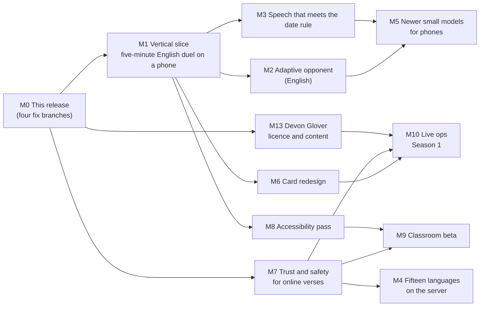

# Production plan and roadmap

**Purpose:** Say where Sonnet Man stands after the November 2026 revival, what this release must finish before it deploys, and what comes next, in what order, with what exit criteria.

**Audience:** The team (David Charlot, founder and technical lead; Devon Glover, "The Sonnet Man", creative director; Arrocito del Diablo, co-founder for game design and card mechanics), future collaborators and contractors, and investors.

**As of:** Commit `0d6df6ef` (branch `integrate/wave3`, 2026-11-18 20:27 -0500), plus the release branches `fix/judge-wording`, `fix/server-authority`, `fix/voice-g2p` and `fix/compliance`, and the nightly database backup set up on 2026-11-19.

**Status:** Draft for the team, 2026-11-19.

**Related documents:** `22-risk-register.md`, `23-market-and-competitors.md`, `24-marketing-press-kit-and-store-pages.md`, `25-live-ops-plan.md`, `17-operations-runbook-and-launch-checklist.md`, `03-gdd.md`, `12-technical-design.md`, `13-ai-design-and-system-cards.md`, `18-trust-and-safety-plan.md`, `26-sota-gap-analysis.md`, `sources/as-built-design.md`, `sources/as-built-tech.md`, `research/sota-design-2026-11.md`, `research/sota-production-2026-11.md`, `docs/ECONOMY.md` (being written on `fix/server-authority`); also `00-README.md` (index), `28-owner-decisions.md`, `29-postmortem-and-incident-templates.md`.

> **How to read the labels.**
> - **As built**: in the code at `0d6df6ef`, with a citation.
> - **In this release**: decided by the owner on 2026-11-19 and being done on the named branch. Not shipped yet.
> - **Proposed**: a recommendation, with the research that supports it.
> - **Not known**: nobody has recorded it. Each one is in the Owner questions at the end.
>
> **Citations.** "design §4.6" is `sources/as-built-design.md` section 4.6; "tech §10.4" is `sources/as-built-tech.md`; "sota-design §4" and "sota-production §5.4" are the two files in `research/`; "landscape §3.3", "in-browser-ai §0" and "xr §7.4" are the three older reports in `docs/research/`. A plain `path:line` is a file in the repository at `0d6df6ef`. Counts marked "derived" were computed from `git log` at `0d6df6ef` for this document.

---

## 1. The short version

- **The core game works.** A solo verse duel runs in 16 languages with no account and no download. An online duel runs in English, scored on the server by rules (As built: design §1, §5).
- **Around the core, much was built and never wired.** Credits, seasons, tournaments, referral, streaks and story mode exist as tables, pages or code that no player can complete (As built: design §3, §4).
- **This release closes the trust gaps before deploy.** The economy moves to the server. The judge's wording goes back to the measured version. The English voice loses a GPL component. The site gets its credits page and AI notice (In this release: four branches, section 3).
- **The production database had 0 accounts on 2026-11-19.** So this release can end every session and reset the economy without touching a single player.
- **Six named rounds follow:** a vertical slice, the adaptive opponent, speech that meets the date rule, the other 15 languages on the server, newer small models for phones, and the card redesign. Trust and safety, accessibility and classroom readiness must come before the game invites strangers or schools (Proposed: sections 4 and 6).

---

## 2. Where the project is: the November 2026 revival

### 2.1 Two builds, nine months apart

| | February 2026 build | November 2026 rebuild |
|---|---|---|
| Commits | 21, dated 2026-02-13 to 02-17 | 659, dated 2026-11-16 to 11-18 (473, 122 and 64 a day; derived) |
| What it was | A "Shakespeare rap battle card game" with wallets, NFTs and a cloud AI (design, header) | A three-round verse duel on in-browser models, with forms checked by code (design §1) |
| AI | A cloud model judged online play when a key was set (tech §0) | No server inference. Models run in the player's browser, or rules decide (tech §4) |
| Web3 | Built 2026-02-14, stripped 2026-02-17 by `7982d79c`; database columns left dormant (design §4.14) | "No blockchain, no wallet" on the About page (design §9) |
| Sign-in | Google | Passkeys and emailed six-digit codes (`6d0ae1d5`, `8f3bfa78`) |

The rebuild is 599 commits past `main`, which is presumed to be what is live (tech §0). Which exact commit is deployed could not be checked (tech §13).

### 2.2 What three days produced

The revival ran as more than a dozen parallel branches, merged into `integrate/wave3`, plus several spikes kept apart. All of the following is As built at `0d6df6ef` unless marked.

| When (2026-11-16 to 18) | Work | What it delivered | Evidence |
|---|---|---|---|
| 16th, 05:18 | Revival (`ddc4e1dd`) | Fixed production API addresses; upgraded every dependency | tech §10.5 |
| 16th, 05:19 | Research first (`8853b437`) | Three research notes; the rebuild followed their recommendations half an hour later | design §9 |
| 16th, 05:51 | The verse duel (`ae20b599`) | The rebuild's first commit. By `0d6df6ef`: three rounds, 12 forms checked by code, card devices, ink, seeded plans; one `DuelSession` behind the flat and 3D screens | design §1 |
| 16th, 05:53 to 05:56 | Sign-in and speech | Passkeys and email codes replace Google; Whisper on the device replaces the browser's server-side speech recognition | design §8; tech §4.3 |
| 16th, 11:28 | Online by rules (`8d113da8`) | The online judge no longer calls a cloud model; the server decides every round by rule | tech §0 |
| 16th, 12:40 | Card art (`0566ca42`) | All 71 cards painted, one art tradition per house | design §7.2 |
| 16th to 17th | `feat/multiplayer-rules`, `fix/rules-findings` | A Rust port of the English verse engine, held to the TypeScript by about 35,000 golden cases; the rules review's findings fixed | tech §5 |
| 16th to 17th | `fix/backend-security` | A mandatory token-signing secret, proxy trust, session records, network-keyed limits | tech §0, §3, §10.3 |
| 16th | `feat/pwa`, `fix/privacy-claims` | Installable app; service worker v3 replaced a v2 that kept signed-in answers after sign-out | tech §1.5 |
| 16th to 18th | Seven `lang/*` branches | 16 languages: interface, card text from Wikidata and Wikisource, sound data, QA tools, measured model lists | tech §6, §4.1 |
| 17th 08:47 to 18th 19:10 | `integrate/wave3` | Everything above merged | `git log --merges` |
| 16th to 17th | Spikes, **not merged** | `spike/decision-judge`, `spike/duel-planner` (the adaptive opponent), `spike/cactus-browser` (Whistle against Whisper), `spike/replacements` (newer models for Whisper, Kokoro and LFM2.5), `spike/mic-test` (phone microphone) | branch READMEs; nothing in the game imports them |

### 2.3 What it cost in rework

These are counts from the commit history at `0d6df6ef` (derived). They are signals, not a time sheet.

| Signal | Count | What it says |
|---|---|---|
| Merge commits | 71 | Many branches moved at once |
| Merges of `main` into a feature branch | 36, most of them on 2026-11-16 | Branches kept chasing a moving `main`; each catch-up is a chance to collide |
| Commits that regenerate the golden vectors | 13 | Every rules change forces a regeneration so the Rust and TypeScript engines agree (tech §5) |
| Commits that re-run or set aside model-evaluation cells | 11 | Including "every cell set aside; no model is offered until they are measured again" |
| Non-merge commits with rework words in the subject ("fix", "again", "no longer", "stale", "instead") | 63 of 588 | About one change in nine repaired an earlier one (a rough grep) |

Four rework events mattered most:

1. **A prompt change broke the judge, and only measurement found it.** After the language branches merged, the model judge's "compare" wording named the language beside the verses instead of in the instruction. Gemma 4 E2B then judged reliably in 4 languages instead of 13, and one planted "ignore all previous instructions" verse beat the real verse in 11 languages (tech §4.2). In this release, `fix/judge-wording` restores main's wording, which passed in 14 languages in the A/B.
2. **Two branches fixed the same strings.** The core locale files were put back to the integration's text, because `lang/qa-pipeline` owned them and had fixed the same strings (commit history).
3. **Failures that hid.** A failed LFM3 load silently fetched a smaller model and claimed to be running it (tech §4.1). Service worker v2 kept signed-in answers after sign-out (tech §1.5). Two test runs on the shared build host tested each other's servers and passed (tech §7.3).
4. **Systems built and never wired.** Credits, season XP, tournament play, referral, streaks, weekly events, draft mode, house allegiance, social sharing and story progress all exist as code no page completes (design §3, "Dead code"). The economy also trusted whatever the browser sent (tech §12, item 1).

### 2.4 What we learned, and the rules we keep

| Lesson | Rule from now on |
|---|---|
| Measurement found the judge regression; review did not | Any change to a prompt, a model or a judging rule is a model change. Re-run the model evaluation before it merges (As built rule: `CLAUDE.md`, model-eval tests fail on drift: tech §4.1) |
| Thresholds set from recorded measurements held up | Keep setting every constant from a recorded measurement, as `duel.ts` and `text.ts` do (tech §7.1) |
| Two engines can be held together exactly | Keep one engine per language and hold every port to it with golden vectors; fix the port, never loosen the comparison (tech §5) |
| Parallel branches on shared files collide | Give each file one owning branch. Integrate daily, not at the end (Proposed) |
| Tests can pass while the thing they guard is broken | Keep the mutation scripts: every guard must be shown to go red when broken (As built: tech §7.1) |
| Building is cheap; wiring and finishing are not | Nothing new starts until a player can complete it from a page, or it is removed. A page must not promise what the code does not do (Proposed; design §10, items 13 to 19) |
| The browser cannot be trusted with anything of value | Anything that ranks, rewards or trades is decided on the server (In this release: `fix/server-authority`) |

---

## 3. This release

### 3.1 What the owner decided on 2026-11-19

All five items are **In this release**. None is built at `0d6df6ef`.

| # | Decision | Branch | What changes | Why (evidence) |
|---|---|---|---|---|
| 1 | The judge's compare wording goes back to main's | `fix/judge-wording` | The model judge passes in 14 languages in the A/B instead of 4 | tech §4.2; `docs/language/MODEL-EVAL.md:73-131` |
| 2 | The economy becomes server-authoritative | `fix/server-authority` (`f661c4cc`, `3fa2c384`; rates in `backend/data/economy.json`; `docs/ECONOMY.md` planned) | Fixed earning rates with daily caps; cards only from the server; leaderboard and tournaments only from server-judged matches; a marketplace purchase moves the credits and the card | As built, any account could add up to 1,000 credits a call, raise its stats, claim any card, and buy a card for free while the seller kept it (tech §12, items 1 to 3) |
| 3 | A nightly database backup on prod, kept 14 days | Operations | Done and restore-tested on 2026-11-19 | No backup was recorded before (tech §10.4) |
| 4 | The English voice drops its GPL eSpeak NG dependency before deploy, rebuilt on the CMU dictionary | `fix/voice-g2p` | No GPL object code is served to browsers | The `phonemizer` package under kokoro-js embeds a compiled eSpeak NG (GPL-3.0-or-later) under an Apache label (sota-production §3.4) |
| 5 | Compliance work | `fix/compliance` | A `/credits` page for the CC BY-SA data; the EU AI Act Article 50(1) notice; privacy-policy wording; asset provenance | The site had no credit for CC BY-SA tables (tech §11.2); Article 50(1) has applied since 2026-08-02 (sota-production §5.4) |

**Also in the release line.** Since `0d6df6ef`, `integrate/wave3` has three more commits: `ee2bf5ad` re-measured the model cells after the six language merges (Gemma 4 E2B now writes Vietnamese), `c22b035a` documents what the Chinese and Thai invocation rules still miss (it is the common base of all four `fix/*` branches), and `32fcddbb` keeps the stage front in view in the Theatre on a phone.

**Where each branch stood at 02:16 on 2026-11-19:** `fix/judge-wording` two commits (`3015897a`, `066a34e2`); `fix/server-authority` two (`f661c4cc`, `3fa2c384`: the API, migration 020 and `economy.json`, whose rates are in `05-systems-economy-and-balance.md` §7.1; no page changed; `docs/ECONOMY.md` not yet written); `fix/voice-g2p` two (`21446923`, `35f43c22`: the new pronunciation step and a build check against eSpeak NG); `fix/compliance` eight (`4dc02c7f` to `d9b966b1`: the notice, `/credits`, privacy and referral wording, `docs/ASSETS.md`).

### 3.2 What deploying this release does to players

- **Every session ends.** Migrations 018 and 019 change session tokens, so current tokens stop parsing (tech §10.3). With 0 accounts, nobody is affected.
- **The API restarts.** Every live online match ends, because rooms live in memory in one process (tech §1.2).
- **The token-signing secret becomes mandatory.** The API refuses to start without it (tech §10.3).
- **A deploy hazard must be closed first.** The shared deploy script would content-hash every `.js`, `.wasm` and `.css` file, including the service worker and the self-hosted model runtime, whose names the page checks. Which route built the live site is not recorded (tech §10.3). The runbook (`17-operations-runbook-and-launch-checklist.md`) carries the steps.

### 3.3 Exit criteria for this release

Proposed, built on the gates the repository already documents (tech §7.2).

1. **The documented gates pass on the build host:** unit tests, the build, the browser suite, the Rust tests and the clean-copy API build. The golden vectors are fresh, so the parity test passes.
2. **The judge:** the real-model tests run, because the wording changes the model path. The per-language pass list from the model evaluation matches what `brain.ts` offers (its test already fails on drift: tech §4.1).
3. **The economy:** new server tests show that a client cannot raise its own credits, stats, cards or achievements, that a purchase moves both the credits and the card, and that daily caps hold. The economy handlers had no tests at all (tech §7.1).
4. **The voice:** the shipped bundle contains no eSpeak NG code. Check the package tree and the built files.
5. **Compliance:** `/credits` lists every CC BY-SA source and every licence notice the data needs (tech §11.2). The AI notice appears at the first interaction (sota-production §5.4). The privacy policy matches what the code does, including the cookie name (tech §12, item 24). Every asset has a recorded source and licence, or is removed.
6. **Deploy:** the migration check passes on prod; the asset-hashing hazard is resolved; the production smoke suite and the proxy-trust check pass after deploy (tech §7.2).
7. **Backup:** a restore of the latest nightly backup succeeds after the deploy's migrations.

### 3.4 What this release does not cover

These carry into the backlog (section 6). Each is a risk in `22-risk-register.md`.

- Machine-readable marking of AI verse and speech under Article 50(2): the cautious reading (`13-ai-design-and-system-cards.md` §7.2) is that it applies from this deploy, because the in-browser models first reached the public after 2026-08-02; 2026-12-02 is the latest date, and only for systems already on the market before 2026-08-02 (sota-production §5.4).
- Review of online reports: they are stored and never read (design §5.7).
- Monitoring, alerting and error reporting: none found (tech §10.4).
- Self-service account deletion (tech §12, item 16).
- A signed licence with Devon Glover: none is recorded (design §11).
- Licences for two music tracks and the fourteen sound effects: none found. `fix/compliance` traces the other two tracks to CC0 sources (`docs/ASSETS.md`) and replaces nothing.
- Page copy that promises what the code does not do (design §10, items 13 to 19).

---

## 4. Milestones

### 4.1 The sequence at a glance (Proposed)

The order follows three rules (Proposed):
- **First make the game a player meets on a phone good.** On phones no model runs, so the written opponent and the rule judge are the whole game there (tech §4.1). M1, M2 and M6 work on that.
- **Before inviting strangers, protect them.** Online verses are shown to other players, which makes the game a user-to-user service with legal duties at any size (sota-production §4.3). M7 comes before any push for online play or classrooms.
- **Before inviting schools, meet their bar.** Districts ask for single sign-on, a privacy certificate and WCAG 2.1 AA (sota-design §6). M8 comes before M9.

### 4.2 Now, next, later (Proposed windows)

No dates have been set by the owner. Decided by default on 2026-11-19: there is no fixed public date, and each deploy goes out when its gates pass; announcing the game is open (`28-owner-decisions.md` D-59, O-10). The windows below are proposals, tied to fixed outside dates where they exist.

| Window | Milestones | Outside dates that shape it |
|---|---|---|
| **Now** (November to December 2026) | M0 this release; M7 trust and safety minimum; Article 50(2) marking | EU AI Act Art 50(2): assume due at this deploy; the transition to 2026-12-02 covers only systems on the market before 2026-08-02 (sota-production §5.4; `13-ai-design-and-system-cards.md` §7.2) |
| **Next** (December 2026 to February 2027) | M1 vertical slice and its AI playtests (`15-qa-and-test-plan.md` §8); M2 adaptive opponent; M6 card redesign; M8 accessibility; M13 Devon Glover licence | Vermont's Age-Appropriate Design Code takes effect 2027-01-01 with no revenue threshold (sota-production §5.2) |
| **Later** (March to June 2027) | M3 speech that meets the date rule; M5 phone models; M4 server languages, one by one; M9 classroom beta; M10 Season 1 | World Poetry Day 21 March; Shakespeare's birthday 23 April; US National Poetry Month in April; Poetry Out Loud National Finals 26 to 28 April 2027; ADA Title II WCAG 2.1 AA for large public entities from 26 April 2027 (sota-production §7.16; sota-design §6) |

### 4.3 Milestone definitions

Each milestone has a goal, a scope, exit criteria and its evidence. All are **Proposed** unless a line says otherwise.

#### M0. This release

Section 3. Exit criteria in section 3.3.

#### M1. Vertical slice: the five-minute English duel on a phone

Section 5 is its brief.

#### M2. The adaptive opponent

- **Goal.** An opponent whose strength changes per player, so difficulty means something where no model runs.
- **Why.** As built, difficulty only changes how many drafts a model writes. Wherever the written opponent plays, which is every phone and headset, Apprentice, Player and Master meet the same verses (design §1.6). The English bank is small: 17 verses over 8 forms, 17 spares, 36 acrostic lines (design §1.6).
- **Starting point.** `spike/duel-planner` (not merged): a planner over the exact rules that chooses the opponent's card and item plays, with a small learned value network, an integer-only kernel with Kani proofs, and an adaptive strength that aims each player's chance of taking a round near one half. It decides from a public view: the player's unplayed cards are never read. It is English only, because the Rust engine scores English only (`planner/README.md` on that branch).
- **Scope.** Merge the planner as a WebAssembly module behind the written opponent. Grow the written verse bank in English. Say on screen that the opponent adapts (sota-design §4: hidden adjustment breeds distrust; named tiers suit a game sold on fair judging).
- **Exit criteria.** The held-out results meet the pre-registered rules in the spike's `planner/docs/ADAPTIVE-PREREG.md` (on `spike/duel-planner`). The module is byte-identical across builders. The fairness test passes. In the AI playtests (`15-qa-and-test-plan.md` §8; `28-owner-decisions.md` D-63), first-time AI players win rounds against it inside the 40 to 60% band, reported per model family, and most runs, asked what the opponent does, can say from the page alone that it adapts; the thresholds are written down before the first run.
- **Decided by default (2026-11-19).** The adaptive opponent is the default, and the three difficulty labels stay as a choice beside it (`28-owner-decisions.md` D-41); Arrocito del Diablo's weekly review may change it (D-49).

#### M3. A speech recogniser that meets the date rule

- **Goal.** Replace Whisper base as the speech recogniser for spoken verses.
- **Why.** Whisper base was released before 2026-04-01, so it fails the owner's date rule (sota-production §2). Its quality outside English is untested in the game (design §8).
- **Starting point.** `spike/cactus-browser` (not merged) measured Whistle against Whisper base in English, Spanish, French, German, Italian and Polish. `spike/replacements` measured other recognisers per tier.
- **What is known.** Whistle is a speech recogniser from Cactus; its Hugging Face repository (`Cactus-Compute/whistle`) was created on 2026-09-30, after the date rule's 2026-04-01 (`09-audio-bible.md` §7, from `spike/mic-test`'s `docs/mic-test/PREREG.md`). A repository date is not a release date, and its licence is **Not known**, so Whistle is one candidate; the milestone is met by any recogniser that passes the date and licence rules and the pre-registered microphone test.
- **Fallbacks with verified releases** (sota-production §3.1): Moonshine Streaming per language (MIT, repositories dated 2026-08-24; English plus Spanish, German, Japanese, Chinese, Arabic, Vietnamese, Tagalog); Granite Speech 5.0 (Apache 2.0, 2026-08 and 2026-10); on desktop Chrome, the on-device Web Speech mode with `processLocally` set, never the default cloud mode.
- **Exit criteria.** Per language, a word error rate under the bar the spike pre-registered, a real-time factor at or under 0.5 on a phone-class CPU, audio that never leaves the device, and a typed path that stays equal (sota-production §3; sota-design §8).

#### M4. The other fifteen languages on the server

- **Goal.** Online duels in more than English.
- **Why it is hard.** The other languages are read by sound tables, a Japanese analyser and the browser's word segmenter. A Rust server cannot yet reproduce them exactly, and a server that scored differently from the preview would be worse than none (As built decision of 2026-11-17: `CLAUDE.md:134-139`; tech §5).
- **Order** (Proposed, easiest to reproduce exactly first, from tech §6.2): Polish, Korean, Vietnamese and Arabic (spelling shows sound; no data fetched); then Spanish, Portuguese, Hindi and Indonesian (small exception tables); then Italian, Russian, French and German (stress and pronunciation tables); last Chinese, Thai and Japanese (segmenter and analyser). For the last three, one segmenter compiled to WebAssembly and used by both sides is the likely route; it is untested.
- **Exit criteria per language.** Golden-vector parity with no disagreement, as English has (tech §5). A content filter for that language (the online filter has 20 English entries: design §5.7). A native-speaker read of that language's duel pack (no language has had one: tech §6.4).

#### M5. Newer small models for phones

- **Goal.** A model opponent or judge on phones, or a clear decision that phones stay rules-only.
- **Why.** As built, phones, tablets and headsets are offered no model at all: the lite tier is used in no language (tech §4.1, §12 item 5). An iPhone Safari tab is killed at about 2 GB (in-browser-ai §0).
- **Evidence so far.** `spike/replacements` found LFM2.5 350M less accurate than the rule judge in all five languages with labelled pairs, and found nothing that replaces Whisper base on a phone-class CPU.
- **Candidates with verified releases after 2026-04-01** (sota-production §2.3, §3.2, §4.2): Liquid d1-2B (2026-10-27, LFM Open License, about 1.95 GB: desktop and strong Android, not iPhone) as a judge that returns scores, not text; Kitten TTS 2 nano or pico (2026-11-13, Apache 2.0, 4 to 17 MB per language, 8 languages; browser use not stated) for voice; content-safety-guard-small (2026-09-27, Apache 2.0, 268 MB) as an on-device pre-filter.
- **Exit criteria.** Measured on a reference mid-range Android phone and a recent iPhone. Beats the rule judge on labelled pairs in each language it is offered in. No injection win. Fits memory. Offered only after the first match, with its size shown (sota-production §2.2).

#### M6. Card redesign

- **Goal.** Cards whose faces say what they do in a duel, and art without known faults.
- **Why** (As built, design §1.3, §7.2, §10):
  - ATK, DEF and HP are printed on every character and never read by a duel.
  - The one Legendary character, The Sonnet Man, is in every new player's starter deck and free online.
  - Duplicates have no use.
  - Seven art faults are known: Juliet cast as East Asian and painted white; two potions with painted labels; Capulet borders; Medusa's victims; Hamlet holding an unnamed blade; Zeus's rounded corners; letter-like glyphs on the Witches' Brew.
  - All 198 world-card variant images are orphaned, in an older photoreal style.
  - 17 of 18 configured 3D models and 52 of 53 splats do not exist.
- **Scope.** Show the house device, signature words, power words and curses on the card face. Drop or give meaning to the stats. Decide what duplicates do. Repaint the faulty cards and look at every image before publishing, as the art script requires (`scripts/art/gen_cards.py:9`). Decide whether variants and 3D are kept or removed.
- **Decisions needed.** Arrocito leads the mechanics. Devon is asked about anything that touches the Sonnet Man card. The owner decides the art direction for redrawn cards: the recorded card-art direction is a global cast, "we are a global planet and represent everyone" (`scripts/art/build_prompts.py:3-10`), while the owner's default for generated brand imagery is central people who are Black, of Haitian descent. **Decided by default (2026-11-19), under that rule's own words ("in generated brand imagery"):** card characters keep the global cast; the default covers brand and marketing imagery only (`28-owner-decisions.md` D-53).

#### M7. Trust and safety for online verses

- **Goal.** The proportionate minimum before online verses are promoted to strangers.
- **Why.** As built: reports are stored and never read; there is no block or mute; a teen account can be paired with any adult stranger; the filter has 20 English entries (design §5.7).
- **Scope** (sota-production §4.3, §4.4): a written UK Online Safety Act risk assessment; a named responsible person and a takedown process; a statement of reasons when a verse is removed (EU DSA Art 17); block and mute; a review queue for reports; NCMEC registration with a one-year preservation procedure; topic guardrails that keep the AI opponent inside California SB 243's game exclusion; join Tech Coalition Pathways (free).
- **Exit criteria.** Each item exists in writing and in code. A report reaches a person within a stated time.

#### M8. Accessibility pass

- **Scope** (As built gaps, design §8): honour reduced motion; open the desktop menus by keyboard; announce the verdict with `aria-live`; measure contrast; ship fonts that cover Vietnamese tone marks; give the Theatre a DOM equivalent.
- **Exit criteria.** A WCAG 2.1 AA conformance report (sota-design §6, §8), and the AI playtests' keyboard and screen-reader-text runs finish a duel (`15-qa-and-test-plan.md` §8.1). Those runs say whether the duel can be finished that way, not how a disabled player experiences it; no disabled playtesters are recruited (`28-owner-decisions.md` D-52).

#### M9. Classroom beta with pilot schools

- **Why.** The classroom tour promises progress tracking that does not exist and shows "FERPA compliant" (design §3, `/classroom`). Districts adopt through single sign-on and LTI, and want privacy certificates (sota-design §6).
- **Scope.** Either build progress records or remove the promise. Clever or ClassLink rostering and an LTI 1.3 launch (not Google sign-in, which the owner excluded on 2026-11-16; ADR 0009). Credits, marketplace and referral off for student accounts. A data protection impact assessment, a COPPA pack, a school pack, and a teacher-hosted live format (sota-production §5.1, §7.22; sota-design §6).
- **Exit criteria.** Two pilot schools run it for a term (Not known which schools). The first pilot is one 13+ class after classroom v1, through Devon Glover's network if he agrees (decided by default: `28-owner-decisions.md` D-51); each school's data agreement comes to the owner to sign.

#### M10. Live ops and Season 1

`25-live-ops-plan.md` holds the plan. Its prerequisites: the season claim bug fixed (the first claimant claims a level for everyone: design §4.7), seasons and tournaments fed only by server-judged play (In this release), self-hosted analytics, and monitoring.

#### M11. Native-speaker review

- **Why.** No string, verse, name or scene in any language has been read by a native speaker (tech §6.4). `docs/language/HUMAN-REVIEW.md` lists 28 items in priority order.
- **Scope.** One paid reviewer per language, starting with the languages marketing will name first. Paying them waits on the owner's budget (`28-owner-decisions.md` O-7).

#### M12. Decisions on unfinished systems

Story mode (a stub), house allegiance, draft mode, streaks, weekly events and referral: wire each, or remove it and its page copy. Whether each was deferred or dropped is Not known (design §11). **Decided by default (2026-11-19), under the owner's rule that recommendations are ordered, not cut:** story mode is finished first; the others stay hidden from players until each has a job in the duel, and none is dropped from the plan; streaks become the forgiving streak of `25-live-ops-plan.md` §5.4 (`28-owner-decisions.md` D-39).

#### M13. Devon Glover: licence and content

- **Why.** The product is named for his persona. The AI opponent can field The Sonnet Man card and, with a model loaded, is prompted "You are The Sonnet Man in a duel of verses" (design §1.6). No recording, verse, voice or music of his is in the game, and no licence is recorded (design §6.1, §11).
- **Scope.** A signed licence whose AI uses are described specifically, with his own counsel (sota-production §5.8). Then his recorded content, with his approval of every use.

---

## 5. Vertical-slice brief (M1)

### 5.1 The slice

**One English duel on a phone, from a shared link to the verdict, at release quality, with no account and no download.** It is the experience most players will have, because phones get no model (tech §4.1).

### 5.2 What exists and what the slice adds

| Part | As built | The slice adds (Proposed) |
|---|---|---|
| First match without a model | Yes: "Play now without a download" starts the written opponent and rule judge (design §8) | Make it the default path, with the model offered only after the first match (sota-design §4) |
| Typed verse | Yes, with a live "What your verse must do" checklist and craft count (design §1.2) | Nothing |
| Spoken verse | Whisper base, English tested only with a stand-in file (design §8) | Typed only in the slice; speech waits for M3 |
| Explained verdict | Craft breakdown, judge points, who took each criterion, which judge ran (design §1.2) | Line-by-line reasons first, judge second, short and skippable (sota-design §1, §4) |
| AI notice | None | In this release (`fix/compliance`) |
| First-time teaching | None on the battle page; a three-step playground tour elsewhere (design §8) | One scaffolded first line, taught by doing (sota-design §4) |
| Match length | No clock in solo play; never measured | Measure; target five minutes (sota-design §1) |
| Accessibility | No reduced motion; verdict not announced (design §8) | Both fixed for the slice's screens |
| Card art | Faults listed in M6 | Repaint the five starter-deck cards first: The Sonnet Man, Romeo, Juliet, Yorick's Skull, the Love Potion (design §1.1). Juliet is one of the listed faults |
| Rewards | A won match pays one random card (design §1.2) | In this release the server grants it |

### 5.3 Quality bar

- **Speed.** First input under 10 seconds on a mid-range phone over a throttled link (Poki: players leave after 10 s; sota-production §1.1). As built, an English duel fetched 7.79 MB in a 2026-11-16 measurement (tech §8). No byte budget is enforced; the slice sets one.
- **Feel.** One quick effect within about 100 ms for each accepted line; nothing blocks the next input (sota-design §4, §9).
- **Fairness.** The player can see why each round went the way it did, without reading code.
- **Honesty.** Every claim on the slice's screens matches what runs.

### 5.4 Risks the slice retires

1. Does a written verse duel hold a new player for three matches in one sitting?
2. Does the rule judge feel fair when it splits most criteria (design §10, item 4)?
3. Does the small written bank (17 English verses and 17 spares) feel repetitive within a few matches?
4. Does the first match start fast enough on a real phone?

### 5.5 How it is tested

**Proposed: by AI players** (`15-qa-and-test-plan.md` §8; `28-owner-decisions.md` D-63). The owner ruled out human playtests on 2026-11-19 ("AI is the playtester"), so the research's think-aloud rounds of five people (sota-production §6.4) are not used. First-time AI players with no prior training on the game play the slice through what a player sees, on the phone-width page or its screen-reader text, with a player's controls only, never the scoring code. Self-hosted models released after 2026-04-01 play (§8.2 there), on the build host, against a local build. Each risk in 5.4 maps to a measure:

1. Whether the duel can be followed for three matches in a row: the share of runs that finish three duels within the step budget, and where the others stop. Whether people come back is measured only after launch, by the live analytics of `16-analytics-and-tracking-plan.md`.
2. Whether the rule judge's verdict explains itself: after each round the AI player says what decided it, and its answer is scored against the verdict's breakdown.
3. Repetition: how often the written opponent repeats a verse across one player's five duels, from the run log, and whether a player that keeps its own notes remarks on it.
4. Start-up speed on a real phone: not an AI measure; the device matrix of `15-qa-and-test-plan.md` §6.3.

### 5.6 Exit criteria

Thresholds are written down before the first run and never moved after the results (`15-qa-and-test-plan.md` §8.5).

- In the English first-time runs, at least the pre-set share of runs reach a first valid verse (accepted and scored, not voided) within the step budget, reported per model family. Poki calls over 70% conversion-to-play "solid" for people (sota-design §4); the AI threshold is set on its own scale and is not read as a human figure.
- The median duel in the AI runs takes five minutes or less (`25-live-ops-plan.md` §10.3's target). A model's speed is not a person's, so the number of actions per duel is reported beside the seconds.
- In most runs, the AI player's stated reason for a round matches the verdict's breakdown.
- The quality bar in 5.3 is met and measured, not estimated.

---

## 6. Prioritised backlog

**MoSCoW** means Must, Should, Could, Won't (for now). Sizes are Proposed estimates: S is a day or two, M up to two weeks, L more. "Owner" is a proposed owner: DC is David Charlot, AdD is Arrocito del Diablo. Devon Glover is never assigned work; items that need him say "ask Devon".

| ID | Item | Priority | Why (evidence) | Size | Milestone | Owner |
|---|---|---|---|---|---|---|
| B01 | Finish and gate the four release branches | Must | Section 3 | L | M0 | DC |
| B02 | Close the asset-hashing deploy hazard | Must | tech §10.3 | S | M0 | DC |
| B03 | Machine-readable marking of AI verse and speech (Art 50(2)); decide the deadline | Must | sota-production §5.4 | M | Now | DC |
| B04 | Remove or fix page copy that promises what the code does not do (15-second scenes, "+50 credits", "Walk through your collection", classroom progress, "FERPA compliant", "5 free packs", "Win a round and earn a card") | Must | design §10, items 9, 11, 13 to 19 | S | M0 or M1 | DC |
| B05 | Review queue for online reports; block and mute; written takedown process | Must | design §5.7; sota-production §4.3 | M | M7 | DC |
| B06 | UK OSA risk assessment and community rules | Must | sota-production §4.3 | S | M7 | DC |
| B07 | Monitoring: uptime check, error reporting, alerts | Must | tech §10.4 | M | Now | DC |
| B08 | Self-service account deletion | Must | tech §12, item 16; Apple 5.1.1(v) if a store build ships (sota-production §1.2) | M | Next | DC |
| B09 | Devon Glover licence with specific AI terms | Must | sota-production §5.8 | M (legal) | M13 | DC, ask Devon |
| B10 | Music and sound-effect licences: confirm or replace all 18 files | Must | design §7.3 | M | M0 or M1 | DC |
| B11 | Card-art licence check (FLUX Kommunity License terms saved and read) | Must | tech §11.3 | S | M0 | DC |
| B12 | Topic guardrails for the AI opponent (SB 243 exclusion) | Must | sota-production §5.2 | M | M7 | DC |
| B13 | Vertical slice (section 5) | Must | Section 5 | L | M1 | DC, AdD |
| B14 | Measure match length and first-input time on real phones | Must | sota-design §1, §4 | S | M1 | DC |
| B15 | Reduced motion, keyboard menus, announced verdict | Must | design §8 | M | M1, M8 | DC |
| B16 | Fix the season claim bug before any season runs | Must | design §4.7 | S | M10 | DC |
| B17 | Adaptive opponent from `spike/duel-planner` | Should | design §1.6 | L | M2 | DC, AdD |
| B18 | Grow the English written-opponent bank | Should | design §1.6 | M | M2 | AdD |
| B19 | Card redesign: card faces, stats, duplicates, starter Legendary | Should | design §1.3, §10 | L | M6 | AdD |
| B20 | Repaint the seven faulty cards; decide variants and 3D | Should | design §7.2, §7.6 | M | M6 | DC |
| B21 | Speech recogniser that meets the date rule (Whistle or a verified alternative) | Should | sota-production §3 | L | M3 | DC |
| B22 | Pin model weights to revisions, and self-host them | Should | tech §4.1, §12 item 7 | M | Next | DC |
| B23 | Self-hosted analytics with a tracking plan; no verse text, no child experiments | Should | tech §9; sota-production §6 | M | M10 | DC |
| B24 | Daily shared verse | Should | sota-design §5 | M | M10 | AdD |
| B25 | Tournament play path, byes that advance, creation limited to staff | Should | design §4.8 | M | M10 | DC |
| B26 | Native-speaker review, language by language | Should | tech §6.4 | L | M11 | DC |
| B27 | Second server language (Polish or Korean) | Should | Section 4.3, M4 | L | M4 | DC |
| B28 | Pre-rendered landing pages in 16 languages with hreflang | Should | sota-production §1.3 | M | Later | DC |
| B29 | Classroom: single sign-on, LTI 1.3, student accounts without commerce | Could | sota-design §6 | L | M9 | DC |
| B30 | Phone-model trial (d1-2B on strong Android; Kitten TTS 2) | Could | sota-production §2.3, §3.2 | L | M5 | DC |
| B31 | Recite-then-remix round built on Devon's method, with his approval | Could | sota-design §9 | M | M13 | AdD, ask Devon |
| B32 | Asynchronous "ghost" opponents online | Could | sota-design §5 | L | Later | DC |
| B33 | itch.io page and a Discord Activity test | Could | sota-production §1.1 | M | Later | DC |
| B34 | Story mode: finish or remove | Could | design §3 | M | M12 | AdD |
| B35 | Remove dormant schema and dead code (NFT columns, unused modules, React with no island) | Could | tech §12, item 17 | M | Later | DC |
| B36 | Apple App Store build | Won't (for now) | sota-production §1.2: riskiest store | L | none | |
| B37 | Selling credits or random packs | Won't | sota-design §7; sota-production §5.7 | | none | |
| B38 | Web portals (Poki, CrazyGames, YouTube Playables) for the full game | Won't | sota-production §1.1 | | none | |
| B39 | AI playtests: the parity interface (the page or its screen-reader text, a player's controls), self-hosted models released after 2026-04-01, the measures and the run log, on the build host | Must | `15-qa-and-test-plan.md` §8; the owner's rule of 2026-11-19, "AI is the playtester" | M | M1 | DC |

---

## 7. Team and cadence

### 7.1 Who does what

| Person | Role (from `PROJECT_BRIEF.md` and the About page) | In this plan |
|---|---|---|
| David Charlot | Founder; technical lead, platform architecture, fundraising | Builds and runs the game, with AI coding agents. Owns releases, operations, legal follow-up |
| Devon Glover | Creative director; Shakespeare content, performance, brand ambassador | Nothing is assumed. Every use of his name, likeness, voice or work waits for his written agreement (section 8) |
| Arrocito del Diablo | Co-founder; game design, card mechanics, strategy | Proposed owner of duel balance, card redesign, the written opponent's verses and the daily verse |
| Treston Knight | Listed on the About page (design §3, `/about`) | Role in production: Not known |
| Contractors (Proposed) | Native-speaker reviewers; a lawyer for the talent licence, COPPA and the OSA assessment; a composer or a licensed music library | To hire per milestone, once the owner sets a budget (`28-owner-decisions.md` O-2, O-7) |

**How the code is made, stated honestly.** One founder works with AI coding agents. The 659 commits of the revival were made in three days that way (section 2). That speed is real, and so is its cost: rework, merge churn and systems left unwired (section 2.3). Investors should read the team as one technical founder plus agents, a performer-educator and a game designer, not as a studio.

### 7.2 Who decides what (RACI)

R is responsible, A accountable, C consulted, I informed. Devon's column says "ask" because his role must be agreed with him.

| Decision | David | Arrocito | Devon |
|---|---|---|---|
| Release go or no-go | A, R | C | I |
| Rules, scoring and balance | A | R | C (ask) |
| Card catalogue and art direction | A | R | C (ask) |
| Anything using his name, likeness, voice, persona or work | R | I | A (ask) |
| Legal, privacy, safety | A, R | I | I |
| Marketing copy | A, R | C | C (ask), A for copy about him |
| Classroom product | A, R | C | C (ask) |

### 7.3 Cadence (Proposed)

- **Weekly.** A 30-minute plan and review: what shipped, what the measurements say, what the risk register changed, what is next. Written notes in the repository.
- **Integration.** Small changes go straight to `main` with the gates passing. A branch only for risky work, merged within days, with each shared file owned by one branch (section 2.4).
- **Release gate.** The checks in section 3.3 for every deploy. Nobody skips a gate to make a date.
- **After every milestone and season.** A short postmortem: what went right, what went wrong, what changes (sota-production §7.21), written with the template in `29-postmortem-and-incident-templates.md`. Incidents get the blameless review in the same file.
- **Monthly.** Re-score the risk register (`22-risk-register.md`).
- **Builds and tests** run on the build host, never on the development laptop, and there is no GitHub Actions (As built rule: tech §7).

### 7.4 Budget

Not known. The repository records no budget, burn rate or runway. The 2025 brief targeted a seed round of $300K to $1M from grants and angels (`PROJECT_BRIEF.md`), and the 2026 roadmap planned 3 to 5 hours a week per person (`ROADMAP.md`). Neither is current. Funders expect a budget of months left times monthly burn (sota-production §7.1, §7.13). Both are open questions for the owner (`28-owner-decisions.md` O-7, O-8).

---

## 8. Change control

- **What changes this plan:** an owner decision, a measurement that contradicts an assumption, a legal finding, or a milestone exit missed.
- **How:** edit this file in the repository with a dated line in section 9, and update the risk register in the same change.
- **What never changes without the owner:** the standing rules (free and self-hosted only; models released after 2026-04-01; no cloud inference; language data from authoritative sources; Rust preferred; no GitHub Actions) and anything touching Devon Glover.

## 9. Change log

- 2026-11-19: first draft.

---

## Owner questions

Settled on 2026-11-19 in `28-owner-decisions.md`: decided by default under the owner's standing rules where a sensible default existed; open only where it needs the owner's money, identity or contact details, a legal commitment in the company's name, or a public step not yet approved.

1. Is a release date set for this deploy and each milestone? **Decided by default:** no fixed public date; each deploy goes out when its gates pass, and the windows of section 4.2 stand (28 D-59). **Open (28 O-10):** when should the game be announced, and by whom?
2. What is the budget, the monthly spend and the runway? **Open (28 O-7, O-8):** what can the company spend in the next year, and on what; what will it ask funders for, and what does it spend each month now?
3. Was the February 2026 build, with its AI features, public before 2026-08-02? **Fact to find out** (28, Facts to find out, 2); less urgent now that the owner chose to mark AI output in this release (R6; 28 D-01).
4. Are the economy branch's rates, caps and pack prices the launch values? **Decided by the owner (2026-11-19, R9):** yes, as tunable launch values (28 D-05).
5. What is Whistle's licence, and does its publisher give a release date? **Fact to find out** (28, Facts to find out, 6); until both are known, Whistle waits (28 D-32).
6. How is the Whisper bar read where its two clauses disagree, and do recognisers retrained from an older model meet the date rule? **Decided by default:** the stricter reading holds (28 D-74); a retrain counts only if its publisher announced it as its own release after 2026-04-01 (28 D-30).
7. Does the adaptive opponent replace the three difficulty labels, or sit beside them? **Decided by default:** beside them, as the default (28 D-41).
8. For redrawn card art, which direction governs? **Decided by default:** the global cast for card characters; the brand-imagery default for brand and marketing imagery only (28 D-53).
9. Story mode, house allegiance, draft mode, streaks, weekly events, referral: deferred or dropped? **Decided by default:** story mode first; the rest hidden until each has a job in the duel, none dropped; streaks replaced by a forgiving streak (28 D-39).
10. What is Treston Knight's role, and how many hours a week can Devon Glover and Arrocito del Diablo give? **Fact to find out** from the owner (28, Facts to find out, 11).
11. Which schools could pilot the classroom beta? **Decided by default:** one 13+ class after classroom v1, through Devon Glover's network if he agrees; the school's agreement comes to the owner then (28 D-51).
12. Replace the untraced music and effects before deploy, after, or never? **Decided by the owner (2026-11-19, R12):** remove the two untraced tracks and the two unused effects now; replace the other effects with traced ones within a month (28 D-08).

### Questions for Devon Glover (to ask him; nothing here assumes an answer)

These are part of asking him for an agreement (`28-owner-decisions.md` O-1, and the full list in its Part 3).

1. Will he sign a licence for his name, likeness, persona and biography, with his own lawyer?
2. Does he agree to an AI opponent that plays a card called "The Sonnet Man", and to the instruction that tells the model to write as that card? If not, what should change? (Until he answers, the card stays out of the AI's hand: R8.)
3. Which of his own recordings or lines, if any, may the game use, and how should they be credited?
4. Is the SM-001 painting meant to depict him? Should it?
5. What should the game never do with his persona (topics, styles, uses)?
6. How much time can he give, and what does he want to approve before it ships?

### Questions for Arrocito del Diablo

Each was decided by default on 2026-11-19 so that work can go ahead; his weekly review may change any of them, recorded as a new decision (`28-owner-decisions.md` D-49).

1. What should the card stats become, or should they go? **Decided by default:** off the card face until they have a role in writing; kept in the card data for the redesign (28 D-42).
2. What should duplicate cards do? **Decided by default:** they get a use, designed with him in the card redesign, M6 (28 D-43).
3. Should The Sonnet Man stay in every starter deck? **Decided by default:** that waits on Devon Glover's answer (28 D-43, O-1).
4. Which forms make the five-minute default duel? **Decided by default:** the two-to-four-line forms (28 D-44).
