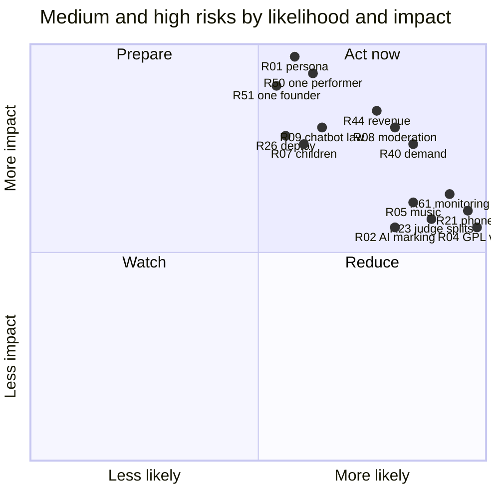

# Risk register

**Purpose:** Name every risk that could hurt Sonnet Man's players, its people or the company, score it, give it an owner, and say what is being done and what would tell us it is happening.

**Audience:** The team (David Charlot, founder and technical lead; Devon Glover, "The Sonnet Man", creative director; Arrocito del Diablo, co-founder for game design and card mechanics), future collaborators and contractors, and investors.

**As of:** Commit `0d6df6ef` (branch `integrate/wave3`, 2026-11-18), plus the release branches `fix/judge-wording`, `fix/server-authority`, `fix/voice-g2p` and `fix/compliance`, and the nightly database backup set up on 2026-11-19.

**Status:** Draft for the team, 2026-11-19.

**Related documents:** `21-production-plan-and-roadmap.md` (milestones and backlog IDs B01 to B39), `15-qa-and-test-plan.md` §8 (the AI playtests), `23-market-and-competitors.md`, `24-marketing-press-kit-and-store-pages.md`, `25-live-ops-plan.md`, `17-operations-runbook-and-launch-checklist.md`, `13-ai-design-and-system-cards.md`, `18-trust-and-safety-plan.md`, `19-privacy-pack.md`, `11-accessibility-plan-and-statement.md`, `sources/as-built-design.md`, `sources/as-built-tech.md`, `research/sota-design-2026-11.md`, `research/sota-production-2026-11.md`; also `00-README.md` (index), `28-owner-decisions.md`, `29-postmortem-and-incident-templates.md`.

> **How to read the labels.** **As built**: in the code at `0d6df6ef`. **In this release**: decided on 2026-11-19, being done on the named branch, not shipped. **Proposed**: a recommendation, with the research behind it. **Not known**: unrecorded; listed in the Owner questions.
>
> **Citations.** "design §x" is `sources/as-built-design.md`; "tech §x" is `sources/as-built-tech.md`; "sota-design §x" and "sota-production §x" are the files in `research/`; "landscape §x" and "in-browser-ai §x" are the older reports in `docs/research/`. Nothing here is legal advice; the legal entries say what the research found and what a lawyer should check.

---

## 1. How risks are scored

- **Likelihood (L), within the next 12 months:** 1 rare, 2 unlikely, 3 possible, 4 likely, 5 almost certain or already happening.
- **Impact (I):** 1 negligible; 2 minor, fixed in a day; 3 moderate, costs weeks or some players; 4 major, legal action, harm to a player, or loss of a channel; 5 severe, loss of the brand, a shutdown, or serious harm.
- **Score** = L × I. **15 to 25 high**, **8 to 14 medium**, **1 to 7 low**. Scores are for the state today (the live site, presumed `main`) unless a row says "residual", which is the score after the release or mitigation named.
- **Response:** avoid (remove the cause), mitigate (lower L or I), transfer (insurance, contract), accept (watch it).
- **Owner** is a proposed owner. DC is David Charlot; AdD is Arrocito del Diablo. Devon Glover owns no risk: where a risk touches him, the entry says "ask Devon".
- **Format** follows the research's columns: cause → event → effect, owner, score, trigger, response, actions, residual (sota-production §7.14).

## 2. The high risks at a glance

| ID | Risk | L | I | Score |
|---|---|---|---|---|
| R08 | Verses shown to strangers with no working moderation | 4 | 4 | 16 |
| R40 | No proven demand for a written-verse duel | 4 | 4 | 16 |
| R44 | No revenue model to pay for running the game | 4 | 4 | 16 |
| R01 | Devon Glover's name and persona used with no recorded licence | 3 | 5 | 15 |
| R21 | On phones the opponent never changes | 5 | 3 | 15 |
| R04 | GPL code served by the live site's voice, until this release deploys | 5 | 3 | 15 |
| R50 | Dependence on one performer | 3 | 5 | 15 |
| R51 | One founder holds the whole system | 3 | 5 | 15 |

## 3. The register

| ID | Risk (short) | Category | L | I | Score | Owner | Response | Status |
|---|---|---|---|---|---|---|---|---|
| R01 | Devon Glover persona without a licence | Legal | 3 | 5 | 15 | DC, ask Devon | Mitigate | Open |
| R02 | AI output not machine-marked (Art 50(2)) | Legal | 4 | 3 | 12 | DC | Mitigate | Open |
| R03 | CC BY-SA attribution and ShareAlike | Legal | 2 | 3 | 6 | DC | Mitigate | In this release |
| R04 | GPL code in the voice stack | Legal | 5 now, 1 after the release | 3 | 15 now; 3 residual | DC | Avoid | In this release |
| R05 | Music and effects without licences | Legal | 4 | 3 | 12 | DC | Avoid | Partly in this release |
| R06 | Art and 3D licences unread or unknown | Legal | 3 | 3 | 9 | DC | Mitigate | Partly in this release |
| R07 | Children's and teens' data and design duties | Legal | 3 | 4 | 12 | DC | Mitigate | Open |
| R08 | User-to-user content duties unmet | Legal, operations | 4 | 4 | 16 | DC | Mitigate | Open |
| R09 | AI opponent outside California's game-bot exclusion | Legal | 3 | 4 | 12 | DC | Mitigate | Open |
| R10 | Credits and marketplace drift into regulated ground | Legal | 2 | 4 | 8 | DC | Avoid | In this release, partly |
| R11 | Copyright in texts, translations and player verses | Legal | 2 | 3 | 6 | DC | Mitigate | Open |
| R12 | Privacy policy does not match the code | Legal | 2 | 3 | 6 | DC | Mitigate | In this release |
| R13 | Accessibility duties through schools | Legal | 3 | 3 | 9 | DC | Mitigate | Open |
| R14 | Liquid licence revenue cliff | Legal | 1 | 3 | 3 | DC | Accept, watch | Open |
| R15 | Names and marks not secured | Legal | 2 | 4 | 8 | DC, ask Devon | Mitigate | Open |
| R20 | One API process holds every live match | Technical | 4 | 2 | 8 | DC | Mitigate | Open |
| R21 | Phones get no model; the opponent never changes | Technical, design | 5 | 3 | 15 | DC, AdD | Mitigate | Open |
| R22 | Judge manipulation and prompt injection | Technical | 3 | 3 | 9 | DC | Mitigate | Partly in this release |
| R23 | The rule judge cannot tell verses apart in many languages | Design | 4 | 3 | 12 | AdD | Mitigate | Open |
| R24 | Model weights unpinned and fetched from a third party | Technical | 3 | 3 | 9 | DC | Mitigate | Open |
| R25 | The new server economy has bugs | Technical | 3 | 3 | 9 | DC | Mitigate | In this release |
| R26 | A deploy breaks the site | Technical, operations | 3 | 4 | 12 | DC | Mitigate | Open |
| R27 | Pre-release runtime and duplicated runtimes | Technical | 3 | 2 | 6 | DC | Mitigate | Open |
| R28 | Server and browser read text differently | Technical | 2 | 2 | 4 | DC | Accept, watch | Open |
| R29 | Non-English duels load slowly | Technical | 3 | 3 | 9 | DC | Mitigate | Open |
| R30 | A server language port drifts from the browser | Technical | 3 | 3 | 9 | DC | Mitigate | Future (M4) |
| R31 | Model quality uneven across languages | Technical | 4 | 2 | 8 | DC | Mitigate | Open |
| R32 | Shipped models break the date rule | Policy | 5 | 2 | 10 | DC | Mitigate | Open |
| R33 | Offline play untested | Technical | 2 | 2 | 4 | DC | Accept, watch | Open |
| R34 | Thin web security headers | Technical | 3 | 3 | 9 | DC | Mitigate | Open |
| R35 | AI playtest results read as what people would do | Design, process | 3 | 3 | 9 | DC, AdD | Mitigate | Open |
| R40 | No proven demand | Market | 4 | 4 | 16 | DC, AdD | Mitigate | Open |
| R41 | Player hostility to generative AI | Market | 4 | 3 | 12 | DC | Mitigate | Open |
| R42 | Players cannot find it; online queues stay empty | Market | 4 | 3 | 12 | DC | Mitigate | Open |
| R43 | Schools cannot buy it | Market | 4 | 3 | 12 | DC | Mitigate | Open |
| R44 | No revenue model | Market | 4 | 4 | 16 | DC | Mitigate | Open |
| R45 | Marketing fails the authenticity test | Market | 3 | 4 | 12 | DC, ask Devon | Avoid | Open |
| R46 | Matches too long for a session | Design | 3 | 3 | 9 | AdD | Mitigate | Open |
| R50 | Dependence on one performer | People | 3 | 5 | 15 | DC, ask Devon | Mitigate | Open |
| R51 | One founder holds the whole system | People | 3 | 5 | 15 | DC | Mitigate | Open |
| R52 | No native-speaker review | People, quality | 4 | 3 | 12 | DC | Mitigate | Open |
| R53 | Team time unknown | People | 3 | 3 | 9 | DC | Mitigate | Open |
| R54 | Building outruns finishing | People, process | 4 | 2 | 8 | DC | Mitigate | Open |
| R60 | Backups are new and thin | Operations | 2 | 4 | 8 | DC | Mitigate | In this release |
| R61 | No monitoring or alerting | Operations | 4 | 3 | 12 | DC | Mitigate | Open |
| R62 | No admin tools; manual database work | Operations | 3 | 3 | 9 | DC | Mitigate | Open |
| R63 | Email off; locked-out accounts | Operations | 3 | 2 | 6 | DC | Mitigate | Open |
| R64 | Third-party services at runtime | Operations, policy | 3 | 2 | 6 | DC | Mitigate | Open |
| R65 | Log-retention promise unverified | Operations, legal | 3 | 2 | 6 | DC | Mitigate | Open |

---

## 4. Legal risks

### R01. Devon Glover's name, likeness and persona used with no recorded licence (15)

- **Cause → event → effect.** The product is named for his persona ("Sonnet Man: the duel of verses"); the About page carries his name, biography and links; the home page badge "Shakespeare on the Go" is his programme's name; the opponent can field the card "The Sonnet Man" and, with a model loaded, is prompted "You are The Sonnet Man in a duel of verses" (As built: design §1.6, §6.1). No signed licence is recorded (design §11) → he objects, or a third party questions the use → rename, remove the card, lose the brand.
- **Law the research names** (sota-production §5.8): New York Civil Rights Law §51 requires written consent for name, likeness or voice in trade. New York General Obligations Law §5-302 and California Labor Code §927 void a vague digital-replica clause unless the performer had counsel or union cover.
- **Also.** The SM-001 painting shows a Black performer on a stage. The prompt does not name him or ask for a likeness (design §6.1). Whether it is meant to depict him is Not known.
- **Mitigation.** Proposed: a licence that covers the 12 points in sota-production §5.8, with AI uses described specifically and his own counsel named. Until it is signed: no new marketing that uses his name or image; every AI verse labelled as AI. In this release: the Article 50(1) notice (`fix/compliance`).
- **Trigger.** Any launch, press or store listing that names him; any concern he raises.
- **Residual after a licence:** 1 × 5 = 5.

### R02. AI output not marked in a machine-readable way (12)

- **Cause → event → effect.** The opponent's verses and the synthetic voice are AI output. EU AI Act Art 50(2) requires machine-readable marking "as far as technically feasible" → an EU regulator or complaint → fines up to €15M or 3% of turnover, the lower for small firms (sota-design §3).
- **Deadline.** 2026-12-02 for systems on the market before 2026-08-02; otherwise it applies now (sota-production §5.4). Whether the February 2026 build's AI was public before 2026-08-02 is Not known.
- **Mitigation.** In this release: the Art 50(1) notice at first interaction. Proposed: mark AI verses in shared or exported text and audio with metadata, write down the method, and follow Section 1 of the EU Code of Practice (sota-production §5.4).
- **Trigger.** This deploy (the cautious reading, `13-ai-design-and-system-cards.md` §7.2); 2026-12-02 at the latest; any share or export feature.

### R03. CC BY-SA data not credited, or ShareAlike reaching code (6)

- **Cause → event → effect.** Wiktionary-derived sound tables, CC-CEDICT and JMdict data ship with the game; the site had no credit (As built: tech §11.2) → a licence breach.
- **Mitigation.** In this release: the `/credits` page (`fix/compliance`). Proposed: keep the derived tables as separate data files under CC BY-SA with a "modified" note, never compiled into code, so ShareAlike does not reach the code that reads them (sota-production §5.10). Keep the NAIST notice with the Japanese dictionary (tech §11.2).
- **Trigger.** A table generated into a code module; a new data source added without a credit line.

### R04. GPL code served to browsers in the voice stack (15 now; 3 after the release)

- **Cause → event → effect.** kokoro-js depends on `phonemizer`, which embeds a compiled eSpeak NG (GPL-3.0-or-later) under an Apache label (sota-production §3.4) → serving it distributes GPL object code without notices.
- **Score.** `main`, presumed live, still serves the component to anyone who turns the English voice on (`20-legal-and-licence-register.md` §6.2), so today L = 5 (already happening) and the score is 15. Once `fix/voice-g2p` is deployed, L = 1: residual 3.
- **Mitigation.** In this release: `fix/voice-g2p` (commits `21446923`, `35f43c22`) builds English pronunciation from a new table of whole CMU pronunciations plus public-domain letter-to-sound rules, aliases `phonemizer` away, and fails the build if eSpeak NG reaches `dist/` (`scripts/check-no-espeak.mjs`). Until the deploy, the owner may switch the English voice off on the live site (`28-owner-decisions.md`).
- **Trigger.** The release check finds eSpeak NG in the built files (`21-production-plan-and-roadmap.md` §3.3).

### R05. Music and sound effects with no recorded licence (12)

- **Cause → event → effect.** Four tracks and fourteen effects date from the first commit with no licence or credit; two tracks carry other artists' tags, "Horror Theme 1" by Lasse Bührmann and "Battle Theme A redone" by The Cynic Project (As built: design §7.3) → a takedown, a strike on a trailer, or a claim.
- **Mitigation.** In this release (`fix/compliance`, `docs/ASSETS.md`): `battle-beat.mp3` and `landing-ambient.mp3` are traced byte for byte to CC0 tracks on OpenGameArt; `playground-ambient.mp3`, `collection-browse.mp3` and all fourteen effects stay untraced, and `/credits` says so. Proposed: for each untraced file, a licence on record or removal before deploy; then commission or license music with written terms, free and self-hosted.
- **Trigger.** Any file with no licence at deploy; any trailer that uses the tracks.

### R06. Art and 3D files whose licences are unread or unknown (9)

- **Cause → event → effect.** The 71 cards were painted with FLUX 3 Image Klein under the FLUX Kommunity License, whose terms are not saved in the repository. The 198 city-variant images came from Z-Image Turbo through a hosted Space, licence not recorded. The GLB and splat files have no recorded origin (As built: tech §11.3; design §7.2, §7.6) → a use the licence does not allow.
- **Mitigation.** In this release (`docs/ASSETS.md`): the FLUX licence is read from the weights' own file. It licenses commercial use of outputs only while group revenue is **under US$5M**, half the LFM threshold the owner confirmed, and asks for AI disclosure where law requires; Z-Image Turbo is Apache-2.0 by its card; the 3D files are byte-identical to output of the owner's own pipeline. Proposed: record the US$5M condition beside the LFM one (`20-legal-and-licence-register.md` §4.1); remove the orphaned variant images and the unknown 3D files unless their licences are found (they are unused or missing anyway: design §7.2, §7.6).
- **Trigger.** A licence term that bars the use; revenue starts.

### R07. Children's and teens' data and design duties (12)

- **Cause → event → effect.** As built, a self-declared age gate blocks under-13s; 13 to 17 tick a parent's-permission box; teens have a 200-credit daily spend cap, and nothing in online play reads the age tier (design §5.7, §8). Classroom mode invites students. → COPPA duties if under-13s get in; Vermont's design code from 2027-01-01 (duty of care against compulsive use, no notifications to minors from midnight to 6 a.m., no revenue threshold); New York's Child Data Protection Act; the UK Children's code (sota-production §5.1 to §5.3).
- **Mitigation.** Proposed: a data protection impact assessment; COPPA's written security program and retention policy; highest-privacy defaults for teen accounts; no notifications to minors at night; streaks and seasons reviewed for compulsive design (`25-live-ops-plan.md`); no under-13 classroom accounts until a school-consent flow exists.
- **Trigger.** Classroom beta; any notification feature; 2027-01-01.

### R08. Verses shown to strangers with no working moderation (16)

- **Cause → event → effect.** Online verses are shown to the other player. As built: 20 filter entries, English only; reports are stored and never read; no block or mute; a teen can be paired by quick match with any adult stranger (design §5.7) → a harmful exchange with no response → harm to a player, a regulator, a store refusal.
- **Duties the research names** (sota-production §4.3): UK Online Safety Act risk assessment and swift takedown, with no small-business exemption; EU DSA Art 16 notice and action and Art 17 statement of reasons at any size; US NCMEC reporting on actual knowledge of child exploitation.
- **Mitigation.** Proposed (milestone M7): risk assessment, named responsible person, report queue read daily, block and mute, statement of reasons, NCMEC registration and a one-year preservation procedure, a filter per online language, and no quick-match pairing of teens with adults until the rest exists. Join Tech Coalition Pathways (free).
- **Trigger.** The first report filed; any push for online play.

### R09. AI opponent outside California's game-bot exclusion (12)

- **Cause → event → effect.** California SB 243 excludes a game bot only if it is limited to the game and cannot discuss mental health, self-harm or sexual content (sota-production §5.2). The model opponent is prompted with the player's last verse (design §1.6), so a player can steer its topic → the exclusion fails → chatbot duties (a self-harm protocol, break reminders for minors).
- **Mitigation.** Proposed: guardrails that deflect those topics; no dialogue outside the duel; no memory between sessions (none was found beyond the match: design §1.6); an on-device classifier before a model verse is shown (content-safety-guard-small, Apache 2.0, 2026-09-27: sota-production §4.2).
- **Trigger.** A model verse on a banned topic in testing or in a report.

### R10. Credits and marketplace drift into regulated ground (8)

- **Cause → event → effect.** In this release, marketplace purchases move credits and the card (`fix/server-authority`). Credits that can only be earned sit outside the EU's in-game currency principles (sota-design §7). Selling credits, random paid packs or a cash-out would bring real-money pricing, 14-day refunds, PEGI 16, and money-transmission questions (sota-production §5.6, §5.7).
- **Mitigation.** Proposed: never sell credits or random packs (backlog B37); marketplace and referral rewards off below 16 and for classroom accounts (sota-design §7); no cash-out ever.
- **Trigger.** Any proposal to sell anything.

### R11. Copyright in texts, translations and player verses (6)

- **Cause → event → effect.** Shakespeare is public domain, but modern editions and translations carry their own terms; Folger texts are non-commercial only (sota-production §5.9). Players may paste copyrighted lyrics → a claim over a shared verse or a card line.
- **As built.** Card lines come from Wikisource and published translations, checked against translators' death dates (commit history; tech §6.3).
- **Mitigation.** Proposed: a text-provenance register per language (edition, translator, death year, first publication); terms that let players keep copyright, grant a display licence and forbid copyrighted lyrics.

### R12. Privacy policy does not match the code (6)

- **Cause.** As built: the policy names the cookie `im_token` while production uses a different name; the 30-day log promise is unverified for the API's own logs; the policy describes a referral system no page offers (tech §12, items 13, 24; design §4.10).
- **Mitigation.** In this release: privacy-policy wording (`fix/compliance`). Proposed: a test that holds the policy to the code, as the room-retention promise already has (tech §9).

### R13. Accessibility duties reached through schools (9)

- **Cause → event → effect.** ADA Title II requires WCAG 2.1 AA of large public entities from 2027-04-26, and vendor tools are not excepted (sota-design §6, §8). As built: no reduced motion, hover-only desktop menus, no announced verdict, contrast unmeasured, dark only (design §8) → schools cannot adopt.
- **Mitigation.** Proposed: milestone M8 and a published conformance report.

### R14. Liquid licence revenue cliff (3)

- **Cause.** LFM3 1.7B and LFM2.5 350M are licensed only while group revenue is under US$10M; the owner confirmed the company is under it on 2026-11-17 (tech §11.1).
- **Mitigation.** Proposed: re-check yearly; plan a replacement before revenue reaches half the threshold.

### R15. Names and marks not secured (8)

- **Cause.** Whether "Sonnet Man", "Inspired Mile" or "Shakespeare on the Go" are registered marks, and whose, is Not known. The third is Devon Glover's programme name (design §6.1).
- **Mitigation.** Proposed: a trademark search; agree with Devon who holds which name, inside the licence (R01).

---

## 5. Technical and design risks

### R20. One API process holds every live match (8)

- **Cause → effect.** Rooms and the quick-match queue live in the memory of one process; a deploy or a crash ends every live match; the server caps rooms at 500 (As built: tech §1.2; design §5.5).
- **Mitigation.** Proposed: deploy at quiet hours with a banner; let rooms drain before restart; asynchronous "ghost" opponents need no live room (sota-design §5).

### R21. On phones the opponent never changes (15)

- **Cause → event → effect.** Phones, tablets and headsets get no model (tech §4.1). The written opponent plays from a small bank (17 English verses, 17 spares) and difficulty does nothing without a model (design §1.6) → repetition within a few matches → players leave.
- **Mitigation.** Proposed: the adaptive opponent (M2), a larger written bank (B18), and phone models only if they beat the rules (M5).
- **Trigger.** AI playtest runs meet the same opponent verses again within a few duels (`15-qa-and-test-plan.md` §8, Proposed); second-session return falls under target (`25-live-ops-plan.md`).

### R22. Judge manipulation and prompt injection (9)

- **As built.** After the integration, one planted "ignore all previous instructions" verse beat the real verse in 11 languages under the new compare wording (tech §4.2). The grade path has three structural defences; injection was tested at most three attempts per language (tech §4.2).
- **Research.** Benign framing flipped AI judges 57% to 100% of the time; the most public 2025 exploit of an AI judge was social engineering (sota-production §4.1; sota-design §3).
- **Mitigation.** In this release: `fix/judge-wording` restores main's wording, which passed in 14 languages. In this release: rankings and tournaments only from server-judged matches, and the server uses rules, not a model. Proposed: a red-team set with benign-framing and refusal-prefix attacks in every language; a decision model that returns scores, not text, for any judge that decides something of value (sota-production §4.4).
- **Not known.** How the server will grant a card for a solo win that the browser judged (In this release: "cards only from the server"). If a browser verdict earns something, it can be faked.

### R23. The rule judge cannot tell verses apart in many languages (12)

- **Cause → effect.** On main's labelled pairs, the rule judge split most criteria in many languages: Chinese 0 right, 40 split, 0 wrong; German 6, 30, 0. Each split is 3 points each, so craft decides most rounds; against the written opponent, wit is always a split (design §1.7, §10) → the judge feels like a coin flip.
- **Mitigation.** Proposed: show the code-checked craft first, line by line; publish each language's known limits; improve the rules with labelled pairs and a native reader (sota-design §2).

### R24. Model weights unpinned and fetched from a third party (9)

- **Cause → effect.** No model load pins a revision, so a change on the hub reaches players unmeasured; the browser fetches weights from Hugging Face, which learns the player's IP (tech §4.1, §9) → a silent quality change, or no model when the hub is down.
- **Mitigation.** Proposed: pin each revision; serve weights from the game's own origin with their licence files beside them (sota-production §5.10).

### R25. The new server economy has bugs (9)

- **Cause.** In this release, `fix/server-authority` rewrites earning, cards, the leaderboard and purchases. The economy handlers had no tests before (tech §7.1).
- **Mitigation.** In this release: server tests in the release gate. With 0 accounts on 2026-11-19, any error found now harms nobody.

### R26. A deploy breaks the site (12)

- **Cause.** The shared deploy script would content-hash the service worker and the model runtime, whose names the page checks; the live route is not recorded (tech §10.3). Deploys are by hand.
- **Mitigation.** Proposed: resolve before this deploy; follow `17-operations-runbook-and-launch-checklist.md`; keep rollback to the old binary with migrations left in place (tech §10.2).

### R27. Pre-release runtime and duplicated runtimes (6)

- **Cause.** The model runtime is a nightly pre-release; kokoro-js ships its own older copies (tech §4.3, §11.4).
- **Mitigation.** Proposed: move to a release build; retire the second runtime with the voice replacement (M5).

### R28. Server and browser read text differently (4)

- **Cause.** The server's Unicode tables (version 16) can be older than the browser's (17); older browsers were not tested (tech §5). A verse with an unknown character is refused, not mis-scored.

### R29. Non-English duels load slowly (9)

- **Cause.** A Japanese duel fetched 62.2 MB before its dictionary was cut to 4.7 MB compressed; a first Japanese duel still waits 5 to 5.7 s on a throttled phone; no byte budget is enforced (tech §8).
- **Mitigation.** Proposed: a per-language byte budget in the tests; load sound data during the first screen.

### R30. A server language port drifts from the browser (9)

- **Cause.** Milestone M4 ports languages that rely on tables, an analyser and a segmenter (tech §5).
- **Mitigation.** Proposed: one language at a time, each held by golden-vector parity, never loosened.

### R31. Model quality uneven across languages (8)

- **Cause.** 30 of 96 model-language cells are unmeasured, each cell ran once on one machine; Gemma answers in English in 9 of 100 Italian plays; no in-game language check (tech §4.2, §12 item 19).
- **Mitigation.** Proposed: a small language identifier before a model verse is shown; finish the matrix.

### R32. Shipped models break the owner's date rule (10)

- **Cause.** Whisper base and Kokoro were released before 2026-04-01 (sota-production §2.3); the rule is "models released after 2026-04-01 only". LFM2.5 350M's date is not recorded here.
- **Mitigation.** Proposed: M3 and M5; meanwhile, the owner decides whether they stay until a measured replacement exists.

### R33. Offline play untested (4)

- **Cause.** No test plays a duel offline (tech §1.5).

### R34. Thin web security headers (9)

- **Cause.** No content security policy; the live origin's headers sit outside the operations repository; the optional proxy shared secret is not configured anywhere readable (tech §12, item 12).
- **Mitigation.** Proposed: a strict policy matching the third-party allowlist the tests already hold (tech §1.4).

### R35. AI playtest results read as what people would do (9)

- **Cause → event → effect.** Under the owner's rule of 2026-11-19, "AI is the playtester" (`28-owner-decisions.md` D-63), AI players with no prior training on the game are the playtesters (`15-qa-and-test-plan.md` §8, Proposed) → a result (time to a first verse, where players stall, win rates) is quoted as if it were how people play → the design is tuned to what models find easy, or a public claim overstates what was measured.
- **Shared tastes.** The game's model judge is Gemma 4 E2B, so a Gemma 4 player may share the judge's tastes and score better than another family would (`15-qa-and-test-plan.md` §8.2).
- **Mitigation.** Proposed: every result says what was measured and which AI player and version produced it, and no claim says "human-level"; results are reported per model family, with three families playing; reference players (a random floor, the written opponent's own verses, a rules-aware solver) bound each result; thresholds are written down before the first run; live numbers from real players (`16-analytics-and-tracking-plan.md`) replace the AI runs' first values as soon as they exist (`15-qa-and-test-plan.md` §8.5).
- **Trigger.** After launch, live numbers differ from the AI runs' first values by more than the runs' own interval.

---

## 6. Market risks

### R40. No proven demand for a written-verse duel (16)

- **Evidence.** No shipped 2024 to 2026 game lets players write verse that code and a model score at scale; the closest, a party pack with a local AI judge, drew one Steam review and was delisted (sota-design, bottom line; §2).
- **Mitigation.** Proposed: the vertical slice and its AI playtests before more building (M1; `15-qa-and-test-plan.md` §8), which show whether a newcomer can reach and finish a duel; cheap channels; audiences that already exist (classrooms, Devon's audience, daily word players) (`23-market-and-competitors.md`). Demand itself shows only in live numbers from real players (`16-analytics-and-tracking-plan.md`), never in AI results (R35).
- **Trigger.** Slice exit criteria missed (`21-production-plan-and-roadmap.md` §5.6).

### R41. Player hostility to generative AI (12)

- **Evidence.** 85% of surveyed gamers were negative about generative AI in games, 83% about AI dialogue; AI difficulty was the most accepted use (sota-design §3, sample skewed to core PC players). On Steam, games that disclosed AI averaged 77% positive against 83% (sota-design §3, no causation shown).
- **Mitigation.** Proposed: sell the player's verse; cast the AI as sparring partner and referee; do not market the AI; a rules-only switch for venues that refuse AI (`24-marketing-press-kit-and-store-pages.md`).

### R42. Players cannot find it; online queues stay empty (12)

- **Evidence.** The big portals forbid accounts, outside calls or chat, and pay only with ads (sota-production §1.1). Quick match is first-come, first-paired and gives up after 3 minutes (design §5.1).
- **Mitigation.** Proposed: own site and installable app first; a daily shared verse; asynchronous ghosts; itch.io and a Discord Activity as tests.

### R43. Schools cannot buy it (12)

- **Evidence.** Districts adopt through Clever (60% of US students monthly) and LTI; the 2026 rankings score privacy certification and accessibility (sota-design §6). As built: passkey or email sign-in only; classroom has a roster and titles, no progress (design §3).
- **Mitigation.** Proposed: M8 and M9.

### R44. No revenue model (16)

- **Evidence.** Nothing is sold; the site says "No real-money purchases" (design §9). The research found no figures for school licences, performer events or grants that fit, and calls revenue "the biggest hole" (sota-design §7). The grant programmes found need a UK, EU or nonprofit partner (xr §7.4).
- **Mitigation.** Proposed: decide a model before Season 1 (`23-market-and-competitors.md` §8).

### R45. Marketing fails the authenticity test (12)

- **Evidence.** Hip-hop audiences doubted a game whose trailer looked AI-made, showed no gameplay and implied artists who were not involved (sota-design §9).
- **Mitigation.** Proposed: real gameplay only; no AI-made key art of real people; Devon's involvement described only as he agrees (`24-marketing-press-kit-and-store-pages.md`).

### R46. Matches too long for a session (9)

- **Evidence.** About three minutes is the reference card match; a top-quartile mobile session is about 5.2 minutes (sota-design §1). Sonnet Man's match length has never been measured.
- **Mitigation.** Proposed: measure match length in the slice's AI playtests (`15-qa-and-test-plan.md` §8.3), then in live analytics; short forms as the default.

---

## 7. People risks

### R50. Dependence on one performer (15)

- **Cause → effect.** The brand is his persona (R01). His availability, his health, a dispute, a change of mind, or harm to his reputation would hit the game; the game can also hurt his reputation if an AI writes badly "as" his card.
- **Mitigation.** Proposed: a licence with a term, wind-down and kill switch (sota-production §5.8); approvals on persona use; a game whose core (the duel) stands under the Inspired Mile name if the persona must be removed.
- **Ask Devon.** See the questions at the end.

### R51. One founder holds the whole system (15)

- **Cause → effect.** The code was built in three days by one founder with AI agents (`21-production-plan-and-roadmap.md` §2); deploys, credentials and operations sit with one person → illness or absence stops the game.
- **Mitigation.** Proposed: this dossier and the runbook; a second trusted person with deploy access and a sealed credentials record, once one is hired (decided by default: 28 D-10; the money is 28 O-7); restore drills.

### R52. No native-speaker review (12)

- **Cause → effect.** No string, verse, name or scene in any language has been read by a native speaker; five languages have no grammar checker (tech §6.4). Players punish bad translation in public, per language (sota-design §8).
- **Mitigation.** Proposed: M11; say on each language's page that the text is machine-made and checked by tools until a reader has read it.

### R53. Team time unknown (9)

- **Cause.** The 2026 roadmap assumed 3 to 5 hours a week per person (`ROADMAP.md`); current commitments are Not known.

### R54. Building outruns finishing (8)

- **Evidence.** Many systems were built and never wired (design §3, "Dead code").
- **Mitigation.** Proposed: the rule in `21-production-plan-and-roadmap.md` §2.4.

---

## 8. Operations risks

### R60. Backups are new and thin (8)

- **In this release.** A nightly backup of the database on prod, kept 14 days, restore-tested on 2026-11-19.
- **Remaining risk.** Whether a copy is kept off the production machine is Not known. Fourteen days may miss slow corruption. No alert on a failed backup was recorded.
- **Mitigation.** Proposed: an off-site copy; a monthly restore drill; an alert when a backup fails or is missing.

### R61. No monitoring or alerting (12)

- **Cause.** No uptime check, alert, error reporting or performance beacon exists for the site (tech §9, §10.4).
- **Mitigation.** Proposed: a self-hosted uptime check on the health endpoint; self-hosted error reporting (GlitchTip, MIT: sota-production §6.1).

### R62. No admin tools; manual database work (9)

- **Cause.** Account deletion must work around foreign keys by hand; nothing reviews reports; any account can create a tournament through the API (tech §12, item 16; design §4.8).
- **Mitigation.** Proposed: small admin commands for deletion, report review and tournament creation.

### R63. Email off; locked-out accounts (6)

- **Cause.** Production runs without the email service, so email-only accounts cannot sign in, and a lost passkey cannot be recovered (design §10, items 32 and 33).
- **Note.** The email service is a third-party API. Whether it fits the free and self-hosted rule is an Owner question.

### R64. Third-party services at runtime (6)

- **Cause.** Analytics loads from a hosted service after the age gate; weights load from the model hub (tech §1.4).
- **Mitigation.** Proposed: self-host analytics (Umami, MIT, cookieless, on the Postgres in place: sota-production §6.1) and model weights.

### R65. Log-retention promise unverified (6)

- **Cause.** The policy promises logs kept no more than 30 days; how the API's log files rotate is not recorded (tech §9).

---

## 9. How this register is kept

- **Monthly**, and whenever a trigger fires: re-score, add, close.
- **Every release:** check each "In this release" status against what shipped.
- **Closed risks** stay in the table, marked Closed, with the date and why.

---

## Owner questions

Settled on 2026-11-19 in `28-owner-decisions.md`: decided by default under the owner's standing rules where a sensible default existed; open only where it needs the owner's money, identity or contact details, a legal commitment in the company's name, or a public step not yet approved.

1. Is there a signed agreement with Devon Glover for the name, persona, likeness and biography? **Open (28 O-1):** will you ask him to sign a written agreement, with his own lawyer reading it?
2. Who holds "Sonnet Man", "Inspired Mile" and "Shakespeare on the Go" as names or marks? **Decided by default:** "Shakespeare on the Go" is not used in marketing until he agrees, and the free public registers are searched now, with the results recorded in doc 20 §10 (28 D-15). **Open (28 O-4):** do you want to pay to search and register the names as trade marks, in the US first?
3. Was the February 2026 build's AI public before 2026-08-02? **Fact to find out** (28, Facts to find out, 2); less urgent now that R6 marks AI output in this release.
4. Do the music and effects get licences, or are they replaced? **Decided by the owner (2026-11-19, R12):** remove the two untraced tracks and the two unused effects; replace the other effects with traced ones within a month (28 D-08).
5. Is the card-art model's licence condition (commercial use only under US$5M group revenue) accepted (R06)? **Decided by default:** record it beside the LFM one, with a repaint plan if revenue nears it (28 D-33). **Open (28 O-9):** how many people does the company employ, and roughly what is its yearly revenue?
6. Is the capped solo claim (50 credits at most 3 times a day, no card to an account) the intended design? **Decided by the owner (2026-11-19, R9):** yes, as tunable launch values (28 D-05).
7. Where is the backup kept, and is there an off-site copy? **Decided by the owner (2026-11-19, R16):** an encrypted copy on a second machine, installed and restore-tested on 2026-11-19 (28 D-10).
8. Who reads reports, and how fast? **Decided by default:** the founder reads them daily, and the Terms say "we aim to review within 48 hours" (28 D-16).
9. May a moderation model run on the server, or must it stay in the browser? **Decided by default:** in the receiving player's browser, under the owner's 2026-11-16 direction "in-browser models only"; the server applies rules only, the word list and the contact-details patterns (28 D-18).
10. Should the email service and the hosted analytics move? **Decided by default:** emailed codes go through Resend, as the owner directed on 2026-11-16, once its account and key exist (28 D-24; that account is **Open, 28 O-11**); analytics move to self-hosted Umami (28 D-25).
11. Do Whisper base and Kokoro stay until measured replacements exist? **Decided by default:** yes, under the owner's "replace as proven" rule, with a review each quarter; LFM2.5 leaves now (28 D-28).
12. Will EU and UK representatives be appointed? **Open (28 O-5):** when players from the EU or the UK start using the game regularly, will you pay for a local representative in each?
13. Who, besides you, can deploy and restore if you are away? **Decided by default:** no one yet; David Charlot is the only operator until a second person is hired (28 D-10), which is money (**Open, 28 O-7**).

### Questions for Devon Glover (to ask him; nothing here assumes an answer)

These are his to answer; asking them is part of 28 O-1.

1. Will he sign a licence, with his own counsel, covering name, persona, likeness, biography and any AI use described specifically?
2. Is he content for an AI opponent to play a card called "The Sonnet Man"?
3. Is the SM-001 painting meant to depict him, and does he want it to?
4. What must the game never do with his persona?
5. Who holds "Shakespeare on the Go" as a name, and may the game use it?
6. If he ever stepped away, what should happen to the card and the name?
