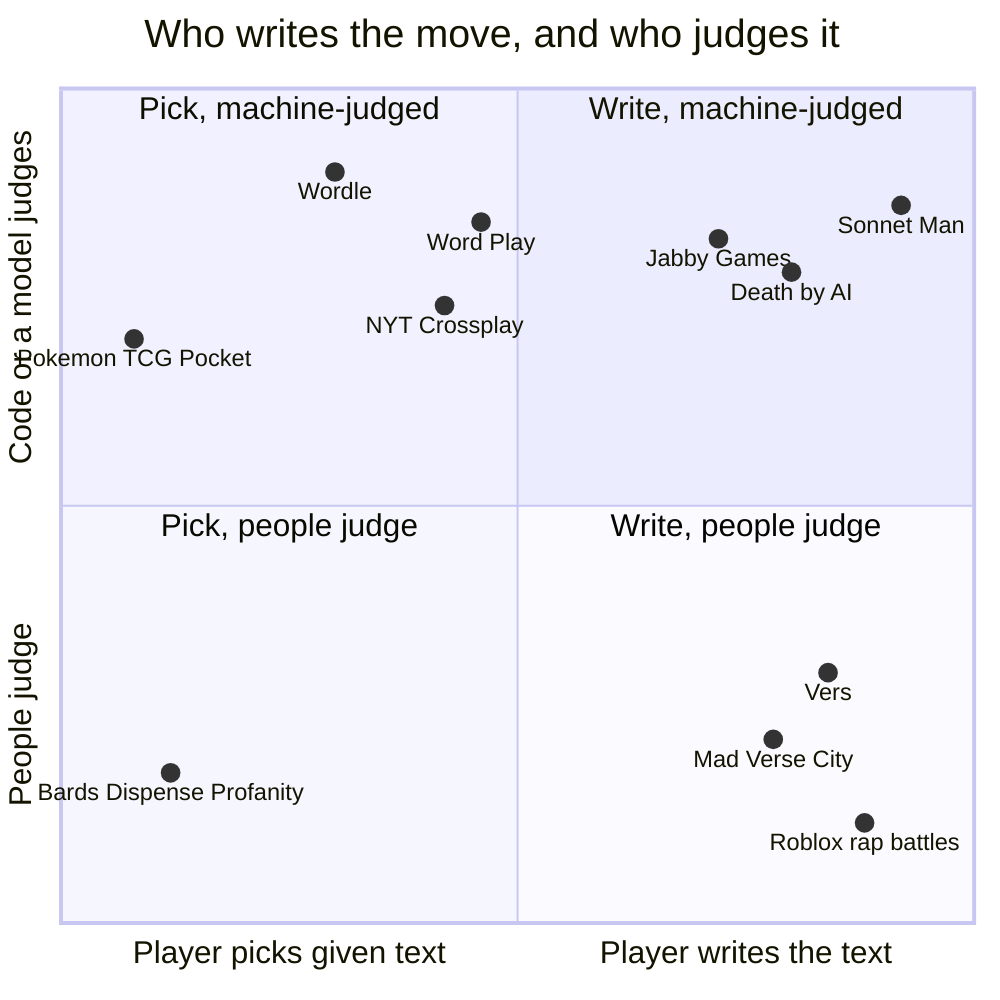

# Market and competitors

**Purpose:** Show who Sonnet Man is for, what else those people play, where the game stands among them, and what the sourced numbers do and do not say.

**Audience:** The team (David Charlot, founder and technical lead; Devon Glover, "The Sonnet Man", creative director; Arrocito del Diablo, co-founder for game design and card mechanics), future collaborators and contractors, and investors.

**As of:** Commit `0d6df6ef` (branch `integrate/wave3`, 2026-11-18), plus the release branches `fix/judge-wording`, `fix/server-authority`, `fix/voice-g2p` and `fix/compliance`, and the nightly database backup set up on 2026-11-19. Research dated 2026-11-16 to 2026-11-19.

**Status:** Draft for the team, 2026-11-19.

**Related documents:** `21-production-plan-and-roadmap.md`, `22-risk-register.md` (market risks R40 to R46), `24-marketing-press-kit-and-store-pages.md`, `25-live-ops-plan.md`, `01-concept-one-pager.md`, `02-pitch.md`, `26-sota-gap-analysis.md`, `sources/as-built-design.md`, `research/sota-design-2026-11.md`, `research/sota-production-2026-11.md`, `docs/research/card-games-landscape-2026-11.md`, `docs/research/xr-card-games-2026-11.md`; also `00-README.md` (index), `28-owner-decisions.md`.

> **How to read the labels.** **As built**: in the code at `0d6df6ef`. **In this release**: decided on 2026-11-19, being done on the named branch. **Proposed**: a recommendation, with the research behind it. **Not known**: unrecorded; listed in the Owner questions.
>
> **Numbers.** Every number below comes from the research files, with the original publisher, its date and the research's evidence mark: **[V]** the page was opened and the claim read there; **[S]** a search summary or secondary source; **[F]** the XR report's mark, equal to [V]. Revenue, download and user figures from analytics firms are estimates, not company disclosures (sota-design, "How to read"). No number here was measured by us.
>
> **Citations.** "design §x" is `sources/as-built-design.md`; "sota-design §x" and "sota-production §x" are in `research/`; "landscape §x" and "xr §x" are the older reports in `docs/research/`.

---

## 1. The short version

- **The space is open, and that cuts both ways.** No shipped 2024 to 2026 game was found in which players write verse that code and a model score at scale. The closest, a party pack with a local AI judge, drew one Steam review and was delisted (sota-design §2). There is no competitor to beat, and no proof that people want it.
- **The audiences that exist are next door.** Daily word puzzles hold huge, habitual audiences. Shakespeare is required reading in the US and England. Spoken-word and hip-hop audiences reward real artists. Sonnet Man touches all three, with a real performer-educator as creative director.
- **The headwinds are real.** Most core gamers dislike generative AI in games. The big web portals forbid what the full game needs. Schools buy through single sign-on and privacy certificates the game does not have yet.
- **The sharpest position** (Proposed): the verse is yours; code checks the form; a small AI on your device spars and referees; nothing you write in a solo duel leaves your device; free, with no ads and no real-money purchases.
- **No market size is given here.** No web-game market sizing could be verified (sota-production §1.3), so this document gives no total, serviceable or obtainable market figure. Section 9 says how to get one.

---

## 2. The market around Sonnet Man, in sourced numbers

### 2.1 Web play and load time

| Number | What it measures | Source | Mark |
|---|---|---|---|
| 100 million monthly players; 1B+ gameplays a month | Poki's claimed reach; "majority mobile" | Poki for Developers, undated (sota-production §1.1) | [V] |
| 50+ million monthly players | CrazyGames' claimed reach | CrazyGames FAQ, undated (sota-production §1.1) | [V] |
| 46% | Weekly US and UK web gamers who stopped playing a mobile game because it took too long to load; 28% because the download was too large | Poki, "State of Web Gaming Report 2026", 2026-06-25; 2,000 respondents, May 2026, by a vendor (sota-production §2.2) | [V] |
| 50% → 72% | Poki's conversion-to-play when median load fell from 29.5 s to 3.7 s | Poki blog, 2026-05-16 (sota-design §4) | [V] |

### 2.2 Daily word habits

| Number | What it measures | Source | Mark |
|---|---|---|---|
| 11.2 billion | NYT Games puzzle plays in 2025; Wordle alone 4.2 billion | Associated Press, 2026-01-21 (sota-design §2) | [V] |
| 84% / 80% | LinkedIn Games players who return the next day / within a week after a first play (company-reported, undated) | Net Influencer, 2025-12-22 (sota-design §2) | [V] |
| +29% | Duolingo daily active users, year on year, Q3 2026 | Duolingo Q3 2026 results, 2026-11-03 (sota-design §5) | [V] |
| 15.4 million | Streaks revived in Duolingo's one-off June 2026 event | Q2 2026 letter summary (sota-design §5) | [S] |

### 2.3 Card games

| Number | What it measures | Source | Mark |
|---|---|---|---|
| About 7 million units, about $140M | Slay the Spire 2 in about three months of Early Access (estimates) | Sensor Tower, June 2026 (sota-design §1) | [V] |
| $741.4M net, year one; −68% in year two | Pokémon TCG Pocket (AppMagic estimates) | PocketGamer.biz, 2026-11-02 (sota-design §7). An earlier figure of about $1.3B is probably gross; unconfirmed | [V] |
| +786% | Shadowverse: Worlds Beyond's daily revenue after its first new card set | PocketGamer.biz, 2025-07-28 (sota-design §1) | [V] |
| About 3 minutes | Marvel Snap's average match, against about 7 in Hearthstone | GamesBeat, 2022 (sota-design §1) | [S] |
| About 5.2 minutes | Top-quartile mobile session, 2025 data | GameAnalytics via Game Dev Reports, 2026-06-04 (sota-design §1) | [V] |
| D1 18.2 to 19.4%; D7 6.5 to 7.1%; D28 2.9 to 3.2% | Card-game retention, 2024 data | GameAnalytics 2025 benchmarks (sota-production §6.3) | [V] |
| D1 10 to 15% "strong" | CrazyGames' web benchmark for a new game | CrazyGames docs, undated (sota-production §1.1) | [V] |

### 2.4 Attitudes to AI in games

| Number | What it measures | Source | Mark |
|---|---|---|---|
| 85% negative; 83% on AI dialogue | Gamers' view of generative AI in games; difficulty adjustment was the most accepted use. Sample skews core and PC | Quantic Foundry via GamesMarket, 2025-12-22; 1,799 respondents (sota-design §3) | [V] |
| 52% | Developers who say generative AI harms the industry (30% in 2025) | GDC 2026 State of the Industry (sota-design §3) | [V] |
| 49.9% | October 2026 Steam releases with an AI disclosure; live generation in play is 3% of disclosures (third-party analysis) | Power Up Gaming, 2026-11-02 (sota-design §3) | [V] |
| 77% vs 83% | Average positive reviews on Steam for games that disclosed AI against those that did not (no causation shown) | Same | [V] |
| Almost 7 million | Death by AI users within weeks; an AI judges each written escape | Discord case study (landscape §3.3) | [V] |

### 2.5 Schools and Shakespeare

| Number | What it measures | Source | Mark |
|---|---|---|---|
| 111,000 schools; 60% of US students monthly | Clever's reach | Clever, "About", 2026 (sota-design §6) | [V] |
| 45% | 2026 top-40 classroom tools holding a privacy certificate; 52.5% have at least ESSA Level IV evidence | GovTech, 2026-06-29 (sota-design §6) | [V] |
| 6 in 10; 32% weekly; 57% | US teachers who used AI in 2024-25; weekly users; share who say it improves grading and feedback (the lowest task) | Gallup, 2025-06-24 (sota-design §6) | [V] |
| Required | "Include at least one play by Shakespeare" (CCSS RL.11-12.7) | Common Core (sota-design §6) | [V] |
| 87% | English students who sit GCSE English Literature, which requires a Shakespeare play | DfE-commissioned review, November 2025 (sota-design §6) | [V] |
| 4.6M students, 89,000 teachers, 22,000 schools | Poetry Out Loud's reach since 2005 | NEA (sota-design §6) | [V] |
| More than two million a year | Teachers and students using the Folger's teaching resources | Folger (sota-design §6) | [V] |

### 2.6 Shakespeare products, performance and XR

| Number | What it measures | Source | Mark |
|---|---|---|---|
| $295,049 from 5,279 backers | Munchkin Shakespeare on Kickstarter | Kicktraq (xr §7.3) | [F] |
| 19.0M visits | "Rap Battles!" on Roblox, judged by crowd vote | RoWatcher (sota-design §2) | [S] |
| 14.3M concurrent | Fortnite's "Remix: The Finale" concert peak | Music Business Worldwide (sota-design §9) | [S] |
| −28% | VR headset shipments in 2025 | Counterpoint (xr §7.1) | [F] |
| "Hundreds to low thousands" a month | Realistic in-headset audience for a free web card game (an estimate) | xr §7.2 | estimate |

---

## 3. Segments

The age gate blocks under-13s on every page, and 13 to 17 need a parent's-permission box (As built: design §8). So every segment below is 13 or older.

| # | Segment | What they want | What Sonnet Man gives today (As built) | Gaps | Size evidence | First channel (Proposed) |
|---|---|---|---|---|---|---|
| S1 | Secondary English classrooms: teachers and students aged 13 to 17 | A short, standards-mapped activity; no student data leaving; easy sign-in | Free solo duel with no account; Shakespeare cards and quotes; Classroom page with a join code and assignment titles (design §3) | No progress records; no single sign-on or LTI; no conformance report; commerce features exist (design §3; sota-design §6) | Clever, CCSS, GCSE, Poetry Out Loud figures (2.5) | Pilot schools; Devon's school circuit, if he agrees |
| S2 | Adult wordsmiths: poets, spoken-word and battle-rap fans | A real challenge, fair scoring, rivals | Online English duels scored by rules on the server; three difficulty labels with a model on desktop (design §1.8, §5) | Phones get no model; difficulty does nothing there; no rating (design §1.6, §5.6) | Roblox rap battles, Fortnite concerts (2.6); no direct figure | Open mics, poetry communities, Devon's audience if he agrees |
| S3 | Daily word-game players | Five minutes a day, one shared puzzle, a shareable result | Daily free card; trivia; quote challenges (design §4.3) | No daily shared verse; sharing code exists but no page uses it (design §5.8) | NYT, LinkedIn, Duolingo figures (2.2) | A daily shared verse (Proposed: `25-live-ops-plan.md`) |
| S4 | Multilingual players and language learners | Play in their own language; learn forms of other traditions | Solo duel and interface in 16 languages; native forms such as jueju and lục bát (design §1.4, §8) | No native-speaker review; online is English only; seven languages play quote challenges in English (design §8, §10) | MENA-3 games market about $2.2B projected for 2025 [S] (sota-design §8) | Language landing pages (Proposed) |
| S5 | Light card-game players | Fast matches, new cards on a rhythm | 71 cards, decks of 3 to 5 characters plus items (design §2, §4.4) | Stats do nothing; duplicates useless; no content cadence (design §10) | Card-game figures (2.3) | Not a launch target |
| S6 | XR headset owners | Something to do in a headset | The Theatre duel in WebXR; tested on an emulated Quest 3 only (design §3) | No model on headsets; minimal scene | Small and shrinking (2.6) | Not a launch target |

**Priority** (Proposed):
1. **At launch: S2 and S3.** They are adults or older teens, need no procurement, and the vertical slice serves them (`21-production-plan-and-roadmap.md` §5).
2. **Build toward S1 for the 2027-28 school year.** It needs milestones M8 (accessibility) and M9 (classroom beta) first. Large US public-school entities must meet WCAG 2.1 AA from 2027-04-26 (sota-design §6).
3. **S4 as a differentiator, not a headline,** until native speakers have read each language (`22-risk-register.md` R52).
4. **S5 and S6 are not targets.** Portals' card leaders are solitaire and UNO-style games (sota-design §1), and the headset market is contracting (xr §7.1).

---

## 4. Personas

These are illustrative composites built from the research. They are not real people and not research participants. Use them to argue about design, not as data.

### P1. Renée, Grade 10 English teacher, US public high school (segment S1)

- **Her week.** Teaches *Romeo and Juliet* every spring. Runs a live quiz tool for review days, as most classroom-game minutes go to four such tools (sota-design §6).
- **What she needs.** A 10-minute activity she can project or assign. Students sign in the way they sign in to everything else. Nothing goes on a student's record by accident. A line in her lesson plan that names the standard.
- **What worries her.** AI grading: teachers rate AI weakest for grading and feedback (sota-design §6). Two-thirds of students worry AI harms critical thinking (sota-design §6).
- **What Sonnet Man offers her today.** A free duel with no account, Romeo and Juliet as the first cards dealt, and rules that check the form line by line (design §1).
- **What stops her.** No single sign-on, no progress view, a classroom tour that promises progress tracking that does not exist (design §3).

### P2. Jaylen, 16, her student (S1, and later S3)

- **His setting.** Plays on a phone between classes. Will not download 3 GB.
- **What he gets today.** The written opponent and the rule judge, which is the whole game on a phone (design §1.8).
- **What he wants.** To beat his friends, show a line he is proud of, and finish a match in a few minutes.
- **Risk to him.** Quick match can pair him with any adult stranger (design §5.7). He should not be in quick match until the safety work is done (`22-risk-register.md` R08).

### P3. Josie, 34, spoken-word poet (S2)

- **Her setting.** Performs at open mics; reads her verse aloud; has a laptop with a recent GPU.
- **What she wants.** An opponent that answers her verse, a judge she can argue with, and human rivals.
- **What she gets today.** On her laptop, Gemma 4 E2B writes the opponent's verse in 12 languages and judges in four at `0d6df6ef` (design §1.8); in this release the judge's wording returns to the version that passed in 14 languages in the A/B (`fix/judge-wording`). Online, English duels against a person, scored by rules (design §5).
- **What she misses.** A rating, rematches with rivals, and the chance to speak her verse with confidence outside English (speech is tested in English only: design §8).

### P4. Daniel, 52, daily puzzle player (S3)

- **His habit.** Five minutes with a coffee, the same puzzle as everyone else, a result he pastes into a family chat. That is the pattern NYT and LinkedIn report (sota-design §2, §5).
- **What he gets today.** A daily free card, unlimited trivia (design §4.3). Nothing shared.
- **What would keep him.** One shared verse a day with a spoiler-free result to paste, and a streak that forgives a missed day (sota-design §5).

### P5. Lin, 22, a Mandarin speaker studying in Germany (S4)

- **Her setting.** Plays in Chinese for fun and in English to practise.
- **What she gets today.** A Chinese duel with eleven forms, jueju among them; the model judges Chinese on a capable desktop (design §1.4, §1.8).
- **What she would notice.** Text no native speaker has read (`docs/language/HUMAN-REVIEW.md` lists Chinese items); online play only in English.

---

## 5. Competitors and adjacent games

No direct competitor exists (section 1). The table groups the games players would compare it with, and says what to borrow and what to avoid. All facts are from the research, with marks carried over.

### 5.1 Daily word games and word duels

| Title | Model | What it proves | Borrow | Avoid |
|---|---|---|---|---|
| NYT Games (Wordle, Connections, Crossplay) | Subscription; Crossplay free, with Cross Bot for subscribers | One short shared puzzle a day holds billions of plays; Crossplay's first duel came with a coach, not a judge; "everything we do is human-crafted" [V] (sota-design §2) | A daily shared verse; a post-match review that shows a stronger line | Selling the review: a free one sets Sonnet Man apart (sota-design §5) |
| LinkedIn Games | Free inside LinkedIn | Under five minutes a day, refreshed daily, high return [V] (sota-design §2) | Short daily format | |
| Semantle | Free web | Players accept a model-based score when the game shows why and admits its blind spots [V] (sota-design §2) | Publish each language's known limits | |
| Word Play (Game Maker's Toolkit) | About $8, Steam | A one-idea language game with roguelike perks can find an audience [S] (landscape §3.2) | Clear, visible scoring | |

### 5.2 Games where language is the move, or an AI judges

| Title | Model | What it proves | Borrow | Avoid |
|---|---|---|---|---|
| Death by AI (Playroom, Discord) | Free | "Write something, an AI judges it, friends watch" reached almost 7 million users in weeks; then token bills, judging queues and humour that did not cross languages [V] (landscape §3.3) | Social play around a verdict | Cloud inference cost; Sonnet Man has none, by design |
| Jabby Games Pack 1 | Paid, Steam; delisted | A local AI judge that explains itself is not a draw on its own [V] (sota-design §2) | | Leading with the AI |
| Mad Verse City (Jackbox) | Paid party pack | Players write rhymes; others vote; "Write for Me" rescues stuck players [V] (landscape §3.2) | A rescue for a blank page | |
| Oh...Sir!! The Insult Simulator | Paid | Reviewers called opaque scoring of wit "a bit random" [S] (landscape §3.2) | | Unexplained scores |
| Mage Arena | Early access | Speech as input sells when the target is small and exact [V] (landscape §3.2) | Speech as a feature, with typing equal | |
| Where Winds Meet | Free-to-play | Players beat AI judges with social tricks (a parenthetical saying the task was done) [S] (sota-design §3) | | Letting a model alone decide anything of value |

### 5.3 Card battlers

| Title | Model | What it proves | Borrow | Avoid |
|---|---|---|---|---|
| Marvel Snap | Free-to-play | About 3-minute matches; the stakes-raising cube [S] (sota-design §1) | Short default duel; a way to raise or concede stakes | |
| Pokémon TCG Pocket | Free-to-play, random packs | Huge first year, steep second; slow coin-flip chains drove players away [V] (sota-design §1, §7) | | Random packs for money; animations that block input |
| Slay the Spire 2 | Premium | Breakout on deliberately rough art; "We're microtransaction haters" [V]/[S] (sota-design §1, §9) | Every option costs something; honest monetisation | |
| Shadowverse: Worlds Beyond | Free-to-play | New cards drove revenue; reviews punished visible greed [V] (sota-design §1) | Content on a rhythm | Whale-targeted monetisation |
| Legends of Runeterra | Free-to-play, cosmetics | "Earn the collection, pay for cosmetics" did not cover a large team [V] (landscape §4) | | A cost base the model cannot fund |

### 5.4 Rap, spoken word and performance

| Title | Model | What it proves | Borrow | Avoid |
|---|---|---|---|---|
| Roblox rap-battle games | Free | Crowds judge; votes, wins and losses all pay a currency, which keeps losers playing [V]/[S] (sota-design §2) | Reward taking part, not only winning | Unprotected peer voting (spite votes and cliques) |
| Vers; DK Rap Battles; Versus Verses (physical) | Retail card games | Rhyme cards remove the hardest step for a beginner [V]/[S] (landscape §3.1) | Scaffolds for a first line | |
| OnlyHands (announced) | Not known | Hip-hop audiences doubted an AI-looking trailer with no gameplay and an improbable roster [V] (sota-design §9) | | AI-looking marketing; implying artists who are not involved |
| Fortnite concerts | Free-to-play | Real artists and real music draw huge live audiences [S] (sota-design §9) | Real performance, not a synthetic one | |

### 5.5 Classroom and Shakespeare programmes

| Title | Model | What it proves | Borrow | Avoid |
|---|---|---|---|---|
| Kahoot!, Blooket, Wayground, Gimkit | Free teacher tiers | Teachers' game minutes go to live, short, quiz-shaped, teacher-hosted tools [V] (sota-design §6) | A projected "class versus the opponent" round | |
| Poetry Out Loud | Free national programme | Recitation runs classroom to national, August to mid-March, a 2 to 3 week unit [V] (sota-design §6) | A spoken-verse practice mode timed to its season | |
| Folger; RSC Associate Schools | Free resources; teacher training | Shakespeare reaches schools through teachers [V] (sota-design §6) | Teacher guides | Folger texts, which are non-commercial only (sota-production §5.9) |
| Flocabulary | Subscription | Hip-hop in classrooms; its efficacy evidence is company-commissioned [S] (landscape §6) | | Overclaiming learning outcomes |

### 5.6 Shakespeare games

| Title | Model | What it proves |
|---|---|---|
| Munchkin Shakespeare | Kickstarter, physical | A literary card game can raise $295,049 [F] (xr §7.3) |
| Bards Dispense Profanity | Physical party game | Shakespeare works as party material, but players pick text and never write it [S] (landscape §3.1) |
| This Way Madness Lies | Premium RPG | "Very Positive" from 153 reviews [S] (sota-design §2) |
| Hail Macbeth | Announced for 2026 | Shakespeare as narrative; release not checked [V] (sota-design §2) |

---

## 6. Positioning

### 6.1 Where it sits

Placement is our judgment from the research, not measured.

### 6.2 Positioning statement (Proposed)

> For people who would rather write a line than pick one (students reading Shakespeare, poets and battle-rap fans, and anyone with five minutes for a daily puzzle), **Sonnet Man is a free verse duel in sixteen languages.** You write or speak a short verse under a poetic form; code checks the form, line by line; a small AI on your own device spars with you and helps referee. Unlike AI party games, the form is scored by fixed rules that are shown to you, not by a model's taste, and nothing you write in a solo duel leaves your device.

Every clause is As built except "helps referee" on phones, where the rules judge alone (design §1.7). The form check is code, never a model (design §1.4); the model judge, where it runs, decides only the 24 judge points (design §1.3). The marketing document turns this into page copy that claims only what runs (`24-marketing-press-kit-and-store-pages.md`).

### 6.3 What sets it apart (As built)

| Differentiator | Evidence |
|---|---|
| The player writes the move, under 12 forms checked by code | design §1.4 |
| Solo verses never leave the device | tech §1.6 |
| No server inference; online scored by rules on the server | tech §0, §5 |
| Plays with no account and no download | design §8 |
| 16 languages, with forms from several traditions | design §1.4, §8 |
| Free, no ads, no real-money purchases | design §9 |
| A real performer-educator as creative director | design §6.1. His role in the game itself is Not known: no content of his is in it |

### 6.4 Where it is weaker (As built)

| Weakness | Evidence | Answer (Proposed) |
|---|---|---|
| On phones the opponent never changes | design §1.6 | The adaptive opponent (`21-production-plan-and-roadmap.md` M2) |
| The rule judge splits most criteria in many languages | design §1.7 | Show craft first; publish limits |
| Online is English only | design §5.1 | One language at a time on the server (M4) |
| Much of the meta-game is unwired | design §3, §4 | Finish or remove (M12) |
| No native-speaker review | tech §6.4 | M11 |
| Demand unproven | sota-design §2 | The vertical slice and its AI playtests (`15-qa-and-test-plan.md` §8, Proposed), which show whether a newcomer can reach and finish a duel; demand itself shows only in live numbers from real players (`16-analytics-and-tracking-plan.md`) |

---

## 7. Channels

| Channel | Fit | Evidence | Status |
|---|---|---|---|
| The game's own site and installable app | Main channel. The portals send direct traffic back to the developer at full value, but forbid the full game | sota-production §1.1, §1.3 | As built (a PWA with an offline page: design §8) |
| Language landing pages in 16 languages | Search in each language | sota-production §1.3 | Proposed |
| Devon Glover's live and school circuit | The likeliest route to schools and spoken-word audiences; his 2026 calendar included the Shakespeare Association of America meeting and festival dates (sota-design §9) | sota-design §6, §9 | Not known: ask Devon |
| Teachers (Poetry Out Loud season, teacher networks) | Classroom adoption, once M8 and M9 are done | sota-design §6 | Proposed |
| itch.io | Free games allowed; 0% share possible | sota-production §1.1 | Proposed test |
| Discord Activity | Embedded web apps; traffic through a proxy; models must pass through it | sota-production §1.1 | Proposed test |
| Reddit, Telegram | Reddit bars outside requests from the client, so no model; Telegram needs its own payments only if something is sold | sota-production §1.1 | Not now |
| Poki, CrazyGames, YouTube Playables | Forbid personal data and accounts (Poki), outside login and links back to the web version (CrazyGames), or outside calls (YouTube); all pay only with ads | sota-production §1.1 | Not for the full game; a guest-only "lite" build at most |
| Google Play (trusted web activity) | Workable for 13+ with an in-app "report AI output" control; no child listing | sota-production §1.2 | Later |
| Apple App Store | The riskiest store: a model download prompt, credits that may not expire, unproven WebGPU in web views | sota-production §1.2 | Deferred |

---

## 8. Revenue options

As built, nothing is sold, and the site says "No real-money purchases" (design §9). In this release, credits are earned at fixed rates and spent in the marketplace, with no money involved (`fix/server-authority`). The research calls revenue its biggest hole (sota-design §7).

| Option | Evidence | Fit with the rules (free, self-hosted, children) | Verdict (Proposed) |
|---|---|---|---|
| Grants and arts or literacy funders | Programmes found need a UK, EU or nonprofit partner; none pays a US for-profit cleanly (xr §7.4). Funders want a deck, a build and a budget (sota-production §7.1) | Fits | Pursue with a nonprofit or university partner |
| School or district licences | No price data found (sota-design §7) | Fits if student accounts carry no commerce | Research after the classroom beta |
| Supporters and donations | Lichess is funded by donations; its US pause shows the legal entity and payment set-up come first (sota-design §7) | Fits; adults only | Consider once there is an audience |
| Live events and workshops with Devon Glover | Not researched (sota-design §7) | Depends on him | Ask Devon |
| Sponsorship by education or literacy organisations | Not researched | Fits if no ads reach children | Not known |
| Portal ad revenue | Poki and CrazyGames pay only from their ads (sota-production §1.1) | Breaks "no ads" | No |
| Selling credits, passes or random packs | EU currency principles, PEGI 16 for paid random items, refunds (sota-design §7; sota-production §5.6) | Poor with a classroom audience | No |

---

## 9. How to size the market, when it matters

No sourced market size exists for web games or verse games (sota-production §1.3). A size would need, at least (Proposed method):
1. **Classrooms:** the number of secondary English classes in target districts that teach a Shakespeare play, times adoption rates seen for free classroom tools.
2. **Wordsmiths:** reachable audiences of poetry and spoken-word communities and of Devon Glover's channels (Not known; ask Devon).
3. **Daily players:** the share of a daily word audience that would try a writing puzzle, from a test of the daily verse.

Each input needs a source before it is used. Until then, plan for niche-sized organic discovery (sota-design §2).

---

## 10. What to research next

- School licence prices, and district bans on ads or in-app purchases (sota-design, gaps).
- Referral programmes and their rules for minors (sota-design §5).
- Performer-brand merchandise and live events (sota-design §7).
- Whether on-device models run inside a Discord Activity (sota-design §5).
- 2026 Top 40 classroom tool names and ranks, behind a form (sota-design §6).
- Any market sizing for web games (Newzoo was blocked: sota-production §1.3).

---

## Owner questions

Settled on 2026-11-19 in `28-owner-decisions.md`: decided by default under the owner's standing rules where a sensible default existed; open only where it needs the owner's money, identity or contact details, a legal commitment in the company's name, or a public step not yet approved.

1. Which players come first: wordsmiths and daily players, or classrooms? **Decided by default:** wordsmiths and daily word players first; classrooms after classroom v1, since classroom is the furthest from ready (28 D-75).
2. Which revenue route first, and with which partner? **Decided by default:** never sell credits or packs, never ads; explore education and arts grants, then school licences invoiced yearly, then recurring supporters; each application or contract comes to you to sign (28 D-56).
3. Is there a nonprofit, university or theatre partner for grant applications? **Fact to find out**, from the owner (28, Facts to find out, 12).
4. Is there a budget for market research? **Open (28 O-7):** how much can the company spend in the next year, and on what? There is no paid playtest panel: AI is the playtester (28 D-63).
5. Should a guest-only lite build go to any portal? **Decided by default:** no portal build, since none fits "no ads"; an itch.io page links to the site once the company may open that account (28 D-59, O-10).
6. Which languages should marketing name at launch? **Decided by default:** only languages a native speaker has reviewed (28 D-50).

### Questions for Devon Glover (to ask him; nothing here assumes an answer)

These are his to answer; asking them is part of 28 O-1.

1. Would he introduce the game to schools or audiences he works with, and on what terms?
2. How large are his own audiences, and which channels does he want the game to use or avoid?
3. Which of his upcoming performances or workshops, if any, could carry a game moment?
4. Does he want to be named in marketing at all, and how?
