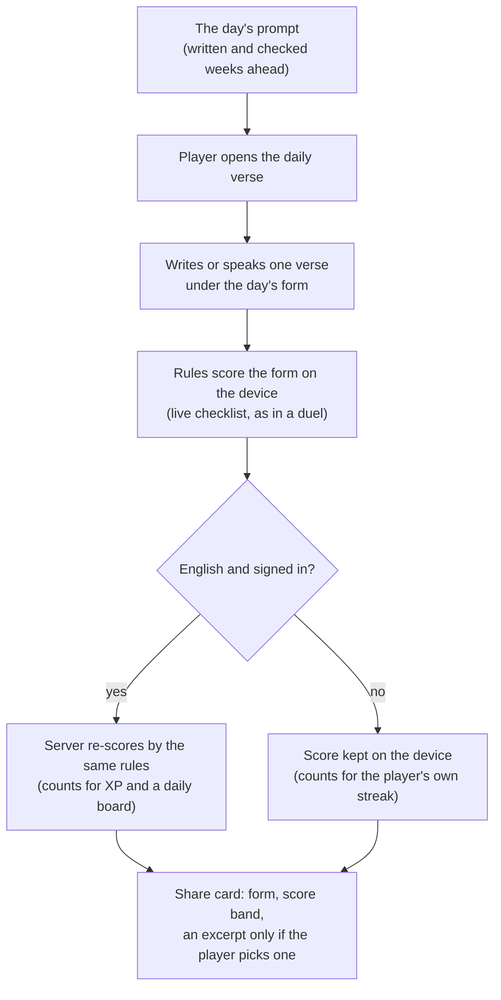
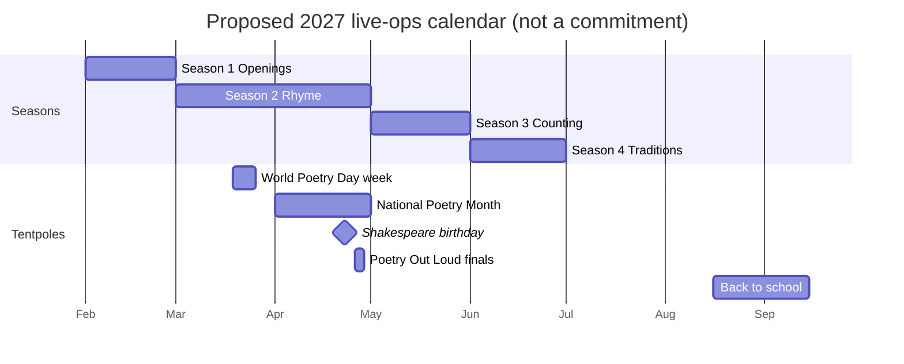

# Live-ops plan

**Purpose:** Say how a small team runs Sonnet Man as a living game: seasons, a daily shared verse, events, new content on a rhythm, how we talk to players, which numbers drive decisions, and the ethical rules the economy keeps.

**Audience:** The team (David Charlot, founder and technical lead; Devon Glover, "The Sonnet Man", creative director; Arrocito del Diablo, co-founder for game design and card mechanics), future collaborators and contractors (community, content, data), and investors.

**As of:** Commit `0d6df6ef` (branch `integrate/wave3`, 2026-11-18), plus the release branches `fix/judge-wording`, `fix/server-authority`, `fix/voice-g2p` and `fix/compliance`, and the nightly database backup set up on 2026-11-19.

**Status:** Draft for the team, 2026-11-19. No season has run. Everything in sections 4 to 12 is Proposed.

**Related documents:** `21-production-plan-and-roadmap.md` (milestone M10), `22-risk-register.md` (R07, R08, R10, R61), `23-market-and-competitors.md`, `24-marketing-press-kit-and-store-pages.md` (the calendar beats and social plan), `17-operations-runbook-and-launch-checklist.md` (incidents and rollback), `05-systems-economy-and-balance.md`, `06-modes.md`, `18-trust-and-safety-plan.md`, `19-privacy-pack.md`, `docs/ECONOMY.md` (being written on `fix/server-authority`), `sources/as-built-design.md`, `sources/as-built-tech.md`, `research/sota-design-2026-11.md`, `research/sota-production-2026-11.md`; also `00-README.md` (index), `28-owner-decisions.md`, `29-postmortem-and-incident-templates.md`.

> **How to read the labels.** **As built**: in the code at `0d6df6ef`. **In this release**: decided on 2026-11-19, being done on the named branch. **Proposed**: a recommendation, with the research behind it. **Not known**: unrecorded; in the Owner questions.
>
> **Citations.** "design §x" is `sources/as-built-design.md`; "tech §x" is `sources/as-built-tech.md`; "sota-design §x" and "sota-production §x" are in `research/`; "landscape §x" is `docs/research/card-games-landscape-2026-11.md`.
>
> **Two words.** *Live ops* means running a game after launch: what changes, when, and why. *Server-judged* means a match the server scored by its own rules, so nobody can fake the result from their browser.

---

## 1. The short version

- **Almost nothing for live ops is wired today.** Seasons, tournaments, credits, streaks and weekly events exist as tables, pages or dead code (As built: design §4).
- **This release lays the floor.** The server becomes the only source of credits, cards, rankings and tournament results (In this release: `fix/server-authority`).
- **The plan.** Monthly seasons that never punish absence; one shared verse a day; a weekly prompt; new forms and cards on a fixed rhythm; competition only from server-judged matches (Proposed).
- **The ethics.** Credits are earned only, never sold. No paid random packs, ever. No streak that punishes a missed day. No notifications to minors at night. Nothing that pressures a child to spend or return (Proposed, from the rules in section 3).
- **The numbers that decide.** Conversion to a first verse, first-duel completion, return on day 1 and day 7, match length, win rates by language, and how often players dispute a verdict, all measured without reading anyone's verse (Proposed: section 10).

---

## 2. What live ops can stand on today

| System | As built (`0d6df6ef`) | In this release | Needed before Season 1 (Proposed) |
|---|---|---|---|
| Seasons | Page and API exist. No migration creates a season; nothing posts XP; the page's level bar assumes 200 XP a level while the server needs `n × 200` for level n; the first player to claim a level claims it for everyone (design §4.7) | XP only from the server at fixed amounts with daily caps; rewards claimed per player (`season_reward_claims`), granting credits, packs or cards (`fix/server-authority`; the claim bug is fixed) | One level curve on both sides; an admin command to create a season |
| Tournaments | Any signed-in account can create one through the API; the scheduler builds brackets but never opens a game room; byes never advance; round robin advances like elimination; results self-reported (design §4.8) | Results only from server-judged matches: either player opens the match's room and only its result decides; byes go through when the bracket is drawn (`fix/server-authority`) | A page path from bracket to duel (the API exists in this release, no page yet); creation limited to staff |
| Leaderboard | Top 50 by browser-reported rounds won (design §5.6) | Only server-judged matches count | A rating (section 4.4) |
| Credits | No page earns or spends them (design §4.6) | Fixed earning rates with daily caps; marketplace purchases move credits and the card | Published rates; tuning rules (section 11) |
| Cards | Earned in the browser, without limit from trivia and quote challenges (design §4.3) | Cards only from the server for accounts (starter, free daily pack, packs bought with credits, season rewards, a one-time import of 20); signed out, trivia and quote challenges add a card to the device at most 3 times a day each | Published card sources |
| Streaks and weekly events | Dead code. The streak resets to day 1 on a missed day; weekly events double XP on set days (design §4.11) | | Replace with a forgiving streak (section 5.4) |
| Achievements | 30, no rewards; "Win 25 battles" counts rounds; two descriptions check the wrong thing (design §4.5) | 18 account achievements computed by the server from its own records; a win is a match (`fix/server-authority`) | Fix the device-side counters and wording to match | Fix counters and wording |
| Analytics | Page views only, through a hosted service, after the age gate; eight event helpers never called (tech §9) | | Self-hosted analytics and a tracking plan (section 10) |
| Monitoring | None (tech §10.4) | | Uptime check and error reporting (`22-risk-register.md` R61) |
| Moderation | Reports stored, never read (design §5.7) | | A daily report review before any event invites strangers (`22-risk-register.md` R08) |
| Communications | No news page; email off; social accounts Not known | | Section 9 |

---

## 3. The rules the economy keeps

These bind every season, event and reward. Each comes from the research.

| Rule (Proposed) | Why | Source |
|---|---|---|
| **Credits are earned only, never sold** | Currency that can only be earned in play sits outside the EU's principles on in-game currency; bought currency brings real-money price display, 14-day refunds and spending off by default in any game not only for adults | sota-design §7 |
| **Never sell random packs** | Paid random items are rated PEGI 16 from June 2026; Korea fines any gap between stated and actual odds | sota-production §5.6; sota-design §7 |
| **No streak that punishes absence** | Rewards for returning are PEGI 7, rising to PEGI 12 if a player loses something by not returning; repairable streaks soften the drop after a break | sota-production §5.6; sota-design §5 |
| **No notifications to minors between midnight and 6 a.m.; streaks and notifications off by default** | Vermont's design code from 2027-01-01; the EU's guidelines on minors | sota-production §5.2, §4.3 |
| **No design that "significantly increases, sustains or extends" a minor's use** | Connecticut's minors' provisions; Vermont's duty of care against compulsive use | sota-production §5.2 |
| **No fake urgency** | Countdowns must be true; fake urgency was among the UK CMA's first targets | sota-design §7 |
| **Season rewards never expire; missed rewards can be claimed later; no mid-season length changes** | Players read a season's length as part of the deal | sota-design §7 |
| **No AI-driven pressure aimed at an age** | EU AI Act Art 5(1)(b) | sota-production §5.4 |
| **Classroom and teen accounts: no marketplace trading, no referral rewards** | Principle 7 of the EU currency principles; Roblox's 2026 age tiers; a school can consent only for school use | sota-design §7; sota-production §5.1 |
| **Only server-judged results earn ranks, prizes or anything tradable** | The most public 2025 exploit of an AI judge was social engineering; the browser can be faked | sota-design §3 |
| **No cash-out, ever** | Credits tradable for money move toward money-transmission and gambling questions | sota-production §5.7 |

As built, the teen spend cap (200 credits a day) already exists (design §4.6). In this release (`fix/server-authority`, `POST /inventory/packs`) the credit-priced pack tiers (Standard 3 cards for 50 credits; Rare 5 for 150; Epic 5 for 400) become buyable with earned credits, drawn with the server's randomness (05 §7.1). Packs bought with earned-only credits are not paid random items; they must never be sold for money.

---

## 4. Seasons

### 4.1 Shape (Proposed)

- **Length:** one calendar month. Marvel Snap and Hearthstone run monthly ranked seasons (sota-production §6.5).
- **Theme:** a family of forms. Each season spotlights forms the code already checks, so a season adds no rule the 16 languages cannot read.
- **Reward track:** free for everyone. Levels earned only from server-judged play and from the daily verse. Rewards are cards, titles and card frames. No premium track: the season table's premium flag stays off (design §4.7).
- **End of season:** ranks soft-reset; rewards stay claimable; the next season's theme is announced a week before.

### 4.2 The first four seasons (Proposed)

The forms each language offers are As built (design §1.4).

| Season | Theme | Forms | Offered in |
|---|---|---|---|
| 1 | Openings | Anaphora (every line opens on the same word), acrostic (openings spell a word) | All 16 languages |
| 2 | Rhyme | Couplet, paired and crossed quatrains, tercet | Every language where rhyme is checked: all but Chinese, Japanese and Thai without their sound data |
| 3 | Counting | Haiku, heroic couplet | Every language where syllables are counted: all but Arabic and Thai |
| 4 | Traditions | Jueju (Chinese), lục bát (Vietnamese), plus a guest form each language's reader proposes | Chinese, Vietnamese, then others as forms are added |

Season 1 uses only structural forms, so every language starts level. Online duels remain English only until the server reads other languages (`21-production-plan-and-roadmap.md` M4); in other languages a season's server-judged part waits for that work, and their players progress through the daily verse.

### 4.3 Experience points (Proposed)

- **Sources:** a completed server-judged online match; a won server-judged match; the daily verse; a weekly prompt.
- **Caps:** a daily cap per source, set in `docs/ECONOMY.md` beside the credit caps (In this release, the credit caps; the XP caps are Proposed).
- **What does not give XP:** solo matches judged in the browser, because their results cannot be trusted for ranking (`22-risk-register.md` R22).

### 4.4 Rating (Proposed)

- **Glicko-2** through the Rust `skillratings` crate (MIT or Apache-2.0): start at 1500, deviation 350, volatility 0.06 (sota-production §6.3). Deviation suits a small pool of infrequent players.
- **Soft reset** at each season's end, toward the middle, with symmetric gains and losses (Clash Royale's pattern: sota-design §4).
- **Labelled AI.** If an empty queue is ever filled with a computer opponent, say so on the match card and rank it separately. Hidden bots were called "deceitful" (sota-design §4).

---

## 5. The daily shared verse

### 5.1 What it is (Proposed)

One prompt, one form, the same for everyone that day. A few minutes. A result you can paste into any chat without giving the verse away. This is the ritual the daily-puzzle leaders run (sota-design §2, §5).

### 5.2 How a day works

- **Scoring.** The day's verse is scored by the same code-checked form rules as a duel (design §1.4). No model decides a daily score, so every player is scored alike, on any device.
- **Ranking.** Only verses the server re-scored count for a daily board or for XP. Today that means English (design §5.1). Other languages join as the server learns them.
- **The prompt.** A public-domain line, card or theme, from the game's own sourced material (Wikisource, the card catalogue), chosen by a person. No unchecked model output (owner's rule; tech §6.3).

### 5.3 Languages

- Start in English, plus each language whose daily prompts a native reader can check. No language has had a native reader yet (tech §6.4).
- Keep a bank of at least 60 days of prompts per language before that language's daily verse goes live, so a missed week of writing never stops the ritual.

### 5.4 The streak (Proposed)

- Counts days with a daily verse.
- **Freezes:** a player can bank freezes that cover missed days.
- **Repair:** a broken streak can be repaired by playing extra days soon after. Shown as intact while repairable.
- **Revival:** an occasional event that restores a lost streak (Duolingo's one-off revival brought back 15.4 million: sota-design §5, [S]).
- **Never** a reward taken away for not returning (section 3).
- **For minors:** no reminder notifications by default, and none at night.

### 5.5 Sharing

The share card is plain text: the form, the score band, a short excerpt only if the player chooses it, and the link (sota-design §5). As built, the sharing module has no importer (design §5.8); this wires it with the rules above.

---

## 6. Events

### 6.1 Weekly

- **The weekly prompt:** a longer theme for the week, in every language with a reader (sota-production §6.5). Duels against the computer on that theme give a small XP bonus, capped.
- **No double-XP days.** The dead weekly-events code doubled XP on set days (design §4.11). Fixed days nudge players to return on schedule, which the rules in section 3 avoid for minors. Prefer bonuses a player can take any day that week.

### 6.2 Tentpoles in 2027 (Proposed)

| When | Event | Shape |
|---|---|---|
| 21 March | World Poetry Day | A week of prompts from poets across the 16 languages, sourced and public domain |
| April | US National Poetry Month | The Season 2 theme lands here; a teacher pack for the month |
| 23 April | Shakespeare's birthday | A day of prompts from his first lines; the five starter cards' lines |
| 26 to 28 April | Poetry Out Loud National Finals | A spoken-verse practice week (speech tested in English), not a sponsorship |
| August to September | Back to school | The classroom calendar starts, if the classroom beta has landed (`21-production-plan-and-roadmap.md` M9) |
| Once a season, if he agrees | A headline duel with Devon Glover | Only on terms he sets: ask Devon. The research suggests one approved headline duel per season (sota-production §6.5) |

Dates from sota-production §7.16 and sota-design §6.

Season 2 runs two months so that one season covers both World Poetry Day and National Poetry Month. Whether Season 1 can start in February 2027 depends on the readiness list in section 13.

---

## 7. Content cadence

New content is what players read as progress (sota-design §1). Sixteen languages multiply its cost, so content that code can check in any language comes first (sota-design §1).

| Content | As built | Proposed cadence | Cost per language | Gate before it ships |
|---|---|---|---|---|
| Daily prompts | None | Daily, from a 60-day bank | A line and its source | A native reader |
| Weekly prompts | None | Weekly | A theme | A native reader |
| Forms | 12 (design §1.4) | One new form or form variant a season | A rule in code for each language, or "not offered" | Measured against published verse in that language, as the sound data was (tech §6.2); an AI playtest run |
| Written-opponent verses | 17 English verses, 17 spares, 36 acrostic lines (design §1.6) | Grow English first; then each language | Verses that keep the form by code | Code check, a native reader and an AI playtest run |
| Cards | 71 (design §2) | A small set each quarter, after the card redesign (`21-production-plan-and-roadmap.md` M6) | Name, line, scene in 15 languages from sources (tech §6.3) | The card-text checks; art looked at by a person (design §7.2); an AI playtest run |
| Trivia and quote challenges | 200 questions; 104 challenges (design §4.3) | A themed batch with each season | Translation and checks | Fact-checked by a person; no model-written fact unchecked (design §6.9) |
| World cards | 20 cities (design §4.12) | Hold until the card redesign decides their future | | |
| Story acts | A stub (design §3) | Hold until finished or removed (`21-production-plan-and-roadmap.md` M12) | | |

**The AI playtest run** (Proposed: `15-qa-and-test-plan.md` §8.5; `28-owner-decisions.md` D-63): before a form, an opponent verse set or a card set ships, AI players with no prior training on the game play it through the page and a player's controls on the build host, to check that it can be understood from what is drawn, that it adds no new place where players get stuck, and that no house gets a free or impossible round.

A balance change ships with a note that says what changed and why. Mega Crit's lesson after its first patch was review-bombed: say that progress "will not be linear and no change is necessarily permanent", and avoid so many changes that wins feel cheap (sota-design §1).

---

## 8. Tournament operations (Proposed)

In this release, tournament results come only from server-judged matches. Before running one:

- **Who creates them:** staff only. As built, any signed-in account can create one through the API (design §4.8).
- **Formats:** single elimination with byes that advance; round robin scored as a table, not as an elimination.
- **Playing a match:** the bracket opens a server room; the room's result writes the bracket. As built, the scheduler never opens a room (design §4.8).
- **Disputes:** the server re-scores from the stored verses by the same rules, and a person reviews any appeal. Results that rest on automated scoring of children are significant decisions, so offer human review on request and explain the scoring (sota-production §5.3).
- **Prizes:** recognition (titles, a featured verse). No credits for entry, no prizes of money.
- **Teens:** only in tournaments limited to their own tier, or in class tournaments run by a teacher, until the safety work is done (`22-risk-register.md` R08).

---

## 9. Communications

| Channel | Use | Status |
|---|---|---|
| In-game banner | Season start and end, events, planned downtime | Proposed |
| A news page on the site | Release notes, balance notes, season themes | Proposed |
| Social channels | `24-marketing-press-kit-and-store-pages.md` §10 | Accounts Not known |
| Email | Only to adults who opt in. As built, email is off in production (tech §1.3) | Not now |
| Teacher notes | A short note each school term, once the classroom beta runs | Proposed |

**Tone.** Plain words, short sentences, the site's own voice. Say what changed, why, and what it means for the player.

**Incidents.** When something breaks: a banner within the hour, a plain note on the news page when fixed, and the steps in `17-operations-runbook-and-launch-checklist.md`. A deploy ends every live online match, because rooms live in one process's memory (tech §1.2). Announce deploys ahead and run them at quiet hours.

**AI incidents.** If a model writes something harmful or a judge is beaten by a trick: switch that language to the written opponent and rule judge, say so in a note, and fix it with a measurement before switching back. The game already falls back to the written opponent and rules when a model fails (tech §4.1).

---

## 10. The metrics that drive decisions

### 10.1 What we collect, and what we never collect (Proposed)

- **Self-hosted, cookieless analytics.** Umami (MIT, cookieless, funnels and retention, runs on the Postgres already in place) replaces the hosted page-view script, which also fits the owner's free and self-hosted rule (sota-production §6.1; tech §9).
- **Errors:** GlitchTip (MIT) with the open-source browser and Rust SDKs (sota-production §6.1).
- **Never:** the text of a verse, any audio, session replay, or a profile of a minor. Classroom and teen sessions: no experiments and no replay; only what internal operations need, named in the privacy notice (sota-production §6.2).
- **Consent:** follow the UK and EU rules for aggregate first-party statistics: a visible statistics setting, default on where the law allows, off where it does not (sota-production §6.2).

### 10.2 The tracking plan (Proposed first events)

Names follow the "noun plus past-tense verb" convention (sota-production §7.19).

| Event | Properties (never the verse text) | Serves |
|---|---|---|
| `Page Viewed` | page, language | Funnel top |
| `Duel Started` | language, difficulty, model tier or none, device class | Conversion |
| `Verse Submitted` | language, form, input mode (typed or spoken), length band, round | First-input rate |
| `Round Scored` | language, form, craft band, judge type (rules or model), who took it | Balance |
| `Duel Completed` | language, rounds played, winner (player or opponent), duration band | Completion, match length |
| `Model Download Accepted` / `Model Loaded` | tier, size, time band | Model funnel |
| `Daily Verse Submitted` | language, form, server re-scored (yes or no) | Daily ritual |
| `Online Match Completed` | rounds, end reason, audit disagreement (yes or no) | Online health |
| `Verse Reported` | room, reason category | Safety |
| `Credits Earned` / `Credits Spent` | source or sink, amount band | Economy |

### 10.3 Targets and the decisions they trigger (Proposed)

| Metric | Target | If it misses | Source of the target |
|---|---|---|---|
| Conversion to a first submitted verse | 70% or more | Cut screens before the first verse; teach by a first line | Poki: over 70% "solid", over 80% "exceptional" (sota-design §4) |
| Time from load to first input, mid-range phone | Under 10 s | Defer more bytes; set a per-language byte budget | Poki: players leave after 10 s (sota-production §1.1) |
| Median match length | 5 minutes or less | Shorter default forms; resumable matches | sota-design §1 |
| First-duel completion | Not set; measure first | Find the round where players leave | |
| Day-1 return | 10 to 15% is a strong web start; card games reach 18 to 19% | Fix the first session before adding content | CrazyGames; GameAnalytics (sota-production §6.3) |
| Day-7 return | About 6.5 to 7% for card games | Daily verse and season work | GameAnalytics (sota-production §6.3) |
| Player win rate against the written opponent, by language and difficulty | Within 45 to 55% | Retune that language's bank or the adaptive target | sota-production §6.3 |
| Share of judge criteria split, by language | Falling over time | Improve that language's rules with labelled pairs | design §1.7 |
| Online audit disagreements (browser preview against server) | Zero | Treat as a parity bug; stop online play in that case | tech §5 |
| Online quick-match success (paired within 3 minutes) | Not set; measure | Add asynchronous ghost opponents | design §5.1; sota-design §5 |
| Reports answered | Every report read within a stated time | Add reviewer time; pause online invitations | sota-production §4.3 |
| Season reward-track completion | Not set; measure | Adjust XP, never by taking rewards away | |

The research warns that its retention benchmarks are optimistic for a web game with no install (sota-production §6.3).

**Before launch** (Proposed): the first values for time to a first verse, match length, first-duel completion and the win rates come from the AI playtests (`15-qa-and-test-plan.md` §8.3), reported per AI player and model family. Live numbers from real players replace them as soon as those exist; an AI value is never presented as what people do (`22-risk-register.md` R35).

### 10.4 Experiments (Proposed)

- Two arms, a sample size fixed in advance by a power analysis, Evan Miller's sequential stopping rule implemented in Rust (sota-production §6.3).
- Expect only big effects to show at launch scale (a minimum detectable effect around 30%), so test only big changes: the first screen, the first match.
- No experiments on minors' or classroom sessions; none in France without consent (sota-production §6.2).

---

## 11. Economy levers and tuning rules (Proposed)

In this release, the server owns every credit and card (`fix/server-authority`, `docs/ECONOMY.md`). The levers, and how to move them:

| Lever | Rule |
|---|---|
| Earning rates and daily caps | Change only at a season boundary, announced a week ahead. Never cut what a player already holds |
| Card sources (daily card, trivia, quote challenges, wins) | Daily caps, so the collection grows on a rhythm rather than all at once (As built, trivia and challenges pay without limit: design §4.3) |
| Marketplace | Prices are the seller's; the server moves credits and the card. Off for teen and classroom accounts (section 3) |
| Duplicates | Give them a use only through the card redesign (`21-production-plan-and-roadmap.md` M6); never a paid conversion |
| Founding-player top-up | As built, accounts made before a configured date are topped up to 500 credits on every sign-in, with no transaction row (design §4.6). **In this release** (`fix/server-authority`) it becomes a one-time grant of 500 credits, logged |
| Referral | As built, the API rewards the referrer with uncapped credits and tells the redeemer of packs it never grants (design §4.10). Keep it off until it is rebuilt with caps, no rewards for minors, and true messages |

---

## 12. Who runs it (Proposed rota)

| Task | How often | Proposed owner |
|---|---|---|
| Read reports and act | Daily, once online play is promoted | DC, then a contractor moderator |
| Check uptime, errors, backups | Daily | DC |
| Queue the next week's daily prompts | Weekly | AdD |
| Review metrics against section 10.3 | Weekly | DC, AdD |
| Season plan and theme | Monthly, a week before the season | AdD |
| Balance changes | At season boundaries | AdD, approved by DC |
| AI playtest runs on new content and each release candidate (`15-qa-and-test-plan.md` §8.5) | Before each content drop and season, and per release | DC, on the build host; findings to AdD |
| Content drops (forms, cards) | Quarterly | AdD and DC |
| Anything involving Devon Glover | As agreed with him | DC, ask Devon |

DC is David Charlot; AdD is Arrocito del Diablo. These are proposals until each person agrees.

---

## 13. Readiness checklist before Season 1

- [ ] This release shipped and stable (`21-production-plan-and-roadmap.md` §3.3).
- [ ] Season claim fixed per player; one level curve on page and server.
- [ ] An admin command to create a season and its rewards.
- [ ] XP posted only by the server from server-judged play and the daily verse, with daily caps.
- [ ] Rating in place with a soft reset.
- [ ] The daily verse built, with a 60-day English prompt bank.
- [ ] A forgiving streak (freezes, repair), no night notifications for minors.
- [ ] Self-hosted analytics and error reporting, with the tracking plan.
- [ ] An AI playtest run of the season's new forms, cards and prompts, with no new place where players get stuck and the win rates inside their bands (`15-qa-and-test-plan.md` §8.5).
- [ ] Monitoring and an alert on a failed backup.
- [ ] Report review in place (`22-risk-register.md` R08).
- [ ] A news page and an in-game banner.
- [ ] Page copy matches what runs (`24-marketing-press-kit-and-store-pages.md` §2.3).

---

## Owner questions

Settled on 2026-11-19 in `28-owner-decisions.md`: decided by default under the owner's standing rules where a sensible default existed; open only where it needs the owner's money, identity or contact details, a legal commitment in the company's name, or a public step not yet approved.

1. Monthly seasons, or seasons aligned to school terms? **Decided by default:** one calendar month, with Season 2 running two months to cover World Poetry Day and National Poetry Month; classroom material follows school terms separately (28 D-76).
2. Will credits ever be sold? **Decided by the owner (2026-11-19, R10):** never. **Decided by default:** packs are never sold either, and there are never ads (28 D-56).
3. Should random packs stay, or should earned credits buy only chosen cards? **Decided by the owner (2026-11-19, R10):** packs stay, bought only with earned credits; buying chosen cards instead is revisited with Arrocito del Diablo when the cards are redesigned (28 D-06).
4. Who counts as a founding player, given 0 accounts? **Decided by default:** every account created before Season 1 starts, each with one logged 500-credit grant; the server's launch date is set to Season 1's start (28 D-77).
5. Who reads reports, and how fast? **Decided by default:** the founder reads them daily, and the Terms say "we aim to review within 48 hours" (28 D-16).
6. Which languages get a daily verse first, and who reads their prompts? **Decided by default:** English first; each other language once a native reader has checked its prompts and a bank of 60 days exists (28 D-78). Paying native readers is **Open (28 O-7)**.
7. Does the hosted analytics move to a self-hosted tool? **Decided by default:** yes, to self-hosted Umami (28 D-25).
8. May players under 18 take part in open tournaments? **Decided by default:** no; under-18s play only in class or teen-only tournaments, and tournaments stay hidden until a page can play them (28 D-19).
9. Should the marketplace stay on for adults after this release? **Decided by the owner (2026-11-19, R10):** yes, for adults only (28 D-06).

### Questions for Devon Glover (to ask him; nothing here assumes an answer)

These are his to answer; asking them is part of 28 O-1.

1. Would he take part in a headline duel or a prompt once a season, and on what terms?
2. Which of his dates, if any, may the event calendar follow?
3. Are there themes or forms he would like a season to celebrate, or avoid?
4. Would he want to choose or write any daily prompts, credited to him?
