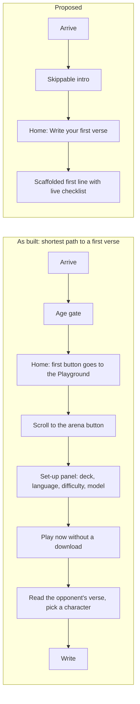
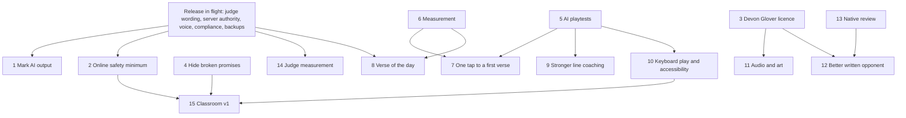

# Sonnet Man: what is next, against the state of the art

**Purpose.** To answer the owner's question directly: what is next, what is outstanding, and where the game can improve in every area, given what is built and the gaps against the game industry in November 2026.

**Audience.** David Charlot, owner and technical lead, first. Then the team (Devon Glover, "The Sonnet Man", creative director; Arrocito del Diablo, co-founder for game design and card mechanics) and future collaborators. It is written candidly for the owner. Edit it before an investor reads it.

**As of.** Commit `0d6df6ef` on `integrate/wave3`, plus the release in flight on 2026-11-19: `fix/judge-wording`, `fix/server-authority`, `fix/voice-g2p`, `fix/compliance`, the nightly database backup, and commits `ee2bf5ad` and `c22b035a` on `integrate/wave3` (`c22b035a` is the common base of all four release branches). Branch contents were re-read at 02:16 on 2026-11-19.

**Status.** Draft for the team, 2026-11-19.

**Related documents.** `sources/as-built-design.md`, `sources/as-built-tech.md`, `research/sota-design-2026-11.md`, `research/sota-production-2026-11.md`, `../research/card-games-landscape-2026-11.md`, `../research/in-browser-ai-2026-11.md`, `../research/xr-card-games-2026-11.md`, `17-operations-runbook-and-launch-checklist.md`, `27-glossary.md`, `28-owner-decisions.md`, and `05-systems-economy-and-balance.md` §7.1 for the release's economy (`docs/ECONOMY.md` is planned on `fix/server-authority` but was not yet written on 2026-11-19). The other numbered documents of this dossier treat each area at length; also `00-README.md` (index).

---

## How to read this document

**Every statement is one of four kinds.**

| Label | Meaning |
|---|---|
| **As built** | What the code at `0d6df6ef` does. Cited to a fact-base section or to `path:line`. Read from the code, not observed running, unless the fact base says otherwise. |
| **In this release** | Decided by the owner on 2026-11-19 and in flight on a named branch. Not yet deployed. Never described here as built. |
| **Proposed** | My recommendation, citing the research that supports it. Nothing labelled Proposed exists. |
| **Not known** | Nobody has established it. Each one is in the closing "Owner questions". |

**Citation keys.**

| Key | File |
|---|---|
| D §n | `sources/as-built-design.md`, section n |
| T §n | `sources/as-built-tech.md`, section n |
| SD §n | `research/sota-design-2026-11.md`, section n |
| SP §n | `research/sota-production-2026-11.md`, section n |
| CGL | `../research/card-games-landscape-2026-11.md` |
| IBA | `../research/in-browser-ai-2026-11.md` |
| XR | `../research/xr-card-games-2026-11.md` |

**Evidence marks.** The research marks each claim [V] (the page was read), [S] (search snippet or secondary source) or [U] (unverified). Research claims below are [V] in their source unless this document repeats an [S] or [U]. Every "Against Sonnet Man" or "For Sonnet Man" line in the research is the researcher's inference, and is treated here as such.

**Impact and effort.** Rough guides, not estimates.

| | High | Medium | Low |
|---|---|---|---|
| **Impact** | Changes whether people play, return, trust the game, or whether the company is exposed in law | Improves an experience people already have | Polish |
| **Effort** | More than a month, several outside people, or an open research risk | One to a few weeks, or one outside party (counsel, a reviewer, Devon Glover) | Days of one person's or agent's work, no outside party |

---

## The short answer

1. **The duel is the asset, and its rules are close to the state of the art.** Craft is checked by code, the judge compares in both orders, the verdict shows its working, the first duel needs no account, no cards and no download (As built: D §1.2, §1.7, §8). The 2026 evidence says these are the things that make a score feel fair (SD §2, §4).
2. **Almost everything around the duel is unfinished, and much of it promises what it does not do.** Credits, marketplace, referral, season pass, tournaments, story mode and the 3D viewer are partly built or stubs; house allegiance, streaks, weekly events and draft mode are dead code; the classroom tour promises progress tracking that does not exist and shows "FERPA compliant" (As built: D §3, §4, §10).
3. **The release in flight fixes the trust layer, not the game.** It makes the economy honest, restores the judge's measured wording, removes a GPL defect, adds credits and an AI notice, and starts backups (In this release). It does not give any of the half-built systems a reason to exist.
4. **Most players will never meet the AI the game is sold on.** Phones, tablets, headsets and small desktops are offered no model, so they always meet a bank of about 17 verses written in advance (drafted by a language model and checked by tools; who wrote the English bank is Not known) that never answers the player (As built: T §4.1; D §6.7). Web audiences are mostly on phones (SP §1.1).
5. **Nobody outside the team is recorded playing it.** No playtest, no analytics event and no match length exist on record (As built: T §9; Not known whether any playtest happened). The engineering is tested more thoroughly than most games; the design has not been tested on a player. Under the owner's rule of 2026-11-19, "AI is the playtester", the next step is AI players that see only the page and use only a player's controls (Proposed: section 16; ranked item 5).
6. **The brand is missing from the game.** Nothing of Devon Glover's own work is in it: no recording, verse, voice or music. The home page plays a track tagged "Horror Theme 1" by another artist, with no licence on record (As built: D §6.1, §7.3). In this release it is traced byte for byte to a CC0 track on OpenGameArt (`fix/compliance`, `docs/ASSETS.md`); it is still off-theme.
7. **Two legal items are urgent and outside the release.** Machine-readable marking of AI output under EU AI Act Article 50(2), which should be treated as due at this deploy: the transition to 2026-12-02 covers only systems on the market before 2026-08-02, and the in-browser models reached the public after that (SP §0, §5.4; `13-ai-design-and-system-cards.md` §7.2); and a written licence from Devon Glover for his name and persona, which the product is named after (SP §5.8). Whether a licence exists is Not known.
8. **The clearest opportunity is a daily, shared, explained duel with the real Sonnet Man in it.** A verse of the day is cheap because the seed already fixes the forms (D §1.2), daily rituals are the most proven retention loop in word games (SD §2, §5), and a real performer is what hip-hop audiences reward (SD §9). Classroom is the second opportunity, and the furthest from ready.
9. **Stop building systems that have no audience yet.** Hide what does not work until it has a job in the duel (decided by default on 2026-11-19: `28-owner-decisions.md` D-39), and put the next month into first-time play, measurement and the performer (Proposed; section "What to stop, cut or hide").

---

## The release in flight, and what it leaves open

| Owner decision (2026-11-19) | Where | What it closes | What it leaves open |
|---|---|---|---|
| Judge's compare wording back to `main`'s | `fix/judge-wording` (commit `3015897a`) | The integration's regression: in an A/B on the same code, `main`'s wording had 2 injection losses and 14 languages passing the judging bar, against 11 and 4 (T §4.2) | The measured language lists in `src/lib/brain.ts` stay at four judging languages until the 32 stale compare-path cells are measured again (commit message of `3015897a`). How many languages a model judges after the release is Not known. Ranking two decent verses is still untested (T §4.2). |
| Server-authoritative economy: fixed rates with daily caps, cards only from the server, leaderboard and tournaments only from server-judged matches, purchases that move credits and the card | `fix/server-authority` (commits `f661c4cc`, `3fa2c384`; migration `020_server_authority.sql`, additive; every rate in `backend/data/economy.json`; `docs/ECONOMY.md` not yet written) | Client-set credits, XP, stats and cards; free, card-copying purchases; a leaderboard of self-reported numbers (T §12, items 1 to 3). Season rewards become per-player claims, and byes go through when the bracket is drawn (commit message of `3fa2c384`; 05 §7.1) | Whether credits, the marketplace or tournaments have a job in the game (section 5). Signed out, the browser keeps its own collection for solo play, and a one-time import of at most 20 cards moves it into an account (`economy.json`; 05 §7.1). No test of the new economy is on record yet. |
| Nightly database backup, kept 14 days | Production backup job, restore-tested 2026-11-19 | No backup on record (T §10.4) | Monitoring, alerting and error reporting. Whether a copy leaves the production machine is Not known. |
| English voice without the GPL eSpeak NG dependency, rebuilt on the CMU dictionary | `fix/voice-g2p` (commits `21446923`, `35f43c22`): a new generated table of full CMU pronunciations from the same pinned cmudict commit, the public-domain NRL letter-to-sound rules for other words, and a build check that fails if eSpeak NG reaches `dist/` | GPL object code shipped under an Apache label inside `kokoro-js` (SP §3.4) | Kokoro-82M itself predates the owner's model-date rule (IBA §4). The voice is English only and off by default (D §7.4). |
| Compliance: a `/credits` page for CC BY-SA data, the EU AI Act Article 50(1) notice, privacy-policy wording, asset provenance | `fix/compliance` | Missing CC BY-SA attribution (T §11.2); no AI notice (the branch shows one of five sentences, in 16 languages, before the first duel); the policy's wrong cookie name and referral's "5 free packs"; provenance: two music tracks traced byte for byte to CC0 tracks, and the 3D figure to the owner's own pipeline (`docs/ASSETS.md` on the branch) | Article 50(2) machine-readable marking (SP §5.4); a Devon Glover licence; two music tracks and all 14 effects still untraced; account deletion (T §2.4); EU and UK representatives; the DPIA and Online Safety Act risk assessment are drafted (19 §4, 18 §9) but need counsel and sign-off (SP §5.3, §4.3) |
| (Carried by the integration line) Gemma 4 E2B writes Vietnamese | `integrate/wave3`, commit `ee2bf5ad` | Vietnamese duels on a capable desktop get a model-written opponent | 35 of 110 plays kept the form in full (32%, bar 30%): within one run's noise of the bar (commit message of `ee2bf5ad`) |

The production database had 0 accounts on 2026-11-19. Any change to accounts, cards or stats therefore migrates no player data; it also means online play will start with an empty pool.

---

## Where each area stands

| # | Area | Gap against the state of the art | Most valuable next move (Proposed) | Impact | Effort |
|---|---|---|---|---|---|
| 1 | Core design and cards | Medium: strong rules, thin cards | Give each card a choice that costs something; decide what The Sonnet Man card is | High | Medium |
| 2 | The duel and judging | Small on rules, medium on the model | A "stronger line" after each round; show the rules-only verdict beside the model's | High | Medium |
| 3 | AI quality and reach | Large on phones | A much better human-written opponent; stop leading with the AI | High | Medium |
| 4 | Onboarding and session length | Medium | One tap from the home page to a first verse; measure it | High | Low |
| 5 | Progression and economy | Large (purpose), small (honesty, after the release) | Earned-only credits; marketplace and referral off; collecting that unlocks play | Medium | Medium |
| 6 | Multiplayer and ranking | Large (no players, no rating) | The written opponent while waiting; later, asynchronous ghost duels and Glicko-2 | Medium | Medium |
| 7 | Social and sharing | Large | A verse of the day from a date seed, with a plain-text share | High | Low |
| 8 | Presentation | Large on audio and performer | Licensed, on-theme music; Devon Glover recorded, under contract | High | Medium |
| 9 | Languages | Breadth ahead; depth (native review) absent | Native review of the 28 open items; per-language machine-text notice | Medium | Medium |
| 10 | Accessibility | Large: the core duel cannot be played by keyboard (11 §1) | Keyboard-operable hand chips, keyboard menus, reduced motion, a live verdict, contrast audit, a statement | High | Low |
| 11 | Classroom | Very large | Remove false claims now; a seeded, teacher-hosted classroom v1 | High | High |
| 12 | Platform and distribution | Medium | Fix the sitemap; pre-render language landing pages; itch.io | Medium | Low |
| 13 | Trust and safety | Large for online play | Read reports, block and mute, keep teens from adult strangers | High | Medium |
| 14 | Law | Medium after the release | Article 50(2) marking; Devon Glover licence | High | Medium |
| 15 | Operations | Medium | Self-hosted analytics and error reporting; uptime alert; pinned weights | High | Low |
| 16 | Production process | Large on players, small on engineering | AI playtests on the build host; a decision log | High | Low to medium |

---

## Area by area

### 1. Core design and cards: the duel's rules are strong; the cards that feed it are thin

**State of the art.**
- Every option should cost something. Mega Crit rebuilt Slay the Spire 2's events so that no choice is a free pass-through, and Hearthstone's developers said "prescriptive" mechanics homogenised their meta (SD §1).
- Marvel Snap's designers target about three minutes a match; a top-quartile mobile session lasts about 5.2 minutes (SD §1).
- Players read new cards as progress. Shadowverse: Worlds Beyond's first set lifted daily revenue about 786%; Slay the Spire 2's testers rejected a smaller card pool ("We need new stuff!") (SD §1).
- A trailing player should keep deciding: Snap's doubling and Mega Crit's paid re-roll turn risk into a choice (SD §1; Snap's cheap retreat is [U]).
- For verse, the November landscape study recommended two layers: code checks the form, a model judges quality, and card effects hang on the code layer (CGL, "Implications").

**As built.**
- The two layers exist as recommended. Craft is code: form points out of 20, a multiplier of 1.00 to 2.25 from the house device, the character's signature and house synergy, +6 for two relic power words, and up to −12 for curse breaches. The judge shares 24 points over four criteria. A player's round tops out at 85 (D §1.3).
- 12 forms, all checked by code, 9 of them in an English duel (D §1.4). 13 devices, one per house; 4 curses; 9 relics (D §1.5).
- Ink is 2 at the start and +1 a round; each item costs 1 (D §1.2). Derived: a match yields at most 4 ink and a full deck holds at most 4 items, so in a three-round match ink limits the order of play, not the number of items. A match decided in two rounds allows at most 3 items, and all four fit only if a relic is kept for round 3, since potions cannot be played there (`duel.ts:363`).
- 53 characters share 13 devices. Within a house only the signature words differ (D §2).
- ATK, DEF, HP and element do nothing in a duel, yet are printed on every character (`src/pages/collection.astro:111,512`; D §1.3). Rarity sets only draw odds and the fanfare (D §2).
- The one Legendary character, The Sonnet Man, is in every new player's starter deck and free to every account online (D §10, item 6).
- The rebuild of 2026-11-16 followed the landscape study: form cards, conditional multipliers, curses, must-use words, ink, riposte, both-order judging, a legible verdict (D §9).
- No content has been added since the art of 2026-11-16 (D §7.2), and no season runs (D §4.7).

**The gap.** The rules engine is at or ahead of the field for a text duel. The cards are not: 53 characters play as 13, the stats are noise, items rarely force a trade-off, and there is no plan for new content.

**Opportunities (Proposed).**
1. Take ATK, DEF, HP and element off card faces until they mean something in a verse duel. Quick win; a decision for Arrocito del Diablo.
2. Give each character one condition of its own beyond its quote's words, checked by code in every language (a word class, a line position, a sound), so that choosing Hamlet over Horatio is a decision. SD §1 argues for devices code can check in any language, because 16 languages multiply every content cost.
3. Make items trade score against difficulty: a relic that adds a requirement as well as its reward; a potion that also binds its caster's next verse (SD §1, "every card should cost something").
4. A stakes move before round 3: raise (a larger judge pool) or bow out (lose by less) (SD §1).
5. Decide what The Sonnet Man card is: the face everyone plays, as now, or something earned. The original brief wanted a scarce 100-card tier (D §9). A question for the owner and for Devon Glover.
6. A content rhythm: each season adds forms, characters and relics (SD §1; card-game cadences in SP §6.5 are [S]). Note the hidden cost: any change to the shared rules needs the Rust port and the golden vectors regenerated before online play matches again (T §5).

| Impact | Effort | Depends on |
|---|---|---|
| High: card choice is what makes it a card game rather than a writing prompt | Medium: rules work plus parity work for every change | Arrocito del Diablo's design pass; balance data from section 15; golden-vector regeneration (T §5) |

### 2. The duel and judging: the verdict explains the rules half; the model's half has no reason

**State of the art.**
- Scores feel fair when the system says why. NYT's Cross Bot shows after a Crossplay game which moves would have scored more; Semantle shows a proximity rank and admits its model's blind spots; Duolingo's Explain My Answer names the rule, shows the learner's answer beside the right form, and is optional (SD §2, §4).
- Players turned against luck that felt arbitrary and slow (Pokémon TCG Pocket's coin flips). The research reads a judge that varies from run to run as the same risk (SD §1, inference).
- AI judges are beaten socially as well as technically. Where Winds Meet players won quest rewards by writing a parenthetical that claimed the task was done (SD §3, [S]). Benign framing wrappers flipped LLM jailbreak judges 57% to 100% of the time, and none of 11 open injection guards beat a five-regex baseline on both kinds of error at once (SP §4.1).
- A new kind of model returns a calibrated score and no text: Liquid d1-2B, a "decision model" released 2026-10-27, about 1.95 GB in the browser (SP §2.3).
- Nothing of value should rest on a model-only verdict (SD, finding 6).

**As built.**
- The verdict shows each side's craft breakdown, judge points, who took each criterion, and whether a model or the rules judged. A live checklist, computed by the scoring function itself, shows what the verse must do while the player writes (D §1.2).
- A model judges only where a capable desktop has loaded one listed for the duel's language: Gemma 4 E2B in en, ru, zh and id; LFM3 1.7B in vi. It asks each criterion in both orders, eight readings a round, so position bias cancels (D §1.7).
- The rule judge often cannot tell two verses apart. On `main`, its labelled-pair tallies (to the better verse / split / to the worse) are en 115/79/19 and zh 0/40/0, and today's judge is held only to be no worse (D §1.7, §10 item 4). Each split pays 3 and 3, so craft decides most rounds.
- Wit is always a split against the written opponent and in every round one (D §1.7).
- On the grade path, lines holding numbers or judge words are not read, and such a round goes to the rules (D §1.7; T §4.2).
- Not established: whether any model ranks two decent verses well, because every test pair sets a verse against a non-verse (T §4.2).
- Online, the server judges by rules only, recomputed by the browser every round (D §5.3).

**In this release (`fix/judge-wording`).** The compare wording goes back to `main`'s, word for word (commit `3015897a`). The judging lists in `brain.ts` change only after the stale cells are measured again; the result is Not known.

**The gap.** The rules half is explained as well as anything in the field. The model's half arrives as points with no reason. Nothing after a round shows the player a better line. Where the rule judge splits nearly everything, the judge adds little.

**Opportunities (Proposed).**
1. After each round, a "stronger line" from the code checks: which requirement missed, which device or signature word would have landed, which line broke the count (SD §2 Cross Bot; SD §4 Duolingo). This uses only what the engine already computes.
2. Wherever a model judges, show the rules-only verdict beside it, and publish each language's known limits in a paragraph (SD §2).
3. Improve the rule judge where it cannot discriminate, Chinese and German first, measured on labelled pairs (D §1.7).
4. Build labelled pairs of two decent verses per language, to learn whether the model judge beats the rules at all (T §4.2).
5. Prototype d1-2B as a judge: a score with no text channel to hijack (SP §2.3, §4). It was released after 2026-04-01 and is under the LFM Open License, with its US$10M ceiling (SP §5.10).
6. Red-team with benign framing and refusal prefixes, and keep those pairs in the gate (SP §4.1).
7. Keep anything of value off the model. Online already obeys this (D §5.3); keep it true for any daily leaderboard and for classroom scores.

| Impact | Effort | Depends on |
|---|---|---|
| High: fairness is the product claim, and coaching turns a loss into a lesson | Medium: items 1 and 2 are low; measurement and a new judge are medium | Re-measuring the judge-wording cells; the build host for model runs; parity regeneration for any online rule change |

### 3. AI quality and reach: most players will never meet the AI the game is sold on

**State of the art.**
- Publishers that shipped player-facing AI chose on-device models for latency and cost, and paid in reach: inZOI's Smart Zoi runs only on RTX GPUs (SD §3).
- Players reject AI that replaces human craft. Of 1,799 gamers surveyed in late 2025, 85% were negative on generative AI in games and 83% on AI-written dialogue; difficulty adjustment was the most accepted use (SD §3; the sample skews core and PC). On Steam, games that disclosed AI averaged 77% positive against 83%, with no causation shown (SD §3).
- An iPhone Safari tab is killed at about 2 GB (IBA §0). web.dev gives 5 MB as a rule of thumb for an in-page model (SP §2.2).
- Portal audiences are mostly mobile (SP §1.1).
- New options released after 2026-04-01: d1-2B (judge); Moonshine Streaming speech recognition per language (MIT, 2026-08-24); Granite Speech 5.0 470M (Apache, 2026-10-21); Kitten TTS 2 nano and pico (Apache, 2026-11-13, 4 to 17 MB a language, 8 languages, browser use not stated) (SP §2.3, §3).

**As built.**

| Tier | Model | Download | Writes the opponent in | Judges in | Offered to |
|---|---|---|---|---|---|
| grand | Gemma 4 E2B | 3,100 MB | 12 languages (13 in this release) | en ru zh id | WebGPU desktops with f16 shaders and 8 GB or more |
| standard | LFM3 1.7B | 1,090 MB | none | vi | the same desktops, as the "lighter download" |
| lite | LFM2.5 350M | 295 MB | none | none | nobody: used in no language |

Source: T §4.1; D §1.8.

- Phones, tablets, headsets and small desktops get no model (T §4.1). Wherever no model runs, the written opponent plays and the difficulty setting changes nothing (D §1.6).
- The written opponent in English is 17 verses over 8 forms, 17 spare verses for curses and 36 acrostic lines; the other languages have 14 to 20 verses and no spares. The seed picks them, so they are knowable. The register is mock-Early-Modern ("thou", "thy") with no hip-hop idiom (D §6.7).
- Model weights are not pinned to a revision, so a change on the hub reaches players unmeasured (T §4.1).
- 66 of 96 model-language cells are measured, one run each, on one machine (T §4.1, §12 item 6).
- A model draft that is void, or worth less than half the written verse, is replaced by the written verse (`src/lib/verse/opponent.ts:158-161`; D §1.6), and a verse under 60% words of the duel's language is thin and so void (D §1.3). Whether this catches every draft written in the wrong language was not measured (T §4.2 records Gemma answering in English in 9 of 100 Italian plays). Not known.
- Model release dates against the owner's post-2026-04-01 rule: Gemma 4, 2026-04-02 (SP §2.1); LFM3, 2026-10-27 (IBA §1.1); LFM2.5, before 2026-04-01 (IBA §1.1, date [U]); Whisper base, older (IBA §4); Kokoro-82M, 2025-01-27 (IBA §4). The ear, the voice and the never-offered lite model all predate the rule.

**In this release.** Gemma 4 E2B writes Vietnamese (`integrate/wave3`, commit `ee2bf5ad`). The English voice is rebuilt without eSpeak NG (`fix/voice-g2p`); the Kokoro model remains.

**The gap.** The home page says "duel an AI that runs in your browser" (D §3). On a phone the opponent is a short bank that never answers the player. The AI is a desktop feature behind a one-to-three-gigabyte download, and the speech models break the owner's own model-date rule.

**Opportunities (Proposed).**
1. Make the opponent most players meet far better without AI. Commission human-written banks per language and form, too large for a seed to exhaust; add verses that throw a word of the player's verse back, so wit is no longer a fixed split; write them in a voice Devon Glover approves (SD §2, NYT's "human-crafted"; SD §3; D §6.7).
2. Stop leading with the AI: "you write, the rules score it, a small model on your device can spar" (SD §3, "do not market the AI").
3. Pin every model to a revision (T §12, item 7). Quick win.
4. Finish the evaluation matrix, on more than one GPU and browser (T §4.2).
5. Watch for a phone-sized writer released after 2026-04-01. The research found none under about 1 GB (SP §2.3).
6. Spike the newer speech models in the browser: Moonshine Streaming and Granite Speech for input, Kitten TTS 2 for output, and measure the real-time factor on a mid-range Android phone and an iPhone, since nobody has published one (SP §3). Whether Whisper and Kokoro are accepted exceptions to the model-date rule is an owner question.
7. Offer the model after the first match and download it in the background, with Background Fetch where the browser has it (SP §2.2).

| Impact | Effort | Depends on |
|---|---|---|
| High: decides what most players actually meet | Medium for item 1 (writers per language); high for a phone model (research risk) | Devon Glover's approval of voice; writers per language (budget: owner question); the build host for evaluation |

### 4. Onboarding and session length: the first verse needs no download, but sits behind a detour

**State of the art.**
- Poki saw conversion-to-play rise from 50% to 72% when median load fell from 29.5 s to 3.7 s. It counts play from the first input, and asks for minimal menus and skippable intros (SD §4).
- In Poki's vendor survey of 2,000 US and UK web gamers, 46% had quit a mobile game because it was slow to open (SP §2.2).
- CrazyGames allows 20 MB before play to be featured on its mobile homepage (SP §1.1).
- Teach a writing game by having the player write one line with instant feedback (SD §4, inference).
- Benchmarks: mobile D1 median about 22%, top quartile above 30%; card games D1 18 to 19%, D7 6.5 to 7%, D28 about 3% (2024 data); for a web game, CrazyGames calls 10 to 15% D1 "strong" (SP §6.3, §1.1).
- A presented, skippable intro is a common practice and one the owner asks of his other games (SP §7.6, inference); on 2026-11-19 it was decided by default for this one too (`28-owner-decisions.md` D-40). Poki asks for intros to be skippable (SD §4).

**As built.**
- An age gate on every page except privacy, terms and about, before anything else (D §8).
- The home page's first button is "Enter the Playground" (`src/pages/index.astro:56`); the arena button is further down (`:192`). The playground's first-visit tour points at the starter pack and trivia before the arena (D §8).
- The battle page's set-up panel asks for deck, language, difficulty and the model offer, then "Play now without a download" (D §3, §8).
- The first duel needs no account, no cards and no model. This already meets the research's most important onboarding rule (D §8; SD, finding 2).
- No tutorial on the battle page; the form's brief, the live checklist and the verdict teach in play (D §8). No intro is presented (D §6.1).
- An English duel against the written opponent fetches 7.79 MB (5.92 MB gzip); a Japanese duel started at once waits 5 to 5.7 s for its dictionary on a throttled phone (T §8).
- No clock in solo play (D §1.2). Read from the code, not observed: the battle page stores only the duel language and the model choice (`src/pages/battle.astro:336,385,488`) and `session.ts` stores nothing, so a reload loses a duel in progress.
- Match length, first-session length and retention: Not known. No analytics event is called (T §9), and no playtest, human or AI, is on record.

**The gap.** The hard part, keeping the model off the critical path, is done. The soft part, getting a visitor to type a first line within seconds, is not, and nothing measures it.

**Opportunities (Proposed).**
1. One tap to a first verse: the home page's first button starts a duel with the starter deck, the interface language and the written opponent; the set-up panel becomes "change" links (SD §4; SP §2.2).
2. Scaffold the first line: "finish this couplet; it must rhyme with *night*", with the live checklist lighting as the player types (SD §4).
3. A presented, skippable intro, made from the game's own duel, with Devon Glover's own recorded performance added if he agrees (Proposed; SP §7.6; SD §9; `28-owner-decisions.md` D-40). His part depends on his licence.
4. Ask counsel whether the age gate must come before a solo duel that collects nothing, and gate accounts, online play and analytics instead. The amended COPPA rule wants a neutral age screen before any collection, and page analytics collect an IP address (SP §5.1). Do not change it without that review.
5. Keep a solo duel across a reload, and let it resume (SD §1, "matches that resume").
6. Measure the funnel: landing, first verse submitted, first duel completed, model accepted, second session (SP §6.3). Before launch, the AI playtests give its first values: time to a first valid verse, voids, and where first-time AI players stall (section 16; `15-qa-and-test-plan.md` §8).
7. Start from web-realistic targets: D1 of 10 to 15%, then the card-genre figures (SP §6.3).

| Impact | Effort | Depends on |
|---|---|---|
| High: the first minute decides whether there is a second | Low for items 1, 2, 5 and 6; medium for the intro | AI playtests (section 16); measurement (section 15); Devon Glover for his part of the intro; counsel for the gate |

### 5. Progression and economy: honest after the release, still without a job

**State of the art.**
- Currency that can only be earned falls outside the EU CPC key principles. Bought currency brings real-money prices on every item, a 14-day right to withdraw from buying unused currency, and spending switched off by default in any game not only for adults (SD §7; SP §5.7 could not open the text, [U]).
- Never sell random packs: from June 2026 PEGI rates paid random items 16, and Korea fined a publisher for odds that differed from the stated ones (SP §5.6; SD §7).
- Seasons are moving to rewards that do not expire and to catch-up (SD §7; Marvel Rivals' policy is [S]).
- Forgiving streaks: seven studies found a repairable streak softens the drop after a break (SD §5); Duolingo's one-off revival brought back 15.4M streaks (SD §5, [S]). PEGI rates log-in streaks 7, or 12 if rewards are lost for not returning (SP §5.6). Vermont's design code imposes a duty of care against compulsive use from 2027-01-01 (SP §5.2).
- 92% of studios under ten people run daily rewards or missions (SP §6.5).
- A collection economy lives on new sets: Pokémon TCG Pocket's second year fell 68% (SD §7).

**As built.**
- Cards are the only working reward, and they live in the browser. Live sources: the starter pack (3), the daily pack (one card a day), trivia (one card per round won, no limit), quote challenges (one per correct answer, no limit), and a won solo match on `/battle` (one). Wins in the Theatre and online pay nothing (D §4.3).
- Duplicates have no use (D §4.2). Free draws are random by rarity, with the odds shown (D §4.2). They are not sold.
- Credits exist only on the server; no page earns or spends them; the server let a client name its own amount (D §4.6; T §12, item 1).
- A marketplace purchase moved no credits and copied the card (D §4.9). Referral grants nothing and promises "5 free packs" (D §4.10). The season pass earns no XP from play, has no season seeded, and its first claimant claims a level for everyone (D §4.7). Tournament results are self-reported and no match can be played from the site (D §4.8). Streaks, weekly events, draft mode and house allegiance are dead code (D §4.11).
- Achievements give nothing. "Battle wins" count rounds; "Completionist" says 48 cards when there are 71; "Relic Hunter" checks any 15 cards (D §4.5).
- The About page promises credit amounts that nothing pays (D §4.6).

**In this release (`fix/server-authority`; rates in `backend/data/economy.json`, detailed in 05 §7.1; `docs/ECONOMY.md` not yet written).** Fixed rates with daily caps; cards only from the server; the leaderboard and tournaments only from server-judged matches; purchases that move credits and the card.

**The gap.** After the release the economy will be honest. It will still not be useful. A card adds little to a deck, credits buy nothing worth having, the marketplace trades cards anyone can win for free, and the marketplace and referral are the features a children's privacy review looks at first (SD §6, §7).

**Opportunities (Proposed).**
1. Write down that credits are earned only and never sold, and that packs are never sold (SD, finding 9; SD §7). If that ever changes, follow the CPC principles and switch spending off by default for minors.
2. Switch the marketplace and referral off for teen and classroom accounts now, and hide them for everyone until trading has a purpose (SD §7; SP §5.7).
3. Give collecting a job in the duel: cards that unlock forms and devices, house sets completed by play, a teacher's class code that unlocks a set (CGL, Implication 11).
4. A forgiving daily streak tied to the verse of the day (section 7): freezes and repair, no reward lost for absence, no notifications to minors at night (SD §5; SP §5.2, §5.6).
5. Wire the season pass only on top of the server-authoritative economy, with rewards that never expire and claims per player, or remove the page (SD §7; D §4.7).
6. Fix the achievement counters and texts (D §4.5). Quick win.
7. Revenue is Not known. The research could not reach school licence prices, grants, performer merchandise or live events (SD §7, gaps). Direction: school licences, education and arts grants, and recurring supporters; never ads, never random packs (SD §7; XR §8, "Funding fit").

| Impact | Effort | Depends on |
|---|---|---|
| Medium: matters once people return; lowers legal risk now | Medium | `fix/server-authority` landing; counsel before any sale; Arrocito del Diablo on unlocks |

### 6. Multiplayer and ranking: a careful live engine with nobody to play

**State of the art.**
- Small games give everyone an opponent asynchronously: Backpack Battles sells duels against other players' recorded builds, "at your own pace" (SD §5).
- Bots that fill queues are tolerated when labelled; bots passed off as people were called "deceitful" (SD §4; the Marvel Rivals reports are [S]).
- A small pool needs rating uncertainty, not strict skill matching. Glicko-2 starts at 1500 with a deviation of 350, and the Rust crate `skillratings` implements it (SP §6.3). Clash Royale's symmetric steps and soft resets keep seasons fresh (SD §4).
- NYT's Crossplay (2026-01-21) pairs a computer opponent, skill matching, in-match chat and post-game analysis (SD §5).

**As built.**
- Quick match is a first-come queue with no rating; a private room is shared by link; online play is English only and scored on the server by rules; the browser re-checks every round; about 35,000 golden cases hold the two engines together (D §5; T §5).
- No relics, potions or ink online (D §1.9).
- Nothing about a match is stored, and no rating exists; the leaderboard ranked self-reported solo rounds (D §5.6).
- No chat, friend list, block or mute; a teen account can be paired with any adult stranger; reports are stored and never read (D §5.7).
- Rooms live in memory in one API process, so a deploy or crash ends every live match (T §1.2).
- English only, because the other 15 languages rely on sound tables, a Japanese analyser and the browser's word segmenter, which the Rust server cannot reproduce exactly (T §5).
- Production had 0 accounts on 2026-11-19.

**In this release (`fix/server-authority`).** The leaderboard and tournaments are fed only by server-judged matches.

**The gap.** Technically careful, socially empty. Inference from an empty pool and a first-come queue: at launch most quick matches will wait three minutes and give up. Ranking does not exist yet.

**Opportunities (Proposed).**
1. While a player waits, offer the written opponent, plainly labelled; never pass it off as a person (SD §4). Quick win.
2. Asynchronous "ghost" duels: a server-judged duel against another player's recorded verses (SD §5). This needs stored verses, which today's two-minute privacy promise forbids (D §5.7), plus consent and moderation (section 13).
3. A Glicko-2 rating through `skillratings`, shown with its uncertainty (SP §6.3).
4. Keep teens out of open quick match with adults: teen-with-teen pairing, or private rooms only (SP §4.3, §5.3; SD §7).
5. Relics and potions online, now that the economy is moving to the server.
6. One verse engine for both sides (see "Larger bets"): it would end parity work and open online play in all 16 languages.

| Impact | Effort | Depends on |
|---|---|---|
| Medium now, high once there is an audience | Medium for items 1, 3 and 4; high for ghosts | Sections 13 and 14; the release; a privacy-policy change for stored verses |

### 7. Social and sharing: no daily ritual and no share, and the seed makes both cheap

**State of the art.**
- NYT Games puzzles were played 11.2 billion times in 2025; LinkedIn says 84% of players return the day after their first game (company figure, undated) (SD §2).
- The Wordle grid worked because it was spoiler-free plain text about a puzzle everyone faced that day (SD §5, [S]).
- NYT added a yearly recap of each player's games (SD §5).
- Crossplay launched with Grammy-nominated musicians challenging fans and a three-week contest (SD §5).
- Discord Activities and Reddit reward daily loops but limit networking and model downloads (SD §5; SP §1.1).

**As built.**
- No sharing: `src/lib/social-share.ts` has no importer and no page calls the Web Share API (D §5.8).
- The "daily pack" is one card every 24 hours (D §4.3). There is no shared daily duel.
- The seed fixes a duel's forms and the written opponent's verses, and the page says so: "The same seed and deck draw the same forms" (D §1.2).
- The footer links to Devon Glover's own channels (D §5.8).

**The gap.** The game lacks the most proven retention loop in word games, though its engine already holds the key part.

**Opportunities (Proposed).**
1. A verse of the day: a seed from the date and the starter deck, so everyone in every language faces the same forms and the same opponent verses (SD §2, §5).
2. A plain-text share: the forms, the round results, a short excerpt of the player's own verse if the player chooses, and a link (SD §5). A solo verse still leaves the device only when its writer shares it.
3. A daily leaderboard only when the server scores it (SD, finding 6).
4. A "beat the Sonnet Man" challenge timed to Devon Glover's public dates, with his agreement (SD §9; his 2026 calendar in SD §9 is drawn from listings).
5. A yearly "Year in Verse" recap, later (SD §5).
6. A Discord Activity spike: map the API and model files through Discord's proxy and test large downloads (SP §1).

| Impact | Effort | Depends on |
|---|---|---|
| High: the cheapest proven reason to come back tomorrow | Low for items 1 and 2 | Measurement (section 15); the server economy for item 3; Devon Glover for item 4; the streak rules in section 5 |

### 8. Presentation: the art is new and bold; the sound is borrowed; the performer is absent

**State of the art.**
- Restraint and timing: effects that reward an outcome (Balatro's burning score) read as feel; effects that block the next input (Pokémon TCG Pocket's flip chains) read as friction (SD §9). One effect per input within about 100 ms (SD §4).
- Art polish did not gate a design-led card game: Slay the Spire 2 sold an estimated 7M units with placeholder art kept on purpose (SD §9; the placeholder quote is [S]).
- Hip-hop audiences reward real artists and test for fakery; a trailer that looked AI-made drew scepticism for OnlyHands (SD §9).
- Arc Raiders re-recorded AI voice lines with actors after a 2/5 review (SD §3, [S]). The 2025 SAG-AFTRA agreement requires clear, separate, use-specific consent for any digital replica (SD §9).

**As built.**
- 71 card paintings made 2026-11-16 with FLUX 3 Image Klein, one art tradition per house. The owner's record lists flaws: Juliet cast as East Asian and painted white, painted labels on two potions, Capulet borders, Medusa's victims. Viewing six images found three more: an unnamed blade in Hamlet's hand, rounded corners on Zeus, letter-like glyphs in Witches' Brew (D §7.2).
- 198 variant images are orphaned and in an older, photoreal style (D §7.2).
- 3D: one point-cloud GLB and one splat, both of The Sonnet Man; 17 of 18 configured GLBs and 52 of 53 splats are missing (D §7.6). The Theatre stage has no characters (D §7.5).
- Music: four tracks with no licence on record. The home page plays one tagged "Horror Theme 1" by another artist; the battle plays one tagged "The Cynic Project" (D §7.3). 14 effects with no recorded source; two are never played.
- Voice: one British male English voice, off by default; no recorded voices (D §7.4).
- Nothing of Devon Glover's own work is in the game (D §6.1).
- The game calls itself both "the duel of verses" and a "rap battle" (D §6.10).
- Dark theme only (D §7.7).

**In this release.** `fix/compliance` records asset provenance; `fix/voice-g2p` rebuilds the English voice's pronunciation step.

**The gap.** What would set Sonnet Man apart, a real performer-educator who turns Shakespeare into hip-hop, is not in anything a player sees or hears, and the audio is off-theme and may not be licensed.

**Opportunities (Proposed).**
1. Replace the four tracks and the effects with sources whose licences are on file. Prefer music by Devon Glover or chosen with him, if he agrees. AI-made music would cut against the authenticity evidence (SD §3, §9).
2. Record Devon Glover: the intro, a line per house, and after-round "model answers" in his recite-then-remix method, which the NEH profile describes (SD §9). Only under a written agreement (SP §5.8). Never synthesise his voice.
3. One strong, skippable effect at the verdict, and nothing that blocks the next round (SD §9).
4. Fix the listed art flaws, with a person checking every image before it ships, as the pipeline's own rule says (`scripts/art/gen_cards.py:9`; D §7.2).
5. Hide the 3D viewer, the AR buttons and the VR gallery's "your collection" claim until the assets exist (D §7.6). The phone "card comes alive" moment is a later bet (XR §8).
6. Choose one name, verse duel or rap battle, with Devon Glover.
7. Brand imagery for the store page, the pitch and key art follows the owner's standing rule: the central people are Black, of Haitian descent, by default. That rule never applies to depicting Devon Glover, who is a real person: use real photographs of him, with his consent. Whether the SM-001 painting is meant to depict him is Not known (D §6.1).
8. A light theme and reduced motion (section 10).

| Impact | Effort | Depends on |
|---|---|---|
| High: the brand is the only thing no competitor can copy | Medium: licensing and recording sessions | Devon Glover's licence and time; music licences; `fix/compliance` provenance findings |

### 9. Languages: breadth ahead of the industry, with no native ear anywhere

**State of the art.**
- Players punish bad or undisclosed translation, one language at a time: Silksong's Simplified Chinese reviews, The Alters' undisclosed AI text (SD §8, [S]).
- Each verse tradition counts its own unit, and hyphenation is not scansion. Open test oracles exist: Qawafi for Arabic, Rantanplan for Spanish (SD §8; Rantanplan's accuracy figures are [S]).
- Right-to-left layouts must mirror; Chinese, Japanese and Korean fonts must be sliced to fit a phone (SD §8).
- The owner's rule: language data from authoritative sources, never one model's unchecked output.

**As built.**
- 16 interface languages, except multiplayer, privacy and terms, which are English (D §8). 16 duel packs with 8 to 11 forms each (D §1.4).
- Sound data measured against published verse: Spanish 42 of 43 rhyme pairs, Russian 47 of 48, Chinese 46 of 49, Vietnamese 56 of 60 (T §6.2).
- Data from CLDR, Wikidata, Wiktionary, kaikki.org, WikiPron, Unihan, CC-CEDICT, JMdict and Wikisource, each generated file pinned to its source by sha256 (T §6.3).
- Card lines come from public-domain translations where one was found, with the translator's death year unit-tested: fr 51, it 51, de 50, ru 34, es 29, pl 28, ja 13, pt 6, and none in ar, hi, zh, ko, vi, th and id, where all 71 lines were written for the game (D §6.4).
- Trivia, story and playground text were translated by a language model, one pass per language, then checked by tools and a second model; five languages have no grammar checker; no native speaker has read any string, verse, name or scene (D §6.4; T §6.4). `docs/language/HUMAN-REVIEW.md` lists 28 open items.
- Arabic and Thai have no syllable forms (T §6.5).
- Fonts ship Latin subsets that miss most Vietnamese tone-marked letters (D §7.7).
- Speech recognition outside English is untested (D §8).
- Whether players are told, in the game, that text is machine-made: the fact bases record no such notice. Not known.

**The gap.** The game already does what the research says matters: per-language forms, sourced data, recorded provenance. It lacks the one check players apply: a native reader.

**Opportunities (Proposed).**
1. Native review: the 28 HUMAN-REVIEW items first, then the written opponent's verses, then trivia. Choose languages by audience, which is Not known (T §6.4; SD §8).
2. A one-line notice, in each language, where text was machine-translated, with a "report this text" link (SD §8).
3. Add the Vietnamese letters to the font subset (D §7.7). Quick win.
4. Use Rantanplan as a build-time oracle for Spanish scansion. Check which parts of Qawafi are trained models before relying on it, under the owner's model-date rule (SD §8).
5. Native forms per language, each with counting rules taken from a cited source (SD §8 marks every rule in its table [U] until sourced; CGL, Implication 12).
6. Online play in more languages: see section 6 and "Larger bets".

| Impact | Effort | Depends on |
|---|---|---|
| Medium: protects reputation in 15 markets | Medium: needs people who read each language | Reviewers per language (budget: owner question); choice of launch languages |

### 10. Accessibility: a text game that should be easy to make fully accessible, with basic failures

**State of the art.**
- US public schools and the vendor tools they use must meet WCAG 2.1 AA from 26 April 2027 (entities of 50,000 people or more) and 26 April 2028 (smaller ones) (SD §6, §8).
- The European Accessibility Act exempts microenterprises; build account and payment flows to WCAG 2.2 AA anyway (SP §5.5).
- Native screen-reader play is an open lane: blind players still reach digital card games through fan mods (SD §8; the mod details are [S]).
- Apple's nine Accessibility Nutrition Label features make a useful checklist: VoiceOver, Voice Control, Larger Text, Dark Interface, Differentiate Without Color Alone, Sufficient Contrast, Reduced Motion, Captions, Audio Descriptions (SD §8).
- A 2026 meta-analysis found no reliable effect from "dyslexia fonts" (SD §8).
- Canvas scenes need a parallel DOM for assistive technology (SD §8, [S]).

**As built.**
- Good: a labelled verse box; `aria-pressed` on the microphone; a status note on the language picker; typing and speaking offered side by side; no clock in solo play; the spoken verse is also on screen; Arabic right-to-left layout tested (D §8).
- Failures: **the core duel cannot be played by keyboard**: the hand chips a player must choose each round are `div`s with click handlers, no `tabindex` and no key handler, and submit is refused until a character is chosen (`battle.astro:283-301,707-736`; 11 §1, read from the code, not tested); the desktop Play and Explore menus open on hover only; no `prefers-reduced-motion` while animations run on every page; the verdict has no `aria-live`; contrast is unmeasured, with small grey text on near-black; only a mute toggle, though volume setters exist; two modals lack a dialog role; the Theatre is a canvas; online rounds are fixed at 180 s (D §8, §7.3, §5.2).
- No accessibility statement or conformance report is on record.

**The gap.** A verse duel is mostly text and state, the easiest kind of game to make fully accessible, and it fails on the basics.

**Opportunities (Proposed).**
1. Quick fixes: hand chips that take focus and answer Enter and Space, so a keyboard-only player can finish a duel (first, P0 in 11); menus that open from the keyboard; reduced motion; a live region for the verdict; dialog roles; volume sliders; a contrast audit and fixes; a check at 200% text size (SD §8; D §8).
2. A screen-reader-first duel, tested with VoiceOver, TalkBack and NVDA: one polite live region, focus moved for urgent events (SD §8).
3. An accessibility statement and a WCAG 2.1 AA conformance report, naming the flat battle page as the accessible equivalent of the Theatre (SD §6, §8; SP §7.22).
4. An online timer the player can extend (SD §8).
5. Do not headline a dyslexia font (SD §8).

| Impact | Effort | Depends on |
|---|---|---|
| High: required by schools, and a real lead in the genre | Low for item 1; medium for items 2 and 3 | Nothing outside the team for item 1; for item 2, the AI playtests' keyboard and screen-reader-text runs (section 16; `15-qa-and-test-plan.md` §8.1) and the team's own checks with VoiceOver, TalkBack and NVDA |

### 11. Classroom: a roster with promises it does not keep

**State of the art.**
- Teachers' game minutes go to teacher-hosted, live, short, quiz-shaped tools: Kahoot!, Blooket, Wayground, Gimkit (SD §6).
- Procurement needs single sign-on (Clever reaches 60% of US students monthly), an LTI 1.3 link for Canvas, a privacy certification (held by 45% of the top 40 tools) and WCAG 2.1 AA (SD §6).
- Under COPPA a school may consent for its pupils only when the data serves the school and no other commercial purpose. A written security program and a written retention policy have been required since 2026-04-22 (SP §5.1).
- England's Department for Education says pupils' work must not train generative AI without permission (SD §6).
- Shakespeare is required in the US Common Core (RL.11-12.7, RL.11-12.4, RL.9-10.9) and in England's GCSE, whose 2025 review leans toward speaking and performance (SD §6).
- Teachers trust AI least for grading and feedback (SD §6). An AI that evaluates learning outcomes may become high-risk under the EU AI Act from 2027-12-02 (SP §5.4).
- The programmes that reach pupils run on teacher training and recitation: the Folger reaches more than two million teachers and students a year; Poetry Out Loud more than 4.6 million students since 2005 (SD §6).
- For children, offer menus rather than free text (Apple's Lil Artist example, SP §2.5).

**As built.**
- `/classroom` is not in the navigation. A teacher creates a class with a join code, students join, and the teacher posts assignment titles (D §3, §4.13).
- No completion, score or progress is recorded, and nothing links an assignment to a game. Yet the tour promises "See what each student has completed, their scores and the cards they have earned" and shows "FERPA compliant" (`src/i18n/pages/classroom/en.ts:78,80`), while the About page says classroom mode stores no grades (D §3, §4.13).
- The age gate blocks everyone under 13 on every page except privacy, terms and about (D §8), so no pupil under 13 can use classroom mode.
- Student accounts reach the same credits, marketplace and referral routes as anyone (D §4).
- A solo verse never leaves the device (T §1.6). The research calls this a real advantage that no procurement checklist yet rewards (SD §6).
- Devon Glover reaches schools in person: more than 600 students and 60 teachers in one Omaha visit, by the NEH profile (SD §6).

**The gap.** The furthest of any area from the state of the art. The "FERPA compliant" claim has nothing on record behind it.

**Opportunities (Proposed).**
1. Remove the "FERPA compliant" badge and the progress promise until they are true. Quick win.
2. Classroom v1: a seeded assignment so the class duels the same forms; completion recorded without storing verse text; a projected, teacher-hosted "class versus the Sonnet Man" round in ten-minute blocks; credits, marketplace and referral off for students; a standards map; a school pack with a data agreement, privacy summary, accessibility statement and a "scores are formative, not grades" statement (SD §6; SP §5.4, §7.22).
3. A teacher override on the judge (SD §6).
4. Later: Clever and ClassLink rostering, an LTI 1.3 launch (Google sign-in is excluded by the owner's 2026-11-16 direction, "No passwords, no Google"; ADR 0009), a privacy certification, an ESSA Level IV logic model and then a small study with a partner school (SD §6).
5. Pupils under 13 only through school consent, with the COPPA written program and retention policy in place (SP §5.1).
6. A pilot through Devon Glover's school circuit, if he agrees.

| Impact | Effort | Depends on |
|---|---|---|
| High: the channel most specific to this game | High: product, legal and procurement work | Sections 10, 13 and 14; the server economy; Devon Glover's school contacts |

### 12. Platform and distribution: the own domain is the right channel, but it is not ready to be found

**State of the art.**
- The big portals conflict with the full game. Poki bans personal data, accounts and chat, pays in ads and wants five-year web exclusivity; CrazyGames bans external login and pays only through its ads; YouTube Playables bans external calls (SP §1.1).
- The card leaders on portals are solitaire and UNO-style games (SD §1).
- Secondary channels that fit: itch.io (0% revenue share possible, 200 MB a file), a Discord Activity (WebSockets work, WebRTC does not) and a Telegram Mini App (SP §1.1).
- Google Play through a Trusted Web Activity suits teens and adults if the app has an in-app report for AI output and is not listed for children. Apple is the riskiest store: its "more than a repackaged website" rule, a size prompt for large downloads, and unproven WebGPU in its web view (SP §1.2).
- Search: pre-render each language's landing page with reciprocal `hreflang` and `x-default`, never redirect by guessed language, and keep Core Web Vitals green (SP §1.3).

**As built.**
- A static site and an installable PWA with an offline page and two shortcuts, battle and theatre (D §3; T §1.5).
- The sitemap lists `/trivia/` and `/challenges/`, which do not exist, leaves out the Theatre, world map, viewer and VR gallery, and dates every entry 2026-02-16 (D §3).
- No `hreflang` anywhere in `src` (grep). The interface language is chosen in the browser from storage, then the browser's languages (D §8).
- WebXR Theatre for Quest 3 and Vision Pro, tested only under an emulated Quest 3 (D §9).
- No store listing.

**Opportunities (Proposed).**
1. Fix the sitemap. Quick win.
2. Pre-render one landing page per language with `hreflang` (SP §1.3).
3. An itch.io page; a Discord Activity spike (SP §1).
4. A Google Play build for teens and adults once an AI-output report control exists; defer Apple (SP §1.2).
5. From Android in-app browsers, offer "open in your browser" until they are tested (SP §2.3).
6. Devon Glover's live circuit as the first channel, if he agrees (SD §1, §9).

| Impact | Effort | Depends on |
|---|---|---|
| Medium: no channel helps until first play and return are good | Low for items 1 and 3; medium for 2 and 4 | Sections 4, 7 and 13 |

### 13. Trust and safety: a word list and an unread inbox

**State of the art.**
- Verses shown to other players make the game a user-to-user service. The UK Online Safety Act's duties (risk assessment, reporting, takedown) scale with size but have no small-business exemption; the EU Digital Services Act's notice-and-action and statement-of-reasons duties apply at any size (SP §0, §4.3).
- The proportionate minimum: a written risk assessment, a report control on every verse and player, a named responsible person, a takedown process, statements of reasons, block and mute, NCMEC registration and plain rules (SP §4, "For Sonnet Man").
- Design risk out for children: no free messaging, preset names, private by default (SP §4).
- Layered moderation: a word list first, then content-safety-guard-small (Apache, 2026-09-27, 268 MB, runs in Transformers.js; its own card says not to rely on it alone for child safety), then a contact-details classifier (Roblox PII v2, 2026-08-03), with people reviewing child-safety flags (SP §4.2).
- California SB 243 excludes a game bot only if it cannot discuss mental health, self-harm or sexual content and keeps to the game (SP §5.2).
- Tech Coalition Pathways is free for startups (SP §4.3).

**As built.**
- Online: a 20-entry English word filter; reports stored and never read; no block, mute or chat; generated usernames; a teen can meet an adult stranger; matches are not stored, and verses leave memory within two minutes (D §5.7; T §2.3).
- Solo verses never leave the device and are never checked (D §5.7).
- The model opponent is prompted in character with the player's last verse passed as data (D §1.6). The fact bases record no topic guard on its output. Not known whether one exists.
- Gemma's model card asks deployers for content-safety safeguards (T §11.1).

**The gap.** The legal minimum for user-to-user content is not met, and children can meet strangers.

**Opportunities (Proposed).**
1. Before inviting the public online: a view that reads and acts on reports; block and mute; teens kept from adult strangers; community rules; a statement-of-reasons template; a written risk assessment; NCMEC registration and a runbook (SP §4).
2. content-safety-guard-small behind the word filter for online verses, with people reviewing child-safety flags (SP §4.2). Where it runs is an owner decision (18 §5.3; `28-owner-decisions.md`): on the company's own server, where it cannot be bypassed and covers phones, but which needs an explicit exception to "no server does inference" (ADR 0001); or in the receiving player's browser (it runs in Transformers.js), inside the rule but a 268 MB download that phones cannot take.
3. Guard the model opponent: run the classifier on each draft and treat a flagged draft as void, so the existing fallback plays the written verse (D §1.6; SP §4.2, §5.2).
4. Join Tech Coalition Pathways (SP §4.3).

| Impact | Effort | Depends on |
|---|---|---|
| High: legal exposure and children's safety | Medium | Counsel; a named responsible person; the release's account changes |

### 14. Law: the release closes several gaps; two urgent items remain

This section summarises research, not legal advice. Counsel should review every item.

**State of the art (SP §5).**
- EU AI Act Article 50(1): tell people they are dealing with an AI at first interaction (since 2026-08-02). Article 50(2): mark AI text and audio in a machine-readable way, with a transition to 2026-12-02 for systems on the market before 2026-08-02 (SP §0, §5.4).
- Amended COPPA: a written security program, a written retention policy, a neutral age screen, separate consent for third-party disclosure, and a notice naming the internal operations behind persistent identifiers (SP §5.1).
- Teen privacy: New York's Child Data Protection Act, Connecticut's minors' provisions (the most likely to apply), Vermont's design code from 2027-01-01 with no revenue threshold (SP §5.2).
- GDPR and UK GDPR: EU and UK representatives for a non-EU controller whose processing is not occasional; a DPIA under the UK Children's code (SP §5.3).
- Right of publicity: New York Civil Rights Law §51 requires written consent to use a person's name, likeness or voice in trade; New York General Obligations Law §5-302 and California Labor Code §927 void vague digital-replica clauses where the performer had no counsel or union cover (SP §5.8).
- Open data: credit CC BY-SA sources and ship Wiktionary-derived lists as separate data files; serve each model's licence beside its weights; plan for Liquid's US$10M ceiling (SP §5.10).
- Folger texts are non-commercial only; each translation carries its own term (SP §5.9).

**As built.**
- Privacy and terms pages in English only, dated 2026-11-16 (D §3).
- An age gate in the browser: under 13 blocked, 13 to 17 with a parental-consent checkbox; nothing verifies age (D §8; T §3.6).
- No account-deletion endpoint; deletion on request, with some tables lacking cascading deletes (T §2.4).
- No CC BY-SA credit on the site (T §11.2). A GPL component inside the voice (SP §3.4).
- The policy names the session cookie without its secure prefix (T §12, item 24).
- The LFM licence threshold confirmed on 2026-11-17 (T §11.1).
- Card lines only from translators who died in 1955 or earlier, unit-tested (D §6.4).
- No licence on record for the music, the effects or the 3D files; the FLUX Kommunity License terms are not saved (T §11.3).
- No record of a licence or approval from Devon Glover (D §6.1). The product, the persona card and the home-page badge use his name and his programme's name.

**In this release.** `fix/compliance`: the `/credits` page, the Article 50(1) notice, privacy wording and asset provenance. `fix/voice-g2p`: eSpeak NG out of the voice.

**Still open after the release (Proposed).**
1. **Article 50(2) marking.** Mark AI-written verses and synthetic speech in a machine-readable way, for example as metadata on the verse element and on any shared or exported verse, and write down the method. Due by 2026-12-02 at the latest if the AI features were on the market before 2026-08-02, otherwise due now (SP §5.4). The in-browser models reached the public on 2026-11-16 at the earliest, so plan as if it is due at this deploy (`13-ai-design-and-system-cards.md` §7.2). Counsel to confirm the studio is a "provider".
2. **Devon Glover licence.** Name, "The Sonnet Man", likeness and voice, with every AI use described specifically, his own counsel, his approvals and a kill switch (SP §5.8, which lists twelve clauses).
3. **Teen privacy review** against Connecticut, New York and Vermont (by 2027-01-01): high-privacy defaults, no night notifications to minors, no design that extends use compulsively (SP §5.2).
4. **EU and UK representatives; the DPIA and the Online Safety Act risk assessment are drafted** (19 §4; 18 §9) **and need counsel's review and sign-off** (SP §5.3, §4.3).
5. **Self-service account deletion** (T §2.4; required by Apple for any store build, SP §1.2).
6. **The COPPA pack** before any pupil under 13 is admitted (SP §5.1).
7. **Music and effects**: two tracks are traced to CC0 sources in this release (`fix/compliance`, `docs/ASSETS.md`); licence or replace the other two tracks and all 14 effects (D §7.3).
8. **The cookie name** in the policy: corrected in this release (`fix/compliance`, commit `2df321b1`, which names `__Host-im_token` and `__Host-im_code`).
9. **Trademarks** "Sonnet Man" and "Inspired Mile": status Not known (SP §5.8 lists marks in the licence grant).
10. **Shakespeare texts**: confirm no Folger text ships. Not known.

| Impact | Effort | Depends on |
|---|---|---|
| High: dated duties and the brand's foundation | Medium: mostly writing, counsel and one negotiation | Counsel; Devon Glover and his counsel; `fix/compliance` |

### 15. Operations: backups are in; the game still runs blind

**State of the art.**
- Self-hosted, cookieless product analytics with funnels and retention: Umami (MIT) on the Postgres already in place. Errors: GlitchTip (MIT, about 512 MB of memory) fed by the Sentry SDKs. Flags: OpenFeature (SP §6.1).
- Consent: the UK allows aggregate statistics with a clear notice and a free way to object (PECR Schedule A1, since 2026-02-05); in the EU the banner-free route is aggregate measurement with no stored identifier; France is stricter (SP §6.2).
- A launch checklist and an operations runbook covering deploy, rollback, incidents (AI-output incidents included), model swaps and moderation escalation (SP §7.22).
- Serve each model's licence beside its weights; pin revisions (SP §5.10).

**As built.**
- The hosted Plausible script loads after the age gate and records page views only; eight event helpers are never called (T §9).
- No error reporting, monitoring or alerting; a health endpoint and a smoke suite run by hand (T §10.4).
- One in-memory API process (T §1.2). No Content-Security-Policy (T §3.5).
- Model weights come from the Hugging Face hub at play time, which tells the hub the player's IP address and browser (T §1.3, §9). Weights are unpinned (T §4.1).
- The deploy route is ambiguous, with a possible break from content-hashing the service worker and runtime files (T §10.3).
- The 30-day log promise is unverified for the API's own logs (T §9).
- Email sign-in is off in production because the email provider's key is not set, so an email-only account cannot sign in, and a lost passkey cannot be recovered (T §3.1; D §10, items 32 and 33).

**In this release.** A nightly database backup on the production server, kept 14 days, restore-tested 2026-11-19.

**The gap.** After the release, data is safe and the economy is honest, but no one will know who plays, where they stop, or when the site breaks. Two runtime dependencies are third-party services under an owner rule of "free and self-hosted only": the hosted analytics script and the model hub. Whether they are accepted exceptions is Not known.

**Opportunities (Proposed).**
1. Umami, self-hosted on the existing Postgres, with the funnel events of section 4 and no session replay (SP §6.1, §6.2).
2. GlitchTip for browser and API errors (SP §6.1).
3. An uptime check with an alert, and log rotation that keeps the 30-day promise (T §9, §10.4).
4. A Content-Security-Policy (T §3.5).
5. Pin model revisions now; serve licence files next to the weights; plan to serve the weights from the game's own origin, which needs a delivery plan for multi-gigabyte files (SP §5.10; T §4.1).
6. Copy the nightly backup off the production machine. Whether this is done is Not known.
7. Settle the deploy route in `17-operations-runbook-and-launch-checklist.md` (T §10.3).
8. Turn email sign-in on, or decide in writing that passkeys alone are the policy.

| Impact | Effort | Depends on |
|---|---|---|
| High: everything else in this document needs measurement to be judged | Low to medium | A privacy-policy update for analytics; the runbook |

### 16. Production process: excellent engineering discipline, no player in the loop

**State of the art.**
- Short living design documents: a one-page hub linked to one-page sub-designs, numbers in data files, the build as the source of truth; docs-as-code; architecture decision records; an `AGENTS.md` for agents in the repository (SP §7.0, §7.2, §8).
- Playtests: the research's practice for small studios is think-aloud rounds of five people, three or four per user group (SP §6.4). The owner ruled out human playtests for this project on 2026-11-19 ("AI is the playtester"). Opportunity 1 below replaces them with AI players.
- Metrics-driven balance, as Mega Crit described it at GDC 2019 (SP §6.4).
- Small-sample experiments: two arms, a power analysis first, a sequential stopping rule; expect to detect only effects of about 30% at launch traffic (SP §6.3).
- A risk register, and a postmortem after each milestone (SP §7.14, §7.21).

**As built.**
- Every threshold set from a recorded measurement; golden vectors for parity; mutation scripts that prove the tests fail when they should; provenance for every data file; model thresholds committed before any cell ran (T §4.1, §5, §7.1).
- 598 vitest call sites, 281 Playwright sites, 184 cargo tests plus 8 parity tests; the build host is the CI (T §7.1).
- No backend test for any economy handler (T §7.1).
- 659 commits from 2026-11-16 to 2026-11-18 (D, header): faster than any person can review.
- No recorded decision on story mode, house allegiance, streaks, weekly events, draft mode or referral (D §11).
- `ROADMAP.md` dates from February 2026, with nothing ticked after the company's formation (D §9).
- No record of anyone outside the team playing the game. The fact bases hold no record that Devon Glover has reviewed or approved any content (D §6.1, "Could not determine"), and none about Arrocito del Diablo's part in the rebuild. Not known.

**The gap.** The code is tested more carefully than most games; the design has never been played by anyone outside the team, human or AI.

**Opportunities (Proposed).**
1. AI playtests (`15-qa-and-test-plan.md` §8; `28-owner-decisions.md` D-63). AI players with no prior training on the game play through a parity interface: the rendered duel page as an image, or its screen-reader text, and only a player's controls (click or tap, type a verse, keys). They see the form's brief, the hand, the checklist as drawn and the judge's verdict as shown, never the scoring code or its constants, and are told nothing about how to win. The players are self-hosted models released after 2026-04-01, named with their release: Gemma 4 31B and 26B MoE (2026-04-02), LFM3 1.7B (2026-10-27) and Apertus v1.1 (2026-05), reported per model family because the game's judge is Gemma 4 E2B; a random floor, the written opponent's own verses and the spike's rules-aware planner serve as reference players, not playtesters. Measured: time to a first valid verse, voids and their reasons, rounds won against each opponent (written, model, adaptive), where runs get stuck, whether a run can say why a round went as it did, match length, and keyboard-only completion. They run on the build host against a local build of each release candidate, in every launch language, never against production. Results name the AI player that produced them; none claims to be what people would do.
2. A decision log: keep, finish or delete each half-built system (D §11).
3. Remove dead code and tables from February once those decisions are made (T §12, item 17).
4. Human gates on agent-made content: a person views every image; every string in a new language gets a native read before it ships; every new rule gets an AI playtest run before it ships (D §7.2; `15-qa-and-test-plan.md` §8.5).
5. A standing design review with Arrocito del Diablo on cards and balance, and a content review with Devon Glover, if they want them. How they want to work is Not known.
6. A risk register and a new roadmap drawn from this dossier.

| Impact | Effort | Depends on |
|---|---|---|
| High: it is the cheapest way to learn whether the design works | Low for the decision log; medium for the AI-playtest harness | The build host's time; the team's time |

---

## The 15 next things, ranked

All Proposed. Ranked by deadline first, then by risk to players, then by what decides whether people play and return. Effort follows the scale above: anything that needs counsel or Devon Glover is at least Medium.

| # | What | Why now | Area | Impact | Effort | Depends on |
|---|---|---|---|---|---|---|
| 1 | Mark AI-written verse and synthetic speech in a machine-readable way, and record the method | EU AI Act Article 50(2): assume due at this deploy (SP §5.4; 13 §7.2) | 14 | High | Medium: the marking is days of work; counsel's view on "provider" is an outside party | Counsel; `fix/compliance` |
| 2 | The online safety minimum: reports read, block and mute, teens kept from adult strangers, community rules, a risk assessment (drafted in 18 §9), NCMEC registration | This release opens user-to-user verse to the public, and quick match can pair a teen with an adult stranger (17 §8.6); the duties apply at any size (SP §4.3) | 13 | High | Medium | Counsel; a named responsible person; the release |
| 3 | Agree a written licence with Devon Glover, with his own counsel, and hold a working session with him (questions below) | The product uses his name and persona in trade (SP §5.8); the brand's assets are his (SD §9) | 14, 8 | High | Medium | Counsel; his time |
| 4 | Hide or remove what the game promises and does not do: "FERPA compliant", classroom progress, About-page credit amounts, the "15-second scene", the VR "your collection", card stats, 3D views without files; switch marketplace and referral off for teens (referral's "5 free packs" is corrected in `fix/compliance`) | Trust, and claims that misstate what the product does (D §10, items 13 to 19) | 5, 8, 11 | High | Low | A decision log (item 2 in section 16) |
| 5 | Run AI playtests: AI players with no prior training on the game play the duel through what a player sees (the rendered page, or its screen-reader text) and a player's controls, never the scoring code, in English and the launch languages, on the build host | No player, human or AI, is on record: time to a first valid verse, voids, rounds won against each opponent and where newcomers get stuck are all unmeasured, and items 7, 9 and 10 need a before and an after (`15-qa-and-test-plan.md` §8) | 16 | High | Medium: a harness and self-hosted model servers on the build host; no outside party | The build host; self-hosted models released after 2026-04-01 (`15-qa-and-test-plan.md` §8.2) |
| 6 | Self-hosted measurement: Umami funnel events, GlitchTip errors, an uptime alert | Every later decision needs data (SP §6.1, §6.3) | 15 | High | Low | A privacy-policy update; consent design |
| 7 | One tap from the home page to a scaffolded first verse | Conversion is decided at the first input (SD §4) | 4 | High | Low; Medium if it carries Devon Glover's recorded intro | Items 5 and 6; Devon Glover only for an intro |
| 8 | Verse of the day from a date seed, with a plain-text share and a forgiving streak | The most proven return loop in word games, cheap here (SD §2, §5; D §1.2) | 7 | High | Low | Item 6; streak rules in section 5 |
| 9 | After each round, a "stronger line" from the code checks, and the rules-only verdict beside the model's | Explanation is what makes scores feel fair (SD §2, §4) | 2 | High | Low to medium | Nothing outside the team |
| 10 | Accessibility: first a duel playable by keyboard (focusable hand chips), then the other quick fixes and an accessibility statement | No keyboard-only player can finish a duel today (11 §1); schools will ask (SD §6, §8) | 10 | High | Low | Nothing outside the team |
| 11 | Replace the music and effects with licensed, on-theme sources; fix the listed art flaws | Two tracks and all effects have no licence on record (D §7.3; `docs/ASSETS.md` on `fix/compliance`) | 8 | High | Medium | Item 3; `fix/compliance` provenance |
| 12 | A much better written opponent: larger human-written banks, verses that answer the player | It is the opponent most players meet (T §4.1; D §6.7) | 3 | High | Medium | Item 3 for voice; writers per language |
| 13 | Native review of the 28 open language items, and a per-language notice where text is machine-made | Players punish bad translation per language (SD §8) | 9 | Medium | Medium | Reviewers; launch-language choice |
| 14 | Measure the judge properly: re-measure the wording cells, build pairs of two decent verses, red-team, prototype d1-2B | Whether the model judge beats the rules is unknown (T §4.2) | 2 | Medium | Medium | The build host; `fix/judge-wording` |
| 15 | Classroom v1: seeded assignments, a teacher-hosted round, commerce off, a school pack | The channel most specific to this game (SD §6) | 11 | High | High | Items 2, 4 and 10; section 14 |

---

## Quick wins

Each is low effort and needs no outside party. All Proposed.

1. Pin every model to a revision (T §12, item 7).
2. Fix the sitemap: remove `/trivia/` and `/challenges/`, add the live pages, real dates (D §3).
3. Remove the "FERPA compliant" badge and the classroom progress promise (D §4.13).
4. Correct the copy that promises unbuilt things: About-page credit amounts, the "15-second AI-generated scene", the world map's "battles, trivia, and exploration", the VR gallery's "your collection", the playground's "Win a round and earn a random card" (D §10). Referral's "5 free packs" is corrected in this release (`fix/compliance`).
5. Fix the achievements: count matches, not rounds; "Completionist" at 71; "Relic Hunter" on relics (D §4.5).
6. Take ATK, DEF, HP and element off card faces (D §1.3); decided by default on 2026-11-19, and Arrocito del Diablo's weekly review may change it (`28-owner-decisions.md` D-42, D-49).
7. Hide the 3D viewer and the AR buttons for cards without files (D §7.6).
8. Switch marketplace and referral off for teen accounts (SD §7).
9. Add the Vietnamese letters to the font subset (D §7.7).
10. Hand chips that take focus and answer Enter and Space, so the duel can be played by keyboard (11 §1); menus that open from the keyboard; `prefers-reduced-motion`; a live region for the verdict; volume sliders on the existing setters (D §8, §7.3).
11. Offer the labelled written opponent while a quick match waits (SD §4).
12. Link the Theatre from the home page, which advertises it (D §3).
13. Correct the story texts that contradict their data: "a Capulet servant" played by Tybalt; the Ghost's scene played by Claudius (D §6.5).
14. A Content-Security-Policy and an uptime alert (T §3.5, §10.4).
15. Keep a solo duel across a reload (section 4).

---

## Larger bets

Each takes more than a month, outside people, or carries research risk. All Proposed.

1. **One verse engine for the browser and the server.** Compile a single Rust engine to WebAssembly for the browser, so the server and browser run the same code. It would end the parity work that every rule change costs today (T §5), and it would remove the reason online play is English only: the server cannot reproduce the browser's language tools (T §5). It fits the owner's full-stack Rust preference. Risk: the Japanese analyser and the browser's word segmenter need Rust equivalents built from authoritative data, which must be found and measured.
2. **Asynchronous ghost duels and a rating.** Server-judged duels against other players' recorded verses, with Glicko-2 and its uncertainty shown (SD §5; SP §6.3). Needs stored verses, consent, a privacy-policy change and the moderation of section 13.
3. **Devon Glover as the live heart of the game.** A recorded intro, after-round remixes in his own method, a recite-then-remix mode that matches Common Core RL.9-10.9, and a season calendar set by his public dates (SD §6, §9). Everything here depends on his agreement and his licence; none of it may be generated in his voice or likeness.
4. **Classroom at procurement grade.** Clever and ClassLink rostering; LTI 1.3 (not Google sign-in, which the owner excluded on 2026-11-16); a privacy certification; a conformance report; school consent for pupils under 13; an ESSA Level IV logic model and a partner-school study (SD §6; SP §5.1).
5. **A phone-sized AI tier, when one qualifies.** A writer and a judge released after 2026-04-01 that fit a phone and pass the game's own measured bars. None is known today (SP §2.3). Meanwhile, newer speech models after browser spikes (SP §3).
6. **A content rhythm.** Seasons that add forms, characters and relics; native forms per language with sourced counting rules; human-written opponent banks per season (SD §1, §8).
7. **New modes from the brand.** Recite-then-remix; a co-written team verse, line by line, for classes and friends (SD §1, co-op as an untested lever); a projected class-versus-the-Sonnet-Man round (SD §6).
8. **Printed cards that come alive on a phone.** A QR code per card opening a camera view that tracks the art, with printable classroom decks that play without a server (XR §8, Stage 1).
9. **A revenue model.** Not known. The research found no figures for school licences, grants, sponsorship or performer-led events (SD §7). Direction: school licences, education and arts grants, recurring supporters; never ads, never random packs.

---

## What to stop, cut or hide

Candid recommendations. All Proposed.

- **Stop adding systems from the February plan** (credits, marketplace, referral, house allegiance, draft mode, tournaments) until the duel has an audience that returns. Each one adds legal and safety surface (SD §6, §7) and none has a job in the verse duel today (section 5).
- **Hide what does not work** rather than leave it reachable by URL: story mode (one readable encounter, none playable; D §6.5), the season page, tournaments until a match can be played, the 3D viewer.
- **Decide, and write it down.** Keep, finish or delete each half-built system, and record the decision (D §11). Decided by default on 2026-11-19 (`28-owner-decisions.md` D-39): story mode is finished first; the other half-built systems are hidden until each has a job in the duel, and none is dropped from the plan; React and the dead NFT and wallet schema are removed.
- **Stop marketing the AI.** Lead with the player's verse, the fair rules and the real performer (SD §3).
- **Never put anything of value on a model-only verdict**, and never build ranked play on the browser's judge (SD, finding 6; CGL, "Things I would not do").
- **Never synthesise Devon Glover's voice or likeness**, and never present AI output as his (SP §5.8; SD §3, §9).
- **Never ship a language string no one can read** without saying it is machine-made (SD §8).

---

## Owner questions

Everything marked Not known above, and the decisions this document could not make. Settled on 2026-11-19 in `28-owner-decisions.md`: decided by default under the owner's standing rules where a sensible default existed; open only where it needs the owner's money, identity or contact details, a legal commitment in the company's name, or a public step not yet approved.

**For the owner.**
1. Is there a written licence with Devon Glover for his name, "The Sonnet Man", "Shakespeare on the Go" and any likeness, and will he have his own lawyer? **Open (28 O-1):** will you ask him to sign one?
2. Were the game's AI features public before 2026-08-02, and is the studio a "provider" under the EU AI Act? **Decided by the owner (2026-11-19, R6):** AI output is marked in this release, so the date matters less (28 D-01). The "provider" question goes to a lawyer: **Open (28 O-2).**
3. Are the release's economy rates and caps the launch values? **Decided by the owner (2026-11-19, R9):** yes, as tunable launch values (28 D-05).
4. Who measures the 32 set-aside judging cells again, and when? **Decided by the owner (2026-11-19, R11):** the build host, before deploy (28 D-07).
5. Are Whisper base, Kokoro-82M and LFM2.5 350M accepted exceptions to the model-date rule? **Decided by default:** LFM2.5 is removed now; Whisper base and Kokoro stay only until a newer model is measured to do each job (28 D-28).
6. Are the hosted analytics script and model downloads from the Hugging Face hub accepted exceptions to "free and self-hosted only"? **Decided by default:** analytics move to self-hosted Umami (28 D-25); model revisions are pinned now and served from the game's own site once traffic is known (28 D-26).
7. Does the thin-verse rule void every model draft written in the wrong language? **Fact to find out** (28, Facts to find out, 10).
8. Does anything keep the model opponent off self-harm, sexual and mental-health topics (California SB 243)? **Decided by default:** a classifier checks each model draft and voids a flagged one (28 D-35).
9. Where do the untraced tracks and the 14 effects come from, and is the card-art licence's US$5M revenue limit accepted? **Decided by the owner (2026-11-19, R12)** for the audio (28 D-08); **decided by default** to record the limit beside the LFM one (28 D-33); whether the company is under it: **Open (28 O-9).**
10. Is the SM-001 painting meant to depict Devon Glover? A question for him (Part 3 of 28; question 4 below).
11. Story mode, house allegiance, streaks, weekly events, draft mode, referral, tournaments, season pass, marketplace: keep, finish or delete each? **Decided by default:** story mode first; the others hidden until each has a job, none dropped from the plan; streaks become a forgiving streak; marketplace for adults only (28 D-39).
12. Were the 10,000 and 100-card tiers and The Sonnet Man's scarcity dropped by decision? **Decided by default:** no; they stay on the list for the card redesign, which decides what rarity means (28 D-39, D-43).
13. Will credits ever be sold, and what revenue is expected in 2027? **Decided by the owner (2026-11-19, R10):** credits are never sold. **Decided by default:** nor packs, and never ads; grants, then school licences, then supporters (28 D-56).
14. Is there a budget for native-speaker reviewers, writers of opponent verses and licensed music? **Open (28 O-7).**
15. Which languages matter most at launch? **Decided by default:** online play stays English only; marketing names only reviewed languages; review starts with the launch market's languages (28 D-48, D-50, D-57).
16. Is the audience teens and adults, or classrooms including pupils under 13? **Decided by default:** 13 and over (28 D-23).
17. Has anyone outside the team played the rebuilt game, and are there any figures for match length or first-time progress? **Fact to find out** (28, Facts to find out, 3); the AI playtests will give the first figures (28 D-63).
18. Is the nightly backup copied off the production machine? **Decided by the owner (2026-11-19, R16):** yes, an encrypted copy, installed that day (28 D-10).
19. Is there an EU and a UK representative, and who signs off the drafted privacy and online-safety risk assessments? **Open (28 O-5 and O-3).**
20. What is the trade-mark status of "Sonnet Man" and "Inspired Mile"? **Decided by default:** the free public registers are searched and the result recorded (28 D-15). **Open (28 O-4):** paying for a full search and registration.
21. Does any shipped Shakespeare text come from a Folger edition? **Decided by default:** confirm none does (28 D-60).
22. (Answered: `fix/compliance` corrects the cookie name, commit `2df321b1`.)
23. Email sign-in on, or passkey-only? **Decided by default:** emailed codes through Resend, as the owner directed on 2026-11-16, once its account exists (28 D-24; **Open, 28 O-11**); passkey-only until then.
24. Does the game tell players, in their language, that its text was machine-translated? **Decided by default:** one line per language until a native speaker has read it (28 D-34).

**To ask Devon Glover.** Ask; do not assume any answer. Asking is part of 28 O-1.
1. On what terms may the game use your name, "The Sonnet Man" and "Shakespeare on the Go", in the product and in marketing?
2. What would you record for the game: an intro, a line per house, remixes after a round, beats? Which of your existing recordings or music may it use?
3. What is your position on an AI opponent "in the style of" you? On any synthetic voice?
4. Is the SM-001 card meant to be you? If you want a likeness, which photographs may be used?
5. "Verse duel" or "rap battle": which name fits your work?
6. Would a mode where a player recites a Shakespeare passage and then remixes it in their own words fit your method? Would you write sample remixes for it?
7. Which school, festival and conference dates could carry an in-game challenge?
8. Which topics, gestures or slang should a game used in classrooms keep out?
9. Would you write or approve the written opponent's voice?
10. Could your school network host a classroom pilot?
11. How do you want to review content, and how quickly can you turn reviews round?

**For Arrocito del Diablo.** Each was decided by default on 2026-11-19 so that work can go ahead; his weekly review can change any of them, recorded as a new decision (28 D-49).
1. Remove ATK, DEF, HP and element, or give them a meaning? **Off the card face until they have a role in writing; kept in the card data** (28 D-42).
2. A condition of its own for each character, beyond its signature words? **Yes, one each** (28 D-42).
3. How should relics and potions trade score against difficulty? **Measured in the AI playtests, then set in the weekly review** (28 D-42).
4. Is a stakes move before round 3 (raise or bow out) worth testing? **Yes: built behind a switch and compared in the AI playtests before it ships** (28 D-44).
5. What should collecting unlock, and how often should new cards arrive? **A use for duplicates in the card redesign; a small set each quarter after it** (28 D-43).
6. Should The Sonnet Man stay in every starter deck? **Waits on Devon Glover's answer** (28 D-43, O-1).
7. How should card and balance changes be reviewed? **A short weekly review** (28 D-49).
